# ViShap.Viper — baseline v1.0.0

A frozen record of one released revision. It is never regenerated: a rebuilt baseline agrees with whatever the code became, and so proves nothing.

| Field | Value |
|---|---|
| Kind | Baseline |
| Track | A — Viper alone |
| Tag | v1.0.0, measured from the revision below, whose `src/` differs from the tag only in `src/ViShap.Viper.Core/ViShap.Viper.Core.csproj`, `src/ViShap.Viper.Generator/ViShap.Viper.Generator.csproj`, `src/ViShap.Viper.Serialization/SERIALIZATION-README.md`, `src/ViShap.Viper.Serialization/ViShap.Viper.Serialization.csproj`, `src/ViShap.Viper/METAPACK-README.md`, `src/ViShap.Viper/ViShap.Viper.csproj` — package metadata and documents, no code |
| git describe | `v1.0.2-8-g1a45b7d` |
| Revision | `1a45b7df283aa36b10e29ac5f34b3f0b3d6650b0` |
| Working tree | clean — the code measured is the code the revision names |
| Job | Publication |
| Filter | none — every suite of the track |
| Started (UTC) | 2026-11-15T04:57:56.6469201Z |
| Finished (UTC) | 2026-11-15T12:15:27.3772581Z |
| Directory | `v1.0.0` |


## How this run was produced

```text
dotnet run --project benchmarks/ViShap.Viper.Serialization.Benchmarks -c Release -- --track A --as v1.0.0
```


## What this record is, and what it is not

- **No second library was measured.** This is Track A of the benchmark plan: Viper against Viper, across its own configurations. The competitor roster, the capability tiers and the exclusions live in §5 and §6 of `internal/Benchmark-Plan.md`, and no cell here compares Viper with anything but Viper.
- **There is no winner.** A configuration that is faster carries less; the point of the table is what each configuration costs, not which one wins.
- **Payload sizes are properties of the format.** They are identical on any machine, under any load, on any day.
- **Every timing and every allocation figure belongs to the machine below.** They are not portable, and they are not comparable with a figure taken anywhere else.
- **Every suite of the track ran.**


## Environment

| Field | Value |
|---|---|
| capturedUtc | 2026-11-15T04:57:56.6927581Z |
| os | Microsoft Windows 10.0.26300 |
| osArchitecture | X64 |
| processArchitecture | X64 |
| cpu | 11th Gen Intel(R) Core(TM) i5-11400H @ 2.70GHz (Intel64 Family 6 Model 141 Stepping 1, GenuineIntel) |
| logicalCores | 12 |
| machine | {     "physicalCores": 6,     "maxClockMHz": 2688,     "memoryBytes": 16889278464,     "memoryModules": 1,     "memoryConfiguredMHz": 3200,     "hypervisorPresent": true,     "model": "ASUS TUF Gaming F15 FX506HEB_FX506HEB"   } |
| powerPlan | GUID схемы питания: 8c5e7fda-e8bf-4a96-9a85-a6e23a8c635c  (Высокая производительность) |
| busyCpuPercentBeforeRun | 8.6 |
| sdk | 10.0.404 |
| runtime | .NET 10.0.15 |
| runtimeIdentifier | win-x64 |
| runtimeSettings | {} |
| serverGc | False |
| concurrentGc | True |
| gcLatencyMode | Interactive |
| is64BitProcess | True |
| aesHardwareAcceleration | True |
| vectorHardwareAcceleration | True |
| debuggerAttached | False |
| configuration | Release |
| benchmarkDotNet | 0.15.8.0 |
| revision | 1a45b7df283aa36b10e29ac5f34b3f0b3d6650b0 |
| branch | release/v1.1.0 |
| dirty | False |
| packagesOnNuGet | {     "BenchmarkDotNet": {       "Pinned": "0.15.8",       "Latest": "0.15.8",       "LatestOverall": "0.15.8",       "Current": true     },     "MemoryPack": {       "Pinned": "1.22.0",       "Latest": "1.22.0",       "LatestOverall": "1.22.0",       "Current": true     },     "MessagePack": {       "Pinned": "3.1.12",       "Latest": "3.1.12",       "LatestOverall": "3.1.12",       "Current": true     },     "MessagePack.ImmutableCollection": {       "Pinned": "3.1.12",       "Latest": "3.1.12",       "LatestOverall": "3.1.12",       "Current": true     },     "Microsoft.CodeAnalysis.CSharp": {       "Pinned": "5.0.0",       "Latest": "5.12.0",       "LatestOverall": "5.12.0",       "Current": false     },     "Microsoft.Extensions.DependencyInjection": {       "Pinned": "10.0.15",       "Latest": "10.0.15",       "LatestOverall": "11.0.0",       "Current": true     },     "Microsoft.Orleans.CodeGenerator": {       "Pinned": "10.4.2",       "Latest": "10.4.2",       "LatestOverall": "10.4.2",       "Current": true     },     "Microsoft.Orleans.Serialization": {       "Pinned": "10.4.2",       "Latest": "10.4.2",       "LatestOverall": "10.4.2",       "Current": true     },     "Nerdbank.MessagePack": {       "Pinned": "1.4.104",       "Latest": "1.4.104",       "LatestOverall": "1.4.104",       "Current": true     },     "protobuf-net": {       "Pinned": "3.4.40",       "Latest": "3.4.40",       "LatestOverall": "3.4.40",       "Current": true     }   } |


### Pinned packages

| Package | Version |
|---|---|
| BenchmarkDotNet | 0.15.8 |
| MemoryPack | 1.22.0 |
| MessagePack | 3.1.12 |
| MessagePack.ImmutableCollection | 3.1.12 |
| Microsoft.CodeAnalysis.CSharp | 5.0.0 |
| Microsoft.Extensions.DependencyInjection | 10.0.15 |
| Microsoft.Orleans.CodeGenerator | 10.4.2 |
| Microsoft.Orleans.Serialization | 10.4.2 |
| Nerdbank.MessagePack | 1.4.104 |
| protobuf-net | 3.4.40 |


## Verification before timing

405 (adapter, dataset) pairs were serialized, read back and compared before any suite was allowed to time them. A timing over an unverified pair is not a measurement.

| State | Pairs |
|---|---|
| Partial | 13 |
| Supported | 379 |
| Unsupported | 13 |


## Payload size and envelope accounting

No timing appears in this table. A size is deterministic, so these rows are valid the moment they are taken and on any machine.

| Profile | Dataset | State | Bytes | Envelope | Reference framing | Compression ratio |
|---|---|---|---|---|---|---|
| B-P0 | DATA-01 | Supported | 98 | 8 | 0 | 1.0000 |
| B-P0 | DATA-02 | Supported | 972 | 9 | 0 | 1.0000 |
| B-P0 | DATA-03 | Supported | 21,489 | 10 | 0 | 1.0000 |
| B-P0 | DATA-04 | Supported | 1,719,372 | 10 | 0 | 1.0000 |
| B-P0 | DATA-05 | Supported | 516,085 | 10 | 0 | 1.0000 |
| B-P0 | DATA-06/5 | Supported | 110 | 8 | 0 | 1.0000 |
| B-P0 | DATA-06/10 | Supported | 213 | 9 | 0 | 1.0000 |
| B-P0 | DATA-06/25 | Supported | 539 | 9 | 0 | 1.0000 |
| B-P0 | DATA-06/50 | Supported | 1,040 | 9 | 0 | 1.0000 |
| B-P0 | DATA-06/200 | Supported | 4,270 | 9 | 0 | 1.0000 |
| B-P0 | DATA-06/511 | Supported | 10,768 | 9 | 0 | 1.0000 |
| B-P0 | DATA-07/unicode | Supported | 111,738 | 10 | 0 | 1.0000 |
| B-P0 | DATA-07/ascii | Supported | 82,726 | 10 | 0 | 1.0000 |
| B-P0 | DATA-08 | Supported | 900,044 | 10 | 0 | 1.0000 |
| B-P0 | DATA-09 | Supported | 355,012 | 10 | 0 | 1.0000 |
| B-P0 | DATA-10 | Partial | 24,145 | 10 | 0 | 1.0000 |
| B-P0 | DATA-11 | Unsupported | 0 | 0 | 0 | 1.0000 |
| B-P0 | DATA-12 | Supported | 106,746 | 10 | 0 | 1.0000 |
| B-P0 | DATA-13 | Supported | 17,812 | 10 | 0 | 1.0000 |
| B-P0 | DATA-14/blob | Supported | 900,039 | 10 | 0 | 1.0000 |
| B-P0 | DATA-14/batch | Supported | 3,600,147 | 11 | 0 | 1.0000 |
| B-P0 | DATA-15 | Supported | 2,000,020 | 10 | 0 | 1.0000 |
| B-P0 | DATA-16 | Supported | 650,778 | 10 | 0 | 1.0000 |
| B-P0 | DATA-17 | Supported | 19,393 | 10 | 0 | 1.0000 |
| B-P0 | DATA-18 | Supported | 1,834 | 9 | 0 | 1.0000 |
| B-P0 | DATA-19 | Supported | 17,466 | 10 | 0 | 1.0000 |
| B-P0 | DATA-20 | Supported | 33,434 | 10 | 0 | 1.0000 |
| B-P1 | DATA-01 | Supported | 98 | 0 | 0 | 1.0000 |
| B-P1 | DATA-02 | Supported | 976 | 0 | 4 | 1.0000 |
| B-P1 | DATA-03 | Supported | 21,677 | 0 | 188 | 1.0000 |
| B-P1 | DATA-04 | Supported | 1,751,119 | 0 | 31,747 | 1.0000 |
| B-P1 | DATA-05 | Supported | 531,832 | 0 | 15,747 | 1.0000 |
| B-P1 | DATA-06/5 | Supported | 110 | 0 | 0 | 1.0000 |
| B-P1 | DATA-06/10 | Supported | 213 | 0 | 0 | 1.0000 |
| B-P1 | DATA-06/25 | Supported | 539 | 0 | 0 | 1.0000 |
| B-P1 | DATA-06/50 | Supported | 1,040 | 0 | 0 | 1.0000 |
| B-P1 | DATA-06/200 | Supported | 4,406 | 0 | 136 | 1.0000 |
| B-P1 | DATA-06/511 | Supported | 11,215 | 0 | 447 | 1.0000 |
| B-P1 | DATA-07/unicode | Supported | 111,739 | 0 | 1 | 1.0000 |
| B-P1 | DATA-07/ascii | Supported | 82,727 | 0 | 1 | 1.0000 |
| B-P1 | DATA-08 | Supported | 900,045 | 0 | 1 | 1.0000 |
| B-P1 | DATA-09 | Supported | 355,013 | 0 | 1 | 1.0000 |
| B-P1 | DATA-10 | Supported | 2,774 | 0 | -21,371 | 1.0000 |
| B-P1 | DATA-11 | Supported | 4,334 | 0 | 0 | 1.0000 |
| B-P1 | DATA-12 | Supported | 109,314 | 0 | 2,568 | 1.0000 |
| B-P1 | DATA-13 | Supported | 18,358 | 0 | 546 | 1.0000 |
| B-P1 | DATA-14/blob | Supported | 900,040 | 0 | 1 | 1.0000 |
| B-P1 | DATA-14/batch | Supported | 3,600,152 | 0 | 5 | 1.0000 |
| B-P1 | DATA-15 | Supported | 2,000,023 | 0 | 3 | 1.0000 |
| B-P1 | DATA-16 | Supported | 650,779 | 0 | 1 | 1.0000 |
| B-P1 | DATA-17 | Supported | 19,831 | 0 | 438 | 1.0000 |
| B-P1 | DATA-18 | Supported | 1,834 | 0 | 0 | 1.0000 |
| B-P1 | DATA-19 | Supported | 17,478 | 0 | 12 | 1.0000 |
| B-P1 | DATA-20 | Supported | 33,472 | 0 | 38 | 1.0000 |
| B-P2 | DATA-01 | Supported | 98 | 0 | 0 | 1.0000 |
| B-P2 | DATA-02 | Supported | 972 | 0 | 0 | 1.0000 |
| B-P2 | DATA-03 | Supported | 21,489 | 0 | 0 | 1.0000 |
| B-P2 | DATA-04 | Supported | 1,719,372 | 0 | 0 | 1.0000 |
| B-P2 | DATA-05 | Supported | 516,085 | 0 | 0 | 1.0000 |
| B-P2 | DATA-06/5 | Supported | 110 | 0 | 0 | 1.0000 |
| B-P2 | DATA-06/10 | Supported | 213 | 0 | 0 | 1.0000 |
| B-P2 | DATA-06/25 | Supported | 539 | 0 | 0 | 1.0000 |
| B-P2 | DATA-06/50 | Supported | 1,040 | 0 | 0 | 1.0000 |
| B-P2 | DATA-06/200 | Supported | 4,270 | 0 | 0 | 1.0000 |
| B-P2 | DATA-06/511 | Supported | 10,768 | 0 | 0 | 1.0000 |
| B-P2 | DATA-07/unicode | Supported | 111,738 | 0 | 0 | 1.0000 |
| B-P2 | DATA-07/ascii | Supported | 82,726 | 0 | 0 | 1.0000 |
| B-P2 | DATA-08 | Supported | 900,044 | 0 | 0 | 1.0000 |
| B-P2 | DATA-09 | Supported | 355,012 | 0 | 0 | 1.0000 |
| B-P2 | DATA-10 | Partial | 24,145 | 0 | 0 | 1.0000 |
| B-P2 | DATA-11 | Unsupported | 0 | 0 | 0 | 1.0000 |
| B-P2 | DATA-12 | Supported | 106,746 | 0 | 0 | 1.0000 |
| B-P2 | DATA-13 | Supported | 17,812 | 0 | 0 | 1.0000 |
| B-P2 | DATA-14/blob | Supported | 900,039 | 0 | 0 | 1.0000 |
| B-P2 | DATA-14/batch | Supported | 3,600,147 | 0 | 0 | 1.0000 |
| B-P2 | DATA-15 | Supported | 2,000,020 | 0 | 0 | 1.0000 |
| B-P2 | DATA-16 | Supported | 650,778 | 0 | 0 | 1.0000 |
| B-P2 | DATA-17 | Supported | 19,393 | 0 | 0 | 1.0000 |
| B-P2 | DATA-18 | Supported | 1,834 | 0 | 0 | 1.0000 |
| B-P2 | DATA-19 | Supported | 17,466 | 0 | 0 | 1.0000 |
| B-P2 | DATA-20 | Supported | 33,434 | 0 | 0 | 1.0000 |
| B-P3d | DATA-01 | Supported | 96 | 0 | 0 | 0.9796 |
| B-P3d | DATA-02 | Supported | 903 | 0 | 0 | 0.9290 |
| B-P3d | DATA-03 | Supported | 17,902 | 0 | 0 | 0.8331 |
| B-P3d | DATA-04 | Supported | 1,426,105 | 0 | 0 | 0.8294 |
| B-P3d | DATA-05 | Supported | 380,181 | 0 | 0 | 0.7367 |
| B-P3d | DATA-06/5 | Supported | 119 | 0 | 0 | 1.0818 |
| B-P3d | DATA-06/10 | Supported | 218 | 0 | 0 | 1.0235 |
| B-P3d | DATA-06/25 | Supported | 532 | 0 | 0 | 0.9870 |
| B-P3d | DATA-06/50 | Supported | 966 | 0 | 0 | 0.9288 |
| B-P3d | DATA-06/200 | Supported | 3,703 | 0 | 0 | 0.8672 |
| B-P3d | DATA-06/511 | Supported | 9,297 | 0 | 0 | 0.8634 |
| B-P3d | DATA-07/unicode | Supported | 9,966 | 0 | 0 | 0.0892 |
| B-P3d | DATA-07/ascii | Supported | 63,943 | 0 | 0 | 0.7729 |
| B-P3d | DATA-08 | Supported | 900,325 | 0 | 0 | 1.0003 |
| B-P3d | DATA-09 | Supported | 2,512 | 0 | 0 | 0.0071 |
| B-P3d | DATA-10 | Partial | 1,737 | 0 | 0 | 0.0719 |
| B-P3d | DATA-11 | Unsupported | 0 | 0 | 0 | 1.0000 |
| B-P3d | DATA-12 | Supported | 89,539 | 0 | 0 | 0.8388 |
| B-P3d | DATA-13 | Supported | 8,213 | 0 | 0 | 0.4611 |
| B-P3d | DATA-14/blob | Supported | 7,079 | 0 | 0 | 0.0079 |
| B-P3d | DATA-14/batch | Supported | 27,258 | 0 | 0 | 0.0076 |
| B-P3d | DATA-15 | Supported | 1,959,515 | 0 | 0 | 0.9797 |
| B-P3d | DATA-16 | Supported | 513,408 | 0 | 0 | 0.7889 |
| B-P3d | DATA-17 | Supported | 9,528 | 0 | 0 | 0.4913 |
| B-P3d | DATA-18 | Supported | 1,608 | 0 | 0 | 0.8768 |
| B-P3d | DATA-19 | Supported | 12,065 | 0 | 0 | 0.6908 |
| B-P3d | DATA-20 | Supported | 24,347 | 0 | 0 | 0.7282 |
| B-P3b | DATA-01 | Supported | 106 | 0 | 0 | 1.0816 |
| B-P3b | DATA-02 | Supported | 883 | 0 | 0 | 0.9084 |
| B-P3b | DATA-03 | Supported | 18,249 | 0 | 0 | 0.8492 |
| B-P3b | DATA-04 | Supported | 1,435,162 | 0 | 0 | 0.8347 |
| B-P3b | DATA-05 | Supported | 371,703 | 0 | 0 | 0.7202 |
| B-P3b | DATA-06/5 | Supported | 118 | 0 | 0 | 1.0727 |
| B-P3b | DATA-06/10 | Supported | 213 | 0 | 0 | 1.0000 |
| B-P3b | DATA-06/25 | Supported | 497 | 0 | 0 | 0.9221 |
| B-P3b | DATA-06/50 | Supported | 926 | 0 | 0 | 0.8904 |
| B-P3b | DATA-06/200 | Supported | 3,661 | 0 | 0 | 0.8574 |
| B-P3b | DATA-06/511 | Supported | 9,282 | 0 | 0 | 0.8620 |
| B-P3b | DATA-07/unicode | Supported | 12,104 | 0 | 0 | 0.1083 |
| B-P3b | DATA-07/ascii | Supported | 63,777 | 0 | 0 | 0.7709 |
| B-P3b | DATA-08 | Supported | 900,055 | 0 | 0 | 1.0000 |
| B-P3b | DATA-09 | Supported | 89 | 0 | 0 | 0.0003 |
| B-P3b | DATA-10 | Partial | 1,568 | 0 | 0 | 0.0649 |
| B-P3b | DATA-11 | Unsupported | 0 | 0 | 0 | 1.0000 |
| B-P3b | DATA-12 | Supported | 92,057 | 0 | 0 | 0.8624 |
| B-P3b | DATA-13 | Supported | 8,265 | 0 | 0 | 0.4640 |
| B-P3b | DATA-14/blob | Supported | 312 | 0 | 0 | 0.0003 |
| B-P3b | DATA-14/batch | Supported | 436 | 0 | 0 | 0.0001 |
| B-P3b | DATA-15 | Supported | 1,959,118 | 0 | 0 | 0.9795 |
| B-P3b | DATA-16 | Supported | 512,948 | 0 | 0 | 0.7882 |
| B-P3b | DATA-17 | Supported | 9,360 | 0 | 0 | 0.4826 |
| B-P3b | DATA-18 | Supported | 1,602 | 0 | 0 | 0.8735 |
| B-P3b | DATA-19 | Supported | 12,132 | 0 | 0 | 0.6946 |
| B-P3b | DATA-20 | Supported | 24,563 | 0 | 0 | 0.7347 |
| B-P4 | DATA-01 | Supported | 105 | 0 | 0 | 1.0000 |
| B-P4 | DATA-02 | Supported | 979 | 0 | 0 | 1.0000 |
| B-P4 | DATA-03 | Supported | 21,496 | 0 | 0 | 1.0000 |
| B-P4 | DATA-04 | Supported | 1,719,379 | 0 | 0 | 1.0000 |
| B-P4 | DATA-05 | Supported | 516,092 | 0 | 0 | 1.0000 |
| B-P4 | DATA-06/5 | Supported | 117 | 0 | 0 | 1.0000 |
| B-P4 | DATA-06/10 | Supported | 220 | 0 | 0 | 1.0000 |
| B-P4 | DATA-06/25 | Supported | 546 | 0 | 0 | 1.0000 |
| B-P4 | DATA-06/50 | Supported | 1,047 | 0 | 0 | 1.0000 |
| B-P4 | DATA-06/200 | Supported | 4,277 | 0 | 0 | 1.0000 |
| B-P4 | DATA-06/511 | Supported | 10,775 | 0 | 0 | 1.0000 |
| B-P4 | DATA-07/unicode | Supported | 111,745 | 0 | 0 | 1.0000 |
| B-P4 | DATA-07/ascii | Supported | 82,733 | 0 | 0 | 1.0000 |
| B-P4 | DATA-08 | Supported | 900,051 | 0 | 0 | 1.0000 |
| B-P4 | DATA-09 | Supported | 355,019 | 0 | 0 | 1.0000 |
| B-P4 | DATA-10 | Partial | 24,152 | 0 | 0 | 1.0000 |
| B-P4 | DATA-11 | Unsupported | 0 | 0 | 0 | 1.0000 |
| B-P4 | DATA-12 | Supported | 106,753 | 0 | 0 | 1.0000 |
| B-P4 | DATA-13 | Supported | 17,819 | 0 | 0 | 1.0000 |
| B-P4 | DATA-14/blob | Supported | 900,046 | 0 | 0 | 1.0000 |
| B-P4 | DATA-14/batch | Supported | 3,600,154 | 0 | 0 | 1.0000 |
| B-P4 | DATA-15 | Supported | 2,000,027 | 0 | 0 | 1.0000 |
| B-P4 | DATA-16 | Supported | 650,785 | 0 | 0 | 1.0000 |
| B-P4 | DATA-17 | Supported | 19,400 | 0 | 0 | 1.0000 |
| B-P4 | DATA-18 | Supported | 1,841 | 0 | 0 | 1.0000 |
| B-P4 | DATA-19 | Supported | 17,473 | 0 | 0 | 1.0000 |
| B-P4 | DATA-20 | Supported | 33,441 | 0 | 0 | 1.0000 |
| B-P5 | DATA-01 | Supported | 135 | 0 | 0 | 1.0000 |
| B-P5 | DATA-02 | Supported | 1,009 | 0 | 0 | 1.0000 |
| B-P5 | DATA-03 | Supported | 21,526 | 0 | 0 | 1.0000 |
| B-P5 | DATA-04 | Supported | 1,719,409 | 0 | 0 | 1.0000 |
| B-P5 | DATA-05 | Supported | 516,122 | 0 | 0 | 1.0000 |
| B-P5 | DATA-06/5 | Supported | 148 | 0 | 0 | 1.0000 |
| B-P5 | DATA-06/10 | Supported | 250 | 0 | 0 | 1.0000 |
| B-P5 | DATA-06/25 | Supported | 576 | 0 | 0 | 1.0000 |
| B-P5 | DATA-06/50 | Supported | 1,077 | 0 | 0 | 1.0000 |
| B-P5 | DATA-06/200 | Supported | 4,307 | 0 | 0 | 1.0000 |
| B-P5 | DATA-06/511 | Supported | 10,805 | 0 | 0 | 1.0000 |
| B-P5 | DATA-07/unicode | Supported | 111,775 | 0 | 0 | 1.0000 |
| B-P5 | DATA-07/ascii | Supported | 82,763 | 0 | 0 | 1.0000 |
| B-P5 | DATA-08 | Supported | 900,081 | 0 | 0 | 1.0000 |
| B-P5 | DATA-09 | Supported | 355,049 | 0 | 0 | 1.0000 |
| B-P5 | DATA-10 | Partial | 24,182 | 0 | 0 | 1.0000 |
| B-P5 | DATA-11 | Unsupported | 0 | 0 | 0 | 1.0000 |
| B-P5 | DATA-12 | Supported | 106,783 | 0 | 0 | 1.0000 |
| B-P5 | DATA-13 | Supported | 17,849 | 0 | 0 | 1.0000 |
| B-P5 | DATA-14/blob | Supported | 900,076 | 0 | 0 | 1.0000 |
| B-P5 | DATA-14/batch | Supported | 3,600,184 | 0 | 0 | 1.0000 |
| B-P5 | DATA-15 | Supported | 2,000,057 | 0 | 0 | 1.0000 |
| B-P5 | DATA-16 | Supported | 650,815 | 0 | 0 | 1.0000 |
| B-P5 | DATA-17 | Supported | 19,430 | 0 | 0 | 1.0000 |
| B-P5 | DATA-18 | Supported | 1,871 | 0 | 0 | 1.0000 |
| B-P5 | DATA-19 | Supported | 17,503 | 0 | 0 | 1.0000 |
| B-P5 | DATA-20 | Supported | 33,471 | 0 | 0 | 1.0000 |
| B-P4x3 | DATA-01 | Supported | 109 | 0 | 0 | 1.0000 |
| B-P4x3 | DATA-02 | Supported | 983 | 0 | 0 | 1.0000 |
| B-P4x3 | DATA-03 | Supported | 21,500 | 0 | 0 | 1.0000 |
| B-P4x3 | DATA-04 | Supported | 1,719,383 | 0 | 0 | 1.0000 |
| B-P4x3 | DATA-05 | Supported | 516,096 | 0 | 0 | 1.0000 |
| B-P4x3 | DATA-06/5 | Supported | 121 | 0 | 0 | 1.0000 |
| B-P4x3 | DATA-06/10 | Supported | 224 | 0 | 0 | 1.0000 |
| B-P4x3 | DATA-06/25 | Supported | 550 | 0 | 0 | 1.0000 |
| B-P4x3 | DATA-06/50 | Supported | 1,051 | 0 | 0 | 1.0000 |
| B-P4x3 | DATA-06/200 | Supported | 4,281 | 0 | 0 | 1.0000 |
| B-P4x3 | DATA-06/511 | Supported | 10,779 | 0 | 0 | 1.0000 |
| B-P4x3 | DATA-07/unicode | Supported | 111,749 | 0 | 0 | 1.0000 |
| B-P4x3 | DATA-07/ascii | Supported | 82,737 | 0 | 0 | 1.0000 |
| B-P4x3 | DATA-08 | Supported | 900,055 | 0 | 0 | 1.0000 |
| B-P4x3 | DATA-09 | Supported | 355,023 | 0 | 0 | 1.0000 |
| B-P4x3 | DATA-10 | Partial | 24,156 | 0 | 0 | 1.0000 |
| B-P4x3 | DATA-11 | Unsupported | 0 | 0 | 0 | 1.0000 |
| B-P4x3 | DATA-12 | Supported | 106,757 | 0 | 0 | 1.0000 |
| B-P4x3 | DATA-13 | Supported | 17,823 | 0 | 0 | 1.0000 |
| B-P4x3 | DATA-14/blob | Supported | 900,050 | 0 | 0 | 1.0000 |
| B-P4x3 | DATA-14/batch | Supported | 3,600,158 | 0 | 0 | 1.0000 |
| B-P4x3 | DATA-15 | Supported | 2,000,031 | 0 | 0 | 1.0000 |
| B-P4x3 | DATA-16 | Supported | 650,789 | 0 | 0 | 1.0000 |
| B-P4x3 | DATA-17 | Supported | 19,404 | 0 | 0 | 1.0000 |
| B-P4x3 | DATA-18 | Supported | 1,845 | 0 | 0 | 1.0000 |
| B-P4x3 | DATA-19 | Supported | 17,477 | 0 | 0 | 1.0000 |
| B-P4x3 | DATA-20 | Supported | 33,445 | 0 | 0 | 1.0000 |
| B-P4x128 | DATA-01 | Supported | 117 | 0 | 0 | 1.0000 |
| B-P4x128 | DATA-02 | Supported | 991 | 0 | 0 | 1.0000 |
| B-P4x128 | DATA-03 | Supported | 21,508 | 0 | 0 | 1.0000 |
| B-P4x128 | DATA-04 | Supported | 1,719,391 | 0 | 0 | 1.0000 |
| B-P4x128 | DATA-05 | Supported | 516,104 | 0 | 0 | 1.0000 |
| B-P4x128 | DATA-06/5 | Supported | 129 | 0 | 0 | 1.0000 |
| B-P4x128 | DATA-06/10 | Supported | 232 | 0 | 0 | 1.0000 |
| B-P4x128 | DATA-06/25 | Supported | 558 | 0 | 0 | 1.0000 |
| B-P4x128 | DATA-06/50 | Supported | 1,059 | 0 | 0 | 1.0000 |
| B-P4x128 | DATA-06/200 | Supported | 4,289 | 0 | 0 | 1.0000 |
| B-P4x128 | DATA-06/511 | Supported | 10,787 | 0 | 0 | 1.0000 |
| B-P4x128 | DATA-07/unicode | Supported | 111,757 | 0 | 0 | 1.0000 |
| B-P4x128 | DATA-07/ascii | Supported | 82,745 | 0 | 0 | 1.0000 |
| B-P4x128 | DATA-08 | Supported | 900,063 | 0 | 0 | 1.0000 |
| B-P4x128 | DATA-09 | Supported | 355,031 | 0 | 0 | 1.0000 |
| B-P4x128 | DATA-10 | Partial | 24,164 | 0 | 0 | 1.0000 |
| B-P4x128 | DATA-11 | Unsupported | 0 | 0 | 0 | 1.0000 |
| B-P4x128 | DATA-12 | Supported | 106,765 | 0 | 0 | 1.0000 |
| B-P4x128 | DATA-13 | Supported | 17,831 | 0 | 0 | 1.0000 |
| B-P4x128 | DATA-14/blob | Supported | 900,058 | 0 | 0 | 1.0000 |
| B-P4x128 | DATA-14/batch | Supported | 3,600,166 | 0 | 0 | 1.0000 |
| B-P4x128 | DATA-15 | Supported | 2,000,039 | 0 | 0 | 1.0000 |
| B-P4x128 | DATA-16 | Supported | 650,797 | 0 | 0 | 1.0000 |
| B-P4x128 | DATA-17 | Supported | 19,412 | 0 | 0 | 1.0000 |
| B-P4x128 | DATA-18 | Supported | 1,853 | 0 | 0 | 1.0000 |
| B-P4x128 | DATA-19 | Supported | 17,485 | 0 | 0 | 1.0000 |
| B-P4x128 | DATA-20 | Supported | 33,453 | 0 | 0 | 1.0000 |
| B-P5c | DATA-01 | Supported | 135 | 0 | 0 | 1.0000 |
| B-P5c | DATA-02 | Supported | 1,009 | 0 | 0 | 1.0000 |
| B-P5c | DATA-03 | Supported | 21,526 | 0 | 0 | 1.0000 |
| B-P5c | DATA-04 | Supported | 1,719,409 | 0 | 0 | 1.0000 |
| B-P5c | DATA-05 | Supported | 516,122 | 0 | 0 | 1.0000 |
| B-P5c | DATA-06/5 | Supported | 148 | 0 | 0 | 1.0000 |
| B-P5c | DATA-06/10 | Supported | 250 | 0 | 0 | 1.0000 |
| B-P5c | DATA-06/25 | Supported | 576 | 0 | 0 | 1.0000 |
| B-P5c | DATA-06/50 | Supported | 1,077 | 0 | 0 | 1.0000 |
| B-P5c | DATA-06/200 | Supported | 4,307 | 0 | 0 | 1.0000 |
| B-P5c | DATA-06/511 | Supported | 10,805 | 0 | 0 | 1.0000 |
| B-P5c | DATA-07/unicode | Supported | 111,775 | 0 | 0 | 1.0000 |
| B-P5c | DATA-07/ascii | Supported | 82,763 | 0 | 0 | 1.0000 |
| B-P5c | DATA-08 | Supported | 900,081 | 0 | 0 | 1.0000 |
| B-P5c | DATA-09 | Supported | 355,049 | 0 | 0 | 1.0000 |
| B-P5c | DATA-10 | Partial | 24,182 | 0 | 0 | 1.0000 |
| B-P5c | DATA-11 | Unsupported | 0 | 0 | 0 | 1.0000 |
| B-P5c | DATA-12 | Supported | 106,783 | 0 | 0 | 1.0000 |
| B-P5c | DATA-13 | Supported | 17,849 | 0 | 0 | 1.0000 |
| B-P5c | DATA-14/blob | Supported | 900,076 | 0 | 0 | 1.0000 |
| B-P5c | DATA-14/batch | Supported | 3,600,184 | 0 | 0 | 1.0000 |
| B-P5c | DATA-15 | Supported | 2,000,057 | 0 | 0 | 1.0000 |
| B-P5c | DATA-16 | Supported | 650,815 | 0 | 0 | 1.0000 |
| B-P5c | DATA-17 | Supported | 19,430 | 0 | 0 | 1.0000 |
| B-P5c | DATA-18 | Supported | 1,871 | 0 | 0 | 1.0000 |
| B-P5c | DATA-19 | Supported | 17,503 | 0 | 0 | 1.0000 |
| B-P5c | DATA-20 | Supported | 33,471 | 0 | 0 | 1.0000 |
| B-P6b | DATA-01 | Supported | 150 | 0 | 0 | 1.5306 |
| B-P6b | DATA-02 | Supported | 927 | 0 | 0 | 0.9537 |
| B-P6b | DATA-03 | Supported | 18,293 | 0 | 0 | 0.8513 |
| B-P6b | DATA-04 | Supported | 1,435,206 | 0 | 0 | 0.8347 |
| B-P6b | DATA-05 | Supported | 371,747 | 0 | 0 | 0.7203 |
| B-P6b | DATA-06/5 | Supported | 163 | 0 | 0 | 1.4818 |
| B-P6b | DATA-06/10 | Supported | 257 | 0 | 0 | 1.2066 |
| B-P6b | DATA-06/25 | Supported | 541 | 0 | 0 | 1.0037 |
| B-P6b | DATA-06/50 | Supported | 970 | 0 | 0 | 0.9327 |
| B-P6b | DATA-06/200 | Supported | 3,705 | 0 | 0 | 0.8677 |
| B-P6b | DATA-06/511 | Supported | 9,326 | 0 | 0 | 0.8661 |
| B-P6b | DATA-07/unicode | Supported | 12,148 | 0 | 0 | 0.1087 |
| B-P6b | DATA-07/ascii | Supported | 63,821 | 0 | 0 | 0.7715 |
| B-P6b | DATA-08 | Supported | 900,099 | 0 | 0 | 1.0001 |
| B-P6b | DATA-09 | Supported | 133 | 0 | 0 | 0.0004 |
| B-P6b | DATA-10 | Partial | 1,612 | 0 | 0 | 0.0668 |
| B-P6b | DATA-11 | Unsupported | 0 | 0 | 0 | 1.0000 |
| B-P6b | DATA-12 | Supported | 92,101 | 0 | 0 | 0.8628 |
| B-P6b | DATA-13 | Supported | 8,309 | 0 | 0 | 0.4665 |
| B-P6b | DATA-14/blob | Supported | 356 | 0 | 0 | 0.0004 |
| B-P6b | DATA-14/batch | Supported | 480 | 0 | 0 | 0.0001 |
| B-P6b | DATA-15 | Supported | 1,959,162 | 0 | 0 | 0.9796 |
| B-P6b | DATA-16 | Supported | 512,992 | 0 | 0 | 0.7883 |
| B-P6b | DATA-17 | Supported | 9,404 | 0 | 0 | 0.4849 |
| B-P6b | DATA-18 | Supported | 1,646 | 0 | 0 | 0.8975 |
| B-P6b | DATA-19 | Supported | 12,176 | 0 | 0 | 0.6971 |
| B-P6b | DATA-20 | Supported | 24,607 | 0 | 0 | 0.7360 |
| B-P6d | DATA-01 | Supported | 140 | 0 | 0 | 1.4286 |
| B-P6d | DATA-02 | Supported | 947 | 0 | 0 | 0.9743 |
| B-P6d | DATA-03 | Supported | 17,946 | 0 | 0 | 0.8351 |
| B-P6d | DATA-04 | Supported | 1,426,149 | 0 | 0 | 0.8295 |
| B-P6d | DATA-05 | Supported | 380,225 | 0 | 0 | 0.7367 |
| B-P6d | DATA-06/5 | Supported | 164 | 0 | 0 | 1.4909 |
| B-P6d | DATA-06/10 | Supported | 262 | 0 | 0 | 1.2300 |
| B-P6d | DATA-06/25 | Supported | 576 | 0 | 0 | 1.0686 |
| B-P6d | DATA-06/50 | Supported | 1,010 | 0 | 0 | 0.9712 |
| B-P6d | DATA-06/200 | Supported | 3,747 | 0 | 0 | 0.8775 |
| B-P6d | DATA-06/511 | Supported | 9,341 | 0 | 0 | 0.8675 |
| B-P6d | DATA-07/unicode | Supported | 10,010 | 0 | 0 | 0.0896 |
| B-P6d | DATA-07/ascii | Supported | 63,987 | 0 | 0 | 0.7735 |
| B-P6d | DATA-08 | Supported | 900,369 | 0 | 0 | 1.0004 |
| B-P6d | DATA-09 | Supported | 2,556 | 0 | 0 | 0.0072 |
| B-P6d | DATA-10 | Partial | 1,781 | 0 | 0 | 0.0738 |
| B-P6d | DATA-11 | Unsupported | 0 | 0 | 0 | 1.0000 |
| B-P6d | DATA-12 | Supported | 89,583 | 0 | 0 | 0.8392 |
| B-P6d | DATA-13 | Supported | 8,257 | 0 | 0 | 0.4636 |
| B-P6d | DATA-14/blob | Supported | 7,123 | 0 | 0 | 0.0079 |
| B-P6d | DATA-14/batch | Supported | 27,302 | 0 | 0 | 0.0076 |
| B-P6d | DATA-15 | Supported | 1,959,559 | 0 | 0 | 0.9798 |
| B-P6d | DATA-16 | Supported | 513,452 | 0 | 0 | 0.7890 |
| B-P6d | DATA-17 | Supported | 9,572 | 0 | 0 | 0.4936 |
| B-P6d | DATA-18 | Supported | 1,652 | 0 | 0 | 0.9008 |
| B-P6d | DATA-19 | Supported | 12,109 | 0 | 0 | 0.6933 |
| B-P6d | DATA-20 | Supported | 24,391 | 0 | 0 | 0.7295 |
| B-P7 | DATA-01 | Supported | 90 | 0 | 0 | 1.0000 |
| B-P7 | DATA-02 | Supported | 963 | 0 | 0 | 1.0000 |
| B-P7 | DATA-03 | Supported | 21,479 | 0 | 0 | 1.0000 |
| B-P7 | DATA-04 | Supported | 1,719,362 | 0 | 0 | 1.0000 |
| B-P7 | DATA-05 | Supported | 516,075 | 0 | 0 | 1.0000 |
| B-P7 | DATA-06/5 | Supported | 102 | 0 | 0 | 1.0000 |
| B-P7 | DATA-06/10 | Supported | 204 | 0 | 0 | 1.0000 |
| B-P7 | DATA-06/25 | Supported | 530 | 0 | 0 | 1.0000 |
| B-P7 | DATA-06/50 | Supported | 1,031 | 0 | 0 | 1.0000 |
| B-P7 | DATA-06/200 | Supported | 4,261 | 0 | 0 | 1.0000 |
| B-P7 | DATA-06/511 | Supported | 10,759 | 0 | 0 | 1.0000 |
| B-P7 | DATA-07/unicode | Supported | 111,728 | 0 | 0 | 1.0000 |
| B-P7 | DATA-07/ascii | Supported | 82,716 | 0 | 0 | 1.0000 |
| B-P7 | DATA-08 | Supported | 900,034 | 0 | 0 | 1.0000 |
| B-P7 | DATA-09 | Supported | 355,002 | 0 | 0 | 1.0000 |
| B-P7 | DATA-10 | Partial | 24,135 | 0 | 0 | 1.0000 |
| B-P7 | DATA-11 | Unsupported | 0 | 0 | 0 | 1.0000 |
| B-P7 | DATA-12 | Supported | 106,736 | 0 | 0 | 1.0000 |
| B-P7 | DATA-13 | Supported | 17,802 | 0 | 0 | 1.0000 |
| B-P7 | DATA-14/blob | Supported | 900,029 | 0 | 0 | 1.0000 |
| B-P7 | DATA-14/batch | Supported | 3,600,136 | 0 | 0 | 1.0000 |
| B-P7 | DATA-15 | Supported | 2,000,010 | 0 | 0 | 1.0000 |
| B-P7 | DATA-16 | Supported | 650,768 | 0 | 0 | 1.0000 |
| B-P7 | DATA-17 | Supported | 19,383 | 0 | 0 | 1.0000 |
| B-P7 | DATA-18 | Supported | 1,825 | 0 | 0 | 1.0000 |
| B-P7 | DATA-19 | Supported | 17,456 | 0 | 0 | 1.0000 |
| B-P7 | DATA-20 | Supported | 33,424 | 0 | 0 | 1.0000 |
| B-P0g | DATA-01 | Supported | 98 | 0 | 0 | 1.0000 |
| B-P0g | DATA-02 | Supported | 972 | 0 | 0 | 1.0000 |
| B-P0g | DATA-03 | Supported | 21,489 | 0 | 0 | 1.0000 |
| B-P0g | DATA-04 | Supported | 1,719,372 | 0 | 0 | 1.0000 |
| B-P0g | DATA-05 | Supported | 516,085 | 0 | 0 | 1.0000 |
| B-P0g | DATA-06/5 | Supported | 110 | 0 | 0 | 1.0000 |
| B-P0g | DATA-06/10 | Supported | 213 | 0 | 0 | 1.0000 |
| B-P0g | DATA-06/25 | Supported | 539 | 0 | 0 | 1.0000 |
| B-P0g | DATA-06/50 | Supported | 1,040 | 0 | 0 | 1.0000 |
| B-P0g | DATA-06/200 | Supported | 4,270 | 0 | 0 | 1.0000 |
| B-P0g | DATA-06/511 | Supported | 10,768 | 0 | 0 | 1.0000 |
| B-P0g | DATA-07/unicode | Supported | 111,738 | 0 | 0 | 1.0000 |
| B-P0g | DATA-07/ascii | Supported | 82,726 | 0 | 0 | 1.0000 |
| B-P0g | DATA-08 | Supported | 900,044 | 0 | 0 | 1.0000 |
| B-P0g | DATA-09 | Supported | 355,012 | 0 | 0 | 1.0000 |
| B-P0g | DATA-10 | Partial | 24,145 | 0 | 0 | 1.0000 |
| B-P0g | DATA-11 | Unsupported | 0 | 0 | 0 | 1.0000 |
| B-P0g | DATA-12 | Supported | 106,746 | 0 | 0 | 1.0000 |
| B-P0g | DATA-13 | Supported | 17,812 | 0 | 0 | 1.0000 |
| B-P0g | DATA-14/blob | Supported | 900,039 | 0 | 0 | 1.0000 |
| B-P0g | DATA-14/batch | Supported | 3,600,147 | 0 | 0 | 1.0000 |
| B-P0g | DATA-15 | Supported | 2,000,020 | 0 | 0 | 1.0000 |
| B-P0g | DATA-16 | Supported | 650,778 | 0 | 0 | 1.0000 |
| B-P0g | DATA-17 | Supported | 19,393 | 0 | 0 | 1.0000 |
| B-P0g | DATA-18 | Supported | 1,834 | 0 | 0 | 1.0000 |
| B-P0g | DATA-19 | Supported | 17,466 | 0 | 0 | 1.0000 |
| B-P0g | DATA-20 | Supported | 33,434 | 0 | 0 | 1.0000 |
| B-P1g | DATA-01 | Supported | 98 | 0 | 0 | 1.0000 |
| B-P1g | DATA-02 | Supported | 976 | 0 | 0 | 1.0000 |
| B-P1g | DATA-03 | Supported | 21,677 | 0 | 0 | 1.0000 |
| B-P1g | DATA-04 | Supported | 1,751,119 | 0 | 0 | 1.0000 |
| B-P1g | DATA-05 | Supported | 531,832 | 0 | 0 | 1.0000 |
| B-P1g | DATA-06/5 | Supported | 110 | 0 | 0 | 1.0000 |
| B-P1g | DATA-06/10 | Supported | 213 | 0 | 0 | 1.0000 |
| B-P1g | DATA-06/25 | Supported | 539 | 0 | 0 | 1.0000 |
| B-P1g | DATA-06/50 | Supported | 1,040 | 0 | 0 | 1.0000 |
| B-P1g | DATA-06/200 | Supported | 4,406 | 0 | 0 | 1.0000 |
| B-P1g | DATA-06/511 | Supported | 11,215 | 0 | 0 | 1.0000 |
| B-P1g | DATA-07/unicode | Supported | 111,739 | 0 | 0 | 1.0000 |
| B-P1g | DATA-07/ascii | Supported | 82,727 | 0 | 0 | 1.0000 |
| B-P1g | DATA-08 | Supported | 900,045 | 0 | 0 | 1.0000 |
| B-P1g | DATA-09 | Supported | 355,013 | 0 | 0 | 1.0000 |
| B-P1g | DATA-10 | Supported | 2,774 | 0 | 0 | 1.0000 |
| B-P1g | DATA-11 | Supported | 4,334 | 0 | 0 | 1.0000 |
| B-P1g | DATA-12 | Supported | 109,314 | 0 | 0 | 1.0000 |
| B-P1g | DATA-13 | Supported | 18,358 | 0 | 0 | 1.0000 |
| B-P1g | DATA-14/blob | Supported | 900,040 | 0 | 0 | 1.0000 |
| B-P1g | DATA-14/batch | Supported | 3,600,152 | 0 | 0 | 1.0000 |
| B-P1g | DATA-15 | Supported | 2,000,023 | 0 | 0 | 1.0000 |
| B-P1g | DATA-16 | Supported | 650,779 | 0 | 0 | 1.0000 |
| B-P1g | DATA-17 | Supported | 19,831 | 0 | 0 | 1.0000 |
| B-P1g | DATA-18 | Supported | 1,834 | 0 | 0 | 1.0000 |
| B-P1g | DATA-19 | Supported | 17,478 | 0 | 0 | 1.0000 |
| B-P1g | DATA-20 | Supported | 33,472 | 0 | 0 | 1.0000 |


## The profile matrix

Every configuration of §8 over the core corpus, through the buffered and the stream entry points. The floor row is an adapter that does none of a serializer's work: a cell near it is a harness artifact rather than a fast serializer.


### ProfileMatrixBenchmarks

| Method | Parameters | State | Mean | Margin | Median | P95 | Ops/s | Allocated | Gen0/1k |
|---|---|---|---|---|---|---|---|---|---|
| 'WL-01 serialize → byte[]' | Profile=Default; Data=DATA-01 TinyFlat | Supported | 427.36 ns | ±1.9% | 428.48 ns | 438.10 ns | 2,339,924 | 400 B | 0.063 |
| 'WL-04 deserialize ← byte[]' | Profile=Default; Data=DATA-01 TinyFlat | Supported | 323.65 ns | ±3.6% | 320.42 ns | 342.46 ns | 3,089,782 | 224 B | 0.035 |
| 'WL-06 round trip' | Profile=Default; Data=DATA-01 TinyFlat | Supported | 793.64 ns | ±2.7% | 790.86 ns | 823.40 ns | 1,260,019 | 624 B | 0.099 |
| 'WL-01 serialize → byte[]' | Profile=Default; Data=DATA-02 MediumObject | Supported | 2.71 µs | ±2.8% | 2.69 µs | 2.82 µs | 368,982 | 1.34 KB | 0.217 |
| 'WL-04 deserialize ← byte[]' | Profile=Default; Data=DATA-02 MediumObject | Supported | 3.23 µs | ±2.4% | 3.23 µs | 3.34 µs | 309,451 | 4.10 KB | 0.668 |
| 'WL-06 round trip' | Profile=Default; Data=DATA-02 MediumObject | Supported | 6.82 µs | ±3.6% | 6.79 µs | 7.12 µs | 146,550 | 5.44 KB | 0.885 |
| 'WL-01 serialize → byte[]' | Profile=Default; Data=DATA-03 RecordBatchSmall | Supported | 42.58 µs | ±3.0% | 42.25 µs | 44.30 µs | 23,486 | 21.52 KB | 3.479 |
| 'WL-04 deserialize ← byte[]' | Profile=Default; Data=DATA-03 RecordBatchSmall | Supported | 55.39 µs | ±2.1% | 55.40 µs | 57.23 µs | 18,055 | 37.47 KB | 6.104 |
| 'WL-06 round trip' | Profile=Default; Data=DATA-03 RecordBatchSmall | Supported | 97.97 µs | ±2.8% | 97.10 µs | 101.75 µs | 10,207 | 58.98 KB | 9.521 |
| 'WL-01 serialize → byte[]' | Profile=Default; Data=DATA-04 RecordBatchLarge | Supported | 3.70 ms | ±2.0% | 3.70 ms | 3.82 ms | 270 | 1.64 MB | 324.219 |
| 'WL-04 deserialize ← byte[]' | Profile=Default; Data=DATA-04 RecordBatchLarge | Supported | 8.69 ms | ±11.8% | 9.03 ms | 9.95 ms | 115 | 2.92 MB | 562.500 |
| 'WL-06 round trip' | Profile=Default; Data=DATA-04 RecordBatchLarge | Supported | 12.52 ms | ±2.4% | 12.55 ms | 12.82 ms | 80 | 4.56 MB | 765.625 |
| 'WL-01 serialize → byte[]' | Profile=Default; Data=DATA-05 DictionaryHeavy | Supported | 1.53 ms | ±3.2% | 1.51 ms | 1.60 ms | 655 | 505.59 KB | 109.375 |
| 'WL-04 deserialize ← byte[]' | Profile=Default; Data=DATA-05 DictionaryHeavy | Supported | 3.93 ms | ±1.3% | 3.95 ms | 3.98 ms | 254 | 1.87 MB | 347.656 |
| 'WL-06 round trip' | Profile=Default; Data=DATA-05 DictionaryHeavy | Supported | 6.20 ms | ±2.9% | 6.19 ms | 6.51 ms | 161 | 2.36 MB | 460.938 |
| 'WL-01 serialize → byte[]' | Profile=Default; Data=DATA-07/unicode UnicodeHeavy | Supported | 198.91 µs | ±2.6% | 200.51 µs | 203.83 µs | 5,027 | 109.69 KB | 34.424 |
| 'WL-04 deserialize ← byte[]' | Profile=Default; Data=DATA-07/unicode UnicodeHeavy | Supported | 260.61 µs | ±2.3% | 259.47 µs | 270.38 µs | 3,837 | 178.34 KB | 28.809 |
| 'WL-06 round trip' | Profile=Default; Data=DATA-07/unicode UnicodeHeavy | Supported | 509.18 µs | ±2.9% | 508.74 µs | 527.36 µs | 1,964 | 288.04 KB | 33.203 |
| 'WL-01 serialize → byte[]' | Profile=PreserveReferences; Data=DATA-01 TinyFlat | Supported | 441.72 ns | ±2.8% | 437.20 ns | 460.69 ns | 2,263,875 | 400 B | 0.063 |
| 'WL-04 deserialize ← byte[]' | Profile=PreserveReferences; Data=DATA-01 TinyFlat | Supported | 346.60 ns | ±2.5% | 345.42 ns | 359.62 ns | 2,885,135 | 224 B | 0.035 |
| 'WL-06 round trip' | Profile=PreserveReferences; Data=DATA-01 TinyFlat | Supported | 827.38 ns | ±2.5% | 822.81 ns | 862.35 ns | 1,208,641 | 624 B | 0.099 |
| 'WL-01 serialize → byte[]' | Profile=PreserveReferences; Data=DATA-02 MediumObject | Supported | 2.88 µs | ±2.8% | 2.87 µs | 3.01 µs | 346,858 | 1.34 KB | 0.217 |
| 'WL-04 deserialize ← byte[]' | Profile=PreserveReferences; Data=DATA-02 MediumObject | Supported | 3.58 µs | ±1.2% | 3.58 µs | 3.62 µs | 279,474 | 4.10 KB | 0.668 |
| 'WL-06 round trip' | Profile=PreserveReferences; Data=DATA-02 MediumObject | Supported | 6.89 µs | ±1.2% | 6.90 µs | 6.97 µs | 145,222 | 5.44 KB | 0.885 |
| 'WL-01 serialize → byte[]' | Profile=PreserveReferences; Data=DATA-03 RecordBatchSmall | Supported | 46.63 µs | ±1.0% | 46.76 µs | 47.10 µs | 21,443 | 21.70 KB | 3.479 |
| 'WL-04 deserialize ← byte[]' | Profile=PreserveReferences; Data=DATA-03 RecordBatchSmall | Supported | 59.07 µs | ±2.7% | 58.67 µs | 61.38 µs | 16,929 | 37.47 KB | 6.104 |
| 'WL-06 round trip' | Profile=PreserveReferences; Data=DATA-03 RecordBatchSmall | Supported | 108.68 µs | ±2.4% | 107.82 µs | 112.81 µs | 9,202 | 59.16 KB | 9.644 |
| 'WL-01 serialize → byte[]' | Profile=PreserveReferences; Data=DATA-04 RecordBatchLarge | Supported | 4.81 ms | ±0.9% | 4.80 ms | 4.85 ms | 208 | 4.05 MB | 1023.438 |
| 'WL-04 deserialize ← byte[]' | Profile=PreserveReferences; Data=DATA-04 RecordBatchLarge | Supported | 9.11 ms | ±0.3% | 9.11 ms | 9.14 ms | 110 | 5.04 MB | 828.125 |
| 'WL-06 round trip' | Profile=PreserveReferences; Data=DATA-04 RecordBatchLarge | Supported | 10.72 ms | ±0.8% | 10.73 ms | 10.82 ms | 93 | 9.08 MB | 1531.250 |
| 'WL-01 serialize → byte[]' | Profile=PreserveReferences; Data=DATA-05 DictionaryHeavy | Supported | 1.83 ms | ±2.1% | 1.82 ms | 1.89 ms | 545 | 1.66 MB | 359.375 |
| 'WL-04 deserialize ← byte[]' | Profile=PreserveReferences; Data=DATA-05 DictionaryHeavy | Supported | 4.64 ms | ±5.3% | 4.62 ms | 4.97 ms | 216 | 2.89 MB | 562.500 |
| 'WL-06 round trip' | Profile=PreserveReferences; Data=DATA-05 DictionaryHeavy | Supported | 4.97 ms | ±0.6% | 4.97 ms | 5.00 ms | 201 | 4.55 MB | 945.312 |
| 'WL-01 serialize → byte[]' | Profile=PreserveReferences; Data=DATA-07/unicode UnicodeHeavy | Supported | 189.00 µs | ±1.7% | 188.58 µs | 193.63 µs | 5,291 | 109.68 KB | 34.424 |
| 'WL-04 deserialize ← byte[]' | Profile=PreserveReferences; Data=DATA-07/unicode UnicodeHeavy | Supported | 256.75 µs | ±1.4% | 256.17 µs | 262.58 µs | 3,895 | 178.34 KB | 28.809 |
| 'WL-06 round trip' | Profile=PreserveReferences; Data=DATA-07/unicode UnicodeHeavy | Supported | 498.02 µs | ±1.9% | 501.54 µs | 508.64 µs | 2,008 | 288.02 KB | 33.203 |
| 'WL-01 serialize → byte[]' | Profile=TightLimits; Data=DATA-01 TinyFlat | Supported | 410.04 ns | ±2.8% | 407.07 ns | 426.08 ns | 2,438,807 | 400 B | 0.063 |
| 'WL-04 deserialize ← byte[]' | Profile=TightLimits; Data=DATA-01 TinyFlat | Supported | 330.10 ns | ±3.2% | 328.58 ns | 345.73 ns | 3,029,348 | 224 B | 0.035 |
| 'WL-06 round trip' | Profile=TightLimits; Data=DATA-01 TinyFlat | Supported | 781.87 ns | ±2.3% | 783.60 ns | 809.22 ns | 1,278,986 | 624 B | 0.099 |
| 'WL-01 serialize → byte[]' | Profile=TightLimits; Data=DATA-02 MediumObject | Supported | 2.93 µs | ±1.2% | 2.94 µs | 2.97 µs | 341,351 | 1.34 KB | 0.217 |
| 'WL-04 deserialize ← byte[]' | Profile=TightLimits; Data=DATA-02 MediumObject | Supported | 3.37 µs | ±1.6% | 3.37 µs | 3.44 µs | 296,812 | 4.10 KB | 0.668 |
| 'WL-06 round trip' | Profile=TightLimits; Data=DATA-02 MediumObject | Supported | 6.71 µs | ±3.7% | 6.69 µs | 7.03 µs | 148,933 | 5.44 KB | 0.885 |
| 'WL-01 serialize → byte[]' | Profile=TightLimits; Data=DATA-03 RecordBatchSmall | Supported | 42.45 µs | ±1.4% | 42.25 µs | 43.28 µs | 23,555 | 21.52 KB | 3.479 |
| 'WL-04 deserialize ← byte[]' | Profile=TightLimits; Data=DATA-03 RecordBatchSmall | Supported | 54.54 µs | ±2.8% | 54.11 µs | 56.88 µs | 18,335 | 37.47 KB | 6.104 |
| 'WL-06 round trip' | Profile=TightLimits; Data=DATA-03 RecordBatchSmall | Supported | 97.28 µs | ±2.6% | 96.26 µs | 100.94 µs | 10,280 | 58.98 KB | 9.521 |
| 'WL-01 serialize → byte[]' | Profile=TightLimits; Data=DATA-04 RecordBatchLarge | Supported | 3.77 ms | ±0.8% | 3.78 ms | 3.81 ms | 265 | 1.64 MB | 312.500 |
| 'WL-04 deserialize ← byte[]' | Profile=TightLimits; Data=DATA-04 RecordBatchLarge | Supported | 7.27 ms | ±0.2% | 7.27 ms | 7.29 ms | 138 | 2.92 MB | 578.125 |
| 'WL-06 round trip' | Profile=TightLimits; Data=DATA-04 RecordBatchLarge | Supported | 12.53 ms | ±1.0% | 12.56 ms | 12.61 ms | 80 | 4.56 MB | 765.625 |
| 'WL-01 serialize → byte[]' | Profile=TightLimits; Data=DATA-05 DictionaryHeavy | Supported | 1.46 ms | ±2.3% | 1.46 ms | 1.50 ms | 685 | 505.59 KB | 109.375 |
| 'WL-04 deserialize ← byte[]' | Profile=TightLimits; Data=DATA-05 DictionaryHeavy | Supported | 4.01 ms | ±2.2% | 4.02 ms | 4.11 ms | 250 | 1.87 MB | 343.750 |
| 'WL-06 round trip' | Profile=TightLimits; Data=DATA-05 DictionaryHeavy | Supported | 6.14 ms | ±1.4% | 6.18 ms | 6.23 ms | 163 | 2.36 MB | 460.938 |
| 'WL-01 serialize → byte[]' | Profile=TightLimits; Data=DATA-07/unicode UnicodeHeavy | Supported | 203.95 µs | ±2.6% | 204.32 µs | 210.97 µs | 4,903 | 109.69 KB | 34.424 |
| 'WL-04 deserialize ← byte[]' | Profile=TightLimits; Data=DATA-07/unicode UnicodeHeavy | Supported | 250.49 µs | ±2.3% | 249.07 µs | 260.16 µs | 3,992 | 178.34 KB | 28.809 |
| 'WL-06 round trip' | Profile=TightLimits; Data=DATA-07/unicode UnicodeHeavy | Supported | 489.10 µs | ±2.5% | 482.41 µs | 510.50 µs | 2,045 | 288.04 KB | 33.203 |
| 'WL-01 serialize → byte[]' | Profile=Deflate; Data=DATA-01 TinyFlat | Supported | 7.09 µs | ±1.7% | 7.06 µs | 7.26 µs | 140,984 | 672 B | 0.107 |
| 'WL-04 deserialize ← byte[]' | Profile=Deflate; Data=DATA-01 TinyFlat | Supported | 1.73 µs | ±2.7% | 1.71 µs | 1.79 µs | 579,359 | 744 B | 0.118 |
| 'WL-06 round trip' | Profile=Deflate; Data=DATA-01 TinyFlat | Supported | 8.83 µs | ±1.4% | 8.79 µs | 9.00 µs | 113,230 | 1.38 KB | 0.214 |
| 'WL-01 serialize → byte[]' | Profile=Deflate; Data=DATA-02 MediumObject | Supported | 25.72 µs | ±1.1% | 25.67 µs | 26.02 µs | 38,882 | 1.54 KB | 0.244 |
| 'WL-04 deserialize ← byte[]' | Profile=Deflate; Data=DATA-02 MediumObject | Supported | 10.48 µs | ±1.8% | 10.54 µs | 10.67 µs | 95,402 | 4.61 KB | 0.748 |
| 'WL-06 round trip' | Profile=Deflate; Data=DATA-02 MediumObject | Supported | 38.24 µs | ±2.2% | 38.22 µs | 39.34 µs | 26,152 | 6.15 KB | 0.977 |
| 'WL-01 serialize → byte[]' | Profile=Deflate; Data=DATA-03 RecordBatchSmall | Supported | 417.29 µs | ±2.5% | 413.31 µs | 432.00 µs | 2,396 | 18.28 KB | 2.930 |
| 'WL-04 deserialize ← byte[]' | Profile=Deflate; Data=DATA-03 RecordBatchSmall | Supported | 100.00 µs | ±0.8% | 99.84 µs | 100.97 µs | 10,000 | 37.98 KB | 6.104 |
| 'WL-06 round trip' | Profile=Deflate; Data=DATA-03 RecordBatchSmall | Supported | 523.32 µs | ±1.8% | 523.29 µs | 534.68 µs | 1,911 | 56.26 KB | 7.812 |
| 'WL-01 serialize → byte[]' | Profile=Deflate; Data=DATA-04 RecordBatchLarge | Supported | 41.67 ms | ±2.5% | 41.17 ms | 43.31 ms | 24 | 1.36 MB | 0.000 |
| 'WL-04 deserialize ← byte[]' | Profile=Deflate; Data=DATA-04 RecordBatchLarge | Supported | 10.76 ms | ±2.6% | 10.58 ms | 11.16 ms | 93 | 2.92 MB | 562.500 |
| 'WL-06 round trip' | Profile=Deflate; Data=DATA-04 RecordBatchLarge | Supported | 51.39 ms | ±2.6% | 50.65 ms | 53.37 ms | 19 | 4.28 MB | 500.000 |
| 'WL-01 serialize → byte[]' | Profile=Deflate; Data=DATA-05 DictionaryHeavy | Supported | 10.47 ms | ±0.6% | 10.49 ms | 10.54 ms | 95 | 372.86 KB | 78.125 |
| 'WL-04 deserialize ← byte[]' | Profile=Deflate; Data=DATA-05 DictionaryHeavy | Supported | 5.14 ms | ±2.6% | 5.07 ms | 5.30 ms | 195 | 1.87 MB | 343.750 |
| 'WL-06 round trip' | Profile=Deflate; Data=DATA-05 DictionaryHeavy | Supported | 15.13 ms | ±0.8% | 15.12 ms | 15.28 ms | 66 | 2.23 MB | 421.875 |
| 'WL-01 serialize → byte[]' | Profile=Deflate; Data=DATA-07/unicode UnicodeHeavy | Supported | 1.18 ms | ±0.5% | 1.18 ms | 1.19 ms | 846 | 10.53 KB | 0.000 |
| 'WL-04 deserialize ← byte[]' | Profile=Deflate; Data=DATA-07/unicode UnicodeHeavy | Supported | 320.80 µs | ±2.0% | 318.84 µs | 330.33 µs | 3,117 | 178.86 KB | 28.809 |
| 'WL-06 round trip' | Profile=Deflate; Data=DATA-07/unicode UnicodeHeavy | Supported | 1.55 ms | ±0.5% | 1.55 ms | 1.56 ms | 645 | 189.39 KB | 27.344 |
| 'WL-01 serialize → byte[]' | Profile=Brotli; Data=DATA-01 TinyFlat | Supported | 12.60 µs | ±2.0% | 12.65 µs | 12.87 µs | 79,353 | 488 B | 0.076 |
| 'WL-04 deserialize ← byte[]' | Profile=Brotli; Data=DATA-01 TinyFlat | Supported | 1.08 µs | ±2.9% | 1.08 µs | 1.12 µs | 927,366 | 488 B | 0.076 |
| 'WL-06 round trip' | Profile=Brotli; Data=DATA-01 TinyFlat | Supported | 14.52 µs | ±2.3% | 14.54 µs | 15.11 µs | 68,870 | 976 B | 0.153 |
| 'WL-01 serialize → byte[]' | Profile=Brotli; Data=DATA-02 MediumObject | Supported | 30.27 µs | ±1.8% | 30.09 µs | 31.01 µs | 33,038 | 1.33 KB | 0.214 |
| 'WL-04 deserialize ← byte[]' | Profile=Brotli; Data=DATA-02 MediumObject | Supported | 10.80 µs | ±1.6% | 10.88 µs | 10.98 µs | 92,585 | 4.36 KB | 0.702 |
| 'WL-06 round trip' | Profile=Brotli; Data=DATA-02 MediumObject | Supported | 44.75 µs | ±0.9% | 44.74 µs | 45.40 µs | 22,345 | 5.69 KB | 0.916 |
| 'WL-01 serialize → byte[]' | Profile=Brotli; Data=DATA-03 RecordBatchSmall | Supported | 393.42 µs | ±2.5% | 392.17 µs | 405.72 µs | 2,542 | 18.43 KB | 2.930 |
| 'WL-04 deserialize ← byte[]' | Profile=Brotli; Data=DATA-03 RecordBatchSmall | Supported | 141.65 µs | ±2.9% | 141.18 µs | 146.56 µs | 7,060 | 37.73 KB | 6.104 |
| 'WL-06 round trip' | Profile=Brotli; Data=DATA-03 RecordBatchSmall | Supported | 561.98 µs | ±3.2% | 555.42 µs | 588.50 µs | 1,779 | 56.16 KB | 7.812 |
| 'WL-01 serialize → byte[]' | Profile=Brotli; Data=DATA-04 RecordBatchLarge | Supported | 33.55 ms | ±1.6% | 33.75 ms | 34.02 ms | 30 | 1.37 MB | 93.750 |
| 'WL-04 deserialize ← byte[]' | Profile=Brotli; Data=DATA-04 RecordBatchLarge | Supported | 14.98 ms | ±4.1% | 15.04 ms | 15.60 ms | 67 | 2.92 MB | 562.500 |
| 'WL-06 round trip' | Profile=Brotli; Data=DATA-04 RecordBatchLarge | Supported | 42.80 ms | ±1.4% | 42.75 ms | 43.52 ms | 23 | 4.29 MB | 500.000 |
| 'WL-01 serialize → byte[]' | Profile=Brotli; Data=DATA-05 DictionaryHeavy | Supported | 8.21 ms | ±1.3% | 8.17 ms | 8.37 ms | 122 | 364.50 KB | 78.125 |
| 'WL-04 deserialize ← byte[]' | Profile=Brotli; Data=DATA-05 DictionaryHeavy | Supported | 6.09 ms | ±2.0% | 6.06 ms | 6.27 ms | 164 | 1.87 MB | 343.750 |
| 'WL-06 round trip' | Profile=Brotli; Data=DATA-05 DictionaryHeavy | Supported | 14.24 ms | ±1.2% | 14.32 ms | 14.37 ms | 70 | 2.22 MB | 421.875 |
| 'WL-01 serialize → byte[]' | Profile=Brotli; Data=DATA-07/unicode UnicodeHeavy | Supported | 783.27 µs | ±1.5% | 782.71 µs | 799.03 µs | 1,277 | 12.42 KB | 1.953 |
| 'WL-04 deserialize ← byte[]' | Profile=Brotli; Data=DATA-07/unicode UnicodeHeavy | Supported | 362.82 µs | ±3.0% | 359.30 µs | 380.01 µs | 2,756 | 178.62 KB | 28.809 |
| 'WL-06 round trip' | Profile=Brotli; Data=DATA-07/unicode UnicodeHeavy | Supported | 1.17 ms | ±2.3% | 1.15 ms | 1.21 ms | 855 | 191.04 KB | 29.297 |
| 'WL-01 serialize → byte[]' | Profile=Crc32; Data=DATA-01 TinyFlat | Supported | 420.55 ns | ±2.3% | 417.09 ns | 437.07 ns | 2,377,831 | 440 B | 0.070 |
| 'WL-04 deserialize ← byte[]' | Profile=Crc32; Data=DATA-01 TinyFlat | Supported | 492.40 ns | ±2.4% | 492.19 ns | 507.77 ns | 2,030,880 | 432 B | 0.069 |
| 'WL-06 round trip' | Profile=Crc32; Data=DATA-01 TinyFlat | Supported | 1.03 µs | ±1.3% | 1.03 µs | 1.05 µs | 971,516 | 872 B | 0.137 |
| 'WL-01 serialize → byte[]' | Profile=Crc32; Data=DATA-02 MediumObject | Supported | 3.05 µs | ±2.0% | 3.05 µs | 3.12 µs | 328,370 | 1.38 KB | 0.221 |
| 'WL-04 deserialize ← byte[]' | Profile=Crc32; Data=DATA-02 MediumObject | Supported | 3.65 µs | ±3.4% | 3.62 µs | 3.82 µs | 273,714 | 4.30 KB | 0.702 |
| 'WL-06 round trip' | Profile=Crc32; Data=DATA-02 MediumObject | Supported | 6.98 µs | ±2.8% | 6.92 µs | 7.25 µs | 143,280 | 5.68 KB | 0.916 |
| 'WL-01 serialize → byte[]' | Profile=Crc32; Data=DATA-03 RecordBatchSmall | Supported | 44.58 µs | ±3.4% | 44.03 µs | 46.47 µs | 22,429 | 21.55 KB | 3.479 |
| 'WL-04 deserialize ← byte[]' | Profile=Crc32; Data=DATA-03 RecordBatchSmall | Supported | 57.37 µs | ±1.9% | 57.50 µs | 58.44 µs | 17,431 | 37.67 KB | 6.104 |
| 'WL-06 round trip' | Profile=Crc32; Data=DATA-03 RecordBatchSmall | Supported | 102.90 µs | ±2.6% | 102.92 µs | 106.26 µs | 9,718 | 59.22 KB | 9.644 |
| 'WL-01 serialize → byte[]' | Profile=Crc32; Data=DATA-04 RecordBatchLarge | Supported | 3.93 ms | ±1.5% | 3.94 ms | 3.99 ms | 254 | 1.64 MB | 207.031 |
| 'WL-04 deserialize ← byte[]' | Profile=Crc32; Data=DATA-04 RecordBatchLarge | Supported | 7.28 ms | ±0.3% | 7.28 ms | 7.31 ms | 137 | 2.92 MB | 578.125 |
| 'WL-06 round trip' | Profile=Crc32; Data=DATA-04 RecordBatchLarge | Supported | 10.87 ms | ±1.5% | 10.83 ms | 11.09 ms | 92 | 4.56 MB | 703.125 |
| 'WL-01 serialize → byte[]' | Profile=Crc32; Data=DATA-05 DictionaryHeavy | Supported | 1.47 ms | ±0.8% | 1.47 ms | 1.48 ms | 682 | 505.88 KB | 123.047 |
| 'WL-04 deserialize ← byte[]' | Profile=Crc32; Data=DATA-05 DictionaryHeavy | Supported | 3.94 ms | ±1.7% | 3.93 ms | 4.05 ms | 254 | 1.87 MB | 343.750 |
| 'WL-06 round trip' | Profile=Crc32; Data=DATA-05 DictionaryHeavy | Supported | 5.99 ms | ±2.8% | 6.02 ms | 6.27 ms | 167 | 2.36 MB | 460.938 |
| 'WL-01 serialize → byte[]' | Profile=Crc32; Data=DATA-07/unicode UnicodeHeavy | Supported | 197.59 µs | ±4.4% | 195.26 µs | 211.72 µs | 5,061 | 109.73 KB | 34.424 |
| 'WL-04 deserialize ← byte[]' | Profile=Crc32; Data=DATA-07/unicode UnicodeHeavy | Supported | 252.81 µs | ±0.9% | 253.01 µs | 255.59 µs | 3,956 | 178.55 KB | 28.809 |
| 'WL-06 round trip' | Profile=Crc32; Data=DATA-07/unicode UnicodeHeavy | Supported | 496.58 µs | ±0.7% | 495.89 µs | 501.79 µs | 2,014 | 288.29 KB | 34.180 |
| 'WL-01 serialize → byte[]' | Profile=Aes256Gcm; Data=DATA-01 TinyFlat | Supported | 1.44 µs | ±1.2% | 1.44 µs | 1.46 µs | 696,055 | 592 B | 0.093 |
| 'WL-04 deserialize ← byte[]' | Profile=Aes256Gcm; Data=DATA-01 TinyFlat | Supported | 1.37 µs | ±2.0% | 1.37 µs | 1.40 µs | 729,673 | 624 B | 0.099 |
| 'WL-06 round trip' | Profile=Aes256Gcm; Data=DATA-01 TinyFlat | Supported | 2.99 µs | ±1.7% | 3.00 µs | 3.06 µs | 334,095 | 1.19 KB | 0.191 |
| 'WL-01 serialize → byte[]' | Profile=Aes256Gcm; Data=DATA-02 MediumObject | Supported | 4.19 µs | ±3.0% | 4.23 µs | 4.31 µs | 238,626 | 1.53 KB | 0.244 |
| 'WL-04 deserialize ← byte[]' | Profile=Aes256Gcm; Data=DATA-02 MediumObject | Supported | 5.00 µs | ±3.1% | 5.05 µs | 5.16 µs | 200,111 | 4.49 KB | 0.732 |
| 'WL-06 round trip' | Profile=Aes256Gcm; Data=DATA-02 MediumObject | Supported | 9.22 µs | ±2.6% | 9.15 µs | 9.60 µs | 108,508 | 6.02 KB | 0.977 |
| 'WL-01 serialize → byte[]' | Profile=Aes256Gcm; Data=DATA-03 RecordBatchSmall | Supported | 47.14 µs | ±2.0% | 47.24 µs | 47.99 µs | 21,213 | 21.70 KB | 3.479 |
| 'WL-04 deserialize ← byte[]' | Profile=Aes256Gcm; Data=DATA-03 RecordBatchSmall | Supported | 60.07 µs | ±2.0% | 60.38 µs | 61.68 µs | 16,648 | 37.86 KB | 6.104 |
| 'WL-06 round trip' | Profile=Aes256Gcm; Data=DATA-03 RecordBatchSmall | Supported | 110.10 µs | ±1.3% | 110.19 µs | 111.78 µs | 9,082 | 59.57 KB | 9.644 |
| 'WL-01 serialize → byte[]' | Profile=Aes256Gcm; Data=DATA-04 RecordBatchLarge | Supported | 4.03 ms | ±1.0% | 4.03 ms | 4.08 ms | 248 | 1.64 MB | 187.500 |
| 'WL-04 deserialize ← byte[]' | Profile=Aes256Gcm; Data=DATA-04 RecordBatchLarge | Supported | 7.35 ms | ±0.4% | 7.35 ms | 7.38 ms | 136 | 2.92 MB | 562.500 |
| 'WL-06 round trip' | Profile=Aes256Gcm; Data=DATA-04 RecordBatchLarge | Supported | 11.44 ms | ±2.9% | 11.34 ms | 11.91 ms | 87 | 4.56 MB | 703.125 |
| 'WL-01 serialize → byte[]' | Profile=Aes256Gcm; Data=DATA-05 DictionaryHeavy | Supported | 1.51 ms | ±0.6% | 1.51 ms | 1.52 ms | 663 | 506.04 KB | 123.047 |
| 'WL-04 deserialize ← byte[]' | Profile=Aes256Gcm; Data=DATA-05 DictionaryHeavy | Supported | 4.03 ms | ±1.6% | 4.03 ms | 4.12 ms | 248 | 1.87 MB | 347.656 |
| 'WL-06 round trip' | Profile=Aes256Gcm; Data=DATA-05 DictionaryHeavy | Supported | 5.55 ms | ±3.6% | 5.52 ms | 5.78 ms | 180 | 2.36 MB | 460.938 |
| 'WL-01 serialize → byte[]' | Profile=Aes256Gcm; Data=DATA-07/unicode UnicodeHeavy | Supported | 219.09 µs | ±0.9% | 219.31 µs | 221.15 µs | 4,564 | 109.89 KB | 34.424 |
| 'WL-04 deserialize ← byte[]' | Profile=Aes256Gcm; Data=DATA-07/unicode UnicodeHeavy | Supported | 266.46 µs | ±2.5% | 262.73 µs | 276.79 µs | 3,753 | 178.75 KB | 28.809 |
| 'WL-06 round trip' | Profile=Aes256Gcm; Data=DATA-07/unicode UnicodeHeavy | Supported | 518.09 µs | ±1.8% | 519.72 µs | 531.34 µs | 1,930 | 288.63 KB | 33.203 |
| 'WL-01 serialize → byte[]' | Profile=XxHash3; Data=DATA-01 TinyFlat | Supported | 430.17 ns | ±2.6% | 425.80 ns | 450.48 ns | 2,324,655 | 440 B | 0.070 |
| 'WL-04 deserialize ← byte[]' | Profile=XxHash3; Data=DATA-01 TinyFlat | Supported | 489.31 ns | ±3.5% | 487.28 ns | 512.53 ns | 2,043,695 | 432 B | 0.069 |
| 'WL-06 round trip' | Profile=XxHash3; Data=DATA-01 TinyFlat | Supported | 1.05 µs | ±1.6% | 1.05 µs | 1.06 µs | 955,865 | 872 B | 0.137 |
| 'WL-01 serialize → byte[]' | Profile=XxHash3; Data=DATA-02 MediumObject | Supported | 3.08 µs | ±2.2% | 3.08 µs | 3.16 µs | 324,634 | 1.38 KB | 0.221 |
| 'WL-04 deserialize ← byte[]' | Profile=XxHash3; Data=DATA-02 MediumObject | Supported | 3.91 µs | ±2.0% | 3.91 µs | 4.02 µs | 255,495 | 4.30 KB | 0.702 |
| 'WL-06 round trip' | Profile=XxHash3; Data=DATA-02 MediumObject | Supported | 7.19 µs | ±2.6% | 7.26 µs | 7.37 µs | 139,055 | 5.68 KB | 0.923 |
| 'WL-01 serialize → byte[]' | Profile=XxHash3; Data=DATA-03 RecordBatchSmall | Supported | 44.78 µs | ±3.7% | 44.27 µs | 46.82 µs | 22,331 | 21.55 KB | 3.479 |
| 'WL-04 deserialize ← byte[]' | Profile=XxHash3; Data=DATA-03 RecordBatchSmall | Supported | 54.92 µs | ±3.2% | 53.85 µs | 57.45 µs | 18,207 | 37.67 KB | 6.104 |
| 'WL-06 round trip' | Profile=XxHash3; Data=DATA-03 RecordBatchSmall | Supported | 100.17 µs | ±2.8% | 98.57 µs | 104.47 µs | 9,983 | 59.23 KB | 9.644 |
| 'WL-01 serialize → byte[]' | Profile=XxHash3; Data=DATA-04 RecordBatchLarge | Supported | 3.90 ms | ±0.7% | 3.90 ms | 3.93 ms | 257 | 1.64 MB | 226.562 |
| 'WL-04 deserialize ← byte[]' | Profile=XxHash3; Data=DATA-04 RecordBatchLarge | Supported | 7.33 ms | ±0.9% | 7.33 ms | 7.41 ms | 136 | 2.92 MB | 562.500 |
| 'WL-06 round trip' | Profile=XxHash3; Data=DATA-04 RecordBatchLarge | Supported | 11.07 ms | ±0.4% | 11.06 ms | 11.13 ms | 90 | 4.56 MB | 703.125 |
| 'WL-01 serialize → byte[]' | Profile=XxHash3; Data=DATA-05 DictionaryHeavy | Supported | 1.44 ms | ±0.8% | 1.45 ms | 1.45 ms | 693 | 505.88 KB | 123.047 |
| 'WL-04 deserialize ← byte[]' | Profile=XxHash3; Data=DATA-05 DictionaryHeavy | Supported | 3.99 ms | ±1.3% | 3.99 ms | 4.07 ms | 250 | 1.87 MB | 343.750 |
| 'WL-06 round trip' | Profile=XxHash3; Data=DATA-05 DictionaryHeavy | Supported | 6.22 ms | ±1.9% | 6.19 ms | 6.36 ms | 161 | 2.36 MB | 460.938 |
| 'WL-01 serialize → byte[]' | Profile=XxHash3; Data=DATA-07/unicode UnicodeHeavy | Supported | 208.13 µs | ±1.3% | 207.22 µs | 211.39 µs | 4,805 | 109.73 KB | 34.424 |
| 'WL-04 deserialize ← byte[]' | Profile=XxHash3; Data=DATA-07/unicode UnicodeHeavy | Supported | 264.35 µs | ±1.7% | 263.81 µs | 270.76 µs | 3,783 | 178.55 KB | 28.809 |
| 'WL-06 round trip' | Profile=XxHash3; Data=DATA-07/unicode UnicodeHeavy | Supported | 515.38 µs | ±2.1% | 516.64 µs | 527.21 µs | 1,940 | 288.29 KB | 34.180 |
| 'WL-01 serialize → byte[]' | Profile=XxHash128; Data=DATA-01 TinyFlat | Supported | 421.93 ns | ±3.4% | 424.46 ns | 437.19 ns | 2,370,060 | 456 B | 0.072 |
| 'WL-04 deserialize ← byte[]' | Profile=XxHash128; Data=DATA-01 TinyFlat | Supported | 471.15 ns | ±3.4% | 469.84 ns | 492.09 ns | 2,122,477 | 440 B | 0.070 |
| 'WL-06 round trip' | Profile=XxHash128; Data=DATA-01 TinyFlat | Supported | 1.01 µs | ±3.1% | 1.01 µs | 1.05 µs | 989,684 | 896 B | 0.141 |
| 'WL-01 serialize → byte[]' | Profile=XxHash128; Data=DATA-02 MediumObject | Supported | 2.91 µs | ±3.1% | 2.88 µs | 3.04 µs | 344,099 | 1.39 KB | 0.225 |
| 'WL-04 deserialize ← byte[]' | Profile=XxHash128; Data=DATA-02 MediumObject | Supported | 3.73 µs | ±3.4% | 3.70 µs | 3.93 µs | 267,819 | 4.31 KB | 0.702 |
| 'WL-06 round trip' | Profile=XxHash128; Data=DATA-02 MediumObject | Supported | 6.95 µs | ±2.9% | 6.83 µs | 7.23 µs | 143,955 | 5.70 KB | 0.931 |
| 'WL-01 serialize → byte[]' | Profile=XxHash128; Data=DATA-03 RecordBatchSmall | Supported | 45.11 µs | ±2.1% | 44.94 µs | 46.35 µs | 22,168 | 21.57 KB | 3.479 |
| 'WL-04 deserialize ← byte[]' | Profile=XxHash128; Data=DATA-03 RecordBatchSmall | Supported | 59.62 µs | ±3.3% | 58.88 µs | 62.31 µs | 16,772 | 37.68 KB | 6.104 |
| 'WL-06 round trip' | Profile=XxHash128; Data=DATA-03 RecordBatchSmall | Supported | 102.64 µs | ±1.0% | 102.70 µs | 103.82 µs | 9,743 | 59.25 KB | 9.644 |
| 'WL-01 serialize → byte[]' | Profile=XxHash128; Data=DATA-04 RecordBatchLarge | Supported | 4.05 ms | ±1.9% | 4.06 ms | 4.16 ms | 247 | 1.64 MB | 218.750 |
| 'WL-04 deserialize ← byte[]' | Profile=XxHash128; Data=DATA-04 RecordBatchLarge | Supported | 8.36 ms | ±10.3% | 8.35 ms | 9.43 ms | 120 | 2.92 MB | 562.500 |
| 'WL-06 round trip' | Profile=XxHash128; Data=DATA-04 RecordBatchLarge | Supported | 11.68 ms | ±1.9% | 11.77 ms | 11.90 ms | 86 | 4.56 MB | 703.125 |
| 'WL-01 serialize → byte[]' | Profile=XxHash128; Data=DATA-05 DictionaryHeavy | Supported | 1.58 ms | ±0.8% | 1.59 ms | 1.59 ms | 632 | 505.91 KB | 123.047 |
| 'WL-04 deserialize ← byte[]' | Profile=XxHash128; Data=DATA-05 DictionaryHeavy | Supported | 3.98 ms | ±0.8% | 4.01 ms | 4.02 ms | 251 | 1.87 MB | 347.656 |
| 'WL-06 round trip' | Profile=XxHash128; Data=DATA-05 DictionaryHeavy | Supported | 5.86 ms | ±2.3% | 5.86 ms | 5.99 ms | 171 | 2.36 MB | 460.938 |
| 'WL-01 serialize → byte[]' | Profile=XxHash128; Data=DATA-07/unicode UnicodeHeavy | Supported | 194.19 µs | ±0.9% | 193.80 µs | 196.23 µs | 5,149 | 109.75 KB | 34.424 |
| 'WL-04 deserialize ← byte[]' | Profile=XxHash128; Data=DATA-07/unicode UnicodeHeavy | Supported | 250.83 µs | ±1.8% | 248.49 µs | 257.68 µs | 3,987 | 178.56 KB | 28.809 |
| 'WL-06 round trip' | Profile=XxHash128; Data=DATA-07/unicode UnicodeHeavy | Supported | 489.05 µs | ±0.8% | 488.14 µs | 493.22 µs | 2,045 | 288.31 KB | 34.180 |
| 'WL-01 serialize → byte[]' | Profile=ChaCha20Poly1305; Data=DATA-01 TinyFlat | Supported | 1.40 µs | ±2.2% | 1.39 µs | 1.45 µs | 714,037 | 592 B | 0.093 |
| 'WL-04 deserialize ← byte[]' | Profile=ChaCha20Poly1305; Data=DATA-01 TinyFlat | Supported | 1.34 µs | ±1.3% | 1.34 µs | 1.37 µs | 743,535 | 624 B | 0.099 |
| 'WL-06 round trip' | Profile=ChaCha20Poly1305; Data=DATA-01 TinyFlat | Supported | 2.96 µs | ±2.6% | 2.97 µs | 3.05 µs | 337,727 | 1.19 KB | 0.191 |
| 'WL-01 serialize → byte[]' | Profile=ChaCha20Poly1305; Data=DATA-02 MediumObject | Supported | 5.97 µs | ±2.9% | 5.96 µs | 6.20 µs | 167,365 | 1.53 KB | 0.244 |
| 'WL-04 deserialize ← byte[]' | Profile=ChaCha20Poly1305; Data=DATA-02 MediumObject | Supported | 6.56 µs | ±3.0% | 6.41 µs | 6.81 µs | 152,554 | 4.49 KB | 0.732 |
| 'WL-06 round trip' | Profile=ChaCha20Poly1305; Data=DATA-02 MediumObject | Supported | 12.92 µs | ±2.3% | 12.84 µs | 13.34 µs | 77,427 | 6.02 KB | 0.977 |
| 'WL-01 serialize → byte[]' | Profile=ChaCha20Poly1305; Data=DATA-03 RecordBatchSmall | Supported | 88.44 µs | ±1.9% | 87.74 µs | 91.11 µs | 11,307 | 21.70 KB | 3.418 |
| 'WL-04 deserialize ← byte[]' | Profile=ChaCha20Poly1305; Data=DATA-03 RecordBatchSmall | Supported | 100.48 µs | ±1.0% | 100.45 µs | 101.58 µs | 9,952 | 37.86 KB | 6.104 |
| 'WL-06 round trip' | Profile=ChaCha20Poly1305; Data=DATA-03 RecordBatchSmall | Supported | 192.60 µs | ±2.6% | 192.31 µs | 198.39 µs | 5,192 | 59.57 KB | 9.521 |
| 'WL-01 serialize → byte[]' | Profile=ChaCha20Poly1305; Data=DATA-04 RecordBatchLarge | Supported | 6.95 ms | ±0.6% | 6.94 ms | 7.00 ms | 144 | 1.64 MB | 203.125 |
| 'WL-04 deserialize ← byte[]' | Profile=ChaCha20Poly1305; Data=DATA-04 RecordBatchLarge | Supported | 10.37 ms | ±1.5% | 10.29 ms | 10.57 ms | 96 | 2.92 MB | 562.500 |
| 'WL-06 round trip' | Profile=ChaCha20Poly1305; Data=DATA-04 RecordBatchLarge | Supported | 19.01 ms | ±1.8% | 19.08 ms | 19.55 ms | 53 | 4.56 MB | 656.250 |
| 'WL-01 serialize → byte[]' | Profile=ChaCha20Poly1305; Data=DATA-05 DictionaryHeavy | Supported | 2.37 ms | ±0.2% | 2.37 ms | 2.38 ms | 422 | 506.04 KB | 121.094 |
| 'WL-04 deserialize ← byte[]' | Profile=ChaCha20Poly1305; Data=DATA-05 DictionaryHeavy | Supported | 5.03 ms | ±2.2% | 5.03 ms | 5.17 ms | 199 | 1.87 MB | 343.750 |
| 'WL-06 round trip' | Profile=ChaCha20Poly1305; Data=DATA-05 DictionaryHeavy | Supported | 7.22 ms | ±1.1% | 7.22 ms | 7.31 ms | 138 | 2.36 MB | 492.188 |
| 'WL-01 serialize → byte[]' | Profile=ChaCha20Poly1305; Data=DATA-07/unicode UnicodeHeavy | Supported | 424.00 µs | ±0.4% | 423.57 µs | 426.59 µs | 2,358 | 109.89 KB | 34.180 |
| 'WL-04 deserialize ← byte[]' | Profile=ChaCha20Poly1305; Data=DATA-07/unicode UnicodeHeavy | Supported | 496.37 µs | ±1.8% | 491.64 µs | 508.53 µs | 2,015 | 178.75 KB | 28.320 |
| 'WL-06 round trip' | Profile=ChaCha20Poly1305; Data=DATA-07/unicode UnicodeHeavy | Supported | 973.21 µs | ±1.8% | 963.70 µs | 999.16 µs | 1,028 | 288.63 KB | 33.203 |
| 'WL-01 serialize → byte[]' | Profile=ProtectedBrotli; Data=DATA-01 TinyFlat | Supported | 13.43 µs | ±2.2% | 13.27 µs | 13.89 µs | 74,443 | 720 B | 0.107 |
| 'WL-04 deserialize ← byte[]' | Profile=ProtectedBrotli; Data=DATA-01 TinyFlat | Supported | 2.23 µs | ±3.0% | 2.20 µs | 2.33 µs | 448,502 | 1.07 KB | 0.172 |
| 'WL-06 round trip' | Profile=ProtectedBrotli; Data=DATA-01 TinyFlat | Supported | 17.56 µs | ±2.1% | 17.43 µs | 18.12 µs | 56,947 | 1.77 KB | 0.275 |
| 'WL-01 serialize → byte[]' | Profile=ProtectedBrotli; Data=DATA-02 MediumObject | Supported | 31.12 µs | ±3.2% | 31.05 µs | 32.36 µs | 32,138 | 1.55 KB | 0.244 |
| 'WL-04 deserialize ← byte[]' | Profile=ProtectedBrotli; Data=DATA-02 MediumObject | Supported | 11.84 µs | ±2.6% | 11.82 µs | 12.21 µs | 84,458 | 4.95 KB | 0.793 |
| 'WL-06 round trip' | Profile=ProtectedBrotli; Data=DATA-02 MediumObject | Supported | 45.67 µs | ±2.5% | 45.36 µs | 47.32 µs | 21,894 | 6.51 KB | 1.038 |
| 'WL-01 serialize → byte[]' | Profile=ProtectedBrotli; Data=DATA-03 RecordBatchSmall | Supported | 390.33 µs | ±2.8% | 388.82 µs | 405.93 µs | 2,562 | 18.66 KB | 2.930 |
| 'WL-04 deserialize ← byte[]' | Profile=ProtectedBrotli; Data=DATA-03 RecordBatchSmall | Supported | 141.15 µs | ±1.6% | 140.63 µs | 143.34 µs | 7,085 | 38.33 KB | 5.859 |
| 'WL-06 round trip' | Profile=ProtectedBrotli; Data=DATA-03 RecordBatchSmall | Supported | 577.43 µs | ±2.9% | 579.61 µs | 595.41 µs | 1,732 | 56.99 KB | 7.812 |
| 'WL-01 serialize → byte[]' | Profile=ProtectedBrotli; Data=DATA-04 RecordBatchLarge | Supported | 29.26 ms | ±2.1% | 28.93 ms | 30.09 ms | 34 | 1.37 MB | 93.750 |
| 'WL-04 deserialize ← byte[]' | Profile=ProtectedBrotli; Data=DATA-04 RecordBatchLarge | Supported | 14.70 ms | ±0.4% | 14.70 ms | 14.76 ms | 68 | 2.92 MB | 562.500 |
| 'WL-06 round trip' | Profile=ProtectedBrotli; Data=DATA-04 RecordBatchLarge | Supported | 43.77 ms | ±2.3% | 43.56 ms | 45.10 ms | 23 | 4.29 MB | 500.000 |
| 'WL-01 serialize → byte[]' | Profile=ProtectedBrotli; Data=DATA-05 DictionaryHeavy | Supported | 8.42 ms | ±1.3% | 8.38 ms | 8.57 ms | 119 | 364.69 KB | 78.125 |
| 'WL-04 deserialize ← byte[]' | Profile=ProtectedBrotli; Data=DATA-05 DictionaryHeavy | Supported | 5.86 ms | ±1.2% | 5.90 ms | 5.92 ms | 171 | 1.87 MB | 343.750 |
| 'WL-06 round trip' | Profile=ProtectedBrotli; Data=DATA-05 DictionaryHeavy | Supported | 13.52 ms | ±1.8% | 13.55 ms | 13.80 ms | 74 | 2.23 MB | 421.875 |
| 'WL-01 serialize → byte[]' | Profile=ProtectedBrotli; Data=DATA-07/unicode UnicodeHeavy | Supported | 767.34 µs | ±2.2% | 772.72 µs | 787.64 µs | 1,303 | 12.66 KB | 1.953 |
| 'WL-04 deserialize ← byte[]' | Profile=ProtectedBrotli; Data=DATA-07/unicode UnicodeHeavy | Supported | 366.23 µs | ±2.3% | 361.36 µs | 375.60 µs | 2,731 | 179.23 KB | 28.809 |
| 'WL-06 round trip' | Profile=ProtectedBrotli; Data=DATA-07/unicode UnicodeHeavy | Supported | 1.21 ms | ±1.8% | 1.20 ms | 1.24 ms | 829 | 191.89 KB | 31.250 |
| 'WL-01 serialize → byte[]' | Profile=ProtectedDeflate; Data=DATA-01 TinyFlat | Supported | 8.04 µs | ±1.6% | 7.98 µs | 8.25 µs | 124,443 | 912 B | 0.137 |
| 'WL-04 deserialize ← byte[]' | Profile=ProtectedDeflate; Data=DATA-01 TinyFlat | Supported | 2.98 µs | ±2.8% | 2.97 µs | 3.10 µs | 336,005 | 1.32 KB | 0.214 |
| 'WL-06 round trip' | Profile=ProtectedDeflate; Data=DATA-01 TinyFlat | Supported | 11.37 µs | ±2.8% | 11.22 µs | 11.90 µs | 87,920 | 2.21 KB | 0.336 |
| 'WL-01 serialize → byte[]' | Profile=ProtectedDeflate; Data=DATA-02 MediumObject | Supported | 27.67 µs | ±2.8% | 27.52 µs | 28.60 µs | 36,145 | 1.77 KB | 0.275 |
| 'WL-04 deserialize ← byte[]' | Profile=ProtectedDeflate; Data=DATA-02 MediumObject | Supported | 11.13 µs | ±0.9% | 11.11 µs | 11.26 µs | 89,864 | 5.20 KB | 0.839 |
| 'WL-06 round trip' | Profile=ProtectedDeflate; Data=DATA-02 MediumObject | Supported | 40.16 µs | ±2.4% | 39.94 µs | 41.82 µs | 24,902 | 6.98 KB | 1.099 |
| 'WL-01 serialize → byte[]' | Profile=ProtectedDeflate; Data=DATA-03 RecordBatchSmall | Supported | 422.72 µs | ±2.9% | 421.45 µs | 438.84 µs | 2,366 | 18.52 KB | 2.930 |
| 'WL-04 deserialize ← byte[]' | Profile=ProtectedDeflate; Data=DATA-03 RecordBatchSmall | Supported | 103.62 µs | ±2.7% | 102.08 µs | 107.83 µs | 9,651 | 38.58 KB | 6.226 |
| 'WL-06 round trip' | Profile=ProtectedDeflate; Data=DATA-03 RecordBatchSmall | Supported | 523.69 µs | ±1.4% | 521.06 µs | 534.55 µs | 1,910 | 57.09 KB | 7.812 |
| 'WL-01 serialize → byte[]' | Profile=ProtectedDeflate; Data=DATA-04 RecordBatchLarge | Supported | 40.32 ms | ±0.2% | 40.30 ms | 40.44 ms | 25 | 1.36 MB | 0.000 |
| 'WL-04 deserialize ← byte[]' | Profile=ProtectedDeflate; Data=DATA-04 RecordBatchLarge | Supported | 11.04 ms | ±0.4% | 11.03 ms | 11.09 ms | 91 | 2.92 MB | 562.500 |
| 'WL-06 round trip' | Profile=ProtectedDeflate; Data=DATA-04 RecordBatchLarge | Supported | 51.71 ms | ±2.2% | 51.18 ms | 53.31 ms | 19 | 4.28 MB | 500.000 |
| 'WL-01 serialize → byte[]' | Profile=ProtectedDeflate; Data=DATA-05 DictionaryHeavy | Supported | 10.65 ms | ±1.3% | 10.59 ms | 10.88 ms | 94 | 373.21 KB | 78.125 |
| 'WL-04 deserialize ← byte[]' | Profile=ProtectedDeflate; Data=DATA-05 DictionaryHeavy | Supported | 5.26 ms | ±2.3% | 5.29 ms | 5.42 ms | 190 | 1.87 MB | 343.750 |
| 'WL-06 round trip' | Profile=ProtectedDeflate; Data=DATA-05 DictionaryHeavy | Supported | 14.78 ms | ±0.4% | 14.78 ms | 14.85 ms | 68 | 2.23 MB | 406.250 |
| 'WL-01 serialize → byte[]' | Profile=ProtectedDeflate; Data=DATA-07/unicode UnicodeHeavy | Supported | 1.19 ms | ±0.4% | 1.19 ms | 1.20 ms | 839 | 10.77 KB | 0.000 |
| 'WL-04 deserialize ← byte[]' | Profile=ProtectedDeflate; Data=DATA-07/unicode UnicodeHeavy | Supported | 321.49 µs | ±0.9% | 320.67 µs | 326.24 µs | 3,111 | 179.47 KB | 28.809 |
| 'WL-06 round trip' | Profile=ProtectedDeflate; Data=DATA-07/unicode UnicodeHeavy | Supported | 1.56 ms | ±0.4% | 1.56 ms | 1.57 ms | 641 | 190.24 KB | 27.344 |
| 'WL-01 serialize → byte[]' | Profile=Headerless; Data=DATA-01 TinyFlat | Supported | 275.92 ns | ±1.8% | 273.85 ns | 285.00 ns | 3,624,275 | 256 B | 0.041 |
| 'WL-04 deserialize ← byte[]' | Profile=Headerless; Data=DATA-01 TinyFlat | Supported | 254.07 ns | ±3.1% | 250.39 ns | 266.68 ns | 3,935,973 | 152 B | 0.024 |
| 'WL-06 round trip' | Profile=Headerless; Data=DATA-01 TinyFlat | Supported | 579.72 ns | ±3.2% | 578.51 ns | 607.47 ns | 1,724,976 | 408 B | 0.065 |
| 'WL-01 serialize → byte[]' | Profile=Headerless; Data=DATA-02 MediumObject | Supported | 2.51 µs | ±3.5% | 2.47 µs | 2.64 µs | 398,636 | 1.20 KB | 0.195 |
| 'WL-04 deserialize ← byte[]' | Profile=Headerless; Data=DATA-02 MediumObject | Supported | 3.21 µs | ±3.0% | 3.16 µs | 3.37 µs | 311,399 | 4.03 KB | 0.656 |
| 'WL-06 round trip' | Profile=Headerless; Data=DATA-02 MediumObject | Supported | 6.26 µs | ±2.9% | 6.18 µs | 6.48 µs | 159,853 | 5.23 KB | 0.847 |
| 'WL-01 serialize → byte[]' | Profile=Headerless; Data=DATA-03 RecordBatchSmall | Supported | 41.15 µs | ±0.5% | 41.11 µs | 41.45 µs | 24,301 | 21.37 KB | 3.479 |
| 'WL-04 deserialize ← byte[]' | Profile=Headerless; Data=DATA-03 RecordBatchSmall | Supported | 53.42 µs | ±0.7% | 53.41 µs | 53.96 µs | 18,719 | 37.40 KB | 6.104 |
| 'WL-06 round trip' | Profile=Headerless; Data=DATA-03 RecordBatchSmall | Supported | 97.45 µs | ±3.1% | 96.50 µs | 101.71 µs | 10,261 | 58.77 KB | 9.521 |
| 'WL-01 serialize → byte[]' | Profile=Headerless; Data=DATA-04 RecordBatchLarge | Supported | 3.70 ms | ±0.6% | 3.70 ms | 3.74 ms | 270 | 1.64 MB | 324.219 |
| 'WL-04 deserialize ← byte[]' | Profile=Headerless; Data=DATA-04 RecordBatchLarge | Supported | 7.28 ms | ±0.2% | 7.28 ms | 7.29 ms | 137 | 2.92 MB | 578.125 |
| 'WL-06 round trip' | Profile=Headerless; Data=DATA-04 RecordBatchLarge | Supported | 12.47 ms | ±1.3% | 12.56 ms | 12.62 ms | 80 | 4.56 MB | 765.625 |
| 'WL-01 serialize → byte[]' | Profile=Headerless; Data=DATA-05 DictionaryHeavy | Supported | 1.40 ms | ±0.6% | 1.40 ms | 1.41 ms | 712 | 505.66 KB | 123.047 |
| 'WL-04 deserialize ← byte[]' | Profile=Headerless; Data=DATA-05 DictionaryHeavy | Supported | 3.94 ms | ±0.2% | 3.94 ms | 3.95 ms | 254 | 1.87 MB | 343.750 |
| 'WL-06 round trip' | Profile=Headerless; Data=DATA-05 DictionaryHeavy | Supported | 6.20 ms | ±5.1% | 6.36 ms | 6.39 ms | 161 | 2.36 MB | 437.500 |
| 'WL-01 serialize → byte[]' | Profile=Headerless; Data=DATA-07/unicode UnicodeHeavy | Supported | 189.29 µs | ±1.9% | 187.98 µs | 195.15 µs | 5,283 | 109.54 KB | 34.424 |
| 'WL-04 deserialize ← byte[]' | Profile=Headerless; Data=DATA-07/unicode UnicodeHeavy | Supported | 247.08 µs | ±1.8% | 245.42 µs | 254.34 µs | 4,047 | 178.27 KB | 29.053 |
| 'WL-06 round trip' | Profile=Headerless; Data=DATA-07/unicode UnicodeHeavy | Supported | 482.06 µs | ±1.7% | 477.83 µs | 494.78 µs | 2,074 | 287.82 KB | 34.180 |
| 'WL-01 serialize → byte[]' | Profile=Generated; Data=DATA-01 TinyFlat | Supported | 359.92 ns | ±2.7% | 355.71 ns | 375.26 ns | 2,778,400 | 400 B | 0.063 |
| 'WL-04 deserialize ← byte[]' | Profile=Generated; Data=DATA-01 TinyFlat | Supported | 280.40 ns | ±2.2% | 276.49 ns | 288.74 ns | 3,566,322 | 224 B | 0.035 |
| 'WL-06 round trip' | Profile=Generated; Data=DATA-01 TinyFlat | Supported | 698.33 ns | ±2.6% | 696.31 ns | 726.30 ns | 1,431,985 | 624 B | 0.099 |
| 'WL-01 serialize → byte[]' | Profile=Generated; Data=DATA-02 MediumObject | Supported | 2.43 µs | ±2.7% | 2.40 µs | 2.56 µs | 411,362 | 1.34 KB | 0.217 |
| 'WL-04 deserialize ← byte[]' | Profile=Generated; Data=DATA-02 MediumObject | Supported | 2.95 µs | ±2.9% | 2.92 µs | 3.08 µs | 339,301 | 4.10 KB | 0.668 |
| 'WL-06 round trip' | Profile=Generated; Data=DATA-02 MediumObject | Supported | 5.95 µs | ±3.1% | 5.94 µs | 6.24 µs | 168,160 | 5.44 KB | 0.885 |
| 'WL-01 serialize → byte[]' | Profile=Generated; Data=DATA-03 RecordBatchSmall | Supported | 33.18 µs | ±3.3% | 33.27 µs | 34.66 µs | 30,142 | 21.52 KB | 3.479 |
| 'WL-04 deserialize ← byte[]' | Profile=Generated; Data=DATA-03 RecordBatchSmall | Supported | 47.45 µs | ±2.4% | 46.83 µs | 49.60 µs | 21,073 | 37.47 KB | 6.104 |
| 'WL-06 round trip' | Profile=Generated; Data=DATA-03 RecordBatchSmall | Supported | 82.71 µs | ±3.1% | 81.08 µs | 86.61 µs | 12,090 | 58.98 KB | 9.521 |
| 'WL-01 serialize → byte[]' | Profile=Generated; Data=DATA-04 RecordBatchLarge | Supported | 3.22 ms | ±0.5% | 3.22 ms | 3.24 ms | 311 | 1.64 MB | 324.219 |
| 'WL-04 deserialize ← byte[]' | Profile=Generated; Data=DATA-04 RecordBatchLarge | Supported | 7.26 ms | ±0.9% | 7.28 ms | 7.30 ms | 138 | 2.92 MB | 578.125 |
| 'WL-06 round trip' | Profile=Generated; Data=DATA-04 RecordBatchLarge | Supported | 11.84 ms | ±3.0% | 11.88 ms | 12.15 ms | 84 | 4.56 MB | 765.625 |
| 'WL-01 serialize → byte[]' | Profile=Generated; Data=DATA-05 DictionaryHeavy | Supported | 1.33 ms | ±0.5% | 1.34 ms | 1.34 ms | 750 | 505.83 KB | 123.047 |
| 'WL-04 deserialize ← byte[]' | Profile=Generated; Data=DATA-05 DictionaryHeavy | Supported | 3.90 ms | ±2.9% | 3.94 ms | 3.95 ms | 257 | 1.87 MB | 343.750 |
| 'WL-06 round trip' | Profile=Generated; Data=DATA-05 DictionaryHeavy | Supported | 6.06 ms | ±4.3% | 5.90 ms | 6.37 ms | 165 | 2.36 MB | 437.500 |
| 'WL-01 serialize → byte[]' | Profile=Generated; Data=DATA-07/unicode UnicodeHeavy | Supported | 192.38 µs | ±2.6% | 191.99 µs | 198.84 µs | 5,198 | 109.69 KB | 34.424 |
| 'WL-04 deserialize ← byte[]' | Profile=Generated; Data=DATA-07/unicode UnicodeHeavy | Supported | 251.80 µs | ±2.7% | 251.06 µs | 260.94 µs | 3,971 | 178.34 KB | 28.809 |
| 'WL-06 round trip' | Profile=Generated; Data=DATA-07/unicode UnicodeHeavy | Supported | 493.17 µs | ±2.7% | 489.76 µs | 511.99 µs | 2,028 | 288.04 KB | 34.180 |
| 'WL-01 serialize → byte[]' | Profile=GeneratedReferences; Data=DATA-01 TinyFlat | Supported | 381.86 ns | ±2.5% | 379.79 ns | 396.83 ns | 2,618,754 | 400 B | 0.063 |
| 'WL-04 deserialize ← byte[]' | Profile=GeneratedReferences; Data=DATA-01 TinyFlat | Supported | 322.49 ns | ±3.0% | 323.75 ns | 335.40 ns | 3,100,861 | 224 B | 0.035 |
| 'WL-06 round trip' | Profile=GeneratedReferences; Data=DATA-01 TinyFlat | Supported | 745.59 ns | ±3.2% | 750.32 ns | 778.68 ns | 1,341,226 | 624 B | 0.099 |
| 'WL-01 serialize → byte[]' | Profile=GeneratedReferences; Data=DATA-02 MediumObject | Supported | 2.66 µs | ±3.6% | 2.62 µs | 2.80 µs | 375,909 | 1.34 KB | 0.217 |
| 'WL-04 deserialize ← byte[]' | Profile=GeneratedReferences; Data=DATA-02 MediumObject | Supported | 3.29 µs | ±3.2% | 3.30 µs | 3.45 µs | 303,699 | 4.10 KB | 0.668 |
| 'WL-06 round trip' | Profile=GeneratedReferences; Data=DATA-02 MediumObject | Supported | 6.45 µs | ±3.0% | 6.45 µs | 6.69 µs | 155,044 | 5.44 KB | 0.885 |
| 'WL-01 serialize → byte[]' | Profile=GeneratedReferences; Data=DATA-03 RecordBatchSmall | Supported | 39.57 µs | ±3.6% | 38.62 µs | 41.42 µs | 25,270 | 21.70 KB | 3.479 |
| 'WL-04 deserialize ← byte[]' | Profile=GeneratedReferences; Data=DATA-03 RecordBatchSmall | Supported | 50.83 µs | ±2.6% | 50.29 µs | 53.16 µs | 19,672 | 37.47 KB | 6.104 |
| 'WL-06 round trip' | Profile=GeneratedReferences; Data=DATA-03 RecordBatchSmall | Supported | 91.32 µs | ±3.1% | 91.29 µs | 95.59 µs | 10,950 | 59.16 KB | 8.789 |
| 'WL-01 serialize → byte[]' | Profile=GeneratedReferences; Data=DATA-04 RecordBatchLarge | Supported | 4.14 ms | ±2.0% | 4.17 ms | 4.20 ms | 241 | 4.05 MB | 1023.438 |
| 'WL-04 deserialize ← byte[]' | Profile=GeneratedReferences; Data=DATA-04 RecordBatchLarge | Supported | 8.86 ms | ±2.9% | 8.85 ms | 9.18 ms | 113 | 5.04 MB | 828.125 |
| 'WL-06 round trip' | Profile=GeneratedReferences; Data=DATA-04 RecordBatchLarge | Supported | 9.28 ms | ±3.4% | 9.16 ms | 9.71 ms | 108 | 9.08 MB | 1531.250 |
| 'WL-01 serialize → byte[]' | Profile=GeneratedReferences; Data=DATA-05 DictionaryHeavy | Supported | 1.73 ms | ±1.4% | 1.72 ms | 1.76 ms | 577 | 1.66 MB | 388.672 |
| 'WL-04 deserialize ← byte[]' | Profile=GeneratedReferences; Data=DATA-05 DictionaryHeavy | Supported | 4.22 ms | ±0.2% | 4.22 ms | 4.23 ms | 237 | 2.89 MB | 562.500 |
| 'WL-06 round trip' | Profile=GeneratedReferences; Data=DATA-05 DictionaryHeavy | Supported | 4.56 ms | ±4.0% | 4.47 ms | 4.85 ms | 219 | 4.55 MB | 875.000 |
| 'WL-01 serialize → byte[]' | Profile=GeneratedReferences; Data=DATA-07/unicode UnicodeHeavy | Supported | 194.68 µs | ±2.1% | 193.87 µs | 199.92 µs | 5,137 | 109.68 KB | 34.424 |
| 'WL-04 deserialize ← byte[]' | Profile=GeneratedReferences; Data=DATA-07/unicode UnicodeHeavy | Supported | 255.44 µs | ±2.1% | 251.99 µs | 263.72 µs | 3,915 | 178.34 KB | 28.809 |
| 'WL-06 round trip' | Profile=GeneratedReferences; Data=DATA-07/unicode UnicodeHeavy | Supported | 494.43 µs | ±2.0% | 491.07 µs | 510.94 µs | 2,023 | 288.03 KB | 34.180 |


### ProfileStreamBenchmarks

| Method | Parameters | State | Mean | Margin | Median | P95 | Ops/s | Allocated | Gen0/1k |
|---|---|---|---|---|---|---|---|---|---|
| 'WL-02 serialize → Stream' | Profile=Default; Data=DATA-01 TinyFlat | Supported | 400.09 ns | ±3.4% | 398.51 ns | 417.16 ns | 2,499,452 | 272 B | 0.043 |
| 'WL-03 serialize → non-seekable Stream' | Profile=Default; Data=DATA-01 TinyFlat | Supported | 390.97 ns | ±3.3% | 383.64 ns | 406.37 ns | 2,557,727 | 272 B | 0.043 |
| 'WL-05 deserialize ← Stream' | Profile=Default; Data=DATA-01 TinyFlat | Supported | 516.98 ns | ±3.3% | 507.61 ns | 538.93 ns | 1,934,324 | 224 B | 0.035 |
| 'WL-02 serialize → Stream' | Profile=Default; Data=DATA-02 MediumObject | Supported | 2.63 µs | ±3.4% | 2.61 µs | 2.75 µs | 379,581 | 368 B | 0.057 |
| 'WL-03 serialize → non-seekable Stream' | Profile=Default; Data=DATA-02 MediumObject | Supported | 2.63 µs | ±3.1% | 2.58 µs | 2.74 µs | 380,152 | 368 B | 0.057 |
| 'WL-05 deserialize ← Stream' | Profile=Default; Data=DATA-02 MediumObject | Supported | 3.57 µs | ±3.1% | 3.50 µs | 3.74 µs | 280,241 | 4.10 KB | 0.668 |
| 'WL-02 serialize → Stream' | Profile=Default; Data=DATA-03 RecordBatchSmall | Supported | 42.47 µs | ±3.5% | 42.61 µs | 44.28 µs | 23,544 | 512 B | 0.061 |
| 'WL-03 serialize → non-seekable Stream' | Profile=Default; Data=DATA-03 RecordBatchSmall | Supported | 40.01 µs | ±3.4% | 39.38 µs | 42.16 µs | 24,996 | 512 B | 0.061 |
| 'WL-05 deserialize ← Stream' | Profile=Default; Data=DATA-03 RecordBatchSmall | Supported | 54.95 µs | ±2.7% | 54.27 µs | 57.21 µs | 18,198 | 37.47 KB | 6.104 |
| 'WL-02 serialize → Stream' | Profile=Default; Data=DATA-04 RecordBatchLarge | Supported | 3.39 ms | ±4.0% | 3.30 ms | 3.55 ms | 295 | 752 B | 0.000 |
| 'WL-03 serialize → non-seekable Stream' | Profile=Default; Data=DATA-04 RecordBatchLarge | Supported | 3.38 ms | ±3.7% | 3.31 ms | 3.57 ms | 296 | 752 B | 0.000 |
| 'WL-05 deserialize ← Stream' | Profile=Default; Data=DATA-04 RecordBatchLarge | Supported | 7.28 ms | ±0.2% | 7.28 ms | 7.30 ms | 137 | 2.92 MB | 578.125 |
| 'WL-02 serialize → Stream' | Profile=Default; Data=DATA-05 DictionaryHeavy | Supported | 1.32 ms | ±3.5% | 1.29 ms | 1.38 ms | 760 | 752 B | 0.000 |
| 'WL-03 serialize → non-seekable Stream' | Profile=Default; Data=DATA-05 DictionaryHeavy | Supported | 1.19 ms | ±0.4% | 1.19 ms | 1.20 ms | 837 | 752 B | 0.000 |
| 'WL-05 deserialize ← Stream' | Profile=Default; Data=DATA-05 DictionaryHeavy | Supported | 3.78 ms | ±1.6% | 3.79 ms | 3.83 ms | 264 | 1.87 MB | 343.750 |
| 'WL-02 serialize → Stream' | Profile=Default; Data=DATA-07/unicode UnicodeHeavy | Supported | 141.46 µs | ±2.2% | 141.10 µs | 146.50 µs | 7,069 | 512 B | 0.000 |
| 'WL-03 serialize → non-seekable Stream' | Profile=Default; Data=DATA-07/unicode UnicodeHeavy | Supported | 140.51 µs | ±2.0% | 139.19 µs | 145.53 µs | 7,117 | 512 B | 0.000 |
| 'WL-05 deserialize ← Stream' | Profile=Default; Data=DATA-07/unicode UnicodeHeavy | Supported | 252.02 µs | ±2.0% | 249.23 µs | 258.41 µs | 3,968 | 178.34 KB | 28.809 |
| 'WL-02 serialize → Stream' | Profile=PreserveReferences; Data=DATA-01 TinyFlat | Supported | 385.82 ns | ±3.4% | 385.11 ns | 402.78 ns | 2,591,874 | 272 B | 0.043 |
| 'WL-03 serialize → non-seekable Stream' | Profile=PreserveReferences; Data=DATA-01 TinyFlat | Supported | 393.49 ns | ±3.3% | 394.44 ns | 408.99 ns | 2,541,364 | 272 B | 0.043 |
| 'WL-05 deserialize ← Stream' | Profile=PreserveReferences; Data=DATA-01 TinyFlat | Supported | 527.19 ns | ±2.9% | 526.69 ns | 550.42 ns | 1,896,853 | 224 B | 0.035 |
| 'WL-02 serialize → Stream' | Profile=PreserveReferences; Data=DATA-02 MediumObject | Supported | 2.79 µs | ±2.8% | 2.76 µs | 2.92 µs | 358,652 | 368 B | 0.057 |
| 'WL-03 serialize → non-seekable Stream' | Profile=PreserveReferences; Data=DATA-02 MediumObject | Supported | 2.84 µs | ±3.2% | 2.85 µs | 2.95 µs | 352,477 | 368 B | 0.057 |
| 'WL-05 deserialize ← Stream' | Profile=PreserveReferences; Data=DATA-02 MediumObject | Supported | 3.98 µs | ±3.7% | 3.99 µs | 4.15 µs | 251,177 | 4.10 KB | 0.664 |
| 'WL-02 serialize → Stream' | Profile=PreserveReferences; Data=DATA-03 RecordBatchSmall | Supported | 45.09 µs | ±1.9% | 44.75 µs | 46.29 µs | 22,180 | 512 B | 0.061 |
| 'WL-03 serialize → non-seekable Stream' | Profile=PreserveReferences; Data=DATA-03 RecordBatchSmall | Supported | 46.34 µs | ±3.5% | 45.50 µs | 48.80 µs | 21,579 | 512 B | 0.061 |
| 'WL-05 deserialize ← Stream' | Profile=PreserveReferences; Data=DATA-03 RecordBatchSmall | Supported | 58.71 µs | ±1.5% | 58.40 µs | 60.17 µs | 17,032 | 37.47 KB | 6.104 |
| 'WL-02 serialize → Stream' | Profile=PreserveReferences; Data=DATA-04 RecordBatchLarge | Supported | 4.62 ms | ±0.9% | 4.63 ms | 4.68 ms | 216 | 2.37 MB | 273.438 |
| 'WL-03 serialize → non-seekable Stream' | Profile=PreserveReferences; Data=DATA-04 RecordBatchLarge | Supported | 4.71 ms | ±0.6% | 4.71 ms | 4.74 ms | 212 | 2.37 MB | 273.438 |
| 'WL-05 deserialize ← Stream' | Profile=PreserveReferences; Data=DATA-04 RecordBatchLarge | Supported | 8.85 ms | ±0.4% | 8.86 ms | 8.89 ms | 113 | 5.04 MB | 687.500 |
| 'WL-02 serialize → Stream' | Profile=PreserveReferences; Data=DATA-05 DictionaryHeavy | Supported | 1.89 ms | ±0.4% | 1.89 ms | 1.90 ms | 528 | 1.15 MB | 298.828 |
| 'WL-03 serialize → non-seekable Stream' | Profile=PreserveReferences; Data=DATA-05 DictionaryHeavy | Supported | 1.94 ms | ±0.4% | 1.94 ms | 1.95 ms | 516 | 1.15 MB | 300.781 |
| 'WL-05 deserialize ← Stream' | Profile=PreserveReferences; Data=DATA-05 DictionaryHeavy | Supported | 4.78 ms | ±8.2% | 4.69 ms | 5.49 ms | 209 | 2.89 MB | 515.625 |
| 'WL-02 serialize → Stream' | Profile=PreserveReferences; Data=DATA-07/unicode UnicodeHeavy | Supported | 144.65 µs | ±2.6% | 144.58 µs | 150.63 µs | 6,913 | 512 B | 0.000 |
| 'WL-03 serialize → non-seekable Stream' | Profile=PreserveReferences; Data=DATA-07/unicode UnicodeHeavy | Supported | 145.46 µs | ±2.7% | 143.44 µs | 151.17 µs | 6,875 | 512 B | 0.000 |
| 'WL-05 deserialize ← Stream' | Profile=PreserveReferences; Data=DATA-07/unicode UnicodeHeavy | Supported | 262.26 µs | ±1.0% | 261.39 µs | 266.06 µs | 3,813 | 178.34 KB | 28.809 |
| 'WL-02 serialize → Stream' | Profile=TightLimits; Data=DATA-01 TinyFlat | Supported | 384.34 ns | ±2.9% | 378.87 ns | 400.39 ns | 2,601,869 | 272 B | 0.043 |
| 'WL-03 serialize → non-seekable Stream' | Profile=TightLimits; Data=DATA-01 TinyFlat | Supported | 393.26 ns | ±2.2% | 393.11 ns | 403.59 ns | 2,542,831 | 272 B | 0.043 |
| 'WL-05 deserialize ← Stream' | Profile=TightLimits; Data=DATA-01 TinyFlat | Supported | 503.83 ns | ±3.4% | 499.17 ns | 529.22 ns | 1,984,815 | 224 B | 0.035 |
| 'WL-02 serialize → Stream' | Profile=TightLimits; Data=DATA-02 MediumObject | Supported | 2.67 µs | ±3.5% | 2.61 µs | 2.80 µs | 375,132 | 368 B | 0.057 |
| 'WL-03 serialize → non-seekable Stream' | Profile=TightLimits; Data=DATA-02 MediumObject | Supported | 2.61 µs | ±1.3% | 2.60 µs | 2.67 µs | 383,489 | 368 B | 0.057 |
| 'WL-05 deserialize ← Stream' | Profile=TightLimits; Data=DATA-02 MediumObject | Supported | 3.68 µs | ±1.1% | 3.68 µs | 3.74 µs | 271,675 | 4.10 KB | 0.668 |
| 'WL-02 serialize → Stream' | Profile=TightLimits; Data=DATA-03 RecordBatchSmall | Supported | 39.82 µs | ±1.3% | 39.70 µs | 40.48 µs | 25,111 | 512 B | 0.061 |
| 'WL-03 serialize → non-seekable Stream' | Profile=TightLimits; Data=DATA-03 RecordBatchSmall | Supported | 40.92 µs | ±2.9% | 40.36 µs | 42.85 µs | 24,439 | 512 B | 0.061 |
| 'WL-05 deserialize ← Stream' | Profile=TightLimits; Data=DATA-03 RecordBatchSmall | Supported | 55.55 µs | ±3.0% | 55.37 µs | 57.80 µs | 18,002 | 37.47 KB | 6.104 |
| 'WL-02 serialize → Stream' | Profile=TightLimits; Data=DATA-04 RecordBatchLarge | Supported | 3.31 ms | ±4.0% | 3.23 ms | 3.47 ms | 302 | 752 B | 0.000 |
| 'WL-03 serialize → non-seekable Stream' | Profile=TightLimits; Data=DATA-04 RecordBatchLarge | Supported | 3.35 ms | ±4.0% | 3.26 ms | 3.52 ms | 298 | 752 B | 0.000 |
| 'WL-05 deserialize ← Stream' | Profile=TightLimits; Data=DATA-04 RecordBatchLarge | Supported | 7.33 ms | ±1.3% | 7.31 ms | 7.45 ms | 136 | 2.92 MB | 578.125 |
| 'WL-02 serialize → Stream' | Profile=TightLimits; Data=DATA-05 DictionaryHeavy | Supported | 1.34 ms | ±3.8% | 1.34 ms | 1.39 ms | 749 | 752 B | 0.000 |
| 'WL-03 serialize → non-seekable Stream' | Profile=TightLimits; Data=DATA-05 DictionaryHeavy | Supported | 1.28 ms | ±3.9% | 1.25 ms | 1.35 ms | 780 | 752 B | 0.000 |
| 'WL-05 deserialize ← Stream' | Profile=TightLimits; Data=DATA-05 DictionaryHeavy | Supported | 3.95 ms | ±1.1% | 3.95 ms | 4.01 ms | 253 | 1.87 MB | 347.656 |
| 'WL-02 serialize → Stream' | Profile=TightLimits; Data=DATA-07/unicode UnicodeHeavy | Supported | 142.51 µs | ±2.4% | 141.21 µs | 146.87 µs | 7,017 | 512 B | 0.000 |
| 'WL-03 serialize → non-seekable Stream' | Profile=TightLimits; Data=DATA-07/unicode UnicodeHeavy | Supported | 147.29 µs | ±2.0% | 147.01 µs | 150.87 µs | 6,789 | 512 B | 0.000 |
| 'WL-05 deserialize ← Stream' | Profile=TightLimits; Data=DATA-07/unicode UnicodeHeavy | Supported | 249.99 µs | ±1.7% | 247.74 µs | 257.02 µs | 4,000 | 178.34 KB | 28.809 |
| 'WL-02 serialize → Stream' | Profile=Deflate; Data=DATA-01 TinyFlat | Supported | 7.08 µs | ±2.2% | 7.01 µs | 7.28 µs | 141,322 | 552 B | 0.084 |
| 'WL-03 serialize → non-seekable Stream' | Profile=Deflate; Data=DATA-01 TinyFlat | Supported | 7.09 µs | ±2.2% | 7.03 µs | 7.27 µs | 141,119 | 552 B | 0.084 |
| 'WL-05 deserialize ← Stream' | Profile=Deflate; Data=DATA-01 TinyFlat | Supported | 2.13 µs | ±3.2% | 2.10 µs | 2.22 µs | 468,642 | 928 B | 0.145 |
| 'WL-02 serialize → Stream' | Profile=Deflate; Data=DATA-02 MediumObject | Supported | 25.97 µs | ±2.9% | 25.56 µs | 26.93 µs | 38,504 | 648 B | 0.092 |
| 'WL-03 serialize → non-seekable Stream' | Profile=Deflate; Data=DATA-02 MediumObject | Supported | 26.18 µs | ±2.9% | 26.28 µs | 27.10 µs | 38,193 | 648 B | 0.092 |
| 'WL-05 deserialize ← Stream' | Profile=Deflate; Data=DATA-02 MediumObject | Supported | 10.39 µs | ±2.7% | 10.24 µs | 10.81 µs | 96,289 | 4.79 KB | 0.778 |
| 'WL-02 serialize → Stream' | Profile=Deflate; Data=DATA-03 RecordBatchSmall | Supported | 408.47 µs | ±1.6% | 409.51 µs | 417.94 µs | 2,448 | 792 B | 0.000 |
| 'WL-03 serialize → non-seekable Stream' | Profile=Deflate; Data=DATA-03 RecordBatchSmall | Supported | 409.23 µs | ±2.4% | 403.63 µs | 423.65 µs | 2,444 | 792 B | 0.000 |
| 'WL-05 deserialize ← Stream' | Profile=Deflate; Data=DATA-03 RecordBatchSmall | Supported | 97.84 µs | ±0.3% | 97.87 µs | 98.07 µs | 10,221 | 38.16 KB | 6.226 |
| 'WL-02 serialize → Stream' | Profile=Deflate; Data=DATA-04 RecordBatchLarge | Supported | 40.58 ms | ±2.2% | 40.05 ms | 41.86 ms | 25 | 1.01 KB | 0.000 |
| 'WL-03 serialize → non-seekable Stream' | Profile=Deflate; Data=DATA-04 RecordBatchLarge | Supported | 40.17 ms | ±1.0% | 40.03 ms | 40.82 ms | 25 | 1.01 KB | 0.000 |
| 'WL-05 deserialize ← Stream' | Profile=Deflate; Data=DATA-04 RecordBatchLarge | Supported | 10.75 ms | ±1.0% | 10.78 ms | 10.82 ms | 93 | 2.92 MB | 562.500 |
| 'WL-02 serialize → Stream' | Profile=Deflate; Data=DATA-05 DictionaryHeavy | Supported | 10.16 ms | ±2.7% | 10.01 ms | 10.61 ms | 98 | 1.01 KB | 0.000 |
| 'WL-03 serialize → non-seekable Stream' | Profile=Deflate; Data=DATA-05 DictionaryHeavy | Supported | 10.13 ms | ±2.8% | 9.97 ms | 10.55 ms | 99 | 1.01 KB | 0.000 |
| 'WL-05 deserialize ← Stream' | Profile=Deflate; Data=DATA-05 DictionaryHeavy | Supported | 4.91 ms | ±1.8% | 4.93 ms | 5.01 ms | 203 | 1.87 MB | 335.938 |
| 'WL-02 serialize → Stream' | Profile=Deflate; Data=DATA-07/unicode UnicodeHeavy | Supported | 1.18 ms | ±0.3% | 1.17 ms | 1.18 ms | 851 | 792 B | 0.000 |
| 'WL-03 serialize → non-seekable Stream' | Profile=Deflate; Data=DATA-07/unicode UnicodeHeavy | Supported | 1.18 ms | ±0.3% | 1.18 ms | 1.18 ms | 849 | 792 B | 0.000 |
| 'WL-05 deserialize ← Stream' | Profile=Deflate; Data=DATA-07/unicode UnicodeHeavy | Supported | 318.08 µs | ±1.7% | 316.36 µs | 324.97 µs | 3,144 | 179.04 KB | 28.809 |
| 'WL-02 serialize → Stream' | Profile=Brotli; Data=DATA-01 TinyFlat | Supported | 12.07 µs | ±0.8% | 12.02 µs | 12.17 µs | 82,879 | 352 B | 0.046 |
| 'WL-03 serialize → non-seekable Stream' | Profile=Brotli; Data=DATA-01 TinyFlat | Supported | 13.28 µs | ±1.7% | 13.20 µs | 13.65 µs | 75,279 | 352 B | 0.046 |
| 'WL-05 deserialize ← Stream' | Profile=Brotli; Data=DATA-01 TinyFlat | Supported | 1.39 µs | ±2.9% | 1.39 µs | 1.44 µs | 720,482 | 672 B | 0.107 |
| 'WL-02 serialize → Stream' | Profile=Brotli; Data=DATA-02 MediumObject | Supported | 30.76 µs | ±2.8% | 30.23 µs | 31.94 µs | 32,511 | 448 B | 0.061 |
| 'WL-03 serialize → non-seekable Stream' | Profile=Brotli; Data=DATA-02 MediumObject | Supported | 30.11 µs | ±1.0% | 30.04 µs | 30.59 µs | 33,212 | 448 B | 0.061 |
| 'WL-05 deserialize ← Stream' | Profile=Brotli; Data=DATA-02 MediumObject | Supported | 10.66 µs | ±2.7% | 10.62 µs | 11.04 µs | 93,790 | 4.54 KB | 0.732 |
| 'WL-02 serialize → Stream' | Profile=Brotli; Data=DATA-03 RecordBatchSmall | Supported | 377.92 µs | ±3.1% | 370.92 µs | 394.59 µs | 2,646 | 592 B | 0.000 |
| 'WL-03 serialize → non-seekable Stream' | Profile=Brotli; Data=DATA-03 RecordBatchSmall | Supported | 382.35 µs | ±2.8% | 383.54 µs | 397.10 µs | 2,615 | 592 B | 0.000 |
| 'WL-05 deserialize ← Stream' | Profile=Brotli; Data=DATA-03 RecordBatchSmall | Supported | 138.31 µs | ±1.9% | 137.05 µs | 142.43 µs | 7,230 | 37.91 KB | 6.104 |
| 'WL-02 serialize → Stream' | Profile=Brotli; Data=DATA-04 RecordBatchLarge | Supported | 28.84 ms | ±2.0% | 28.60 ms | 29.71 ms | 35 | 839 B | 0.000 |
| 'WL-03 serialize → non-seekable Stream' | Profile=Brotli; Data=DATA-04 RecordBatchLarge | Supported | 29.07 ms | ±2.5% | 28.71 ms | 30.10 ms | 34 | 839 B | 0.000 |
| 'WL-05 deserialize ← Stream' | Profile=Brotli; Data=DATA-04 RecordBatchLarge | Supported | 14.66 ms | ±1.8% | 14.68 ms | 14.98 ms | 68 | 2.92 MB | 562.500 |
| 'WL-02 serialize → Stream' | Profile=Brotli; Data=DATA-05 DictionaryHeavy | Supported | 8.33 ms | ±4.3% | 8.46 ms | 8.68 ms | 120 | 836 B | 0.000 |
| 'WL-03 serialize → non-seekable Stream' | Profile=Brotli; Data=DATA-05 DictionaryHeavy | Supported | 8.24 ms | ±3.6% | 8.19 ms | 8.63 ms | 121 | 836 B | 0.000 |
| 'WL-05 deserialize ← Stream' | Profile=Brotli; Data=DATA-05 DictionaryHeavy | Supported | 6.04 ms | ±1.6% | 6.04 ms | 6.13 ms | 166 | 1.87 MB | 343.750 |
| 'WL-02 serialize → Stream' | Profile=Brotli; Data=DATA-07/unicode UnicodeHeavy | Supported | 756.72 µs | ±2.9% | 747.12 µs | 792.11 µs | 1,321 | 592 B | 0.000 |
| 'WL-03 serialize → non-seekable Stream' | Profile=Brotli; Data=DATA-07/unicode UnicodeHeavy | Supported | 759.65 µs | ±2.6% | 763.72 µs | 787.28 µs | 1,316 | 592 B | 0.000 |
| 'WL-05 deserialize ← Stream' | Profile=Brotli; Data=DATA-07/unicode UnicodeHeavy | Supported | 357.58 µs | ±1.9% | 354.42 µs | 368.54 µs | 2,797 | 178.79 KB | 28.809 |
| 'WL-02 serialize → Stream' | Profile=Crc32; Data=DATA-01 TinyFlat | Supported | 420.91 ns | ±3.2% | 415.09 ns | 443.35 ns | 2,375,831 | 304 B | 0.048 |
| 'WL-03 serialize → non-seekable Stream' | Profile=Crc32; Data=DATA-01 TinyFlat | Supported | 424.28 ns | ±3.3% | 417.77 ns | 443.07 ns | 2,356,934 | 304 B | 0.048 |
| 'WL-05 deserialize ← Stream' | Profile=Crc32; Data=DATA-01 TinyFlat | Supported | 828.27 ns | ±3.0% | 827.13 ns | 860.98 ns | 1,207,340 | 640 B | 0.101 |
| 'WL-02 serialize → Stream' | Profile=Crc32; Data=DATA-02 MediumObject | Supported | 2.78 µs | ±4.0% | 2.72 µs | 2.92 µs | 359,367 | 400 B | 0.061 |
| 'WL-03 serialize → non-seekable Stream' | Profile=Crc32; Data=DATA-02 MediumObject | Supported | 2.87 µs | ±3.9% | 2.85 µs | 3.00 µs | 348,846 | 400 B | 0.061 |
| 'WL-05 deserialize ← Stream' | Profile=Crc32; Data=DATA-02 MediumObject | Supported | 4.00 µs | ±0.7% | 4.00 µs | 4.02 µs | 250,311 | 4.51 KB | 0.732 |
| 'WL-02 serialize → Stream' | Profile=Crc32; Data=DATA-03 RecordBatchSmall | Supported | 41.62 µs | ±3.5% | 40.73 µs | 43.59 µs | 24,027 | 544 B | 0.061 |
| 'WL-03 serialize → non-seekable Stream' | Profile=Crc32; Data=DATA-03 RecordBatchSmall | Supported | 42.24 µs | ±3.1% | 41.49 µs | 43.90 µs | 23,675 | 544 B | 0.061 |
| 'WL-05 deserialize ← Stream' | Profile=Crc32; Data=DATA-03 RecordBatchSmall | Supported | 56.98 µs | ±3.3% | 55.89 µs | 59.77 µs | 17,551 | 37.88 KB | 6.165 |
| 'WL-02 serialize → Stream' | Profile=Crc32; Data=DATA-04 RecordBatchLarge | Supported | 3.57 ms | ±3.2% | 3.51 ms | 3.74 ms | 280 | 784 B | 0.000 |
| 'WL-03 serialize → non-seekable Stream' | Profile=Crc32; Data=DATA-04 RecordBatchLarge | Supported | 3.56 ms | ±3.3% | 3.49 ms | 3.72 ms | 281 | 784 B | 0.000 |
| 'WL-05 deserialize ← Stream' | Profile=Crc32; Data=DATA-04 RecordBatchLarge | Supported | 7.38 ms | ±1.1% | 7.40 ms | 7.46 ms | 136 | 2.92 MB | 578.125 |
| 'WL-02 serialize → Stream' | Profile=Crc32; Data=DATA-05 DictionaryHeavy | Supported | 1.33 ms | ±3.6% | 1.30 ms | 1.40 ms | 754 | 784 B | 0.000 |
| 'WL-03 serialize → non-seekable Stream' | Profile=Crc32; Data=DATA-05 DictionaryHeavy | Supported | 1.35 ms | ±3.5% | 1.33 ms | 1.40 ms | 742 | 784 B | 0.000 |
| 'WL-05 deserialize ← Stream' | Profile=Crc32; Data=DATA-05 DictionaryHeavy | Supported | 3.94 ms | ±0.3% | 3.94 ms | 3.95 ms | 254 | 1.87 MB | 343.750 |
| 'WL-02 serialize → Stream' | Profile=Crc32; Data=DATA-07/unicode UnicodeHeavy | Supported | 153.42 µs | ±1.6% | 153.14 µs | 157.29 µs | 6,518 | 544 B | 0.000 |
| 'WL-03 serialize → non-seekable Stream' | Profile=Crc32; Data=DATA-07/unicode UnicodeHeavy | Supported | 149.92 µs | ±2.3% | 149.70 µs | 154.09 µs | 6,670 | 544 B | 0.000 |
| 'WL-05 deserialize ← Stream' | Profile=Crc32; Data=DATA-07/unicode UnicodeHeavy | Supported | 255.51 µs | ±1.8% | 253.39 µs | 261.94 µs | 3,914 | 178.76 KB | 28.809 |
| 'WL-02 serialize → Stream' | Profile=Aes256Gcm; Data=DATA-01 TinyFlat | Supported | 1.40 µs | ±2.9% | 1.39 µs | 1.45 µs | 716,581 | 432 B | 0.069 |
| 'WL-03 serialize → non-seekable Stream' | Profile=Aes256Gcm; Data=DATA-01 TinyFlat | Supported | 1.39 µs | ±2.8% | 1.40 µs | 1.44 µs | 717,924 | 432 B | 0.069 |
| 'WL-05 deserialize ← Stream' | Profile=Aes256Gcm; Data=DATA-01 TinyFlat | Supported | 1.76 µs | ±2.8% | 1.73 µs | 1.84 µs | 568,125 | 896 B | 0.141 |
| 'WL-02 serialize → Stream' | Profile=Aes256Gcm; Data=DATA-02 MediumObject | Supported | 4.08 µs | ±3.5% | 4.00 µs | 4.27 µs | 244,892 | 528 B | 0.084 |
| 'WL-03 serialize → non-seekable Stream' | Profile=Aes256Gcm; Data=DATA-02 MediumObject | Supported | 4.01 µs | ±3.4% | 3.94 µs | 4.19 µs | 249,413 | 528 B | 0.084 |
| 'WL-05 deserialize ← Stream' | Profile=Aes256Gcm; Data=DATA-02 MediumObject | Supported | 5.26 µs | ±2.5% | 5.26 µs | 5.44 µs | 190,057 | 4.76 KB | 0.771 |
| 'WL-02 serialize → Stream' | Profile=Aes256Gcm; Data=DATA-03 RecordBatchSmall | Supported | 46.71 µs | ±3.6% | 46.38 µs | 48.55 µs | 21,408 | 672 B | 0.061 |
| 'WL-03 serialize → non-seekable Stream' | Profile=Aes256Gcm; Data=DATA-03 RecordBatchSmall | Supported | 46.43 µs | ±3.5% | 46.15 µs | 48.43 µs | 21,537 | 672 B | 0.061 |
| 'WL-05 deserialize ← Stream' | Profile=Aes256Gcm; Data=DATA-03 RecordBatchSmall | Supported | 59.06 µs | ±0.7% | 59.04 µs | 59.60 µs | 16,931 | 38.13 KB | 6.165 |
| 'WL-02 serialize → Stream' | Profile=Aes256Gcm; Data=DATA-04 RecordBatchLarge | Supported | 3.74 ms | ±3.1% | 3.70 ms | 3.90 ms | 267 | 913 B | 0.000 |
| 'WL-03 serialize → non-seekable Stream' | Profile=Aes256Gcm; Data=DATA-04 RecordBatchLarge | Supported | 3.61 ms | ±1.0% | 3.61 ms | 3.66 ms | 277 | 914 B | 0.000 |
| 'WL-05 deserialize ← Stream' | Profile=Aes256Gcm; Data=DATA-04 RecordBatchLarge | Supported | 7.36 ms | ±0.6% | 7.36 ms | 7.41 ms | 136 | 2.92 MB | 562.500 |
| 'WL-02 serialize → Stream' | Profile=Aes256Gcm; Data=DATA-05 DictionaryHeavy | Supported | 1.40 ms | ±3.6% | 1.36 ms | 1.46 ms | 717 | 912 B | 0.000 |
| 'WL-03 serialize → non-seekable Stream' | Profile=Aes256Gcm; Data=DATA-05 DictionaryHeavy | Supported | 1.43 ms | ±3.3% | 1.41 ms | 1.50 ms | 699 | 912 B | 0.000 |
| 'WL-05 deserialize ← Stream' | Profile=Aes256Gcm; Data=DATA-05 DictionaryHeavy | Supported | 3.97 ms | ±0.9% | 3.96 ms | 4.02 ms | 252 | 1.87 MB | 347.656 |
| 'WL-02 serialize → Stream' | Profile=Aes256Gcm; Data=DATA-07/unicode UnicodeHeavy | Supported | 164.90 µs | ±2.9% | 162.51 µs | 171.06 µs | 6,064 | 672 B | 0.000 |
| 'WL-03 serialize → non-seekable Stream' | Profile=Aes256Gcm; Data=DATA-07/unicode UnicodeHeavy | Supported | 157.28 µs | ±2.9% | 155.24 µs | 163.59 µs | 6,358 | 672 B | 0.000 |
| 'WL-05 deserialize ← Stream' | Profile=Aes256Gcm; Data=DATA-07/unicode UnicodeHeavy | Supported | 270.85 µs | ±1.7% | 270.25 µs | 276.94 µs | 3,692 | 179.01 KB | 28.809 |
| 'WL-02 serialize → Stream' | Profile=XxHash3; Data=DATA-01 TinyFlat | Supported | 398.97 ns | ±2.5% | 397.34 ns | 415.22 ns | 2,506,454 | 304 B | 0.048 |
| 'WL-03 serialize → non-seekable Stream' | Profile=XxHash3; Data=DATA-01 TinyFlat | Supported | 410.89 ns | ±2.8% | 405.34 ns | 427.33 ns | 2,433,765 | 304 B | 0.048 |
| 'WL-05 deserialize ← Stream' | Profile=XxHash3; Data=DATA-01 TinyFlat | Supported | 822.10 ns | ±2.6% | 813.02 ns | 855.12 ns | 1,216,402 | 640 B | 0.101 |
| 'WL-02 serialize → Stream' | Profile=XxHash3; Data=DATA-02 MediumObject | Supported | 2.82 µs | ±3.5% | 2.76 µs | 2.95 µs | 354,983 | 400 B | 0.061 |
| 'WL-03 serialize → non-seekable Stream' | Profile=XxHash3; Data=DATA-02 MediumObject | Supported | 2.84 µs | ±3.7% | 2.85 µs | 2.99 µs | 352,402 | 400 B | 0.061 |
| 'WL-05 deserialize ← Stream' | Profile=XxHash3; Data=DATA-02 MediumObject | Supported | 4.03 µs | ±3.3% | 4.02 µs | 4.20 µs | 248,234 | 4.51 KB | 0.732 |
| 'WL-02 serialize → Stream' | Profile=XxHash3; Data=DATA-03 RecordBatchSmall | Supported | 42.36 µs | ±3.3% | 41.56 µs | 44.42 µs | 23,608 | 544 B | 0.061 |
| 'WL-03 serialize → non-seekable Stream' | Profile=XxHash3; Data=DATA-03 RecordBatchSmall | Supported | 43.08 µs | ±3.5% | 42.60 µs | 45.23 µs | 23,211 | 544 B | 0.061 |
| 'WL-05 deserialize ← Stream' | Profile=XxHash3; Data=DATA-03 RecordBatchSmall | Supported | 56.84 µs | ±3.3% | 56.74 µs | 59.18 µs | 17,592 | 37.88 KB | 6.165 |
| 'WL-02 serialize → Stream' | Profile=XxHash3; Data=DATA-04 RecordBatchLarge | Supported | 3.61 ms | ±3.5% | 3.55 ms | 3.76 ms | 277 | 784 B | 0.000 |
| 'WL-03 serialize → non-seekable Stream' | Profile=XxHash3; Data=DATA-04 RecordBatchLarge | Supported | 3.53 ms | ±0.8% | 3.53 ms | 3.57 ms | 283 | 784 B | 0.000 |
| 'WL-05 deserialize ← Stream' | Profile=XxHash3; Data=DATA-04 RecordBatchLarge | Supported | 7.36 ms | ±0.3% | 7.36 ms | 7.39 ms | 136 | 2.92 MB | 562.500 |
| 'WL-02 serialize → Stream' | Profile=XxHash3; Data=DATA-05 DictionaryHeavy | Supported | 1.31 ms | ±3.9% | 1.31 ms | 1.37 ms | 763 | 784 B | 0.000 |
| 'WL-03 serialize → non-seekable Stream' | Profile=XxHash3; Data=DATA-05 DictionaryHeavy | Supported | 1.38 ms | ±3.6% | 1.35 ms | 1.44 ms | 724 | 784 B | 0.000 |
| 'WL-05 deserialize ← Stream' | Profile=XxHash3; Data=DATA-05 DictionaryHeavy | Supported | 3.94 ms | ±0.3% | 3.94 ms | 3.96 ms | 254 | 1.87 MB | 343.750 |
| 'WL-02 serialize → Stream' | Profile=XxHash3; Data=DATA-07/unicode UnicodeHeavy | Supported | 146.01 µs | ±2.7% | 146.39 µs | 150.52 µs | 6,849 | 544 B | 0.000 |
| 'WL-03 serialize → non-seekable Stream' | Profile=XxHash3; Data=DATA-07/unicode UnicodeHeavy | Supported | 155.13 µs | ±2.5% | 154.99 µs | 159.83 µs | 6,446 | 544 B | 0.000 |
| 'WL-05 deserialize ← Stream' | Profile=XxHash3; Data=DATA-07/unicode UnicodeHeavy | Supported | 255.24 µs | ±1.6% | 253.26 µs | 261.80 µs | 3,918 | 178.76 KB | 28.809 |
| 'WL-02 serialize → Stream' | Profile=XxHash128; Data=DATA-01 TinyFlat | Supported | 415.22 ns | ±2.9% | 414.16 ns | 434.32 ns | 2,408,380 | 312 B | 0.050 |
| 'WL-03 serialize → non-seekable Stream' | Profile=XxHash128; Data=DATA-01 TinyFlat | Supported | 415.97 ns | ±3.2% | 414.16 ns | 432.69 ns | 2,404,026 | 312 B | 0.050 |
| 'WL-05 deserialize ← Stream' | Profile=XxHash128; Data=DATA-01 TinyFlat | Supported | 825.91 ns | ±3.5% | 810.27 ns | 870.93 ns | 1,210,781 | 656 B | 0.104 |
| 'WL-02 serialize → Stream' | Profile=XxHash128; Data=DATA-02 MediumObject | Supported | 2.81 µs | ±4.0% | 2.76 µs | 2.93 µs | 355,868 | 408 B | 0.065 |
| 'WL-03 serialize → non-seekable Stream' | Profile=XxHash128; Data=DATA-02 MediumObject | Supported | 2.75 µs | ±2.9% | 2.71 µs | 2.88 µs | 364,213 | 408 B | 0.065 |
| 'WL-05 deserialize ← Stream' | Profile=XxHash128; Data=DATA-02 MediumObject | Supported | 4.00 µs | ±1.2% | 3.99 µs | 4.06 µs | 250,184 | 4.52 KB | 0.732 |
| 'WL-02 serialize → Stream' | Profile=XxHash128; Data=DATA-03 RecordBatchSmall | Supported | 41.76 µs | ±3.6% | 41.69 µs | 43.70 µs | 23,948 | 552 B | 0.061 |
| 'WL-03 serialize → non-seekable Stream' | Profile=XxHash128; Data=DATA-03 RecordBatchSmall | Supported | 41.65 µs | ±3.4% | 40.89 µs | 43.83 µs | 24,012 | 552 B | 0.061 |
| 'WL-05 deserialize ← Stream' | Profile=XxHash128; Data=DATA-03 RecordBatchSmall | Supported | 55.91 µs | ±3.5% | 54.81 µs | 58.39 µs | 17,885 | 37.89 KB | 6.165 |
| 'WL-02 serialize → Stream' | Profile=XxHash128; Data=DATA-04 RecordBatchLarge | Supported | 3.53 ms | ±3.7% | 3.45 ms | 3.71 ms | 283 | 792 B | 0.000 |
| 'WL-03 serialize → non-seekable Stream' | Profile=XxHash128; Data=DATA-04 RecordBatchLarge | Supported | 3.56 ms | ±3.5% | 3.49 ms | 3.75 ms | 281 | 792 B | 0.000 |
| 'WL-05 deserialize ← Stream' | Profile=XxHash128; Data=DATA-04 RecordBatchLarge | Supported | 7.37 ms | ±0.8% | 7.39 ms | 7.42 ms | 136 | 2.92 MB | 578.125 |
| 'WL-02 serialize → Stream' | Profile=XxHash128; Data=DATA-05 DictionaryHeavy | Supported | 1.30 ms | ±1.3% | 1.30 ms | 1.33 ms | 767 | 792 B | 0.000 |
| 'WL-03 serialize → non-seekable Stream' | Profile=XxHash128; Data=DATA-05 DictionaryHeavy | Supported | 1.33 ms | ±3.4% | 1.31 ms | 1.40 ms | 753 | 792 B | 0.000 |
| 'WL-05 deserialize ← Stream' | Profile=XxHash128; Data=DATA-05 DictionaryHeavy | Supported | 3.91 ms | ±1.6% | 3.94 ms | 3.96 ms | 256 | 1.87 MB | 343.750 |
| 'WL-02 serialize → Stream' | Profile=XxHash128; Data=DATA-07/unicode UnicodeHeavy | Supported | 147.28 µs | ±2.4% | 147.49 µs | 152.17 µs | 6,790 | 552 B | 0.000 |
| 'WL-03 serialize → non-seekable Stream' | Profile=XxHash128; Data=DATA-07/unicode UnicodeHeavy | Supported | 150.90 µs | ±2.1% | 151.02 µs | 155.43 µs | 6,627 | 552 B | 0.000 |
| 'WL-05 deserialize ← Stream' | Profile=XxHash128; Data=DATA-07/unicode UnicodeHeavy | Supported | 255.70 µs | ±0.6% | 255.18 µs | 257.92 µs | 3,911 | 178.77 KB | 28.809 |
| 'WL-02 serialize → Stream' | Profile=ChaCha20Poly1305; Data=DATA-01 TinyFlat | Supported | 1.46 µs | ±3.0% | 1.47 µs | 1.52 µs | 683,935 | 432 B | 0.069 |
| 'WL-03 serialize → non-seekable Stream' | Profile=ChaCha20Poly1305; Data=DATA-01 TinyFlat | Supported | 1.48 µs | ±3.4% | 1.45 µs | 1.55 µs | 674,353 | 432 B | 0.069 |
| 'WL-05 deserialize ← Stream' | Profile=ChaCha20Poly1305; Data=DATA-01 TinyFlat | Supported | 1.82 µs | ±3.3% | 1.78 µs | 1.90 µs | 550,837 | 896 B | 0.141 |
| 'WL-02 serialize → Stream' | Profile=ChaCha20Poly1305; Data=DATA-02 MediumObject | Supported | 5.90 µs | ±2.5% | 5.81 µs | 6.13 µs | 169,554 | 528 B | 0.084 |
| 'WL-03 serialize → non-seekable Stream' | Profile=ChaCha20Poly1305; Data=DATA-02 MediumObject | Supported | 5.92 µs | ±2.9% | 5.82 µs | 6.15 µs | 169,046 | 528 B | 0.084 |
| 'WL-05 deserialize ← Stream' | Profile=ChaCha20Poly1305; Data=DATA-02 MediumObject | Supported | 6.91 µs | ±1.4% | 6.90 µs | 7.06 µs | 144,716 | 4.76 KB | 0.771 |
| 'WL-02 serialize → Stream' | Profile=ChaCha20Poly1305; Data=DATA-03 RecordBatchSmall | Supported | 89.21 µs | ±3.2% | 89.47 µs | 92.74 µs | 11,210 | 672 B | 0.000 |
| 'WL-03 serialize → non-seekable Stream' | Profile=ChaCha20Poly1305; Data=DATA-03 RecordBatchSmall | Supported | 90.15 µs | ±3.2% | 88.10 µs | 94.19 µs | 11,093 | 672 B | 0.000 |
| 'WL-05 deserialize ← Stream' | Profile=ChaCha20Poly1305; Data=DATA-03 RecordBatchSmall | Supported | 102.27 µs | ±3.2% | 100.63 µs | 106.38 µs | 9,778 | 38.13 KB | 6.104 |
| 'WL-02 serialize → Stream' | Profile=ChaCha20Poly1305; Data=DATA-04 RecordBatchLarge | Supported | 7.11 ms | ±3.3% | 6.93 ms | 7.37 ms | 141 | 914 B | 0.000 |
| 'WL-03 serialize → non-seekable Stream' | Profile=ChaCha20Poly1305; Data=DATA-04 RecordBatchLarge | Supported | 7.22 ms | ±3.4% | 7.38 ms | 7.45 ms | 139 | 914 B | 0.000 |
| 'WL-05 deserialize ← Stream' | Profile=ChaCha20Poly1305; Data=DATA-04 RecordBatchLarge | Supported | 10.68 ms | ±3.2% | 10.74 ms | 11.11 ms | 94 | 2.92 MB | 562.500 |
| 'WL-02 serialize → Stream' | Profile=ChaCha20Poly1305; Data=DATA-05 DictionaryHeavy | Supported | 2.42 ms | ±3.4% | 2.36 ms | 2.52 ms | 414 | 913 B | 0.000 |
| 'WL-03 serialize → non-seekable Stream' | Profile=ChaCha20Poly1305; Data=DATA-05 DictionaryHeavy | Supported | 2.43 ms | ±3.1% | 2.38 ms | 2.54 ms | 412 | 913 B | 0.000 |
| 'WL-05 deserialize ← Stream' | Profile=ChaCha20Poly1305; Data=DATA-05 DictionaryHeavy | Supported | 4.98 ms | ±1.9% | 5.01 ms | 5.10 ms | 201 | 1.87 MB | 335.938 |
| 'WL-02 serialize → Stream' | Profile=ChaCha20Poly1305; Data=DATA-07/unicode UnicodeHeavy | Supported | 399.32 µs | ±1.9% | 401.81 µs | 406.39 µs | 2,504 | 672 B | 0.000 |
| 'WL-03 serialize → non-seekable Stream' | Profile=ChaCha20Poly1305; Data=DATA-07/unicode UnicodeHeavy | Supported | 391.46 µs | ±1.8% | 386.63 µs | 401.24 µs | 2,555 | 672 B | 0.000 |
| 'WL-05 deserialize ← Stream' | Profile=ChaCha20Poly1305; Data=DATA-07/unicode UnicodeHeavy | Supported | 498.63 µs | ±1.5% | 494.48 µs | 510.18 µs | 2,005 | 179.01 KB | 28.320 |
| 'WL-02 serialize → Stream' | Profile=ProtectedBrotli; Data=DATA-01 TinyFlat | Supported | 13.45 µs | ±2.8% | 13.30 µs | 13.97 µs | 74,367 | 544 B | 0.076 |
| 'WL-03 serialize → non-seekable Stream' | Profile=ProtectedBrotli; Data=DATA-01 TinyFlat | Supported | 13.40 µs | ±2.6% | 13.40 µs | 13.87 µs | 74,626 | 544 B | 0.076 |
| 'WL-05 deserialize ← Stream' | Profile=ProtectedBrotli; Data=DATA-01 TinyFlat | Supported | 3.02 µs | ±2.9% | 2.97 µs | 3.16 µs | 330,959 | 1.72 KB | 0.278 |
| 'WL-02 serialize → Stream' | Profile=ProtectedBrotli; Data=DATA-02 MediumObject | Supported | 32.12 µs | ±1.4% | 31.97 µs | 32.74 µs | 31,137 | 640 B | 0.092 |
| 'WL-03 serialize → non-seekable Stream' | Profile=ProtectedBrotli; Data=DATA-02 MediumObject | Supported | 32.54 µs | ±2.8% | 32.18 µs | 33.69 µs | 30,731 | 640 B | 0.092 |
| 'WL-05 deserialize ← Stream' | Profile=ProtectedBrotli; Data=DATA-02 MediumObject | Supported | 13.11 µs | ±3.2% | 13.15 µs | 13.58 µs | 76,303 | 5.60 KB | 0.900 |
| 'WL-02 serialize → Stream' | Profile=ProtectedBrotli; Data=DATA-03 RecordBatchSmall | Supported | 388.77 µs | ±3.1% | 389.86 µs | 406.77 µs | 2,572 | 784 B | 0.000 |
| 'WL-03 serialize → non-seekable Stream' | Profile=ProtectedBrotli; Data=DATA-03 RecordBatchSmall | Supported | 387.93 µs | ±3.2% | 380.92 µs | 405.14 µs | 2,578 | 784 B | 0.000 |
| 'WL-05 deserialize ← Stream' | Profile=ProtectedBrotli; Data=DATA-03 RecordBatchSmall | Supported | 145.21 µs | ±3.0% | 142.79 µs | 151.60 µs | 6,886 | 38.98 KB | 6.348 |
| 'WL-02 serialize → Stream' | Profile=ProtectedBrotli; Data=DATA-04 RecordBatchLarge | Supported | 29.01 ms | ±1.9% | 28.74 ms | 29.81 ms | 34 | 1.01 KB | 0.000 |
| 'WL-03 serialize → non-seekable Stream' | Profile=ProtectedBrotli; Data=DATA-04 RecordBatchLarge | Supported | 29.50 ms | ±2.5% | 29.04 ms | 30.47 ms | 34 | 1.01 KB | 0.000 |
| 'WL-05 deserialize ← Stream' | Profile=ProtectedBrotli; Data=DATA-04 RecordBatchLarge | Supported | 14.93 ms | ±0.7% | 14.95 ms | 15.02 ms | 67 | 2.92 MB | 562.500 |
| 'WL-02 serialize → Stream' | Profile=ProtectedBrotli; Data=DATA-05 DictionaryHeavy | Supported | 8.22 ms | ±3.6% | 8.27 ms | 8.58 ms | 122 | 1.01 KB | 0.000 |
| 'WL-03 serialize → non-seekable Stream' | Profile=ProtectedBrotli; Data=DATA-05 DictionaryHeavy | Supported | 7.99 ms | ±2.5% | 7.95 ms | 8.28 ms | 125 | 1.01 KB | 0.000 |
| 'WL-05 deserialize ← Stream' | Profile=ProtectedBrotli; Data=DATA-05 DictionaryHeavy | Supported | 5.84 ms | ±1.5% | 5.82 ms | 5.96 ms | 171 | 1.87 MB | 343.750 |
| 'WL-02 serialize → Stream' | Profile=ProtectedBrotli; Data=DATA-07/unicode UnicodeHeavy | Supported | 760.59 µs | ±3.1% | 747.54 µs | 795.49 µs | 1,315 | 784 B | 0.000 |
| 'WL-03 serialize → non-seekable Stream' | Profile=ProtectedBrotli; Data=DATA-07/unicode UnicodeHeavy | Supported | 747.51 µs | ±2.5% | 737.60 µs | 780.92 µs | 1,338 | 784 B | 0.000 |
| 'WL-05 deserialize ← Stream' | Profile=ProtectedBrotli; Data=DATA-07/unicode UnicodeHeavy | Supported | 364.80 µs | ±1.3% | 365.93 µs | 369.75 µs | 2,741 | 179.88 KB | 29.297 |
| 'WL-02 serialize → Stream' | Profile=ProtectedDeflate; Data=DATA-01 TinyFlat | Supported | 8.32 µs | ±1.9% | 8.30 µs | 8.53 µs | 120,254 | 744 B | 0.107 |
| 'WL-03 serialize → non-seekable Stream' | Profile=ProtectedDeflate; Data=DATA-01 TinyFlat | Supported | 8.31 µs | ±2.2% | 8.32 µs | 8.57 µs | 120,268 | 744 B | 0.107 |
| 'WL-05 deserialize ← Stream' | Profile=ProtectedDeflate; Data=DATA-01 TinyFlat | Supported | 3.71 µs | ±2.3% | 3.68 µs | 3.84 µs | 269,699 | 1.97 KB | 0.320 |
| 'WL-02 serialize → Stream' | Profile=ProtectedDeflate; Data=DATA-02 MediumObject | Supported | 27.35 µs | ±2.9% | 26.82 µs | 28.53 µs | 36,568 | 840 B | 0.122 |
| 'WL-03 serialize → non-seekable Stream' | Profile=ProtectedDeflate; Data=DATA-02 MediumObject | Supported | 27.69 µs | ±2.9% | 27.43 µs | 28.63 µs | 36,117 | 840 B | 0.122 |
| 'WL-05 deserialize ← Stream' | Profile=ProtectedDeflate; Data=DATA-02 MediumObject | Supported | 12.40 µs | ±3.0% | 12.19 µs | 12.88 µs | 80,665 | 5.85 KB | 0.946 |
| 'WL-02 serialize → Stream' | Profile=ProtectedDeflate; Data=DATA-03 RecordBatchSmall | Supported | 417.24 µs | ±2.7% | 417.62 µs | 430.25 µs | 2,397 | 984 B | 0.000 |
| 'WL-03 serialize → non-seekable Stream' | Profile=ProtectedDeflate; Data=DATA-03 RecordBatchSmall | Supported | 414.53 µs | ±2.3% | 408.92 µs | 427.97 µs | 2,412 | 984 B | 0.000 |
| 'WL-05 deserialize ← Stream' | Profile=ProtectedDeflate; Data=DATA-03 RecordBatchSmall | Supported | 105.38 µs | ±2.8% | 104.05 µs | 110.02 µs | 9,489 | 39.22 KB | 5.859 |
| 'WL-02 serialize → Stream' | Profile=ProtectedDeflate; Data=DATA-04 RecordBatchLarge | Supported | 40.97 ms | ±2.5% | 40.33 ms | 42.42 ms | 24 | 1.21 KB | 0.000 |
| 'WL-03 serialize → non-seekable Stream' | Profile=ProtectedDeflate; Data=DATA-04 RecordBatchLarge | Supported | 40.72 ms | ±2.3% | 40.18 ms | 42.18 ms | 25 | 1.21 KB | 0.000 |
| 'WL-05 deserialize ← Stream' | Profile=ProtectedDeflate; Data=DATA-04 RecordBatchLarge | Supported | 11.36 ms | ±3.0% | 11.31 ms | 11.85 ms | 88 | 2.92 MB | 562.500 |
| 'WL-02 serialize → Stream' | Profile=ProtectedDeflate; Data=DATA-05 DictionaryHeavy | Supported | 10.36 ms | ±2.8% | 10.40 ms | 10.66 ms | 96 | 1.20 KB | 0.000 |
| 'WL-03 serialize → non-seekable Stream' | Profile=ProtectedDeflate; Data=DATA-05 DictionaryHeavy | Supported | 10.42 ms | ±3.0% | 10.60 ms | 10.74 ms | 96 | 1.20 KB | 0.000 |
| 'WL-05 deserialize ← Stream' | Profile=ProtectedDeflate; Data=DATA-05 DictionaryHeavy | Supported | 5.25 ms | ±1.5% | 5.28 ms | 5.34 ms | 191 | 1.87 MB | 335.938 |
| 'WL-02 serialize → Stream' | Profile=ProtectedDeflate; Data=DATA-07/unicode UnicodeHeavy | Supported | 1.21 ms | ±0.3% | 1.20 ms | 1.21 ms | 829 | 984 B | 0.000 |
| 'WL-03 serialize → non-seekable Stream' | Profile=ProtectedDeflate; Data=DATA-07/unicode UnicodeHeavy | Supported | 1.19 ms | ±0.3% | 1.19 ms | 1.19 ms | 842 | 984 B | 0.000 |
| 'WL-05 deserialize ← Stream' | Profile=ProtectedDeflate; Data=DATA-07/unicode UnicodeHeavy | Supported | 327.64 µs | ±0.6% | 327.56 µs | 330.52 µs | 3,052 | 180.12 KB | 29.297 |
| 'WL-02 serialize → Stream' | Profile=Headerless; Data=DATA-01 TinyFlat | Supported | 270.44 ns | ±2.9% | 267.86 ns | 282.43 ns | 3,697,625 | 136 B | 0.021 |
| 'WL-03 serialize → non-seekable Stream' | Profile=Headerless; Data=DATA-01 TinyFlat | Supported | 274.99 ns | ±1.5% | 274.27 ns | 282.01 ns | 3,636,445 | 136 B | 0.021 |
| 'WL-05 deserialize ← Stream' | Profile=Headerless; Data=DATA-01 TinyFlat | Supported | 320.08 ns | ±3.6% | 324.80 ns | 331.35 ns | 3,124,258 | 152 B | 0.024 |
| 'WL-02 serialize → Stream' | Profile=Headerless; Data=DATA-02 MediumObject | Supported | 2.50 µs | ±3.5% | 2.44 µs | 2.64 µs | 399,348 | 232 B | 0.034 |
| 'WL-03 serialize → non-seekable Stream' | Profile=Headerless; Data=DATA-02 MediumObject | Supported | 2.50 µs | ±3.7% | 2.46 µs | 2.63 µs | 399,539 | 232 B | 0.034 |
| 'WL-05 deserialize ← Stream' | Profile=Headerless; Data=DATA-02 MediumObject | Supported | 3.38 µs | ±3.0% | 3.35 µs | 3.50 µs | 295,493 | 4.03 KB | 0.656 |
| 'WL-02 serialize → Stream' | Profile=Headerless; Data=DATA-03 RecordBatchSmall | Supported | 41.07 µs | ±3.4% | 40.93 µs | 42.87 µs | 24,352 | 376 B | 0.000 |
| 'WL-03 serialize → non-seekable Stream' | Profile=Headerless; Data=DATA-03 RecordBatchSmall | Supported | 41.46 µs | ±3.4% | 41.51 µs | 43.35 µs | 24,118 | 376 B | 0.000 |
| 'WL-05 deserialize ← Stream' | Profile=Headerless; Data=DATA-03 RecordBatchSmall | Supported | 54.93 µs | ±3.1% | 54.27 µs | 57.99 µs | 18,205 | 37.40 KB | 6.104 |
| 'WL-02 serialize → Stream' | Profile=Headerless; Data=DATA-04 RecordBatchLarge | Supported | 3.37 ms | ±4.1% | 3.29 ms | 3.54 ms | 297 | 616 B | 0.000 |
| 'WL-03 serialize → non-seekable Stream' | Profile=Headerless; Data=DATA-04 RecordBatchLarge | Supported | 3.32 ms | ±4.0% | 3.24 ms | 3.50 ms | 301 | 616 B | 0.000 |
| 'WL-05 deserialize ← Stream' | Profile=Headerless; Data=DATA-04 RecordBatchLarge | Supported | 7.31 ms | ±0.8% | 7.28 ms | 7.40 ms | 137 | 2.92 MB | 578.125 |
| 'WL-02 serialize → Stream' | Profile=Headerless; Data=DATA-05 DictionaryHeavy | Supported | 1.34 ms | ±3.5% | 1.34 ms | 1.41 ms | 745 | 616 B | 0.000 |
| 'WL-03 serialize → non-seekable Stream' | Profile=Headerless; Data=DATA-05 DictionaryHeavy | Supported | 1.27 ms | ±3.4% | 1.25 ms | 1.33 ms | 787 | 616 B | 0.000 |
| 'WL-05 deserialize ← Stream' | Profile=Headerless; Data=DATA-05 DictionaryHeavy | Supported | 4.05 ms | ±1.7% | 4.08 ms | 4.09 ms | 247 | 1.87 MB | 347.656 |
| 'WL-02 serialize → Stream' | Profile=Headerless; Data=DATA-07/unicode UnicodeHeavy | Supported | 142.60 µs | ±2.4% | 143.13 µs | 147.28 µs | 7,013 | 376 B | 0.000 |
| 'WL-03 serialize → non-seekable Stream' | Profile=Headerless; Data=DATA-07/unicode UnicodeHeavy | Supported | 143.38 µs | ±2.6% | 143.13 µs | 147.99 µs | 6,975 | 376 B | 0.000 |
| 'WL-05 deserialize ← Stream' | Profile=Headerless; Data=DATA-07/unicode UnicodeHeavy | Supported | 254.90 µs | ±1.8% | 254.14 µs | 262.17 µs | 3,923 | 178.27 KB | 28.809 |
| 'WL-02 serialize → Stream' | Profile=Generated; Data=DATA-01 TinyFlat | Supported | 354.80 ns | ±2.6% | 355.19 ns | 366.87 ns | 2,818,483 | 272 B | 0.043 |
| 'WL-03 serialize → non-seekable Stream' | Profile=Generated; Data=DATA-01 TinyFlat | Supported | 350.04 ns | ±3.1% | 347.89 ns | 364.99 ns | 2,856,813 | 272 B | 0.043 |
| 'WL-05 deserialize ← Stream' | Profile=Generated; Data=DATA-01 TinyFlat | Supported | 482.33 ns | ±2.8% | 482.05 ns | 499.55 ns | 2,073,262 | 224 B | 0.035 |
| 'WL-02 serialize → Stream' | Profile=Generated; Data=DATA-02 MediumObject | Supported | 2.35 µs | ±3.2% | 2.32 µs | 2.47 µs | 424,806 | 368 B | 0.057 |
| 'WL-03 serialize → non-seekable Stream' | Profile=Generated; Data=DATA-02 MediumObject | Supported | 2.33 µs | ±2.9% | 2.30 µs | 2.42 µs | 429,481 | 368 B | 0.057 |
| 'WL-05 deserialize ← Stream' | Profile=Generated; Data=DATA-02 MediumObject | Supported | 3.25 µs | ±1.0% | 3.24 µs | 3.29 µs | 307,889 | 4.10 KB | 0.668 |
| 'WL-02 serialize → Stream' | Profile=Generated; Data=DATA-03 RecordBatchSmall | Supported | 31.58 µs | ±0.8% | 31.60 µs | 31.82 µs | 31,670 | 512 B | 0.061 |
| 'WL-03 serialize → non-seekable Stream' | Profile=Generated; Data=DATA-03 RecordBatchSmall | Supported | 32.66 µs | ±3.0% | 32.52 µs | 33.81 µs | 30,622 | 512 B | 0.061 |
| 'WL-05 deserialize ← Stream' | Profile=Generated; Data=DATA-03 RecordBatchSmall | Supported | 48.86 µs | ±1.9% | 48.48 µs | 50.24 µs | 20,467 | 37.47 KB | 6.104 |
| 'WL-02 serialize → Stream' | Profile=Generated; Data=DATA-04 RecordBatchLarge | Supported | 2.83 ms | ±0.6% | 2.83 ms | 2.85 ms | 353 | 752 B | 0.000 |
| 'WL-03 serialize → non-seekable Stream' | Profile=Generated; Data=DATA-04 RecordBatchLarge | Supported | 2.74 ms | ±0.7% | 2.73 ms | 2.76 ms | 366 | 752 B | 0.000 |
| 'WL-05 deserialize ← Stream' | Profile=Generated; Data=DATA-04 RecordBatchLarge | Supported | 7.28 ms | ±0.1% | 7.28 ms | 7.29 ms | 137 | 2.92 MB | 578.125 |
| 'WL-02 serialize → Stream' | Profile=Generated; Data=DATA-05 DictionaryHeavy | Supported | 1.09 ms | ±3.6% | 1.07 ms | 1.16 ms | 916 | 752 B | 0.000 |
| 'WL-03 serialize → non-seekable Stream' | Profile=Generated; Data=DATA-05 DictionaryHeavy | Supported | 1.17 ms | ±4.2% | 1.19 ms | 1.22 ms | 857 | 752 B | 0.000 |
| 'WL-05 deserialize ← Stream' | Profile=Generated; Data=DATA-05 DictionaryHeavy | Supported | 3.74 ms | ±2.9% | 3.75 ms | 3.86 ms | 268 | 1.87 MB | 343.750 |
| 'WL-02 serialize → Stream' | Profile=Generated; Data=DATA-07/unicode UnicodeHeavy | Supported | 146.50 µs | ±2.6% | 144.97 µs | 151.51 µs | 6,826 | 512 B | 0.000 |
| 'WL-03 serialize → non-seekable Stream' | Profile=Generated; Data=DATA-07/unicode UnicodeHeavy | Supported | 141.89 µs | ±2.6% | 140.40 µs | 147.99 µs | 7,048 | 512 B | 0.000 |
| 'WL-05 deserialize ← Stream' | Profile=Generated; Data=DATA-07/unicode UnicodeHeavy | Supported | 252.09 µs | ±0.4% | 252.28 µs | 253.21 µs | 3,967 | 178.34 KB | 28.809 |
| 'WL-02 serialize → Stream' | Profile=GeneratedReferences; Data=DATA-01 TinyFlat | Supported | 351.89 ns | ±2.4% | 349.24 ns | 367.17 ns | 2,841,797 | 272 B | 0.043 |
| 'WL-03 serialize → non-seekable Stream' | Profile=GeneratedReferences; Data=DATA-01 TinyFlat | Supported | 365.37 ns | ±3.3% | 360.39 ns | 382.47 ns | 2,736,949 | 272 B | 0.043 |
| 'WL-05 deserialize ← Stream' | Profile=GeneratedReferences; Data=DATA-01 TinyFlat | Supported | 500.88 ns | ±3.1% | 504.00 ns | 520.64 ns | 1,996,469 | 224 B | 0.035 |
| 'WL-02 serialize → Stream' | Profile=GeneratedReferences; Data=DATA-02 MediumObject | Supported | 2.59 µs | ±3.1% | 2.59 µs | 2.69 µs | 386,545 | 368 B | 0.057 |
| 'WL-03 serialize → non-seekable Stream' | Profile=GeneratedReferences; Data=DATA-02 MediumObject | Supported | 2.54 µs | ±3.3% | 2.54 µs | 2.66 µs | 393,289 | 368 B | 0.057 |
| 'WL-05 deserialize ← Stream' | Profile=GeneratedReferences; Data=DATA-02 MediumObject | Supported | 3.47 µs | ±2.7% | 3.46 µs | 3.62 µs | 288,537 | 4.10 KB | 0.668 |
| 'WL-02 serialize → Stream' | Profile=GeneratedReferences; Data=DATA-03 RecordBatchSmall | Supported | 38.49 µs | ±2.9% | 38.36 µs | 40.04 µs | 25,978 | 512 B | 0.061 |
| 'WL-03 serialize → non-seekable Stream' | Profile=GeneratedReferences; Data=DATA-03 RecordBatchSmall | Supported | 39.38 µs | ±3.1% | 38.82 µs | 41.25 µs | 25,396 | 512 B | 0.061 |
| 'WL-05 deserialize ← Stream' | Profile=GeneratedReferences; Data=DATA-03 RecordBatchSmall | Supported | 52.34 µs | ±2.1% | 51.87 µs | 54.13 µs | 19,106 | 37.47 KB | 6.104 |
| 'WL-02 serialize → Stream' | Profile=GeneratedReferences; Data=DATA-04 RecordBatchLarge | Supported | 4.11 ms | ±2.3% | 4.11 ms | 4.23 ms | 243 | 2.37 MB | 273.438 |
| 'WL-03 serialize → non-seekable Stream' | Profile=GeneratedReferences; Data=DATA-04 RecordBatchLarge | Supported | 4.03 ms | ±1.1% | 4.02 ms | 4.10 ms | 248 | 2.37 MB | 273.438 |
| 'WL-05 deserialize ← Stream' | Profile=GeneratedReferences; Data=DATA-04 RecordBatchLarge | Supported | 8.35 ms | ±4.0% | 8.34 ms | 8.80 ms | 120 | 5.04 MB | 687.500 |
| 'WL-02 serialize → Stream' | Profile=GeneratedReferences; Data=DATA-05 DictionaryHeavy | Supported | 1.73 ms | ±0.7% | 1.73 ms | 1.74 ms | 579 | 1.15 MB | 292.969 |
| 'WL-03 serialize → non-seekable Stream' | Profile=GeneratedReferences; Data=DATA-05 DictionaryHeavy | Supported | 1.75 ms | ±0.5% | 1.75 ms | 1.76 ms | 571 | 1.15 MB | 296.875 |
| 'WL-05 deserialize ← Stream' | Profile=GeneratedReferences; Data=DATA-05 DictionaryHeavy | Supported | 4.56 ms | ±3.2% | 4.49 ms | 4.80 ms | 219 | 2.89 MB | 523.438 |
| 'WL-02 serialize → Stream' | Profile=GeneratedReferences; Data=DATA-07/unicode UnicodeHeavy | Supported | 141.30 µs | ±2.7% | 139.85 µs | 147.72 µs | 7,077 | 512 B | 0.000 |
| 'WL-03 serialize → non-seekable Stream' | Profile=GeneratedReferences; Data=DATA-07/unicode UnicodeHeavy | Supported | 144.47 µs | ±2.4% | 143.38 µs | 148.75 µs | 6,922 | 512 B | 0.000 |
| 'WL-05 deserialize ← Stream' | Profile=GeneratedReferences; Data=DATA-07/unicode UnicodeHeavy | Supported | 260.70 µs | ±1.9% | 260.42 µs | 267.09 µs | 3,836 | 178.34 KB | 28.809 |


### HarnessFloorBenchmarks

| Method | Parameters | State | Mean | Margin | Median | P95 | Ops/s | Allocated | Gen0/1k |
|---|---|---|---|---|---|---|---|---|---|
| 'floor serialize' | Data=DATA-01 TinyFlat | Supported | 3.97 ns | ±6.6% | 3.99 ns | 4.31 ns | 251,721,551 | — | 0.000 |
| 'floor deserialize' | Data=DATA-01 TinyFlat | Supported | 5.29 ns | ±5.2% | 5.11 ns | 5.67 ns | 188,926,088 | — | 0.000 |
| 'floor serialize' | Data=DATA-02 MediumObject | Supported | 4.03 ns | ±6.5% | 3.88 ns | 4.37 ns | 248,282,850 | — | 0.000 |
| 'floor deserialize' | Data=DATA-02 MediumObject | Supported | 4.06 ns | ±6.3% | 3.91 ns | 4.40 ns | 246,440,434 | — | 0.000 |
| 'floor serialize' | Data=DATA-03 RecordBatchSmall | Supported | 3.69 ns | ±6.6% | 3.73 ns | 3.95 ns | 271,036,813 | — | 0.000 |
| 'floor deserialize' | Data=DATA-03 RecordBatchSmall | Supported | 4.99 ns | ±5.8% | 4.79 ns | 5.35 ns | 200,400,467 | — | 0.000 |
| 'floor serialize' | Data=DATA-04 RecordBatchLarge | Supported | 3.60 ns | ±6.8% | 3.47 ns | 3.99 ns | 277,625,053 | — | 0.000 |
| 'floor deserialize' | Data=DATA-04 RecordBatchLarge | Supported | 4.06 ns | ±6.3% | 3.89 ns | 4.41 ns | 246,370,832 | — | 0.000 |
| 'floor serialize' | Data=DATA-05 DictionaryHeavy | Supported | 3.65 ns | ±6.0% | 3.54 ns | 3.94 ns | 274,015,892 | — | 0.000 |
| 'floor deserialize' | Data=DATA-05 DictionaryHeavy | Supported | 3.96 ns | ±6.1% | 3.83 ns | 4.34 ns | 252,711,275 | — | 0.000 |
| 'floor serialize' | Data=DATA-07/unicode UnicodeHeavy | Supported | 3.59 ns | ±6.5% | 3.61 ns | 3.90 ns | 278,405,880 | — | 0.000 |
| 'floor deserialize' | Data=DATA-07/unicode UnicodeHeavy | Supported | 5.30 ns | ±5.5% | 5.48 ns | 5.61 ns | 188,756,847 | — | 0.000 |


## The generator profile

The contracts of a generated context (B-P0g, B-P1g) beside the reflected ones (B-P0, B-P1), on the same values and the same bytes: positional and keyed, few members and many, one object and a batch. The first use of each type is in the first-use table below.


### GeneratorProfileBenchmarks

| Method | Parameters | State | Mean | Margin | Median | P95 | Ops/s | Allocated | Gen0/1k |
|---|---|---|---|---|---|---|---|---|---|
| 'WL-01 serialize → byte[]' | Profile=Default; Data=DATA-01 TinyFlat | Supported | 415.18 ns | ±3.8% | 417.52 ns | 433.62 ns | 2,408,588 | 400 B | 0.063 |
| 'WL-04 deserialize ← byte[]' | Profile=Default; Data=DATA-01 TinyFlat | Supported | 314.90 ns | ±3.7% | 310.64 ns | 330.44 ns | 3,175,598 | 224 B | 0.035 |
| 'WL-01 serialize → byte[]' | Profile=Default; Data=DATA-02 MediumObject | Supported | 2.94 µs | ±3.6% | 2.96 µs | 3.06 µs | 339,628 | 1.34 KB | 0.217 |
| 'WL-04 deserialize ← byte[]' | Profile=Default; Data=DATA-02 MediumObject | Supported | 3.37 µs | ±2.8% | 3.34 µs | 3.49 µs | 296,680 | 4.10 KB | 0.668 |
| 'WL-01 serialize → byte[]' | Profile=Default; Data=DATA-04 RecordBatchLarge | Supported | 3.57 ms | ±1.0% | 3.57 ms | 3.62 ms | 280 | 1.64 MB | 234.375 |
| 'WL-04 deserialize ← byte[]' | Profile=Default; Data=DATA-04 RecordBatchLarge | Supported | 7.28 ms | ±0.3% | 7.28 ms | 7.30 ms | 137 | 2.92 MB | 578.125 |
| 'WL-01 serialize → byte[]' | Profile=Default; Data=DATA-12 PolymorphicBatch | Supported | 297.81 µs | ±3.3% | 293.58 µs | 313.15 µs | 3,358 | 104.82 KB | 33.203 |
| 'WL-04 deserialize ← byte[]' | Profile=Default; Data=DATA-12 PolymorphicBatch | Supported | 363.10 µs | ±3.3% | 357.16 µs | 381.37 µs | 2,754 | 267.65 KB | 43.457 |
| 'WL-01 serialize → byte[]' | Profile=Default; Data=DATA-13 KeyedEvolution | Supported | 64.01 µs | ±3.2% | 63.09 µs | 67.05 µs | 15,623 | 17.92 KB | 2.808 |
| 'WL-04 deserialize ← byte[]' | Profile=Default; Data=DATA-13 KeyedEvolution | Supported | 73.18 µs | ±3.4% | 72.01 µs | 77.50 µs | 13,666 | 39.63 KB | 6.348 |
| 'WL-01 serialize → byte[]' | Profile=Default; Data=DATA-18 WideObject | Supported | 2.96 µs | ±3.9% | 2.92 µs | 3.12 µs | 337,358 | 2.18 KB | 0.355 |
| 'WL-04 deserialize ← byte[]' | Profile=Default; Data=DATA-18 WideObject | Supported | 3.37 µs | ±4.2% | 3.36 µs | 3.54 µs | 297,026 | 2.95 KB | 0.481 |
| 'WL-01 serialize → byte[]' | Profile=Default; Data=SCALE-04/k200 WideKeyed200 | Supported | 9.14 µs | ±3.0% | 9.21 µs | 9.52 µs | 109,422 | 3.33 KB | 0.534 |
| 'WL-04 deserialize ← byte[]' | Profile=Default; Data=SCALE-04/k200 WideKeyed200 | Supported | 11.42 µs | ±3.7% | 11.44 µs | 11.91 µs | 87,544 | 3.14 KB | 0.504 |
| 'WL-01 serialize → byte[]' | Profile=Default; Data=SCALE-04/k5 WideKeyed005 | Supported | 429.77 ns | ±3.9% | 426.59 ns | 454.25 ns | 2,326,848 | 384 B | 0.061 |
| 'WL-04 deserialize ← byte[]' | Profile=Default; Data=SCALE-04/k5 WideKeyed005 | Supported | 342.48 ns | ±3.2% | 337.97 ns | 359.51 ns | 2,919,921 | 200 B | 0.031 |
| 'WL-01 serialize → byte[]' | Profile=Default; Data=SCALE-04/p5 WidePositional005 | Supported | 323.33 ns | ±3.4% | 325.45 ns | 335.07 ns | 3,092,781 | 360 B | 0.057 |
| 'WL-04 deserialize ← byte[]' | Profile=Default; Data=SCALE-04/p5 WidePositional005 | Supported | 232.72 ns | ±2.9% | 234.03 ns | 241.47 ns | 4,297,067 | 200 B | 0.032 |
| 'WL-01 serialize → byte[]' | Profile=PreserveReferences; Data=DATA-01 TinyFlat | Supported | 401.98 ns | ±2.9% | 403.70 ns | 416.87 ns | 2,487,713 | 400 B | 0.061 |
| 'WL-04 deserialize ← byte[]' | Profile=PreserveReferences; Data=DATA-01 TinyFlat | Supported | 337.35 ns | ±3.1% | 333.43 ns | 351.85 ns | 2,964,245 | 224 B | 0.035 |
| 'WL-01 serialize → byte[]' | Profile=PreserveReferences; Data=DATA-02 MediumObject | Supported | 3.10 µs | ±3.4% | 3.06 µs | 3.24 µs | 322,117 | 1.34 KB | 0.217 |
| 'WL-04 deserialize ← byte[]' | Profile=PreserveReferences; Data=DATA-02 MediumObject | Supported | 3.63 µs | ±3.0% | 3.58 µs | 3.79 µs | 275,705 | 4.10 KB | 0.668 |
| 'WL-01 serialize → byte[]' | Profile=PreserveReferences; Data=DATA-04 RecordBatchLarge | Supported | 4.56 ms | ±0.6% | 4.56 ms | 4.59 ms | 219 | 4.04 MB | 695.312 |
| 'WL-04 deserialize ← byte[]' | Profile=PreserveReferences; Data=DATA-04 RecordBatchLarge | Supported | 9.19 ms | ±3.5% | 9.12 ms | 9.58 ms | 109 | 5.04 MB | 765.625 |
| 'WL-01 serialize → byte[]' | Profile=PreserveReferences; Data=DATA-12 PolymorphicBatch | Supported | 365.33 µs | ±3.6% | 359.17 µs | 381.52 µs | 2,737 | 107.31 KB | 34.180 |
| 'WL-04 deserialize ← byte[]' | Profile=PreserveReferences; Data=DATA-12 PolymorphicBatch | Supported | 409.26 µs | ±3.4% | 407.50 µs | 426.02 µs | 2,443 | 267.65 KB | 43.457 |
| 'WL-01 serialize → byte[]' | Profile=PreserveReferences; Data=DATA-13 KeyedEvolution | Supported | 79.37 µs | ±3.1% | 78.83 µs | 83.39 µs | 12,600 | 18.45 KB | 2.930 |
| 'WL-04 deserialize ← byte[]' | Profile=PreserveReferences; Data=DATA-13 KeyedEvolution | Supported | 87.82 µs | ±3.8% | 88.69 µs | 92.02 µs | 11,387 | 39.63 KB | 6.348 |
| 'WL-01 serialize → byte[]' | Profile=PreserveReferences; Data=DATA-18 WideObject | Supported | 2.84 µs | ±4.0% | 2.85 µs | 2.98 µs | 352,149 | 2.18 KB | 0.355 |
| 'WL-04 deserialize ← byte[]' | Profile=PreserveReferences; Data=DATA-18 WideObject | Supported | 3.20 µs | ±1.3% | 3.21 µs | 3.25 µs | 312,532 | 2.95 KB | 0.481 |
| 'WL-01 serialize → byte[]' | Profile=PreserveReferences; Data=SCALE-04/k200 WideKeyed200 | Supported | 10.40 µs | ±1.1% | 10.36 µs | 10.55 µs | 96,165 | 3.33 KB | 0.534 |
| 'WL-04 deserialize ← byte[]' | Profile=PreserveReferences; Data=SCALE-04/k200 WideKeyed200 | Supported | 12.95 µs | ±3.4% | 12.66 µs | 13.62 µs | 77,229 | 3.14 KB | 0.504 |
| 'WL-01 serialize → byte[]' | Profile=PreserveReferences; Data=SCALE-04/k5 WideKeyed005 | Supported | 444.87 ns | ±1.1% | 442.58 ns | 451.47 ns | 2,247,829 | 392 B | 0.062 |
| 'WL-04 deserialize ← byte[]' | Profile=PreserveReferences; Data=SCALE-04/k5 WideKeyed005 | Supported | 406.54 ns | ±2.6% | 402.45 ns | 424.61 ns | 2,459,793 | 200 B | 0.031 |
| 'WL-01 serialize → byte[]' | Profile=PreserveReferences; Data=SCALE-04/p5 WidePositional005 | Supported | 322.60 ns | ±2.8% | 323.75 ns | 334.22 ns | 3,099,797 | 360 B | 0.057 |
| 'WL-04 deserialize ← byte[]' | Profile=PreserveReferences; Data=SCALE-04/p5 WidePositional005 | Supported | 265.29 ns | ±2.8% | 266.95 ns | 273.61 ns | 3,769,451 | 200 B | 0.031 |
| 'WL-01 serialize → byte[]' | Profile=Generated; Data=DATA-01 TinyFlat | Supported | 368.58 ns | ±3.3% | 369.90 ns | 385.39 ns | 2,713,118 | 400 B | 0.063 |
| 'WL-04 deserialize ← byte[]' | Profile=Generated; Data=DATA-01 TinyFlat | Supported | 283.94 ns | ±3.3% | 278.67 ns | 296.28 ns | 3,521,823 | 224 B | 0.035 |
| 'WL-01 serialize → byte[]' | Profile=Generated; Data=DATA-02 MediumObject | Supported | 2.47 µs | ±3.8% | 2.42 µs | 2.58 µs | 405,485 | 1.34 KB | 0.217 |
| 'WL-04 deserialize ← byte[]' | Profile=Generated; Data=DATA-02 MediumObject | Supported | 3.04 µs | ±3.4% | 2.99 µs | 3.16 µs | 329,317 | 4.10 KB | 0.668 |
| 'WL-01 serialize → byte[]' | Profile=Generated; Data=DATA-04 RecordBatchLarge | Supported | 2.97 ms | ±0.5% | 2.96 ms | 2.99 ms | 337 | 1.64 MB | 238.281 |
| 'WL-04 deserialize ← byte[]' | Profile=Generated; Data=DATA-04 RecordBatchLarge | Supported | 7.20 ms | ±1.9% | 7.25 ms | 7.29 ms | 139 | 2.92 MB | 578.125 |
| 'WL-01 serialize → byte[]' | Profile=Generated; Data=DATA-12 PolymorphicBatch | Supported | 273.75 µs | ±2.3% | 273.88 µs | 282.70 µs | 3,653 | 104.82 KB | 33.203 |
| 'WL-04 deserialize ← byte[]' | Profile=Generated; Data=DATA-12 PolymorphicBatch | Supported | 337.78 µs | ±3.4% | 333.39 µs | 353.85 µs | 2,961 | 267.65 KB | 43.457 |
| 'WL-01 serialize → byte[]' | Profile=Generated; Data=DATA-13 KeyedEvolution | Supported | 55.96 µs | ±2.6% | 55.78 µs | 58.21 µs | 17,869 | 17.92 KB | 2.869 |
| 'WL-04 deserialize ← byte[]' | Profile=Generated; Data=DATA-13 KeyedEvolution | Supported | 73.43 µs | ±2.7% | 72.92 µs | 76.77 µs | 13,618 | 39.63 KB | 6.348 |
| 'WL-01 serialize → byte[]' | Profile=Generated; Data=DATA-18 WideObject | Supported | 2.52 µs | ±0.9% | 2.52 µs | 2.55 µs | 396,244 | 2.18 KB | 0.355 |
| 'WL-04 deserialize ← byte[]' | Profile=Generated; Data=DATA-18 WideObject | Supported | 2.79 µs | ±3.7% | 2.76 µs | 2.93 µs | 358,579 | 2.95 KB | 0.481 |
| 'WL-01 serialize → byte[]' | Profile=Generated; Data=SCALE-04/k200 WideKeyed200 | Supported | 6.75 µs | ±3.5% | 6.84 µs | 7.02 µs | 148,093 | 3.33 KB | 0.542 |
| 'WL-04 deserialize ← byte[]' | Profile=Generated; Data=SCALE-04/k200 WideKeyed200 | Supported | 8.55 µs | ±0.8% | 8.53 µs | 8.63 µs | 116,976 | 3.14 KB | 0.504 |
| 'WL-01 serialize → byte[]' | Profile=Generated; Data=SCALE-04/k5 WideKeyed005 | Supported | 404.06 ns | ±3.1% | 406.91 ns | 419.39 ns | 2,474,894 | 384 B | 0.061 |
| 'WL-04 deserialize ← byte[]' | Profile=Generated; Data=SCALE-04/k5 WideKeyed005 | Supported | 343.38 ns | ±3.3% | 345.91 ns | 355.80 ns | 2,912,220 | 200 B | 0.031 |
| 'WL-01 serialize → byte[]' | Profile=Generated; Data=SCALE-04/p5 WidePositional005 | Supported | 301.12 ns | ±2.0% | 297.97 ns | 308.05 ns | 3,320,961 | 360 B | 0.057 |
| 'WL-04 deserialize ← byte[]' | Profile=Generated; Data=SCALE-04/p5 WidePositional005 | Supported | 214.48 ns | ±3.6% | 210.76 ns | 224.79 ns | 4,662,534 | 200 B | 0.032 |
| 'WL-01 serialize → byte[]' | Profile=GeneratedReferences; Data=DATA-01 TinyFlat | Supported | 373.68 ns | ±3.4% | 369.10 ns | 391.50 ns | 2,676,106 | 400 B | 0.063 |
| 'WL-04 deserialize ← byte[]' | Profile=GeneratedReferences; Data=DATA-01 TinyFlat | Supported | 311.68 ns | ±2.8% | 307.98 ns | 324.14 ns | 3,208,411 | 224 B | 0.035 |
| 'WL-01 serialize → byte[]' | Profile=GeneratedReferences; Data=DATA-02 MediumObject | Supported | 2.61 µs | ±3.2% | 2.58 µs | 2.76 µs | 383,343 | 1.34 KB | 0.217 |
| 'WL-04 deserialize ← byte[]' | Profile=GeneratedReferences; Data=DATA-02 MediumObject | Supported | 3.12 µs | ±3.1% | 3.08 µs | 3.27 µs | 320,262 | 4.10 KB | 0.668 |
| 'WL-01 serialize → byte[]' | Profile=GeneratedReferences; Data=DATA-04 RecordBatchLarge | Supported | 4.05 ms | ±1.8% | 4.05 ms | 4.14 ms | 247 | 4.04 MB | 648.438 |
| 'WL-04 deserialize ← byte[]' | Profile=GeneratedReferences; Data=DATA-04 RecordBatchLarge | Supported | 8.92 ms | ±2.5% | 8.86 ms | 9.20 ms | 112 | 5.04 MB | 781.250 |
| 'WL-01 serialize → byte[]' | Profile=GeneratedReferences; Data=DATA-12 PolymorphicBatch | Supported | 325.96 µs | ±1.0% | 324.97 µs | 329.54 µs | 3,068 | 107.31 KB | 34.180 |
| 'WL-04 deserialize ← byte[]' | Profile=GeneratedReferences; Data=DATA-12 PolymorphicBatch | Supported | 372.66 µs | ±2.6% | 369.14 µs | 387.23 µs | 2,683 | 267.65 KB | 43.457 |
| 'WL-01 serialize → byte[]' | Profile=GeneratedReferences; Data=DATA-13 KeyedEvolution | Supported | 75.08 µs | ±3.5% | 75.37 µs | 78.37 µs | 13,320 | 18.45 KB | 2.930 |
| 'WL-04 deserialize ← byte[]' | Profile=GeneratedReferences; Data=DATA-13 KeyedEvolution | Supported | 84.15 µs | ±3.4% | 82.40 µs | 88.69 µs | 11,884 | 39.63 KB | 6.348 |
| 'WL-01 serialize → byte[]' | Profile=GeneratedReferences; Data=DATA-18 WideObject | Supported | 2.60 µs | ±3.5% | 2.60 µs | 2.71 µs | 384,457 | 2.18 KB | 0.355 |
| 'WL-04 deserialize ← byte[]' | Profile=GeneratedReferences; Data=DATA-18 WideObject | Supported | 2.84 µs | ±3.9% | 2.79 µs | 3.00 µs | 351,714 | 2.95 KB | 0.481 |
| 'WL-01 serialize → byte[]' | Profile=GeneratedReferences; Data=SCALE-04/k200 WideKeyed200 | Supported | 7.85 µs | ±3.8% | 7.85 µs | 8.20 µs | 127,340 | 3.33 KB | 0.534 |
| 'WL-04 deserialize ← byte[]' | Profile=GeneratedReferences; Data=SCALE-04/k200 WideKeyed200 | Supported | 10.27 µs | ±3.8% | 10.02 µs | 10.74 µs | 97,364 | 3.14 KB | 0.504 |
| 'WL-01 serialize → byte[]' | Profile=GeneratedReferences; Data=SCALE-04/k5 WideKeyed005 | Supported | 451.46 ns | ±2.9% | 453.00 ns | 465.86 ns | 2,215,032 | 392 B | 0.062 |
| 'WL-04 deserialize ← byte[]' | Profile=GeneratedReferences; Data=SCALE-04/k5 WideKeyed005 | Supported | 390.09 ns | ±2.0% | 389.07 ns | 400.58 ns | 2,563,493 | 200 B | 0.031 |
| 'WL-01 serialize → byte[]' | Profile=GeneratedReferences; Data=SCALE-04/p5 WidePositional005 | Supported | 305.38 ns | ±1.8% | 305.29 ns | 313.36 ns | 3,274,597 | 360 B | 0.057 |
| 'WL-04 deserialize ← byte[]' | Profile=GeneratedReferences; Data=SCALE-04/p5 WidePositional005 | Supported | 243.72 ns | ±3.8% | 243.55 ns | 257.38 ns | 4,103,057 | 200 B | 0.031 |


## Compression, checksum and encryption

Each phase measured against the same datasets with no algorithm configured, so a phase's cost is a difference rather than an estimate.


### AlgorithmBenchmarks

| Method | Parameters | State | Mean | Margin | Median | P95 | Ops/s | Allocated | Gen0/1k |
|---|---|---|---|---|---|---|---|---|---|
| 'phase write' | Profile=Default; Data=DATA-04 RecordBatchLarge | Supported | 4.02 ms | ±2.0% | 4.01 ms | 4.13 ms | 249 | 1.64 MB | 312.500 |
| 'phase read' | Profile=Default; Data=DATA-04 RecordBatchLarge | Supported | 7.28 ms | ±0.2% | 7.28 ms | 7.30 ms | 137 | 2.92 MB | 578.125 |
| 'phase write' | Profile=Default; Data=DATA-08 Incompressible | Supported | 1.22 ms | ±0.6% | 1.22 ms | 1.23 ms | 817 | 880.44 KB | 197.266 |
| 'phase read' | Profile=Default; Data=DATA-08 Incompressible | Supported | 1.49 ms | ±0.2% | 1.49 ms | 1.49 ms | 673 | 879.35 KB | 197.266 |
| 'phase write' | Profile=Default; Data=DATA-09 HighlyCompressible | Supported | 200.71 µs | ±3.1% | 202.24 µs | 207.28 µs | 4,982 | 347.60 KB | 111.084 |
| 'phase read' | Profile=Default; Data=DATA-09 HighlyCompressible | Supported | 194.25 µs | ±2.0% | 194.62 µs | 198.94 µs | 5,148 | 859.50 KB | 140.137 |
| 'phase write' | Profile=Default; Data=DATA-14/blob ByteBlob(0.9 MB) | Supported | 1.16 ms | ±1.1% | 1.16 ms | 1.17 ms | 865 | 880.54 KB | 197.266 |
| 'phase read' | Profile=Default; Data=DATA-14/blob ByteBlob(0.9 MB) | Supported | 1.23 ms | ±0.4% | 1.23 ms | 1.23 ms | 814 | 879.34 KB | 197.266 |
| 'phase write' | Profile=Default; Data=DATA-16 StringTable | Supported | 1.33 ms | ±0.3% | 1.33 ms | 1.33 ms | 752 | 637.76 KB | 164.062 |
| 'phase read' | Profile=Default; Data=DATA-16 StringTable | Supported | 4.12 ms | ±4.6% | 4.07 ms | 4.36 ms | 243 | 2.73 MB | 500.000 |
| 'phase write' | Profile=Deflate; Data=DATA-04 RecordBatchLarge | Supported | 40.86 ms | ±2.6% | 40.24 ms | 42.47 ms | 24 | 1.36 MB | 0.000 |
| 'phase read' | Profile=Deflate; Data=DATA-04 RecordBatchLarge | Supported | 10.57 ms | ±1.3% | 10.54 ms | 10.78 ms | 95 | 2.92 MB | 562.500 |
| 'phase write' | Profile=Deflate; Data=DATA-08 Incompressible | Supported | 19.54 ms | ±1.8% | 19.36 ms | 20.06 ms | 51 | 880.95 KB | 93.750 |
| 'phase read' | Profile=Deflate; Data=DATA-08 Incompressible | Supported | 1.39 ms | ±0.4% | 1.39 ms | 1.40 ms | 719 | 879.85 KB | 162.109 |
| 'phase write' | Profile=Deflate; Data=DATA-09 HighlyCompressible | Supported | 221.36 µs | ±3.3% | 222.88 µs | 229.38 µs | 4,518 | 3.48 KB | 0.488 |
| 'phase read' | Profile=Deflate; Data=DATA-09 HighlyCompressible | Supported | 223.55 µs | ±2.6% | 220.96 µs | 232.24 µs | 4,473 | 860.04 KB | 140.137 |
| 'phase write' | Profile=Deflate; Data=DATA-14/blob ByteBlob(0.9 MB) | Supported | 1.29 ms | ±2.4% | 1.29 ms | 1.34 ms | 774 | 7.95 KB | 0.000 |
| 'phase read' | Profile=Deflate; Data=DATA-14/blob ByteBlob(0.9 MB) | Supported | 1.58 ms | ±0.2% | 1.58 ms | 1.58 ms | 634 | 879.89 KB | 195.312 |
| 'phase write' | Profile=Deflate; Data=DATA-16 StringTable | Supported | 15.23 ms | ±0.6% | 15.24 ms | 15.31 ms | 66 | 503.11 KB | 78.125 |
| 'phase read' | Profile=Deflate; Data=DATA-16 StringTable | Supported | 6.03 ms | ±2.1% | 6.03 ms | 6.19 ms | 166 | 2.73 MB | 492.188 |
| 'phase write' | Profile=Brotli; Data=DATA-04 RecordBatchLarge | Supported | 29.74 ms | ±1.8% | 30.00 ms | 30.18 ms | 34 | 1.37 MB | 93.750 |
| 'phase read' | Profile=Brotli; Data=DATA-04 RecordBatchLarge | Supported | 14.51 ms | ±2.3% | 14.51 ms | 14.90 ms | 69 | 2.92 MB | 562.500 |
| 'phase write' | Profile=Brotli; Data=DATA-08 Incompressible | Supported | 2.54 ms | ±0.9% | 2.54 ms | 2.57 ms | 393 | 880.96 KB | 171.875 |
| 'phase read' | Profile=Brotli; Data=DATA-08 Incompressible | Supported | 1.47 ms | ±0.5% | 1.46 ms | 1.48 ms | 682 | 879.63 KB | 162.109 |
| 'phase write' | Profile=Brotli; Data=DATA-09 HighlyCompressible | Supported | 523.39 µs | ±2.0% | 519.10 µs | 538.81 µs | 1,911 | 952 B | 0.000 |
| 'phase read' | Profile=Brotli; Data=DATA-09 HighlyCompressible | Supported | 500.68 µs | ±4.0% | 503.88 µs | 526.85 µs | 1,997 | 859.82 KB | 139.648 |
| 'phase write' | Profile=Brotli; Data=DATA-14/blob ByteBlob(0.9 MB) | Supported | 2.18 ms | ±2.0% | 2.17 ms | 2.23 ms | 459 | 1.14 KB | 0.000 |
| 'phase read' | Profile=Brotli; Data=DATA-14/blob ByteBlob(0.9 MB) | Supported | 2.34 ms | ±0.5% | 2.34 ms | 2.35 ms | 428 | 879.67 KB | 187.500 |
| 'phase write' | Profile=Brotli; Data=DATA-16 StringTable | Supported | 4.76 ms | ±0.5% | 4.77 ms | 4.78 ms | 210 | 502.59 KB | 101.562 |
| 'phase read' | Profile=Brotli; Data=DATA-16 StringTable | Supported | 6.47 ms | ±1.3% | 6.48 ms | 6.54 ms | 155 | 2.73 MB | 492.188 |
| 'phase write' | Profile=Crc32; Data=DATA-04 RecordBatchLarge | Supported | 3.96 ms | ±1.1% | 3.96 ms | 4.02 ms | 252 | 1.64 MB | 226.562 |
| 'phase read' | Profile=Crc32; Data=DATA-04 RecordBatchLarge | Supported | 7.28 ms | ±0.2% | 7.27 ms | 7.29 ms | 137 | 2.92 MB | 578.125 |
| 'phase write' | Profile=Crc32; Data=DATA-08 Incompressible | Supported | 1.28 ms | ±0.9% | 1.28 ms | 1.30 ms | 779 | 880.45 KB | 183.594 |
| 'phase read' | Profile=Crc32; Data=DATA-08 Incompressible | Supported | 1.52 ms | ±0.2% | 1.52 ms | 1.52 ms | 657 | 879.59 KB | 195.312 |
| 'phase write' | Profile=Crc32; Data=DATA-09 HighlyCompressible | Supported | 221.90 µs | ±2.2% | 224.69 µs | 225.62 µs | 4,507 | 348.25 KB | 100.098 |
| 'phase read' | Profile=Crc32; Data=DATA-09 HighlyCompressible | Supported | 203.51 µs | ±2.8% | 202.56 µs | 210.12 µs | 4,914 | 859.74 KB | 140.137 |
| 'phase write' | Profile=Crc32; Data=DATA-14/blob ByteBlob(0.9 MB) | Supported | 1.30 ms | ±0.6% | 1.30 ms | 1.31 ms | 769 | 880.40 KB | 183.594 |
| 'phase read' | Profile=Crc32; Data=DATA-14/blob ByteBlob(0.9 MB) | Supported | 1.23 ms | ±1.3% | 1.23 ms | 1.24 ms | 813 | 879.59 KB | 195.312 |
| 'phase write' | Profile=Crc32; Data=DATA-16 StringTable | Supported | 1.40 ms | ±0.3% | 1.39 ms | 1.40 ms | 717 | 637.72 KB | 162.109 |
| 'phase read' | Profile=Crc32; Data=DATA-16 StringTable | Supported | 4.26 ms | ±5.7% | 4.19 ms | 4.63 ms | 235 | 2.73 MB | 492.188 |
| 'phase write' | Profile=Aes256Gcm; Data=DATA-04 RecordBatchLarge | Supported | 3.89 ms | ±2.4% | 3.90 ms | 4.00 ms | 257 | 1.64 MB | 179.688 |
| 'phase read' | Profile=Aes256Gcm; Data=DATA-04 RecordBatchLarge | Supported | 7.32 ms | ±0.9% | 7.29 ms | 7.42 ms | 137 | 2.92 MB | 578.125 |
| 'phase write' | Profile=Aes256Gcm; Data=DATA-08 Incompressible | Supported | 1.26 ms | ±0.9% | 1.26 ms | 1.27 ms | 794 | 881.55 KB | 191.406 |
| 'phase read' | Profile=Aes256Gcm; Data=DATA-08 Incompressible | Supported | 1.37 ms | ±0.3% | 1.37 ms | 1.38 ms | 728 | 879.83 KB | 195.312 |
| 'phase write' | Profile=Aes256Gcm; Data=DATA-09 HighlyCompressible | Supported | 224.94 µs | ±1.6% | 223.89 µs | 230.65 µs | 4,446 | 348.51 KB | 100.098 |
| 'phase read' | Profile=Aes256Gcm; Data=DATA-09 HighlyCompressible | Supported | 249.64 µs | ±2.4% | 251.20 µs | 256.41 µs | 4,006 | 859.95 KB | 140.137 |
| 'phase write' | Profile=Aes256Gcm; Data=DATA-14/blob ByteBlob(0.9 MB) | Supported | 1.25 ms | ±0.8% | 1.24 ms | 1.26 ms | 801 | 881.44 KB | 191.406 |
| 'phase read' | Profile=Aes256Gcm; Data=DATA-14/blob ByteBlob(0.9 MB) | Supported | 1.37 ms | ±0.4% | 1.37 ms | 1.38 ms | 728 | 879.82 KB | 195.312 |
| 'phase write' | Profile=Aes256Gcm; Data=DATA-16 StringTable | Supported | 1.42 ms | ±0.9% | 1.42 ms | 1.44 ms | 703 | 637.80 KB | 148.438 |
| 'phase read' | Profile=Aes256Gcm; Data=DATA-16 StringTable | Supported | 4.73 ms | ±6.1% | 4.66 ms | 5.05 ms | 211 | 2.73 MB | 484.375 |
| 'phase write' | Profile=XxHash3; Data=DATA-04 RecordBatchLarge | Supported | 3.98 ms | ±0.7% | 3.97 ms | 4.01 ms | 251 | 1.64 MB | 226.562 |
| 'phase read' | Profile=XxHash3; Data=DATA-04 RecordBatchLarge | Supported | 7.28 ms | ±0.3% | 7.28 ms | 7.29 ms | 137 | 2.92 MB | 578.125 |
| 'phase write' | Profile=XxHash3; Data=DATA-08 Incompressible | Supported | 1.35 ms | ±0.5% | 1.35 ms | 1.36 ms | 738 | 880.44 KB | 183.594 |
| 'phase read' | Profile=XxHash3; Data=DATA-08 Incompressible | Supported | 1.27 ms | ±0.3% | 1.27 ms | 1.27 ms | 790 | 879.59 KB | 195.312 |
| 'phase write' | Profile=XxHash3; Data=DATA-09 HighlyCompressible | Supported | 210.83 µs | ±0.7% | 211.02 µs | 211.92 µs | 4,743 | 348.18 KB | 100.098 |
| 'phase read' | Profile=XxHash3; Data=DATA-09 HighlyCompressible | Supported | 204.33 µs | ±2.7% | 204.36 µs | 211.69 µs | 4,894 | 859.74 KB | 140.137 |
| 'phase write' | Profile=XxHash3; Data=DATA-14/blob ByteBlob(0.9 MB) | Supported | 1.32 ms | ±0.5% | 1.32 ms | 1.33 ms | 759 | 880.46 KB | 183.594 |
| 'phase read' | Profile=XxHash3; Data=DATA-14/blob ByteBlob(0.9 MB) | Supported | 1.53 ms | ±0.2% | 1.53 ms | 1.53 ms | 656 | 879.59 KB | 195.312 |
| 'phase write' | Profile=XxHash3; Data=DATA-16 StringTable | Supported | 1.40 ms | ±0.5% | 1.40 ms | 1.40 ms | 716 | 637.76 KB | 162.109 |
| 'phase read' | Profile=XxHash3; Data=DATA-16 StringTable | Supported | 4.29 ms | ±3.8% | 4.26 ms | 4.55 ms | 233 | 2.73 MB | 492.188 |
| 'phase write' | Profile=XxHash128; Data=DATA-04 RecordBatchLarge | Supported | 3.90 ms | ±0.5% | 3.90 ms | 3.92 ms | 257 | 1.64 MB | 226.562 |
| 'phase read' | Profile=XxHash128; Data=DATA-04 RecordBatchLarge | Supported | 7.28 ms | ±0.2% | 7.27 ms | 7.29 ms | 137 | 2.92 MB | 578.125 |
| 'phase write' | Profile=XxHash128; Data=DATA-08 Incompressible | Supported | 1.24 ms | ±0.7% | 1.24 ms | 1.25 ms | 806 | 880.57 KB | 185.547 |
| 'phase read' | Profile=XxHash128; Data=DATA-08 Incompressible | Supported | 1.52 ms | ±0.2% | 1.52 ms | 1.53 ms | 657 | 879.60 KB | 195.312 |
| 'phase write' | Profile=XxHash128; Data=DATA-09 HighlyCompressible | Supported | 223.79 µs | ±0.9% | 224.62 µs | 225.47 µs | 4,468 | 348.24 KB | 99.609 |
| 'phase read' | Profile=XxHash128; Data=DATA-09 HighlyCompressible | Supported | 206.89 µs | ±2.8% | 206.15 µs | 213.46 µs | 4,833 | 859.74 KB | 140.137 |
| 'phase write' | Profile=XxHash128; Data=DATA-14/blob ByteBlob(0.9 MB) | Supported | 1.31 ms | ±0.4% | 1.31 ms | 1.32 ms | 763 | 880.48 KB | 183.594 |
| 'phase read' | Profile=XxHash128; Data=DATA-14/blob ByteBlob(0.9 MB) | Supported | 1.26 ms | ±0.4% | 1.26 ms | 1.26 ms | 794 | 879.59 KB | 195.312 |
| 'phase write' | Profile=XxHash128; Data=DATA-16 StringTable | Supported | 1.40 ms | ±1.1% | 1.40 ms | 1.42 ms | 713 | 637.63 KB | 148.438 |
| 'phase read' | Profile=XxHash128; Data=DATA-16 StringTable | Supported | 4.52 ms | ±4.2% | 4.42 ms | 4.76 ms | 221 | 2.73 MB | 484.375 |
| 'phase write' | Profile=ChaCha20Poly1305; Data=DATA-04 RecordBatchLarge | Supported | 6.93 ms | ±0.6% | 6.93 ms | 7.00 ms | 144 | 1.64 MB | 203.125 |
| 'phase read' | Profile=ChaCha20Poly1305; Data=DATA-04 RecordBatchLarge | Supported | 10.29 ms | ±0.3% | 10.29 ms | 10.32 ms | 97 | 2.92 MB | 562.500 |
| 'phase write' | Profile=ChaCha20Poly1305; Data=DATA-08 Incompressible | Supported | 3.06 ms | ±0.1% | 3.06 ms | 3.06 ms | 327 | 881.71 KB | 191.406 |
| 'phase read' | Profile=ChaCha20Poly1305; Data=DATA-08 Incompressible | Supported | 3.47 ms | ±0.3% | 3.47 ms | 3.48 ms | 288 | 879.82 KB | 191.406 |
| 'phase write' | Profile=ChaCha20Poly1305; Data=DATA-09 HighlyCompressible | Supported | 898.89 µs | ±0.1% | 898.99 µs | 900.26 µs | 1,112 | 348.57 KB | 99.609 |
| 'phase read' | Profile=ChaCha20Poly1305; Data=DATA-09 HighlyCompressible | Supported | 1.00 ms | ±1.4% | 999.45 µs | 1.02 ms | 1,000 | 859.95 KB | 138.672 |
| 'phase write' | Profile=ChaCha20Poly1305; Data=DATA-14/blob ByteBlob(0.9 MB) | Supported | 3.06 ms | ±0.2% | 3.06 ms | 3.07 ms | 327 | 881.71 KB | 191.406 |
| 'phase read' | Profile=ChaCha20Poly1305; Data=DATA-14/blob ByteBlob(0.9 MB) | Supported | 3.46 ms | ±0.8% | 3.46 ms | 3.50 ms | 289 | 879.79 KB | 179.688 |
| 'phase write' | Profile=ChaCha20Poly1305; Data=DATA-16 StringTable | Supported | 2.57 ms | ±0.3% | 2.57 ms | 2.57 ms | 390 | 637.93 KB | 156.250 |
| 'phase read' | Profile=ChaCha20Poly1305; Data=DATA-16 StringTable | Supported | 5.86 ms | ±1.7% | 5.88 ms | 5.91 ms | 171 | 2.73 MB | 484.375 |
| 'phase write' | Profile=ProtectedBrotli; Data=DATA-04 RecordBatchLarge | Supported | 30.15 ms | ±2.3% | 30.11 ms | 31.14 ms | 33 | 1.37 MB | 93.750 |
| 'phase read' | Profile=ProtectedBrotli; Data=DATA-04 RecordBatchLarge | Supported | 14.77 ms | ±0.9% | 14.73 ms | 14.98 ms | 68 | 2.92 MB | 562.500 |
| 'phase write' | Profile=ProtectedBrotli; Data=DATA-08 Incompressible | Supported | 2.58 ms | ±0.8% | 2.58 ms | 2.61 ms | 387 | 881.33 KB | 156.250 |
| 'phase read' | Profile=ProtectedBrotli; Data=DATA-08 Incompressible | Supported | 1.64 ms | ±0.6% | 1.64 ms | 1.65 ms | 610 | 880.34 KB | 162.109 |
| 'phase write' | Profile=ProtectedBrotli; Data=DATA-09 HighlyCompressible | Supported | 552.59 µs | ±2.1% | 551.00 µs | 567.30 µs | 1,810 | 1.16 KB | 0.000 |
| 'phase read' | Profile=ProtectedBrotli; Data=DATA-09 HighlyCompressible | Supported | 512.68 µs | ±4.0% | 512.77 µs | 534.97 µs | 1,951 | 860.51 KB | 139.648 |
| 'phase write' | Profile=ProtectedBrotli; Data=DATA-14/blob ByteBlob(0.9 MB) | Supported | 2.10 ms | ±2.5% | 2.09 ms | 2.16 ms | 476 | 1.38 KB | 0.000 |
| 'phase read' | Profile=ProtectedBrotli; Data=DATA-14/blob ByteBlob(0.9 MB) | Supported | 2.10 ms | ±1.6% | 2.11 ms | 2.13 ms | 476 | 880.40 KB | 187.500 |
| 'phase write' | Profile=ProtectedBrotli; Data=DATA-16 StringTable | Supported | 4.86 ms | ±1.1% | 4.85 ms | 4.93 ms | 206 | 502.91 KB | 101.562 |
| 'phase read' | Profile=ProtectedBrotli; Data=DATA-16 StringTable | Supported | 6.39 ms | ±0.3% | 6.39 ms | 6.41 ms | 157 | 2.73 MB | 500.000 |
| 'phase write' | Profile=ProtectedDeflate; Data=DATA-04 RecordBatchLarge | Supported | 41.51 ms | ±2.4% | 40.97 ms | 43.09 ms | 24 | 1.36 MB | 0.000 |
| 'phase read' | Profile=ProtectedDeflate; Data=DATA-04 RecordBatchLarge | Supported | 11.00 ms | ±1.0% | 11.02 ms | 11.08 ms | 91 | 2.92 MB | 562.500 |
| 'phase write' | Profile=ProtectedDeflate; Data=DATA-08 Incompressible | Supported | 19.45 ms | ±0.5% | 19.43 ms | 19.60 ms | 51 | 881.18 KB | 93.750 |
| 'phase read' | Profile=ProtectedDeflate; Data=DATA-08 Incompressible | Supported | 1.80 ms | ±0.3% | 1.80 ms | 1.81 ms | 556 | 880.50 KB | 136.719 |
| 'phase write' | Profile=ProtectedDeflate; Data=DATA-09 HighlyCompressible | Supported | 232.45 µs | ±3.1% | 228.55 µs | 240.74 µs | 4,302 | 3.72 KB | 0.488 |
| 'phase read' | Profile=ProtectedDeflate; Data=DATA-09 HighlyCompressible | Supported | 242.14 µs | ±1.6% | 242.46 µs | 246.58 µs | 4,130 | 860.73 KB | 140.137 |
| 'phase write' | Profile=ProtectedDeflate; Data=DATA-14/blob ByteBlob(0.9 MB) | Supported | 1.41 ms | ±3.9% | 1.40 ms | 1.49 ms | 709 | 8.18 KB | 0.000 |
| 'phase read' | Profile=ProtectedDeflate; Data=DATA-14/blob ByteBlob(0.9 MB) | Supported | 1.34 ms | ±0.4% | 1.34 ms | 1.34 ms | 747 | 880.62 KB | 195.312 |
| 'phase write' | Profile=ProtectedDeflate; Data=DATA-16 StringTable | Supported | 15.11 ms | ±0.5% | 15.13 ms | 15.16 ms | 66 | 503.36 KB | 78.125 |
| 'phase read' | Profile=ProtectedDeflate; Data=DATA-16 StringTable | Supported | 6.24 ms | ±1.0% | 6.27 ms | 6.29 ms | 160 | 2.73 MB | 500.000 |


### EnvelopeDifferentialBenchmarks

| Method | Parameters | State | Mean | Margin | Median | P95 | Ops/s | Allocated | Gen0/1k |
|---|---|---|---|---|---|---|---|---|---|
| 'DIFF-01 serialize' | Configuration=Headerless | Supported | 2.63 µs | ±4.0% | 2.61 µs | 2.76 µs | 379,680 | 1.20 KB | 0.195 |
| 'DIFF-01 deserialize' | Configuration=Headerless | Supported | 3.13 µs | ±3.3% | 3.11 µs | 3.30 µs | 319,433 | 4.03 KB | 0.656 |
| 'DIFF-01 serialize' | Configuration=MinimalHeader | Supported | 2.81 µs | ±3.1% | 2.78 µs | 2.95 µs | 356,354 | 1.34 KB | 0.217 |
| 'DIFF-01 deserialize' | Configuration=MinimalHeader | Supported | 3.37 µs | ±3.4% | 3.34 µs | 3.53 µs | 296,329 | 4.10 KB | 0.668 |
| 'DIFF-01 serialize' | Configuration=Encrypted | Supported | 4.18 µs | ±3.5% | 4.10 µs | 4.38 µs | 239,483 | 1.52 KB | 0.244 |
| 'DIFF-01 deserialize' | Configuration=Encrypted | Supported | 4.89 µs | ±3.2% | 4.83 µs | 5.10 µs | 204,462 | 4.46 KB | 0.725 |
| 'DIFF-01 serialize' | Configuration=EncryptedWithKeyId | Supported | 4.19 µs | ±3.0% | 4.14 µs | 4.35 µs | 238,947 | 1.55 KB | 0.252 |
| 'DIFF-01 deserialize' | Configuration=EncryptedWithKeyId | Supported | 4.77 µs | ±2.7% | 4.74 µs | 4.94 µs | 209,442 | 4.52 KB | 0.732 |
| 'DIFF-01 serialize' | Configuration=Protected | Supported | 27.55 µs | ±2.4% | 27.33 µs | 28.63 µs | 36,299 | 1.79 KB | 0.275 |
| 'DIFF-01 deserialize' | Configuration=Protected | Supported | 11.58 µs | ±2.9% | 11.57 µs | 12.11 µs | 86,385 | 5.24 KB | 0.854 |
| 'DIFF-01 serialize' | Configuration=ProtectedCustomNames | Supported | 27.82 µs | ±2.3% | 27.83 µs | 28.85 µs | 35,951 | 1.84 KB | 0.275 |
| 'DIFF-01 deserialize' | Configuration=ProtectedCustomNames | Supported | 11.71 µs | ±1.4% | 11.64 µs | 11.95 µs | 85,432 | 5.95 KB | 0.961 |


## Component record

Diagnostic, never a market comparison. These figures exist for two readers: the engineer explaining an end-to-end number, and the next version, which needs a per-mechanism record of this one to know what a change actually improved.


### ArrayMaterializationBenchmarks

| Method | Parameters | State | Mean | Margin | Median | P95 | Ops/s | Allocated | Gen0/1k |
|---|---|---|---|---|---|---|---|---|---|
| 'MICRO-18 read into the final array' | Length=16 | Supported | 63.72 ns | ±3.5% | 63.56 ns | 66.52 ns | 15,693,060 | 88 B | 0.014 |
| 'MICRO-18 read through the pooled path' | Length=16 | Supported | 79.04 ns | ±3.5% | 77.57 ns | 82.44 ns | 12,651,325 | 88 B | 0.014 |
| 'MICRO-18 read into the final array' | Length=4096 | Supported | 10.83 µs | ±2.2% | 10.77 µs | 11.23 µs | 92,324 | 16.02 KB | 2.609 |
| 'MICRO-18 read through the pooled path' | Length=4096 | Supported | 13.76 µs | ±2.6% | 13.85 µs | 14.26 µs | 72,658 | 16.02 KB | 2.609 |
| 'MICRO-18 read into the final array' | Length=1000000 | Supported | 2.95 ms | ±0.4% | 2.94 ms | 2.96 ms | 340 | 3.81 MB | 277.344 |
| 'MICRO-18 read through the pooled path' | Length=1000000 | Supported | 3.74 ms | ±1.1% | 3.73 ms | 3.81 ms | 268 | 3.81 MB | 191.406 |


### BudgetBenchmarks

| Method | Parameters | State | Mean | Margin | Median | P95 | Ops/s | Allocated | Gen0/1k |
|---|---|---|---|---|---|---|---|---|---|
| 'MICRO-02 validate collection count' |  | Supported | 1.25 ns | ±2.7% | 1.25 ns | 1.29 ns | 802,486,873 | — | 0.000 |
| 'MICRO-02 validate array count' |  | Supported | 1.65 ns | ±2.7% | 1.62 ns | 1.71 ns | 607,603,072 | — | 0.000 |
| 'MICRO-02 validate dictionary count' |  | Supported | 1.21 ns | ±2.1% | 1.20 ns | 1.24 ns | 828,890,691 | — | 0.000 |
| 'MICRO-02 validate rank-3 shape' |  | Supported | 7.11 ns | ±2.4% | 7.03 ns | 7.34 ns | 140,709,340 | — | 0.000 |
| 'MICRO-02 charge graph node' |  | Supported | 1.24 ns | ±1.7% | 1.24 ns | 1.27 ns | 808,254,724 | — | 0.000 |
| 'MICRO-02 charge keyed field' |  | Supported | 0.94 ns | ±3.1% | 0.94 ns | 0.98 ns | 1,060,071,629 | — | 0.000 |


### CompressionPrimitiveBenchmarks

| Method | Parameters | State | Mean | Margin | Median | P95 | Ops/s | Allocated | Gen0/1k |
|---|---|---|---|---|---|---|---|---|---|
| 'MICRO-10 deflate compress' | Bytes=4096; Compressible=False | Supported | 64.38 µs | ±1.7% | 64.20 µs | 66.07 µs | 15,533 | 232 B | 0.000 |
| 'MICRO-10 deflate decompress' | Bytes=4096; Compressible=False | Supported | 846.65 ns | ±2.9% | 835.93 ns | 890.08 ns | 1,181,127 | 288 B | 0.046 |
| 'MICRO-10 brotli compress' | Bytes=4096; Compressible=False | Supported | 47.31 µs | ±1.4% | 47.13 µs | 48.29 µs | 21,139 | 32 B | 0.000 |
| 'MICRO-10 brotli decompress' | Bytes=4096; Compressible=False | Supported | 488.86 ns | ±2.3% | 491.60 ns | 503.69 ns | 2,045,576 | 32 B | 0.005 |
| 'MICRO-10 deflate compress' | Bytes=4096; Compressible=True | Supported | 6.08 µs | ±1.8% | 6.08 µs | 6.22 µs | 164,547 | 232 B | 0.031 |
| 'MICRO-10 deflate decompress' | Bytes=4096; Compressible=True | Supported | 2.47 µs | ±1.9% | 2.47 µs | 2.54 µs | 405,146 | 288 B | 0.046 |
| 'MICRO-10 brotli compress' | Bytes=4096; Compressible=True | Supported | 13.65 µs | ±1.3% | 13.63 µs | 13.89 µs | 73,270 | 32 B | 0.000 |
| 'MICRO-10 brotli decompress' | Bytes=4096; Compressible=True | Supported | 4.49 µs | ±2.4% | 4.50 µs | 4.65 µs | 222,963 | 32 B | 0.000 |
| 'MICRO-10 deflate compress' | Bytes=65536; Compressible=False | Supported | 1.22 ms | ±1.9% | 1.23 ms | 1.25 ms | 818 | 232 B | 0.000 |
| 'MICRO-10 deflate decompress' | Bytes=65536; Compressible=False | Supported | 6.84 µs | ±2.4% | 6.78 µs | 7.08 µs | 146,215 | 288 B | 0.046 |
| 'MICRO-10 brotli compress' | Bytes=65536; Compressible=False | Supported | 127.18 µs | ±1.6% | 126.88 µs | 130.06 µs | 7,863 | 32 B | 0.000 |
| 'MICRO-10 brotli decompress' | Bytes=65536; Compressible=False | Supported | 3.07 µs | ±2.7% | 3.08 µs | 3.16 µs | 325,819 | 32 B | 0.004 |
| 'MICRO-10 deflate compress' | Bytes=65536; Compressible=True | Supported | 16.34 µs | ±2.3% | 16.21 µs | 16.88 µs | 61,201 | 232 B | 0.031 |
| 'MICRO-10 deflate decompress' | Bytes=65536; Compressible=True | Supported | 5.86 µs | ±2.2% | 5.89 µs | 6.03 µs | 170,663 | 288 B | 0.046 |
| 'MICRO-10 brotli compress' | Bytes=65536; Compressible=True | Supported | 86.64 µs | ±1.3% | 86.50 µs | 88.27 µs | 11,542 | 32 B | 0.000 |
| 'MICRO-10 brotli decompress' | Bytes=65536; Compressible=True | Supported | 52.66 µs | ±3.0% | 52.14 µs | 55.25 µs | 18,991 | 32 B | 0.000 |
| 'MICRO-10 deflate compress' | Bytes=1000000; Compressible=False | Supported | 20.50 ms | ±2.4% | 20.52 ms | 21.14 ms | 49 | 232 B | 0.000 |
| 'MICRO-10 deflate decompress' | Bytes=1000000; Compressible=False | Supported | 123.62 µs | ±3.0% | 124.19 µs | 127.40 µs | 8,089 | 288 B | 0.000 |
| 'MICRO-10 brotli compress' | Bytes=1000000; Compressible=False | Supported | 1.34 ms | ±1.9% | 1.33 ms | 1.38 ms | 747 | 32 B | 0.000 |
| 'MICRO-10 brotli decompress' | Bytes=1000000; Compressible=False | Supported | 254.59 µs | ±1.1% | 254.72 µs | 258.57 µs | 3,928 | 32 B | 0.000 |
| 'MICRO-10 deflate compress' | Bytes=1000000; Compressible=True | Supported | 219.05 µs | ±2.8% | 219.37 µs | 226.20 µs | 4,565 | 232 B | 0.000 |
| 'MICRO-10 deflate decompress' | Bytes=1000000; Compressible=True | Supported | 56.41 µs | ±2.1% | 55.93 µs | 58.48 µs | 17,726 | 288 B | 0.000 |
| 'MICRO-10 brotli compress' | Bytes=1000000; Compressible=True | Supported | 1.02 ms | ±1.9% | 1.01 ms | 1.06 ms | 978 | 32 B | 0.000 |
| 'MICRO-10 brotli decompress' | Bytes=1000000; Compressible=True | Supported | 912.57 µs | ±1.9% | 904.67 µs | 935.86 µs | 1,096 | 32 B | 0.000 |


### ContractLookupBenchmarks

| Method | Parameters | State | Mean | Margin | Median | P95 | Ops/s | Allocated | Gen0/1k |
|---|---|---|---|---|---|---|---|---|---|
| 'MICRO-04 positional lookup' |  | Supported | 4.16 ns | ±3.3% | 4.09 ns | 4.36 ns | 240,408,036 | — | 0.000 |
| 'MICRO-04 keyed lookup' |  | Supported | 4.16 ns | ±3.7% | 4.18 ns | 4.37 ns | 240,128,665 | — | 0.000 |
| 'MICRO-04 union lookup' |  | Supported | 9.42 ns | ±3.2% | 9.44 ns | 9.78 ns | 106,180,288 | — | 0.000 |


### CycleDetectionBenchmarks

| Method | Parameters | State | Mean | Margin | Median | P95 | Ops/s | Allocated | Gen0/1k |
|---|---|---|---|---|---|---|---|---|---|
| 'ALLOC-09 engine write, ancestor stack' | Depth=4 | Supported | 392.52 ns | ±3.1% | 389.42 ns | 409.74 ns | 2,547,646 | 136 B | 0.021 |
| 'ALLOC-09 per-operation HashSet replica' | Depth=4 | Supported | 79.48 ns | ±3.0% | 78.30 ns | 82.71 ns | 12,581,935 | 368 B | 0.059 |
| 'ALLOC-09 engine write, ancestor stack' | Depth=32 | Supported | 3.22 µs | ±3.0% | 3.17 µs | 3.35 µs | 310,871 | 232 B | 0.034 |
| 'ALLOC-09 per-operation HashSet replica' | Depth=32 | Supported | 489.01 ns | ±2.6% | 490.87 ns | 505.11 ns | 2,044,953 | 1.45 KB | 0.237 |
| 'ALLOC-09 engine write, ancestor stack' | Depth=500 | Supported | 101.20 µs | ±2.3% | 100.60 µs | 104.41 µs | 9,881 | 232 B | 0.000 |
| 'ALLOC-09 per-operation HashSet replica' | Depth=500 | Supported | 7.73 µs | ±1.5% | 7.70 µs | 7.91 µs | 129,379 | 33.61 KB | 5.478 |


### DepthScopeBenchmarks

| Method | Parameters | State | Mean | Margin | Median | P95 | Ops/s | Allocated | Gen0/1k |
|---|---|---|---|---|---|---|---|---|---|
| 'MICRO-03 enter and exit' | Depth=1 | Supported | 1.07 ns | ±2.2% | 1.07 ns | 1.11 ns | 933,841,450 | — | 0.000 |
| 'MICRO-03 descend and return' | Depth=1 | Supported | 3.66 ns | ±4.1% | 3.67 ns | 3.85 ns | 273,066,844 | — | 0.000 |
| 'MICRO-03 descend and unwind' | Depth=1 | Supported | 1.90 µs | ±2.5% | 1.89 µs | 1.96 µs | 526,874 | 320 B | 0.050 |
| 'MICRO-03 enter and exit' | Depth=8 | Supported | 0.96 ns | ±2.4% | 0.97 ns | 0.99 ns | 1,039,701,730 | — | 0.000 |
| 'MICRO-03 descend and return' | Depth=8 | Supported | 21.29 ns | ±4.2% | 21.20 ns | 22.55 ns | 46,969,559 | — | 0.000 |
| 'MICRO-03 descend and unwind' | Depth=8 | Supported | 3.52 µs | ±2.8% | 3.50 µs | 3.66 µs | 284,026 | 784 B | 0.122 |
| 'MICRO-03 enter and exit' | Depth=64 | Supported | 1.05 ns | ±1.7% | 1.05 ns | 1.08 ns | 951,367,754 | — | 0.000 |
| 'MICRO-03 descend and return' | Depth=64 | Supported | 218.41 ns | ±2.2% | 215.60 ns | 225.56 ns | 4,578,473 | — | 0.000 |
| 'MICRO-03 descend and unwind' | Depth=64 | Supported | 16.28 µs | ±2.6% | 16.39 µs | 16.74 µs | 61,426 | 4.38 KB | 0.702 |
| 'MICRO-03 enter and exit' | Depth=500 | Supported | 0.95 ns | ±2.6% | 0.94 ns | 0.99 ns | 1,047,804,885 | — | 0.000 |
| 'MICRO-03 descend and return' | Depth=500 | Supported | 1.45 µs | ±1.4% | 1.43 µs | 1.49 µs | 690,935 | — | 0.000 |
| 'MICRO-03 descend and unwind' | Depth=500 | Supported | 112.44 µs | ±1.9% | 112.10 µs | 115.74 µs | 8,894 | 16.46 KB | 2.686 |


### DumperBenchmarks

| Method | Parameters | State | Mean | Margin | Median | P95 | Ops/s | Allocated | Gen0/1k |
|---|---|---|---|---|---|---|---|---|---|
| 'MICRO-19 dump DATA-01' |  | Supported | 1.72 µs | ±3.2% | 1.70 µs | 1.81 µs | 580,412 | 4.30 KB | 0.700 |
| 'MICRO-19 dump DATA-04' |  | Supported | 147.50 ms | ±1.5% | 147.38 ms | 150.23 ms | 7 | 78.05 MB | 13500.000 |
| 'MICRO-19 dump DATA-08' |  | Supported | 410.17 ms | ±2.4% | 409.33 ms | 422.77 ms | 2 | 271.86 MB | 46000.000 |


### EnvelopeDifferentialBenchmarks

| Method | Parameters | State | Mean | Margin | Median | P95 | Ops/s | Allocated | Gen0/1k |
|---|---|---|---|---|---|---|---|---|---|
| 'DIFF-01 serialize' | Configuration=Headerless | Supported | 2.63 µs | ±4.0% | 2.61 µs | 2.76 µs | 379,680 | 1.20 KB | 0.195 |
| 'DIFF-01 deserialize' | Configuration=Headerless | Supported | 3.13 µs | ±3.3% | 3.11 µs | 3.30 µs | 319,433 | 4.03 KB | 0.656 |
| 'DIFF-01 serialize' | Configuration=MinimalHeader | Supported | 2.81 µs | ±3.1% | 2.78 µs | 2.95 µs | 356,354 | 1.34 KB | 0.217 |
| 'DIFF-01 deserialize' | Configuration=MinimalHeader | Supported | 3.37 µs | ±3.4% | 3.34 µs | 3.53 µs | 296,329 | 4.10 KB | 0.668 |
| 'DIFF-01 serialize' | Configuration=Encrypted | Supported | 4.18 µs | ±3.5% | 4.10 µs | 4.38 µs | 239,483 | 1.52 KB | 0.244 |
| 'DIFF-01 deserialize' | Configuration=Encrypted | Supported | 4.89 µs | ±3.2% | 4.83 µs | 5.10 µs | 204,462 | 4.46 KB | 0.725 |
| 'DIFF-01 serialize' | Configuration=EncryptedWithKeyId | Supported | 4.19 µs | ±3.0% | 4.14 µs | 4.35 µs | 238,947 | 1.55 KB | 0.252 |
| 'DIFF-01 deserialize' | Configuration=EncryptedWithKeyId | Supported | 4.77 µs | ±2.7% | 4.74 µs | 4.94 µs | 209,442 | 4.52 KB | 0.732 |
| 'DIFF-01 serialize' | Configuration=Protected | Supported | 27.55 µs | ±2.4% | 27.33 µs | 28.63 µs | 36,299 | 1.79 KB | 0.275 |
| 'DIFF-01 deserialize' | Configuration=Protected | Supported | 11.58 µs | ±2.9% | 11.57 µs | 12.11 µs | 86,385 | 5.24 KB | 0.854 |
| 'DIFF-01 serialize' | Configuration=ProtectedCustomNames | Supported | 27.82 µs | ±2.3% | 27.83 µs | 28.85 µs | 35,951 | 1.84 KB | 0.275 |
| 'DIFF-01 deserialize' | Configuration=ProtectedCustomNames | Supported | 11.71 µs | ±1.4% | 11.64 µs | 11.95 µs | 85,432 | 5.95 KB | 0.961 |


### FormatterResolutionBenchmarks

| Method | Parameters | State | Mean | Margin | Median | P95 | Ops/s | Allocated | Gen0/1k |
|---|---|---|---|---|---|---|---|---|---|
| 'MICRO-05 resolve claimed sequence' |  | Supported | 0.23 ns | ±0.1% | 0.23 ns | 0.23 ns | 4,332,263,533 | — | 0.000 |
| 'MICRO-05 resolve claimed map' |  | Supported | 0.23 ns | ±0.1% | 0.23 ns | 0.23 ns | 4,347,237,609 | — | 0.000 |
| 'MICRO-05 resolve member-encoded' |  | Supported | 0.23 ns | ±0.1% | 0.23 ns | 0.23 ns | 4,347,564,269 | — | 0.000 |


### FormatterShapeBenchmarks

| Method | Parameters | State | Mean | Margin | Median | P95 | Ops/s | Allocated | Gen0/1k |
|---|---|---|---|---|---|---|---|---|---|
| 'MICRO-06 scalar write' |  | Supported | 5.44 ns | ±3.5% | 5.39 ns | 5.69 ns | 183,690,855 | — | 0.000 |
| 'MICRO-06 scalar read' |  | Supported | 8.51 ns | ±2.9% | 8.41 ns | 8.83 ns | 117,520,951 | — | 0.000 |
| 'MICRO-06 sequence write' |  | Supported | 181.12 ns | ±2.6% | 181.38 ns | 187.38 ns | 5,521,062 | — | 0.000 |
| 'MICRO-06 sequence read' |  | Supported | 449.49 ns | ±1.2% | 448.60 ns | 457.67 ns | 2,224,757 | 456 B | 0.072 |
| 'MICRO-06 map write' |  | Supported | 470.92 ns | ±2.6% | 471.80 ns | 485.94 ns | 2,123,504 | — | 0.000 |
| 'MICRO-06 map read' |  | Supported | 1.21 µs | ±3.4% | 1.22 µs | 1.26 µs | 827,359 | 3.05 KB | 0.498 |
| 'MICRO-06 composite write' |  | Supported | 49.94 ns | ±2.5% | 50.11 ns | 51.64 ns | 20,023,816 | — | 0.000 |
| 'MICRO-06 composite read' |  | Supported | 66.61 ns | ±2.2% | 66.14 ns | 68.67 ns | 15,012,518 | 40 B | 0.006 |


### HeaderBenchmarks

| Method | Parameters | State | Mean | Margin | Median | P95 | Ops/s | Allocated | Gen0/1k |
|---|---|---|---|---|---|---|---|---|---|
| 'MICRO-08 write header' | AllFields=False | Supported | 31.23 ns | ±3.6% | 30.97 ns | 32.65 ns | 32,018,225 | — | 0.000 |
| 'MICRO-08 parse header' | AllFields=False | Supported | 32.99 ns | ±2.9% | 32.93 ns | 34.39 ns | 30,316,503 | — | 0.000 |
| 'MICRO-08 write header' | AllFields=True | Supported | 157.67 ns | ±2.6% | 158.29 ns | 164.50 ns | 6,342,389 | — | 0.000 |
| 'MICRO-08 parse header' | AllFields=True | Supported | 470.99 ns | ±2.5% | 471.23 ns | 485.57 ns | 2,123,174 | 1.34 KB | 0.219 |


### MeteringBenchmarks

| Method | Parameters | State | Mean | Margin | Median | P95 | Ops/s | Allocated | Gen0/1k |
|---|---|---|---|---|---|---|---|---|---|
| 'MICRO-09 bare write' |  | Supported | 5.53 ns | ±2.5% | 5.53 ns | 5.71 ns | 180,744,860 | — | 0.000 |
| 'MICRO-09 metered write' |  | Supported | 13.27 ns | ±2.8% | 13.14 ns | 13.75 ns | 75,346,914 | 1 B | 0.000 |
| 'MICRO-09 bare read' |  | Supported | 3.16 ns | ±1.6% | 3.14 ns | 3.23 ns | 316,683,799 | — | 0.000 |
| 'MICRO-09 metered read' |  | Supported | 5.44 ns | ±2.8% | 5.46 ns | 5.67 ns | 183,657,610 | — | 0.000 |
| 'MICRO-09 window read' |  | Supported | 5.67 ns | ±3.1% | 5.71 ns | 5.87 ns | 176,213,948 | — | 0.000 |
| 'MICRO-09 window skip' |  | Supported | 1.07 ns | ±3.6% | 1.08 ns | 1.13 ns | 934,426,474 | — | 0.000 |
| 'MICRO-09 copy to stream' |  | Supported | 4.99 ns | ±0.1% | 4.99 ns | 5.00 ns | 200,215,355 | — | 0.000 |


### ProtectionPrimitiveBenchmarks

| Method | Parameters | State | Mean | Margin | Median | P95 | Ops/s | Allocated | Gen0/1k |
|---|---|---|---|---|---|---|---|---|---|
| 'MICRO-10 crc32 compute' | Bytes=4096 | Supported | 120.49 ns | ±3.0% | 119.23 ns | 125.87 ns | 8,299,738 | — | 0.000 |
| 'MICRO-10 xxhash3 compute' | Bytes=4096 | Supported | 96.64 ns | ±2.8% | 96.36 ns | 100.66 ns | 10,347,701 | — | 0.000 |
| 'MICRO-10 xxhash128 compute' | Bytes=4096 | Supported | 99.68 ns | ±2.7% | 99.61 ns | 102.55 ns | 10,032,028 | — | 0.000 |
| 'MICRO-10 aes-256-gcm encrypt' | Bytes=4096 | Supported | 1.19 µs | ±3.3% | 1.19 µs | 1.24 µs | 840,138 | 72 B | 0.011 |
| 'MICRO-10 aes-256-gcm decrypt' | Bytes=4096 | Supported | 1.15 µs | ±2.8% | 1.14 µs | 1.20 µs | 867,516 | 40 B | 0.006 |
| 'MICRO-10 chacha20-poly1305 encrypt' | Bytes=4096 | Supported | 9.41 µs | ±1.4% | 9.34 µs | 9.65 µs | 106,293 | 40 B | 0.000 |
| 'MICRO-10 chacha20-poly1305 decrypt' | Bytes=4096 | Supported | 9.40 µs | ±1.8% | 9.29 µs | 9.62 µs | 106,347 | 40 B | 0.000 |
| 'MICRO-10 crc32 compute' | Bytes=65536 | Supported | 1.86 µs | ±1.4% | 1.84 µs | 1.90 µs | 538,260 | — | 0.000 |
| 'MICRO-10 xxhash3 compute' | Bytes=65536 | Supported | 1.49 µs | ±2.8% | 1.47 µs | 1.55 µs | 672,861 | — | 0.000 |
| 'MICRO-10 xxhash128 compute' | Bytes=65536 | Supported | 1.51 µs | ±3.1% | 1.49 µs | 1.58 µs | 662,433 | — | 0.000 |
| 'MICRO-10 aes-256-gcm encrypt' | Bytes=65536 | Supported | 7.63 µs | ±3.1% | 7.49 µs | 7.95 µs | 131,079 | 72 B | 0.008 |
| 'MICRO-10 aes-256-gcm decrypt' | Bytes=65536 | Supported | 8.61 µs | ±3.6% | 8.61 µs | 9.02 µs | 116,203 | 40 B | 0.000 |
| 'MICRO-10 chacha20-poly1305 encrypt' | Bytes=65536 | Supported | 143.04 µs | ±1.5% | 142.58 µs | 145.97 µs | 6,991 | 40 B | 0.000 |
| 'MICRO-10 chacha20-poly1305 decrypt' | Bytes=65536 | Supported | 143.68 µs | ±1.6% | 143.47 µs | 146.52 µs | 6,960 | 40 B | 0.000 |
| 'MICRO-10 crc32 compute' | Bytes=1000000 | Supported | 28.18 µs | ±1.1% | 27.98 µs | 28.70 µs | 35,483 | — | 0.000 |
| 'MICRO-10 xxhash3 compute' | Bytes=1000000 | Supported | 26.11 µs | ±2.8% | 25.89 µs | 27.10 µs | 38,297 | — | 0.000 |
| 'MICRO-10 xxhash128 compute' | Bytes=1000000 | Supported | 26.33 µs | ±3.1% | 26.42 µs | 27.46 µs | 37,983 | — | 0.000 |
| 'MICRO-10 aes-256-gcm encrypt' | Bytes=1000000 | Supported | 109.41 µs | ±3.6% | 109.43 µs | 115.36 µs | 9,140 | 72 B | 0.000 |
| 'MICRO-10 aes-256-gcm decrypt' | Bytes=1000000 | Supported | 119.59 µs | ±4.0% | 120.16 µs | 125.02 µs | 8,362 | 40 B | 0.000 |
| 'MICRO-10 chacha20-poly1305 encrypt' | Bytes=1000000 | Supported | 2.12 ms | ±0.2% | 2.12 ms | 2.12 ms | 472 | 41 B | 0.000 |
| 'MICRO-10 chacha20-poly1305 decrypt' | Bytes=1000000 | Supported | 2.14 ms | ±1.3% | 2.12 ms | 2.18 ms | 468 | 41 B | 0.000 |


### ReferenceIdentityBenchmarks

| Method | Parameters | State | Mean | Margin | Median | P95 | Ops/s | Allocated | Gen0/1k |
|---|---|---|---|---|---|---|---|---|---|
| 'MICRO-07 write lookup and register' | SharedPercent=0 | Supported | 15.92 ns | ±2.7% | 15.95 ns | 16.48 ns | 62,801,101 | — | 0.000 |
| 'MICRO-07 read register and resolve' | SharedPercent=0 | Supported | 7.81 ns | ±3.4% | 7.80 ns | 8.16 ns | 128,093,458 | — | 0.000 |
| 'MICRO-07 table rent and return' | SharedPercent=0 | Supported | 0.01 ns | ±1.9% | 0.01 ns | 0.01 ns | 189,337,713,764 | — | 0.000 |
| 'MICRO-07 write lookup and register' | SharedPercent=10 | Supported | 14.60 ns | ±2.9% | 14.35 ns | 15.32 ns | 68,513,058 | — | 0.000 |
| 'MICRO-07 read register and resolve' | SharedPercent=10 | Supported | 6.94 ns | ±2.6% | 6.89 ns | 7.30 ns | 143,999,645 | — | 0.000 |
| 'MICRO-07 table rent and return' | SharedPercent=10 | Supported | 0.01 ns | ±5.4% | 0.01 ns | 0.01 ns | 182,855,033,639 | — | 0.000 |
| 'MICRO-07 write lookup and register' | SharedPercent=50 | Supported | 8.46 ns | ±3.5% | 8.45 ns | 8.72 ns | 118,269,906 | — | 0.000 |
| 'MICRO-07 read register and resolve' | SharedPercent=50 | Supported | 4.73 ns | ±2.6% | 4.71 ns | 4.92 ns | 211,573,128 | — | 0.000 |
| 'MICRO-07 table rent and return' | SharedPercent=50 | Supported | 0.01 ns | ±4.2% | 0.01 ns | 0.01 ns | 163,440,114,392 | — | 0.000 |
| 'MICRO-07 write lookup and register' | SharedPercent=90 | Supported | 4.97 ns | ±2.9% | 4.92 ns | 5.24 ns | 201,124,325 | — | 0.000 |
| 'MICRO-07 read register and resolve' | SharedPercent=90 | Supported | 2.65 ns | ±2.3% | 2.64 ns | 2.72 ns | 378,028,962 | — | 0.000 |
| 'MICRO-07 table rent and return' | SharedPercent=90 | Supported | 0.01 ns | ±4.5% | 0.01 ns | 0.01 ns | 182,475,265,722 | — | 0.000 |


### ReferenceScopeBenchmarks

| Method | Parameters | State | Mean | Margin | Median | P95 | Ops/s | Allocated | Gen0/1k |
|---|---|---|---|---|---|---|---|---|---|
| 'MICRO-07 write scope enter and exit' |  | Supported | 2.60 ns | ±2.0% | 2.57 ns | 2.68 ns | 385,018,475 | — | 0.000 |
| 'MICRO-07 read scope enter and exit' |  | Supported | 2.59 ns | ±2.1% | 2.56 ns | 2.65 ns | 386,749,388 | — | 0.000 |


### SmallFieldBenchmarks

| Method | Parameters | State | Mean | Margin | Median | P95 | Ops/s | Allocated | Gen0/1k |
|---|---|---|---|---|---|---|---|---|---|
| 'MICRO-17 write small-field record' |  | Supported | 288.01 ns | ±2.5% | 284.66 ns | 301.35 ns | 3,472,160 | — | 0.000 |
| 'MICRO-17 read small-field record' |  | Supported | 274.40 ns | ±3.1% | 276.19 ns | 282.51 ns | 3,644,326 | 56 B | 0.009 |


### ValuePrimitiveBenchmarks

| Method | Parameters | State | Mean | Margin | Median | P95 | Ops/s | Allocated | Gen0/1k |
|---|---|---|---|---|---|---|---|---|---|
| 'MICRO-01 write' | Primitive=Byte | Supported | 0.69 ns | ±2.3% | 0.68 ns | 0.70 ns | 1,459,661,039 | — | 0.000 |
| 'MICRO-01 read' | Primitive=Byte | Supported | 0.97 ns | ±2.4% | 0.97 ns | 1.00 ns | 1,035,871,410 | — | 0.000 |
| 'MICRO-01 write' | Primitive=Int16 | Supported | 0.97 ns | ±2.3% | 0.96 ns | 1.00 ns | 1,032,575,716 | — | 0.000 |
| 'MICRO-01 read' | Primitive=Int16 | Supported | 2.15 ns | ±3.7% | 2.17 ns | 2.24 ns | 465,136,201 | — | 0.000 |
| 'MICRO-01 write' | Primitive=Int32 | Supported | 1.00 ns | ±3.4% | 1.01 ns | 1.04 ns | 1,000,722,504 | — | 0.000 |
| 'MICRO-01 read' | Primitive=Int32 | Supported | 2.30 ns | ±4.1% | 2.29 ns | 2.45 ns | 434,162,729 | — | 0.000 |
| 'MICRO-01 write' | Primitive=Int64 | Supported | 0.94 ns | ±2.8% | 0.94 ns | 0.98 ns | 1,063,436,430 | — | 0.000 |
| 'MICRO-01 read' | Primitive=Int64 | Supported | 2.13 ns | ±3.6% | 2.11 ns | 2.25 ns | 468,488,642 | — | 0.000 |
| 'MICRO-01 write' | Primitive=Double | Supported | 1.19 ns | ±1.9% | 1.20 ns | 1.22 ns | 837,354,009 | — | 0.000 |
| 'MICRO-01 read' | Primitive=Double | Supported | 2.53 ns | ±3.4% | 2.53 ns | 2.65 ns | 395,549,461 | — | 0.000 |
| 'MICRO-01 write' | Primitive=Decimal | Supported | 3.78 ns | ±3.5% | 3.81 ns | 3.96 ns | 264,560,944 | — | 0.000 |
| 'MICRO-01 read' | Primitive=Decimal | Supported | 35.23 ns | ±1.9% | 34.94 ns | 36.20 ns | 28,386,634 | — | 0.000 |
| 'MICRO-01 write' | Primitive=VarIntOneByte | Supported | 0.66 ns | ±2.9% | 0.66 ns | 0.68 ns | 1,525,519,473 | — | 0.000 |
| 'MICRO-01 read' | Primitive=VarIntOneByte | Supported | 2.95 ns | ±3.0% | 2.90 ns | 3.06 ns | 339,530,107 | — | 0.000 |
| 'MICRO-01 write' | Primitive=VarIntFiveBytes | Supported | 5.01 ns | ±3.3% | 5.00 ns | 5.25 ns | 199,472,376 | — | 0.000 |
| 'MICRO-01 read' | Primitive=VarIntFiveBytes | Supported | 7.85 ns | ±3.9% | 7.78 ns | 8.33 ns | 127,308,021 | — | 0.000 |


### ValueTextBenchmarks

| Method | Parameters | State | Mean | Margin | Median | P95 | Ops/s | Allocated | Gen0/1k |
|---|---|---|---|---|---|---|---|---|---|
| 'MICRO-01 write string' | Bytes=8; MultiByte=False | Supported | 31.15 ns | ±3.3% | 31.20 ns | 32.50 ns | 32,100,720 | — | 0.000 |
| 'MICRO-01 read string' | Bytes=8; MultiByte=False | Supported | 21.83 ns | ±3.4% | 21.57 ns | 22.83 ns | 45,809,914 | 40 B | 0.006 |
| 'MICRO-01 write blob' | Bytes=8; MultiByte=False | Supported | 25.03 ns | ±3.2% | 24.82 ns | 26.09 ns | 39,954,707 | — | 0.000 |
| 'MICRO-01 read blob' | Bytes=8; MultiByte=False | Supported | 28.01 ns | ±2.6% | 27.55 ns | 29.02 ns | 35,706,781 | 96 B | 0.015 |
| 'MICRO-01 write string' | Bytes=8; MultiByte=True | Supported | 32.53 ns | ±3.4% | 32.77 ns | 33.89 ns | 30,743,895 | — | 0.000 |
| 'MICRO-01 read string' | Bytes=8; MultiByte=True | Supported | 26.86 ns | ±3.2% | 26.54 ns | 28.10 ns | 37,224,202 | 32 B | 0.005 |
| 'MICRO-01 write blob' | Bytes=8; MultiByte=True | Supported | 22.50 ns | ±3.2% | 22.35 ns | 23.47 ns | 44,442,383 | — | 0.000 |
| 'MICRO-01 read blob' | Bytes=8; MultiByte=True | Supported | 26.27 ns | ±3.1% | 25.95 ns | 27.31 ns | 38,069,747 | 96 B | 0.015 |
| 'MICRO-01 write string' | Bytes=256; MultiByte=False | Supported | 43.01 ns | ±3.4% | 42.19 ns | 44.96 ns | 23,250,669 | — | 0.000 |
| 'MICRO-01 read string' | Bytes=256; MultiByte=False | Supported | 45.25 ns | ±2.8% | 45.56 ns | 46.87 ns | 22,098,556 | 536 B | 0.085 |
| 'MICRO-01 write blob' | Bytes=256; MultiByte=False | Supported | 26.74 ns | ±3.7% | 26.88 ns | 27.91 ns | 37,398,799 | — | 0.000 |
| 'MICRO-01 read blob' | Bytes=256; MultiByte=False | Supported | 40.66 ns | ±3.2% | 40.87 ns | 42.05 ns | 24,592,016 | 344 B | 0.055 |
| 'MICRO-01 write string' | Bytes=256; MultiByte=True | Supported | 129.30 ns | ±2.3% | 129.72 ns | 132.64 ns | 7,733,880 | — | 0.000 |
| 'MICRO-01 read string' | Bytes=256; MultiByte=True | Supported | 195.94 ns | ±2.3% | 192.70 ns | 201.37 ns | 5,103,732 | 192 B | 0.031 |
| 'MICRO-01 write blob' | Bytes=256; MultiByte=True | Supported | 27.03 ns | ±3.2% | 27.18 ns | 28.19 ns | 36,994,775 | — | 0.000 |
| 'MICRO-01 read blob' | Bytes=256; MultiByte=True | Supported | 40.26 ns | ±2.8% | 39.78 ns | 41.72 ns | 24,840,670 | 344 B | 0.055 |
| 'MICRO-01 write string' | Bytes=4096; MultiByte=False | Supported | 201.23 ns | ±3.0% | 198.32 ns | 211.17 ns | 4,969,554 | — | 0.000 |
| 'MICRO-01 read string' | Bytes=4096; MultiByte=False | Supported | 336.30 ns | ±2.2% | 335.24 ns | 347.16 ns | 2,973,509 | 8.02 KB | 1.308 |
| 'MICRO-01 write blob' | Bytes=4096; MultiByte=False | Supported | 116.05 ns | ±2.3% | 115.14 ns | 120.30 ns | 8,616,679 | — | 0.000 |
| 'MICRO-01 read blob' | Bytes=4096; MultiByte=False | Supported | 188.70 ns | ±1.5% | 190.02 ns | 191.85 ns | 5,299,448 | 4.09 KB | 0.667 |
| 'MICRO-01 write string' | Bytes=4096; MultiByte=True | Supported | 1.51 µs | ±1.6% | 1.50 µs | 1.56 µs | 661,095 | — | 0.000 |
| 'MICRO-01 read string' | Bytes=4096; MultiByte=True | Supported | 2.61 µs | ±1.6% | 2.60 µs | 2.67 µs | 382,968 | 2.69 KB | 0.439 |
| 'MICRO-01 write blob' | Bytes=4096; MultiByte=True | Supported | 114.07 ns | ±2.3% | 112.95 ns | 117.70 ns | 8,766,572 | — | 0.000 |
| 'MICRO-01 read blob' | Bytes=4096; MultiByte=True | Supported | 188.33 ns | ±2.3% | 186.73 ns | 193.91 ns | 5,309,968 | 4.09 KB | 0.667 |
| 'MICRO-01 write string' | Bytes=65536; MultiByte=False | Supported | 3.56 µs | ±2.2% | 3.60 µs | 3.64 µs | 280,780 | — | 0.000 |
| 'MICRO-01 read string' | Bytes=65536; MultiByte=False | Supported | 42.58 µs | ±0.9% | 42.55 µs | 43.11 µs | 23,484 | 128.05 KB | 41.626 |
| 'MICRO-01 write blob' | Bytes=65536; MultiByte=False | Supported | 2.08 µs | ±1.9% | 2.05 µs | 2.14 µs | 481,780 | — | 0.000 |
| 'MICRO-01 read blob' | Bytes=65536; MultiByte=False | Supported | 4.04 µs | ±1.2% | 4.03 µs | 4.11 µs | 247,458 | 64.09 KB | 10.414 |
| 'MICRO-01 write string' | Bytes=65536; MultiByte=True | Supported | 23.32 µs | ±1.6% | 23.38 µs | 23.87 µs | 42,890 | — | 0.000 |
| 'MICRO-01 read string' | Bytes=65536; MultiByte=True | Supported | 41.42 µs | ±1.3% | 41.17 µs | 42.35 µs | 24,142 | 42.69 KB | 6.897 |
| 'MICRO-01 write blob' | Bytes=65536; MultiByte=True | Supported | 2.05 µs | ±0.5% | 2.04 µs | 2.06 µs | 488,409 | — | 0.000 |
| 'MICRO-01 read blob' | Bytes=65536; MultiByte=True | Supported | 4.01 µs | ±1.1% | 4.00 µs | 4.07 µs | 249,345 | 64.09 KB | 10.414 |


## Scaling curves

A single size is a point; a curve is a property. Each sweep multiplies rather than adds, so the charts draw them on a logarithmic axis.


### ElementCountScalingBenchmarks

| Method | Parameters | State | Mean | Margin | Median | P95 | Ops/s | Allocated | Gen0/1k |
|---|---|---|---|---|---|---|---|---|---|
| 'SCALE-01 serialize' | Count=1 | Supported | 441.60 ns | ±3.6% | 445.07 ns | 457.86 ns | 2,264,507 | 400 B | 0.063 |
| 'SCALE-01 deserialize' | Count=1 | Supported | 355.38 ns | ±2.6% | 357.92 ns | 367.93 ns | 2,813,871 | 296 B | 0.047 |
| 'SCALE-01 serialize' | Count=10 | Supported | 2.01 µs | ±2.8% | 2.00 µs | 2.09 µs | 496,475 | 1.23 KB | 0.198 |
| 'SCALE-01 deserialize' | Count=10 | Supported | 2.19 µs | ±3.4% | 2.15 µs | 2.28 µs | 457,338 | 1.62 KB | 0.263 |
| 'SCALE-01 serialize' | Count=100 | Supported | 17.13 µs | ±3.5% | 17.38 µs | 17.77 µs | 58,392 | 8.77 KB | 1.404 |
| 'SCALE-01 deserialize' | Count=100 | Supported | 21.48 µs | ±3.2% | 21.08 µs | 22.44 µs | 46,552 | 15.04 KB | 2.441 |
| 'SCALE-01 serialize' | Count=1000 | Supported | 194.12 µs | ±3.5% | 190.88 µs | 202.94 µs | 5,151 | 84.40 KB | 26.855 |
| 'SCALE-01 deserialize' | Count=1000 | Supported | 223.22 µs | ±2.7% | 224.63 µs | 231.50 µs | 4,480 | 149.43 KB | 24.170 |
| 'SCALE-01 serialize' | Count=10000 | Supported | 1.88 ms | ±0.5% | 1.88 ms | 1.89 ms | 531 | 842.73 KB | 197.266 |
| 'SCALE-01 deserialize' | Count=10000 | Supported | 2.30 ms | ±2.7% | 2.32 ms | 2.37 ms | 435 | 1.46 MB | 242.188 |
| 'SCALE-01 serialize' | Count=100000 | Supported | 17.79 ms | ±1.4% | 17.80 ms | 18.04 ms | 56 | 8.20 MB | 250.000 |
| 'SCALE-01 deserialize' | Count=100000 | Supported | 35.81 ms | ±1.2% | 35.90 ms | 36.15 ms | 28 | 14.61 MB | 2714.286 |


### PayloadSizeScalingBenchmarks

| Method | Parameters | State | Mean | Margin | Median | P95 | Ops/s | Allocated | Gen0/1k |
|---|---|---|---|---|---|---|---|---|---|
| 'SCALE-02 serialize' | Bytes=1000 | Supported | 2.27 µs | ±2.9% | 2.27 µs | 2.38 µs | 440,154 | 1.33 KB | 0.214 |
| 'SCALE-02 deserialize' | Bytes=1000 | Supported | 2.43 µs | ±2.6% | 2.41 µs | 2.52 µs | 411,587 | 1.80 KB | 0.290 |
| 'SCALE-02 serialize' | Bytes=64000 | Supported | 124.45 µs | ±2.1% | 123.52 µs | 129.33 µs | 8,036 | 63.02 KB | 10.010 |
| 'SCALE-02 deserialize' | Bytes=64000 | Supported | 169.95 µs | ±2.8% | 168.23 µs | 177.64 µs | 5,884 | 111.40 KB | 18.066 |
| 'SCALE-02 serialize' | Bytes=1000000 | Supported | 2.15 ms | ±0.6% | 2.15 ms | 2.17 ms | 465 | 980.48 KB | 195.312 |
| 'SCALE-02 deserialize' | Bytes=1000000 | Supported | 3.73 ms | ±0.8% | 3.71 ms | 3.76 ms | 268 | 1.70 MB | 308.594 |
| 'SCALE-02 serialize' | Bytes=16000000 | Supported | 33.76 ms | ±2.9% | 33.51 ms | 35.18 ms | 30 | 15.28 MB | 133.333 |
| 'SCALE-02 deserialize' | Bytes=16000000 | Supported | 74.86 ms | ±3.3% | 74.37 ms | 79.12 ms | 13 | 27.22 MB | 4857.143 |
| 'SCALE-02 serialize' | Bytes=64000000 | Supported | 144.40 ms | ±5.2% | 147.69 ms | 153.67 ms | 7 | 61.10 MB | 0.000 |
| 'SCALE-02 deserialize' | Bytes=64000000 | Supported | 288.32 ms | ±2.2% | 287.95 ms | 297.20 ms | 3 | 108.87 MB | 18000.000 |
| 'SCALE-02 serialize' | Bytes=1000 | Supported | 2.26 µs | ±1.2% | 2.26 µs | 2.29 µs | 443,302 | 1.33 KB | 0.042 |
| 'SCALE-02 deserialize' | Bytes=1000 | Supported | 2.51 µs | ±0.8% | 2.50 µs | 2.54 µs | 398,417 | 1.80 KB | 0.061 |
| 'SCALE-02 serialize' | Bytes=64000 | Supported | 127.37 µs | ±1.4% | 127.84 µs | 129.19 µs | 7,851 | 63.02 KB | 1.953 |
| 'SCALE-02 deserialize' | Bytes=64000 | Supported | 168.63 µs | ±0.9% | 168.62 µs | 171.25 µs | 5,930 | 111.40 KB | 3.662 |
| 'SCALE-02 serialize' | Bytes=1000000 | Supported | 2.32 ms | ±0.9% | 2.31 ms | 2.35 ms | 431 | 978.94 KB | 19.531 |
| 'SCALE-02 deserialize' | Bytes=1000000 | Supported | 3.95 ms | ±3.0% | 3.92 ms | 4.10 ms | 253 | 1.70 MB | 54.688 |
| 'SCALE-02 serialize' | Bytes=16000000 | Supported | 34.30 ms | ±2.6% | 34.41 ms | 35.44 ms | 29 | 15.28 MB | 66.667 |
| 'SCALE-02 deserialize' | Bytes=16000000 | Supported | 52.26 ms | ±1.1% | 52.16 ms | 52.93 ms | 19 | 27.22 MB | 200.000 |
| 'SCALE-02 serialize' | Bytes=64000000 | Supported | 137.66 ms | ±2.8% | 138.35 ms | 142.06 ms | 7 | 61.10 MB | 0.000 |
| 'SCALE-02 deserialize' | Bytes=64000000 | Supported | 189.02 ms | ±1.9% | 188.65 ms | 193.23 ms | 5 | 108.87 MB | 333.333 |


### DepthScalingBenchmarks

| Method | Parameters | State | Mean | Margin | Median | P95 | Ops/s | Allocated | Gen0/1k |
|---|---|---|---|---|---|---|---|---|---|
| 'SCALE-03 serialize' | Depth=1 | Supported | 308.76 ns | ±3.2% | 307.46 ns | 323.96 ns | 3,238,784 | 328 B | 0.052 |
| 'SCALE-03 deserialize' | Depth=1 | Supported | 210.60 ns | ±2.6% | 209.16 ns | 217.90 ns | 4,748,268 | 160 B | 0.025 |
| 'SCALE-03 serialize' | Depth=5 | Supported | 687.83 ns | ±2.8% | 690.69 ns | 711.14 ns | 1,453,849 | 424 B | 0.067 |
| 'SCALE-03 deserialize' | Depth=5 | Supported | 644.82 ns | ±2.9% | 641.28 ns | 669.24 ns | 1,550,823 | 528 B | 0.084 |
| 'SCALE-03 serialize' | Depth=25 | Supported | 2.45 µs | ±2.9% | 2.43 µs | 2.54 µs | 408,703 | 928 B | 0.145 |
| 'SCALE-03 deserialize' | Depth=25 | Supported | 2.86 µs | ±2.8% | 2.88 µs | 2.95 µs | 349,823 | 2.19 KB | 0.355 |
| 'SCALE-03 serialize' | Depth=100 | Supported | 12.99 µs | ±2.8% | 13.03 µs | 13.44 µs | 76,966 | 2.42 KB | 0.381 |
| 'SCALE-03 deserialize' | Depth=100 | Supported | 11.77 µs | ±2.7% | 11.86 µs | 12.21 µs | 84,941 | 8.50 KB | 1.373 |
| 'SCALE-03 serialize' | Depth=500 | Supported | 93.38 µs | ±2.6% | 93.68 µs | 95.63 µs | 10,709 | 10.62 KB | 1.709 |
| 'SCALE-03 deserialize' | Depth=500 | Supported | 67.10 µs | ±3.3% | 67.19 µs | 70.16 µs | 14,903 | 42.48 KB | 6.836 |


### StringScalingBenchmarks

| Method | Parameters | State | Mean | Margin | Median | P95 | Ops/s | Allocated | Gen0/1k |
|---|---|---|---|---|---|---|---|---|---|
| 'SCALE-05 serialize' | Length=8; MultiByte=False | Supported | 205.73 ns | ±3.2% | 203.67 ns | 214.19 ns | 4,860,776 | 320 B | 0.051 |
| 'SCALE-05 deserialize' | Length=8; MultiByte=False | Supported | 115.03 ns | ±3.1% | 115.23 ns | 119.17 ns | 8,693,168 | 112 B | 0.018 |
| 'SCALE-05 serialize' | Length=8; MultiByte=True | Supported | 202.06 ns | ±4.8% | 201.69 ns | 215.53 ns | 4,949,118 | 336 B | 0.053 |
| 'SCALE-05 deserialize' | Length=8; MultiByte=True | Supported | 126.48 ns | ±0.8% | 126.63 ns | 127.44 ns | 7,906,337 | 112 B | 0.018 |
| 'SCALE-05 serialize' | Length=256; MultiByte=False | Supported | 232.13 ns | ±2.8% | 229.84 ns | 241.01 ns | 4,308,005 | 568 B | 0.090 |
| 'SCALE-05 deserialize' | Length=256; MultiByte=False | Supported | 138.52 ns | ±2.3% | 139.61 ns | 142.34 ns | 7,219,239 | 608 B | 0.097 |
| 'SCALE-05 serialize' | Length=256; MultiByte=True | Supported | 572.26 ns | ±2.3% | 577.46 ns | 592.93 ns | 1,747,470 | 1.15 KB | 0.187 |
| 'SCALE-05 deserialize' | Length=256; MultiByte=True | Supported | 623.10 ns | ±2.5% | 627.34 ns | 642.80 ns | 1,604,885 | 608 B | 0.096 |
| 'SCALE-05 serialize' | Length=4000; MultiByte=False | Supported | 594.01 ns | ±3.0% | 601.66 ns | 615.59 ns | 1,683,482 | 4.30 KB | 0.702 |
| 'SCALE-05 deserialize' | Length=4000; MultiByte=False | Supported | 471.78 ns | ±2.5% | 475.41 ns | 482.95 ns | 2,119,650 | 7.91 KB | 1.290 |
| 'SCALE-05 serialize' | Length=4000; MultiByte=True | Supported | 5.08 µs | ±1.6% | 5.07 µs | 5.21 µs | 197,005 | 12.12 KB | 1.968 |
| 'SCALE-05 deserialize' | Length=4000; MultiByte=True | Supported | 7.60 µs | ±1.9% | 7.61 µs | 7.76 µs | 131,528 | 7.91 KB | 1.289 |
| 'SCALE-05 serialize' | Length=64000; MultiByte=False | Supported | 6.41 µs | ±3.7% | 6.31 µs | 6.76 µs | 156,065 | 62.90 KB | 10.201 |
| 'SCALE-05 deserialize' | Length=64000; MultiByte=False | Supported | 43.13 µs | ±1.3% | 43.26 µs | 43.72 µs | 23,185 | 125.13 KB | 39.978 |
| 'SCALE-05 serialize' | Length=64000; MultiByte=True | Supported | 123.23 µs | ±1.6% | 123.10 µs | 125.82 µs | 8,115 | 187.96 KB | 58.594 |
| 'SCALE-05 deserialize' | Length=64000; MultiByte=True | Supported | 147.08 µs | ±1.8% | 146.63 µs | 151.10 µs | 6,799 | 125.13 KB | 39.795 |


### DictionaryScalingBenchmarks

| Method | Parameters | State | Mean | Margin | Median | P95 | Ops/s | Allocated | Gen0/1k |
|---|---|---|---|---|---|---|---|---|---|
| 'SCALE-06 serialize' | Entries=10 | Supported | 1.49 µs | ±3.7% | 1.46 µs | 1.56 µs | 672,206 | 736 B | 0.116 |
| 'SCALE-06 deserialize' | Entries=10 | Supported | 1.63 µs | ±3.3% | 1.65 µs | 1.70 µs | 612,401 | 1.80 KB | 0.294 |
| 'SCALE-06 serialize' | Entries=100 | Supported | 11.61 µs | ±2.9% | 11.44 µs | 12.20 µs | 86,149 | 4.59 KB | 0.748 |
| 'SCALE-06 deserialize' | Entries=100 | Supported | 14.73 µs | ±2.5% | 14.53 µs | 15.25 µs | 67,911 | 16.29 KB | 2.655 |
| 'SCALE-06 serialize' | Entries=1000 | Supported | 110.71 µs | ±3.3% | 108.57 µs | 115.15 µs | 9,032 | 42.43 KB | 6.836 |
| 'SCALE-06 deserialize' | Entries=1000 | Supported | 160.09 µs | ±3.1% | 161.71 µs | 165.29 µs | 6,247 | 161.88 KB | 26.123 |
| 'SCALE-06 serialize' | Entries=10000 | Supported | 1.19 ms | ±0.6% | 1.19 ms | 1.20 ms | 839 | 421.45 KB | 109.375 |
| 'SCALE-06 deserialize' | Entries=10000 | Supported | 3.10 ms | ±2.2% | 3.09 ms | 3.22 ms | 322 | 1.56 MB | 289.062 |
| 'SCALE-06 serialize' | Entries=100000 | Supported | 11.83 ms | ±1.3% | 11.81 ms | 12.06 ms | 85 | 4.10 MB | 218.750 |
| 'SCALE-06 deserialize' | Entries=100000 | Supported | 34.70 ms | ±2.3% | 34.70 ms | 35.96 ms | 29 | 15.76 MB | 2571.429 |


### SharingDensityBenchmarks

| Method | Parameters | State | Mean | Margin | Median | P95 | Ops/s | Allocated | Gen0/1k |
|---|---|---|---|---|---|---|---|---|---|
| 'SCALE-07 serialize' | SharedPercent=0; Profile=Default | Supported | 228.28 µs | ±2.8% | 226.37 µs | 239.69 µs | 4,381 | 53.16 KB | 8.545 |
| 'SCALE-07 deserialize' | SharedPercent=0; Profile=Default | Supported | 325.08 µs | ±4.3% | 317.92 µs | 344.07 µs | 3,076 | 329.68 KB | 53.711 |
| 'SCALE-07 serialize' | SharedPercent=0; Profile=PreserveReferences | Supported | 311.04 µs | ±4.6% | 302.18 µs | 330.61 µs | 3,215 | 58.96 KB | 9.277 |
| 'SCALE-07 deserialize' | SharedPercent=0; Profile=PreserveReferences | Supported | 382.86 µs | ±4.4% | 377.36 µs | 407.95 µs | 2,612 | 329.68 KB | 53.711 |
| 'SCALE-07 serialize' | SharedPercent=10; Profile=Default | Supported | 217.48 µs | ±2.9% | 215.30 µs | 228.68 µs | 4,598 | 52.17 KB | 8.301 |
| 'SCALE-07 deserialize' | SharedPercent=10; Profile=Default | Supported | 312.57 µs | ±3.2% | 314.59 µs | 324.99 µs | 3,199 | 328.52 KB | 53.223 |
| 'SCALE-07 serialize' | SharedPercent=10; Profile=PreserveReferences | Supported | 263.93 µs | ±3.2% | 265.69 µs | 273.44 µs | 3,789 | 53.48 KB | 8.301 |
| 'SCALE-07 deserialize' | SharedPercent=10; Profile=PreserveReferences | Supported | 337.22 µs | ±3.2% | 341.27 µs | 349.74 µs | 2,965 | 298.84 KB | 48.340 |
| 'SCALE-07 serialize' | SharedPercent=50; Profile=Default | Supported | 221.13 µs | ±3.8% | 214.94 µs | 230.41 µs | 4,522 | 47.48 KB | 7.568 |
| 'SCALE-07 deserialize' | SharedPercent=50; Profile=Default | Supported | 290.07 µs | ±3.2% | 290.32 µs | 300.71 µs | 3,447 | 321.52 KB | 52.246 |
| 'SCALE-07 serialize' | SharedPercent=50; Profile=PreserveReferences | Supported | 166.81 µs | ±3.1% | 167.52 µs | 173.28 µs | 5,995 | 31.07 KB | 4.883 |
| 'SCALE-07 deserialize' | SharedPercent=50; Profile=PreserveReferences | Supported | 224.91 µs | ±3.5% | 222.38 µs | 236.96 µs | 4,446 | 174.72 KB | 28.320 |
| 'SCALE-07 serialize' | SharedPercent=90; Profile=Default | Supported | 203.62 µs | ±3.3% | 200.20 µs | 213.93 µs | 4,911 | 42.70 KB | 6.836 |
| 'SCALE-07 deserialize' | SharedPercent=90; Profile=Default | Supported | 271.12 µs | ±3.1% | 266.63 µs | 283.47 µs | 3,688 | 314.30 KB | 51.270 |
| 'SCALE-07 serialize' | SharedPercent=90; Profile=PreserveReferences | Supported | 36.77 µs | ±3.3% | 36.22 µs | 38.62 µs | 27,199 | 7.91 KB | 1.282 |
| 'SCALE-07 deserialize' | SharedPercent=90; Profile=PreserveReferences | Supported | 74.55 µs | ±3.1% | 75.35 µs | 77.08 µs | 13,413 | 46.97 KB | 7.568 |


### MemberCountScalingBenchmarks

| Method | Parameters | State | Mean | Margin | Median | P95 | Ops/s | Allocated | Gen0/1k |
|---|---|---|---|---|---|---|---|---|---|
| 'SCALE-04 serialize' | Members=5; Keyed=False | Supported | 315.68 ns | ±3.1% | 315.69 ns | 329.39 ns | 3,167,793 | 360 B | 0.057 |
| 'SCALE-04 deserialize' | Members=5; Keyed=False | Supported | 227.73 ns | ±3.0% | 224.81 ns | 239.19 ns | 4,391,137 | 200 B | 0.032 |
| 'SCALE-04 serialize' | Members=5; Keyed=True | Supported | 401.43 ns | ±3.0% | 399.93 ns | 420.66 ns | 2,491,071 | 384 B | 0.061 |
| 'SCALE-04 deserialize' | Members=5; Keyed=True | Supported | 388.54 ns | ±2.7% | 391.31 ns | 399.57 ns | 2,573,711 | 200 B | 0.031 |
| 'SCALE-04 serialize' | Members=20; Keyed=False | Supported | 489.16 ns | ±3.5% | 490.79 ns | 506.46 ns | 2,044,331 | 488 B | 0.078 |
| 'SCALE-04 deserialize' | Members=20; Keyed=False | Supported | 471.32 ns | ±3.8% | 462.37 ns | 493.60 ns | 2,121,708 | 400 B | 0.063 |
| 'SCALE-04 serialize' | Members=20; Keyed=True | Supported | 904.32 ns | ±3.0% | 890.29 ns | 945.52 ns | 1,105,803 | 584 B | 0.093 |
| 'SCALE-04 deserialize' | Members=20; Keyed=True | Supported | 907.21 ns | ±1.3% | 904.76 ns | 922.04 ns | 1,102,284 | 400 B | 0.063 |
| 'SCALE-04 serialize' | Members=50; Keyed=False | Supported | 867.83 ns | ±3.4% | 864.75 ns | 906.91 ns | 1,152,304 | 776 B | 0.123 |
| 'SCALE-04 deserialize' | Members=50; Keyed=False | Supported | 952.28 ns | ±3.3% | 956.32 ns | 995.24 ns | 1,050,112 | 864 B | 0.137 |
| 'SCALE-04 serialize' | Members=50; Keyed=True | Supported | 1.96 µs | ±3.2% | 1.97 µs | 2.05 µs | 509,717 | 1.09 KB | 0.175 |
| 'SCALE-04 deserialize' | Members=50; Keyed=True | Supported | 2.25 µs | ±2.9% | 2.25 µs | 2.33 µs | 444,918 | 864 B | 0.137 |
| 'SCALE-04 serialize' | Members=100; Keyed=False | Supported | 1.53 µs | ±3.1% | 1.51 µs | 1.59 µs | 655,468 | 1.32 KB | 0.214 |
| 'SCALE-04 deserialize' | Members=100; Keyed=False | Supported | 1.74 µs | ±3.0% | 1.73 µs | 1.83 µs | 573,821 | 1.62 KB | 0.263 |
| 'SCALE-04 serialize' | Members=100; Keyed=True | Supported | 3.69 µs | ±3.2% | 3.64 µs | 3.87 µs | 270,656 | 1.81 KB | 0.294 |
| 'SCALE-04 deserialize' | Members=100; Keyed=True | Supported | 4.42 µs | ±3.6% | 4.36 µs | 4.63 µs | 226,337 | 1.62 KB | 0.259 |
| 'SCALE-04 serialize' | Members=200; Keyed=False | Supported | 2.88 µs | ±3.5% | 2.89 µs | 3.01 µs | 347,481 | 2.28 KB | 0.370 |
| 'SCALE-04 deserialize' | Members=200; Keyed=False | Supported | 3.46 µs | ±3.2% | 3.45 µs | 3.59 µs | 289,281 | 3.14 KB | 0.511 |
| 'SCALE-04 serialize' | Members=200; Keyed=True | Supported | 9.36 µs | ±2.8% | 9.25 µs | 9.70 µs | 106,829 | 3.33 KB | 0.534 |
| 'SCALE-04 deserialize' | Members=200; Keyed=True | Supported | 10.81 µs | ±2.6% | 10.77 µs | 11.22 µs | 92,542 | 3.14 KB | 0.504 |


## Concurrency

Real threads over one shared serializer.


### ConcurrencyBenchmarks

| Method | Parameters | State | Mean | Margin | Median | P95 | Ops/s | Allocated | Gen0/1k |
|---|---|---|---|---|---|---|---|---|---|
| 'PAR serialize on N threads' | Threads=1; Data=DATA-01 TinyFlat | Supported | 170.23 µs | ±0.2% | 170.25 µs | 170.58 µs | 5,874 | 80.55 KB | 13.184 |
| 'PAR deserialize on N threads' | Threads=1; Data=DATA-01 TinyFlat | Supported | 146.54 µs | ±1.9% | 146.07 µs | 149.97 µs | 6,824 | 44.48 KB | 7.812 |
| 'PAR serialize on N threads' | Threads=1; Data=DATA-02 MediumObject | Supported | 743.16 µs | ±5.1% | 729.66 µs | 793.65 µs | 1,346 | 270.65 KB | 39.062 |
| 'PAR deserialize on N threads' | Threads=1; Data=DATA-02 MediumObject | Supported | 866.18 µs | ±2.2% | 867.59 µs | 895.95 µs | 1,154 | 821.05 KB | 132.812 |
| 'PAR serialize on N threads' | Threads=1; Data=DATA-03 RecordBatchSmall | Supported | 8.79 ms | ±1.8% | 8.79 ms | 9.03 ms | 114 | 4.24 MB | 703.125 |
| 'PAR deserialize on N threads' | Threads=1; Data=DATA-03 RecordBatchSmall | Supported | 11.95 ms | ±1.4% | 12.00 ms | 12.10 ms | 84 | 7.32 MB | 1218.750 |
| 'PAR serialize on N threads' | Threads=2; Data=DATA-01 TinyFlat | Supported | 236.97 µs | ±1.9% | 235.96 µs | 242.41 µs | 4,220 | 160.81 KB | 26.367 |
| 'PAR deserialize on N threads' | Threads=2; Data=DATA-01 TinyFlat | Supported | 230.04 µs | ±4.9% | 227.27 µs | 247.56 µs | 4,347 | 88.67 KB | 15.869 |
| 'PAR serialize on N threads' | Threads=2; Data=DATA-02 MediumObject | Supported | 875.52 µs | ±7.4% | 844.88 µs | 970.88 µs | 1,142 | 540.97 KB | 85.938 |
| 'PAR deserialize on N threads' | Threads=2; Data=DATA-02 MediumObject | Supported | 1.07 ms | ±5.0% | 1.06 ms | 1.16 ms | 934 | 1.60 MB | 269.531 |
| 'PAR serialize on N threads' | Threads=2; Data=DATA-03 RecordBatchSmall | Supported | 11.92 ms | ±16.7% | 11.03 ms | 15.20 ms | 84 | 8.47 MB | 1750.000 |
| 'PAR deserialize on N threads' | Threads=2; Data=DATA-03 RecordBatchSmall | Supported | 13.59 ms | ±4.0% | 13.55 ms | 14.29 ms | 74 | 14.64 MB | 2468.750 |
| 'PAR serialize on N threads' | Threads=4; Data=DATA-01 TinyFlat | Supported | 427.52 µs | ±5.4% | 430.77 µs | 455.18 µs | 2,339 | 321.33 KB | 54.688 |
| 'PAR deserialize on N threads' | Threads=4; Data=DATA-01 TinyFlat | Supported | 338.24 µs | ±1.4% | 336.44 µs | 346.16 µs | 2,956 | 177.05 KB | 31.250 |
| 'PAR serialize on N threads' | Threads=4; Data=DATA-02 MediumObject | Supported | 1.07 ms | ±2.0% | 1.06 ms | 1.10 ms | 939 | 1.06 MB | 179.688 |
| 'PAR deserialize on N threads' | Threads=4; Data=DATA-02 MediumObject | Supported | 1.28 ms | ±4.7% | 1.26 ms | 1.38 ms | 782 | 3.21 MB | 531.250 |
| 'PAR serialize on N threads' | Threads=4; Data=DATA-03 RecordBatchSmall | Supported | 11.68 ms | ±1.0% | 11.68 ms | 11.84 ms | 86 | 16.94 MB | 3781.250 |
| 'PAR deserialize on N threads' | Threads=4; Data=DATA-03 RecordBatchSmall | Supported | 14.92 ms | ±0.8% | 14.88 ms | 15.08 ms | 67 | 29.27 MB | 4953.125 |
| 'PAR serialize on N threads' | Threads=8; Data=DATA-01 TinyFlat | Supported | 665.62 µs | ±1.4% | 662.33 µs | 678.05 µs | 1,502 | 642.28 KB | 111.328 |
| 'PAR deserialize on N threads' | Threads=8; Data=DATA-01 TinyFlat | Supported | 594.96 µs | ±0.7% | 594.95 µs | 601.16 µs | 1,681 | 353.80 KB | 62.500 |
| 'PAR serialize on N threads' | Threads=8; Data=DATA-02 MediumObject | Supported | 1.95 ms | ±1.9% | 1.95 ms | 2.00 ms | 512 | 2.11 MB | 359.375 |
| 'PAR deserialize on N threads' | Threads=8; Data=DATA-02 MediumObject | Supported | 2.36 ms | ±3.5% | 2.32 ms | 2.48 ms | 423 | 6.41 MB | 1078.125 |
| 'PAR serialize on N threads' | Threads=8; Data=DATA-03 RecordBatchSmall | Supported | 22.37 ms | ±8.8% | 22.84 ms | 24.78 ms | 45 | 33.88 MB | 7333.333 |
| 'PAR deserialize on N threads' | Threads=8; Data=DATA-03 RecordBatchSmall | Supported | 25.91 ms | ±2.6% | 25.66 ms | 26.90 ms | 39 | 58.55 MB | 9666.667 |
| 'PAR serialize on N threads' | Threads=12; Data=DATA-01 TinyFlat | Supported | 930.91 µs | ±1.6% | 930.49 µs | 951.02 µs | 1,074 | 963.10 KB | 164.062 |
| 'PAR deserialize on N threads' | Threads=12; Data=DATA-01 TinyFlat | Supported | 896.41 µs | ±1.1% | 896.47 µs | 907.92 µs | 1,116 | 530.55 KB | 93.750 |
| 'PAR serialize on N threads' | Threads=12; Data=DATA-02 MediumObject | Supported | 2.77 ms | ±5.0% | 2.70 ms | 3.01 ms | 361 | 3.17 MB | 531.250 |
| 'PAR deserialize on N threads' | Threads=12; Data=DATA-02 MediumObject | Supported | 3.29 ms | ±1.9% | 3.27 ms | 3.36 ms | 304 | 9.62 MB | 1625.000 |
| 'PAR serialize on N threads' | Threads=12; Data=DATA-03 RecordBatchSmall | Supported | 31.10 ms | ±2.0% | 30.95 ms | 32.04 ms | 32 | 50.82 MB | 11333.333 |
| 'PAR deserialize on N threads' | Threads=12; Data=DATA-03 RecordBatchSmall | Supported | 39.02 ms | ±0.3% | 39.02 ms | 39.17 ms | 26 | 87.82 MB | 14846.154 |


## Cold start

One process per measurement. A first in-process call after a warm-up is not cold.

| profile | dataset | operation | launches | startup_ms_median | operation_ms_mean | operation_ms_median | operation_ms_min | operation_ms_max | allocated_bytes_median | working_set_median |
|---|---|---|---|---|---|---|---|---|---|---|
| B-P0 | DATA-01 | serialize | 20 | 56.281 | 52.468 | 51.938 | 51.187 | 55.040 | 909064 | 31840256 |
| B-P0 | DATA-01 | deserialize | 20 | 55.627 | 53.360 | 52.986 | 52.352 | 55.059 | 901600 | 31752192 |
| B-P0 | DATA-02 | serialize | 20 | 55.255 | 89.090 | 88.377 | 87.529 | 92.709 | 1425284 | 33929216 |
| B-P0 | DATA-02 | deserialize | 20 | 55.840 | 88.980 | 88.230 | 87.275 | 93.267 | 1415960 | 33837056 |
| B-P0 | DATA-03 | serialize | 20 | 55.528 | 70.629 | 69.893 | 69.200 | 74.471 | 1019400 | 33206272 |
| B-P0 | DATA-03 | deserialize | 20 | 55.760 | 71.401 | 71.114 | 70.029 | 74.162 | 979832 | 33079296 |
| B-P7 | DATA-01 | serialize | 20 | 56.226 | 51.174 | 50.824 | 50.182 | 53.019 | 904496 | 31784960 |
| B-P7 | DATA-01 | deserialize | 20 | 55.544 | 51.312 | 50.814 | 50.135 | 54.703 | 901552 | 31723520 |
| B-P7 | DATA-02 | serialize | 20 | 55.512 | 88.092 | 87.475 | 86.454 | 92.756 | 1444888 | 33869824 |
| B-P7 | DATA-02 | deserialize | 20 | 55.535 | 86.924 | 86.674 | 84.934 | 89.971 | 1415992 | 33761280 |
| B-P7 | DATA-03 | serialize | 20 | 55.412 | 69.290 | 69.021 | 68.221 | 71.719 | 1014824 | 33142784 |
| B-P7 | DATA-03 | deserialize | 20 | 55.980 | 69.194 | 68.531 | 67.708 | 71.645 | 979776 | 33032192 |
| B-P6b | DATA-01 | serialize | 20 | 55.172 | 63.626 | 63.426 | 62.262 | 65.959 | 924944 | 33161216 |
| B-P6b | DATA-01 | deserialize | 20 | 55.900 | 66.806 | 66.519 | 65.488 | 69.365 | 911552 | 33275904 |
| B-P6b | DATA-02 | serialize | 20 | 54.928 | 100.619 | 100.221 | 98.728 | 104.381 | 1469928 | 35520512 |
| B-P6b | DATA-02 | deserialize | 20 | 55.481 | 103.067 | 102.166 | 100.796 | 109.188 | 1427612 | 35381248 |
| B-P6b | DATA-03 | serialize | 20 | 55.647 | 82.542 | 82.283 | 80.666 | 86.120 | 1084696 | 34846720 |
| B-P6b | DATA-03 | deserialize | 20 | 55.665 | 85.100 | 84.407 | 83.328 | 89.994 | 1051816 | 34705408 |
| B-P0g | DATA-01 | serialize | 20 | 55.576 | 62.905 | 62.466 | 61.525 | 66.185 | 810424 | 33071104 |
| B-P0g | DATA-01 | deserialize | 20 | 55.619 | 64.135 | 63.666 | 62.706 | 66.290 | 815296 | 33032192 |
| B-P0g | DATA-02 | serialize | 20 | 55.764 | 70.929 | 70.659 | 69.374 | 74.400 | 816968 | 33177600 |
| B-P0g | DATA-02 | deserialize | 20 | 56.118 | 71.475 | 71.350 | 69.955 | 73.194 | 820280 | 33134592 |
| B-P0g | DATA-03 | serialize | 20 | 55.148 | 79.311 | 78.787 | 77.509 | 83.447 | 929624 | 34166784 |
| B-P0g | DATA-03 | deserialize | 20 | 55.652 | 79.901 | 80.001 | 78.528 | 81.444 | 890056 | 34013184 |
| B-P0 | DATA-13 | serialize | 20 | 56.511 | 71.498 | 71.346 | 69.550 | 76.804 | 1033584 | 33243136 |
| B-P0 | DATA-13 | deserialize | 20 | 56.436 | 71.248 | 70.711 | 69.580 | 74.622 | 994328 | 33093632 |
| B-P0g | DATA-13 | serialize | 20 | 56.056 | 77.700 | 76.811 | 74.952 | 82.255 | 927896 | 34127872 |
| B-P0g | DATA-13 | deserialize | 20 | 55.560 | 76.845 | 76.195 | 74.968 | 81.272 | 888640 | 34060288 |


## Member-plan construction

What a type costs the first time it is seen. The first row of the table also pays the one-time JIT of the construction path.

| kind | type | members | samples | mean_us | median_us | p95_us | min_us | max_us | allocated_bytes_median |
|---|---|---|---|---|---|---|---|---|---|
| first-in-process | FirstInProcess | 1 | 1 | 1481.500 | 1481.500 | 1481.500 | 1481.500 | 1481.500 | 24064 |
| generic | ColdShape<T> | 8 | 200 | 2097.737 | 1952.400 | 2269.900 | 1856.500 | 13631.400 | 136880 |
| generic | ColdKeyedShape<T> | 8 | 200 | 2242.874 | 2079.650 | 2541.000 | 1945.800 | 15372.000 | 140880 |
| positional | TinyFlat | 12 | 1 | 0.900 | 0.900 | 0.900 | 0.900 | 0.900 | 40 |
| positional | Address | 7 | 1 | 0.700 | 0.700 | 0.700 | 0.700 | 0.700 | 40 |
| positional | Measurement | 5 | 1 | 0.700 | 0.700 | 0.700 | 0.700 | 0.700 | 40 |
| positional | ScalarRecord | 5 | 1 | 0.600 | 0.600 | 0.600 | 0.600 | 0.600 | 40 |
| positional | DeepNode | 4 | 1 | 0.600 | 0.600 | 0.600 | 0.600 | 0.600 | 40 |
| positional | DagNode | 4 | 1 | 0.700 | 0.700 | 0.700 | 0.700 | 0.700 | 40 |
| positional | TextEvent | 4 | 1 | 0.400 | 0.400 | 0.400 | 0.400 | 0.400 | 40 |
| positional | BatchEvent | 4 | 1 | 0.300 | 0.300 | 0.300 | 0.300 | 0.300 | 40 |
| positional | BlobEnvelope | 3 | 1 | 0.300 | 0.300 | 0.300 | 0.300 | 0.300 | 40 |
| positional | NumericArrays | 3 | 1 | 0.100 | 0.100 | 0.100 | 0.100 | 0.100 | 40 |
| positional | NullSparse | 21 | 1 | 0.300 | 0.300 | 0.300 | 0.300 | 0.300 | 40 |
| positional | CollectionZoo | 15 | 1 | 0.400 | 0.400 | 0.400 | 0.400 | 0.400 | 40 |
| positional | TimeAndNumerics | 21 | 1 | 0.300 | 0.300 | 0.300 | 0.300 | 0.300 | 40 |
| positional | MediumObject | 34 | 1 | 0.300 | 0.300 | 0.300 | 0.300 | 0.300 | 40 |
| positional | WideObject | 200 | 1 | 0.400 | 0.400 | 0.400 | 0.400 | 0.400 | 40 |
| keyed | KeyedLine | 4 | 1 | 0.400 | 0.400 | 0.400 | 0.400 | 0.400 | 40 |
| keyed | KeyedOrder | 8 | 1 | 0.300 | 0.300 | 0.300 | 0.300 | 0.300 | 40 |
| keyed | KeyedOrderV2 | 6 | 1 | 1959.500 | 1959.500 | 1959.500 | 1959.500 | 1959.500 | 97128 |
| positional | WidePositional005 | 5 | 1 | 1313.100 | 1313.100 | 1313.100 | 1313.100 | 1313.100 | 79720 |
| positional | WidePositional020 | 20 | 1 | 4118.300 | 4118.300 | 4118.300 | 4118.300 | 4118.300 | 271608 |
| positional | WidePositional050 | 50 | 1 | 8499.300 | 8499.300 | 8499.300 | 8499.300 | 8499.300 | 610864 |
| positional | WidePositional100 | 100 | 1 | 14791.000 | 14791.000 | 14791.000 | 14791.000 | 14791.000 | 1180136 |
| keyed | WideKeyed005 | 5 | 1 | 1622.900 | 1622.900 | 1622.900 | 1622.900 | 1622.900 | 81992 |
| keyed | WideKeyed020 | 20 | 1 | 4182.100 | 4182.100 | 4182.100 | 4182.100 | 4182.100 | 281624 |
| keyed | WideKeyed050 | 50 | 1 | 8226.200 | 8226.200 | 8226.200 | 8226.200 | 8226.200 | 637064 |
| keyed | WideKeyed100 | 100 | 1 | 13449.800 | 13449.800 | 13449.800 | 13449.800 | 13449.800 | 1230536 |
| keyed | WideKeyed200 | 200 | 1 | 27983.600 | 27983.600 | 27983.600 | 27983.600 | 27983.600 | 2423960 |


## First use of a type

The first serialize and deserialize of each type in a process already warm for another, reflected (B-P0) and generated (B-P0g), one process per launch. The serializer row is its construction, which under B-P0g includes the context.

| profile | type | members | layout | operation | launches | median_us | mean_us | min_us | max_us | allocated_bytes_median |
|---|---|---|---|---|---|---|---|---|---|---|
| B-P0 | (serializer) |  |  | construct | 10 | 3754.100 | 3801.320 | 3660.000 | 4065.400 | 1168 |
| B-P0 | TinyFlat | 12 | positional | serialize | 10 | 14220.400 | 14257.210 | 13944.700 | 15177.200 | 196736 |
| B-P0 | TinyFlat | 12 | positional | deserialize | 10 | 5525.800 | 5560.910 | 5473.500 | 5702.800 | 168 |
| B-P0 | Address | 7 | positional | serialize | 10 | 2014.300 | 2023.610 | 1961.200 | 2116.800 | 98592 |
| B-P0 | Address | 7 | positional | deserialize | 10 | 94.700 | 94.650 | 91.700 | 97.300 | 144 |
| B-P0 | Measurement | 5 | positional | serialize | 10 | 2791.750 | 2804.160 | 2767.500 | 2916.800 | 83464 |
| B-P0 | Measurement | 5 | positional | deserialize | 10 | 569.150 | 569.860 | 561.900 | 578.800 | 120 |
| B-P0 | ScalarRecord | 5 | positional | serialize | 10 | 1594.600 | 1596.490 | 1576.400 | 1617.400 | 81328 |
| B-P0 | ScalarRecord | 5 | positional | deserialize | 10 | 90.750 | 90.820 | 88.300 | 93.300 | 120 |
| B-P0 | DeepNode | 4 | positional | serialize | 10 | 1261.500 | 1259.160 | 1235.300 | 1282.400 | 79584 |
| B-P0 | DeepNode | 4 | positional | deserialize | 10 | 137.750 | 139.260 | 133.600 | 145.700 | 120 |
| B-P0 | DagNode | 4 | positional | serialize | 10 | 2496.550 | 2490.630 | 2429.200 | 2554.700 | 82256 |
| B-P0 | DagNode | 4 | positional | deserialize | 10 | 743.350 | 748.860 | 723.600 | 805.000 | 184 |
| B-P0 | TextEvent | 4 | positional | serialize | 10 | 1423.700 | 1468.290 | 1406.300 | 1863.600 | 80360 |
| B-P0 | TextEvent | 4 | positional | deserialize | 10 | 95.550 | 97.100 | 94.100 | 105.000 | 120 |
| B-P0 | BatchEvent | 4 | positional | serialize | 10 | 2381.300 | 2387.070 | 2355.300 | 2422.400 | 69160 |
| B-P0 | BatchEvent | 4 | positional | deserialize | 10 | 725.100 | 724.640 | 708.900 | 737.600 | 184 |
| B-P0 | BlobEnvelope | 3 | positional | serialize | 10 | 1710.350 | 1717.310 | 1684.000 | 1815.400 | 55416 |
| B-P0 | BlobEnvelope | 3 | positional | deserialize | 10 | 513.750 | 515.820 | 508.200 | 528.900 | 120 |
| B-P0 | NumericArrays | 3 | positional | serialize | 10 | 2262.300 | 2270.570 | 2238.100 | 2363.300 | 60376 |
| B-P0 | NumericArrays | 3 | positional | deserialize | 10 | 1208.900 | 1208.040 | 1194.600 | 1223.800 | 112 |
| B-P0 | NullSparse | 21 | positional | serialize | 10 | 12713.050 | 12763.970 | 12615.700 | 12986.600 | 311712 |
| B-P0 | NullSparse | 21 | positional | deserialize | 10 | 3078.200 | 3097.180 | 3052.600 | 3172.500 | 320 |
| B-P0 | CollectionZoo | 15 | positional | serialize | 10 | 23440.050 | 23459.160 | 23050.200 | 23987.500 | 258800 |
| B-P0 | CollectionZoo | 15 | positional | deserialize | 10 | 9880.450 | 9901.350 | 9711.800 | 10123.200 | 1384 |
| B-P0 | TimeAndNumerics | 21 | positional | serialize | 10 | 21836.600 | 21960.110 | 21489.000 | 22809.800 | 348044 |
| B-P0 | TimeAndNumerics | 21 | positional | deserialize | 10 | 7926.500 | 7919.590 | 7781.700 | 8026.700 | 832 |
| B-P0 | MediumObject | 34 | positional | serialize | 10 | 9554.700 | 9689.130 | 9431.800 | 10340.400 | 513824 |
| B-P0 | MediumObject | 34 | positional | deserialize | 10 | 853.500 | 867.970 | 839.400 | 940.800 | 816 |
| B-P0 | WideObject | 200 | positional | serialize | 10 | 31576.450 | 31628.550 | 31115.800 | 32205.600 | 2330292 |
| B-P0 | WideObject | 200 | positional | deserialize | 10 | 155.600 | 156.700 | 141.900 | 174.000 | 1816 |
| B-P0 | KeyedLine | 4 | keyed | serialize | 10 | 7665.400 | 7700.320 | 7541.800 | 8073.800 | 68800 |
| B-P0 | KeyedLine | 4 | keyed | deserialize | 10 | 1489.700 | 1498.760 | 1475.600 | 1551.100 | 128 |
| B-P0 | KeyedOrder | 8 | keyed | serialize | 10 | 3482.100 | 3483.610 | 3426.800 | 3537.900 | 129792 |
| B-P0 | KeyedOrder | 8 | keyed | deserialize | 10 | 268.250 | 270.210 | 263.600 | 280.400 | 224 |
| B-P0 | KeyedOrderV2 | 6 | keyed | serialize | 10 | 2146.550 | 2155.740 | 2126.800 | 2243.200 | 98728 |
| B-P0 | KeyedOrderV2 | 6 | keyed | deserialize | 10 | 148.500 | 149.190 | 145.900 | 155.500 | 208 |
| B-P0 | WidePositional005 | 5 | positional | serialize | 10 | 1568.400 | 1568.630 | 1552.900 | 1578.900 | 81368 |
| B-P0 | WidePositional005 | 5 | positional | deserialize | 10 | 85.400 | 85.510 | 84.400 | 86.900 | 136 |
| B-P0 | WidePositional020 | 20 | positional | serialize | 10 | 4841.050 | 4856.250 | 4734.200 | 4980.000 | 274024 |
| B-P0 | WidePositional020 | 20 | positional | deserialize | 10 | 91.200 | 92.740 | 89.900 | 102.400 | 256 |
| B-P0 | WidePositional050 | 50 | positional | serialize | 10 | 12938.400 | 12945.570 | 12741.200 | 13236.900 | 619864 |
| B-P0 | WidePositional050 | 50 | positional | deserialize | 10 | 113.700 | 120.430 | 110.900 | 172.200 | 520 |
| B-P0 | WidePositional100 | 100 | positional | serialize | 10 | 15983.100 | 16016.750 | 15857.000 | 16175.000 | 1184896 |
| B-P0 | WidePositional100 | 100 | positional | deserialize | 10 | 125.600 | 141.550 | 119.600 | 230.300 | 944 |
| B-P0 | WideKeyed005 | 5 | keyed | serialize | 10 | 2081.200 | 2087.970 | 2030.500 | 2128.900 | 83976 |
| B-P0 | WideKeyed005 | 5 | keyed | deserialize | 10 | 189.700 | 189.560 | 185.800 | 192.500 | 136 |
| B-P0 | WideKeyed020 | 20 | keyed | serialize | 10 | 4812.050 | 4863.970 | 4782.700 | 5235.900 | 284328 |
| B-P0 | WideKeyed020 | 20 | keyed | deserialize | 10 | 101.100 | 105.820 | 96.100 | 137.100 | 256 |
| B-P0 | WideKeyed050 | 50 | keyed | serialize | 10 | 9108.300 | 9127.090 | 8993.600 | 9320.600 | 639460 |
| B-P0 | WideKeyed050 | 50 | keyed | deserialize | 10 | 115.100 | 119.690 | 111.500 | 149.000 | 520 |
| B-P0 | WideKeyed100 | 100 | keyed | serialize | 10 | 16045.700 | 16078.550 | 15970.100 | 16242.800 | 1234792 |
| B-P0 | WideKeyed100 | 100 | keyed | deserialize | 10 | 133.350 | 134.760 | 131.400 | 141.700 | 944 |
| B-P0 | WideKeyed200 | 200 | keyed | serialize | 10 | 35629.900 | 35876.210 | 35124.500 | 37850.900 | 2426948 |
| B-P0 | WideKeyed200 | 200 | keyed | deserialize | 10 | 199.500 | 208.070 | 187.800 | 273.400 | 1816 |
| B-P0g | (context) |  |  | instantiate | 10 | 44034.850 | 44158.200 | 43198.200 | 45959.600 | 115272 |
| B-P0g | (serializer) |  |  | construct | 10 | 3366.200 | 3386.100 | 3310.100 | 3518.200 | 6144 |
| B-P0g | TinyFlat | 12 | positional | serialize | 10 | 7270.250 | 7291.670 | 7145.100 | 7520.900 | 888 |
| B-P0g | TinyFlat | 12 | positional | deserialize | 10 | 5561.600 | 5565.620 | 5460.600 | 5740.300 | 168 |
| B-P0g | Address | 7 | positional | serialize | 10 | 308.050 | 311.120 | 300.100 | 339.300 | 400 |
| B-P0g | Address | 7 | positional | deserialize | 10 | 322.600 | 323.020 | 310.000 | 340.100 | 144 |
| B-P0g | Measurement | 5 | positional | serialize | 10 | 769.250 | 806.240 | 754.400 | 1136.800 | 408 |
| B-P0g | Measurement | 5 | positional | deserialize | 10 | 723.750 | 731.880 | 708.100 | 787.900 | 120 |
| B-P0g | ScalarRecord | 5 | positional | serialize | 10 | 238.900 | 243.740 | 232.700 | 289.600 | 408 |
| B-P0g | ScalarRecord | 5 | positional | deserialize | 10 | 259.250 | 260.510 | 253.800 | 268.900 | 120 |
| B-P0g | DeepNode | 4 | positional | serialize | 10 | 208.650 | 209.330 | 203.900 | 216.000 | 392 |
| B-P0g | DeepNode | 4 | positional | deserialize | 10 | 273.600 | 273.170 | 264.700 | 280.400 | 120 |
| B-P0g | DagNode | 4 | positional | serialize | 10 | 1129.800 | 1140.970 | 1097.100 | 1234.600 | 392 |
| B-P0g | DagNode | 4 | positional | deserialize | 10 | 900.250 | 897.220 | 879.200 | 924.500 | 184 |
| B-P0g | TextEvent | 4 | positional | serialize | 10 | 224.650 | 226.780 | 220.100 | 242.200 | 400 |
| B-P0g | TextEvent | 4 | positional | deserialize | 10 | 244.150 | 243.990 | 234.100 | 257.200 | 120 |
| B-P0g | BatchEvent | 4 | positional | serialize | 10 | 986.450 | 989.330 | 971.900 | 1026.700 | 408 |
| B-P0g | BatchEvent | 4 | positional | deserialize | 10 | 857.500 | 860.740 | 846.000 | 904.100 | 184 |
| B-P0g | BlobEnvelope | 3 | positional | serialize | 10 | 567.550 | 568.230 | 552.000 | 588.900 | 408 |
| B-P0g | BlobEnvelope | 3 | positional | deserialize | 10 | 649.800 | 652.090 | 636.600 | 675.700 | 120 |
| B-P0g | NumericArrays | 3 | positional | serialize | 10 | 942.700 | 945.170 | 917.000 | 981.900 | 392 |
| B-P0g | NumericArrays | 3 | positional | deserialize | 10 | 1338.450 | 1338.120 | 1311.700 | 1370.100 | 112 |
| B-P0g | NullSparse | 21 | positional | serialize | 10 | 3617.800 | 3616.360 | 3556.100 | 3713.100 | 416 |
| B-P0g | NullSparse | 21 | positional | deserialize | 10 | 3366.750 | 3364.610 | 3288.100 | 3452.900 | 320 |
| B-P0g | CollectionZoo | 15 | positional | serialize | 10 | 15411.950 | 15444.390 | 15094.700 | 16079.100 | 560 |
| B-P0g | CollectionZoo | 15 | positional | deserialize | 10 | 10361.250 | 10290.460 | 10021.000 | 10637.400 | 1384 |
| B-P0g | TimeAndNumerics | 21 | positional | serialize | 10 | 11539.250 | 11499.380 | 11246.900 | 11781.000 | 1552 |
| B-P0g | TimeAndNumerics | 21 | positional | deserialize | 10 | 8106.450 | 8113.910 | 7799.600 | 8605.700 | 832 |
| B-P0g | MediumObject | 34 | positional | serialize | 10 | 1682.450 | 1691.390 | 1623.300 | 1795.900 | 560 |
| B-P0g | MediumObject | 34 | positional | deserialize | 10 | 1731.100 | 1736.220 | 1678.400 | 1834.100 | 816 |
| B-P0g | WideObject | 200 | positional | serialize | 10 | 4187.600 | 4166.530 | 4066.100 | 4264.100 | 5152 |
| B-P0g | WideObject | 200 | positional | deserialize | 10 | 4568.100 | 4528.820 | 4398.900 | 4658.800 | 1816 |
| B-P0g | KeyedLine | 4 | keyed | serialize | 10 | 1298.950 | 1321.530 | 1253.100 | 1414.600 | 424 |
| B-P0g | KeyedLine | 4 | keyed | deserialize | 10 | 1270.350 | 1299.770 | 1230.200 | 1529.500 | 128 |
| B-P0g | KeyedOrder | 8 | keyed | serialize | 10 | 992.300 | 997.590 | 962.400 | 1042.600 | 480 |
| B-P0g | KeyedOrder | 8 | keyed | deserialize | 10 | 409.800 | 409.880 | 398.600 | 426.900 | 224 |
| B-P0g | KeyedOrderV2 | 6 | keyed | serialize | 10 | 482.600 | 483.320 | 469.000 | 498.100 | 456 |
| B-P0g | KeyedOrderV2 | 6 | keyed | deserialize | 10 | 340.950 | 341.500 | 334.800 | 353.400 | 208 |
| B-P0g | WidePositional005 | 5 | positional | serialize | 10 | 236.500 | 236.900 | 229.500 | 248.700 | 432 |
| B-P0g | WidePositional005 | 5 | positional | deserialize | 10 | 275.900 | 277.640 | 269.000 | 288.300 | 136 |
| B-P0g | WidePositional020 | 20 | positional | serialize | 10 | 538.300 | 540.070 | 525.900 | 557.900 | 536 |
| B-P0g | WidePositional020 | 20 | positional | deserialize | 10 | 605.550 | 605.560 | 592.100 | 619.300 | 256 |
| B-P0g | WidePositional050 | 50 | positional | serialize | 10 | 1125.300 | 1130.440 | 1105.500 | 1190.700 | 776 |
| B-P0g | WidePositional050 | 50 | positional | deserialize | 10 | 1238.550 | 1240.310 | 1209.400 | 1267.800 | 520 |
| B-P0g | WidePositional100 | 100 | positional | serialize | 10 | 2096.300 | 2103.200 | 2052.100 | 2201.600 | 1256 |
| B-P0g | WidePositional100 | 100 | positional | deserialize | 10 | 2356.650 | 2347.880 | 2278.800 | 2413.900 | 944 |
| B-P0g | WideKeyed005 | 5 | keyed | serialize | 10 | 654.300 | 655.350 | 633.400 | 695.600 | 448 |
| B-P0g | WideKeyed005 | 5 | keyed | deserialize | 10 | 314.500 | 317.570 | 307.900 | 351.700 | 136 |
| B-P0g | WideKeyed020 | 20 | keyed | serialize | 10 | 573.000 | 573.440 | 556.300 | 594.900 | 632 |
| B-P0g | WideKeyed020 | 20 | keyed | deserialize | 10 | 655.900 | 658.710 | 641.300 | 703.900 | 256 |
| B-P0g | WideKeyed050 | 50 | keyed | serialize | 10 | 1195.950 | 1195.530 | 1163.400 | 1234.700 | 1120 |
| B-P0g | WideKeyed050 | 50 | keyed | deserialize | 10 | 1327.350 | 1331.410 | 1304.500 | 1379.900 | 520 |
| B-P0g | WideKeyed100 | 100 | keyed | serialize | 10 | 2214.450 | 2246.090 | 2161.400 | 2579.800 | 1744 |
| B-P0g | WideKeyed100 | 100 | keyed | deserialize | 10 | 2454.950 | 2452.030 | 2394.600 | 2520.200 | 944 |
| B-P0g | WideKeyed200 | 200 | keyed | serialize | 10 | 4334.700 | 4412.370 | 4196.200 | 5395.000 | 3112 |
| B-P0g | WideKeyed200 | 200 | keyed | deserialize | 10 | 4783.650 | 4780.840 | 4657.700 | 4897.300 | 1816 |


## Sustained load

Throughput and memory sampled throughout a fixed duration.

| profile | dataset | elapsed_s | operations | ops_per_second | managed_heap_bytes | working_set_bytes | gen0 | gen1 | gen2 |
|---|---|---|---|---|---|---|---|---|---|
| B-P0 | DATA-02 | 10.0 | 2509216 | 250921.5 | 66697192 | 260243456 | 16969 | 4996 | 1124 |
| B-P0 | DATA-02 | 20.0 | 4980326 | 247110.9 | 66571368 | 260243456 | 18066 | 4997 | 1124 |
| B-P0 | DATA-02 | 30.0 | 7506916 | 252658.8 | 66169784 | 260227072 | 19187 | 4998 | 1124 |
| B-P0 | DATA-02 | 40.0 | 9976866 | 246994.9 | 67000480 | 260227072 | 20283 | 4999 | 1124 |
| B-P0 | DATA-02 | 50.0 | 12408538 | 243167.1 | 67914248 | 259883008 | 21362 | 5000 | 1124 |
| B-P0 | DATA-02 | 60.0 | 14901062 | 249252.2 | 68845864 | 259883008 | 22468 | 5001 | 1124 |
| B-P0 | DATA-02 | 70.0 | 17424990 | 252392.6 | 71715512 | 259883008 | 23588 | 5002 | 1124 |
| B-P0 | DATA-02 | 80.0 | 19897906 | 247291.6 | 66159608 | 259883008 | 24686 | 5003 | 1124 |
| B-P0 | DATA-02 | 90.0 | 22381032 | 248312.4 | 66239784 | 259883008 | 25788 | 5004 | 1124 |
| B-P0 | DATA-02 | 100.0 | 24853032 | 247199.8 | 66524680 | 259883008 | 26885 | 5005 | 1124 |
| B-P0 | DATA-02 | 110.0 | 27349694 | 249666.2 | 68544432 | 259932160 | 27994 | 5007 | 1125 |
| B-P0 | DATA-02 | 120.0 | 29813444 | 246374.8 | 68856136 | 259923968 | 29087 | 5008 | 1125 |
| B-P0 | DATA-02 | 130.0 | 32293142 | 247969.7 | 67548424 | 259899392 | 30188 | 5009 | 1125 |
| B-P0 | DATA-02 | 140.0 | 34785876 | 249273.3 | 69078088 | 259899392 | 31294 | 5010 | 1125 |
| B-P0 | DATA-02 | 150.0 | 37300672 | 251479.5 | 67406776 | 259944448 | 32410 | 5011 | 1125 |
| B-P0 | DATA-02 | 160.0 | 39769820 | 246914.6 | 67878392 | 259944448 | 33506 | 5028 | 1125 |
| B-P0 | DATA-02 | 170.0 | 42245604 | 247578.4 | 66226432 | 259923968 | 34605 | 5040 | 1125 |
| B-P0 | DATA-02 | 180.0 | 44751548 | 250594.3 | 66777560 | 259928064 | 35717 | 5053 | 1125 |
| B-P0 | DATA-02 | 190.0 | 47274718 | 252316.8 | 71401368 | 259932160 | 36836 | 5066 | 1125 |
| B-P0 | DATA-02 | 200.0 | 49752734 | 247801.4 | 69698584 | 259932160 | 37936 | 5078 | 1125 |
| B-P0 | DATA-02 | 210.0 | 52187164 | 243442.9 | 65737880 | 255082496 | 39018 | 5096 | 1126 |
| B-P0 | DATA-02 | 220.0 | 54589154 | 240198.8 | 71671712 | 255082496 | 40083 | 5114 | 1126 |
| B-P0 | DATA-02 | 230.0 | 57077064 | 248790.8 | 66022160 | 255062016 | 41188 | 5132 | 1126 |
| B-P0 | DATA-02 | 240.0 | 59480206 | 240314.0 | 69148168 | 255062016 | 42254 | 5149 | 1126 |
| B-P0 | DATA-02 | 250.0 | 61958804 | 247859.7 | 69072624 | 255062016 | 43354 | 5161 | 1126 |
| B-P0 | DATA-02 | 260.0 | 64445106 | 248630.0 | 71366920 | 255062016 | 44457 | 5174 | 1126 |
| B-P0 | DATA-02 | 270.0 | 66880338 | 243523.1 | 69694112 | 255062016 | 45538 | 5186 | 1126 |
| B-P0 | DATA-02 | 280.0 | 69347288 | 246694.9 | 68267600 | 255021056 | 46633 | 5199 | 1126 |
| B-P0 | DATA-02 | 290.0 | 71839388 | 249209.9 | 68157200 | 255021056 | 47739 | 5211 | 1126 |
| B-P0 | DATA-02 | 300.0 | 74288010 | 244862.1 | 66136976 | 255021056 | 48826 | 5223 | 1126 |
| B-P0 | DATA-02 | 310.0 | 76785910 | 249789.8 | 69369528 | 255045632 | 49935 | 5243 | 1127 |
| B-P0 | DATA-02 | 320.0 | 79280726 | 249481.5 | 70552416 | 255045632 | 51042 | 5255 | 1127 |
| B-P0 | DATA-02 | 330.0 | 81717120 | 243639.2 | 65828704 | 255021056 | 52124 | 5267 | 1127 |
| B-P0 | DATA-02 | 340.0 | 84162086 | 244496.5 | 65909360 | 255021056 | 53209 | 5280 | 1127 |
| B-P0 | DATA-02 | 350.0 | 86642212 | 248012.4 | 70102496 | 255066112 | 54309 | 5292 | 1127 |
| B-P0 | DATA-02 | 360.0 | 89113898 | 247168.5 | 69321120 | 255066112 | 55406 | 5305 | 1127 |
| B-P0 | DATA-02 | 370.0 | 91595558 | 248165.8 | 71506736 | 255066112 | 56507 | 5317 | 1127 |
| B-P0 | DATA-02 | 380.0 | 94079582 | 248402.4 | 67715904 | 255066112 | 57610 | 5329 | 1127 |
| B-P0 | DATA-02 | 390.0 | 96619860 | 254027.6 | 69798728 | 255066112 | 58737 | 5342 | 1127 |
| B-P0 | DATA-02 | 400.0 | 99094456 | 247459.5 | 70857040 | 255066112 | 59835 | 5355 | 1127 |
| B-P0 | DATA-02 | 410.0 | 101608278 | 251382.1 | 68417112 | 255066112 | 60952 | 5374 | 1128 |
| B-P0 | DATA-02 | 420.0 | 104085056 | 247677.7 | 69548864 | 255066112 | 62051 | 5386 | 1128 |
| B-P0 | DATA-02 | 430.0 | 106528832 | 244377.5 | 66307760 | 255041536 | 63136 | 5399 | 1128 |
| B-P0 | DATA-02 | 440.0 | 109010602 | 248176.8 | 68792744 | 255041536 | 64237 | 5411 | 1128 |
| B-P0 | DATA-02 | 450.0 | 111453878 | 244327.5 | 70710840 | 255041536 | 65321 | 5423 | 1128 |
| B-P0 | DATA-02 | 460.0 | 113933428 | 247954.9 | 66882232 | 255041536 | 66422 | 5441 | 1128 |
| B-P0 | DATA-02 | 470.0 | 116392594 | 245916.4 | 68987752 | 255041536 | 67513 | 5459 | 1128 |
| B-P0 | DATA-02 | 480.0 | 118885362 | 249276.6 | 70603816 | 255021056 | 68619 | 5477 | 1128 |
| B-P0 | DATA-02 | 490.0 | 121368216 | 248285.2 | 69685224 | 255021056 | 69721 | 5495 | 1128 |
| B-P0 | DATA-02 | 500.0 | 123848582 | 248036.4 | 68112872 | 255021056 | 70822 | 5513 | 1128 |
| B-P0 | DATA-02 | 510.0 | 126354624 | 250604.2 | 69096456 | 255045632 | 71935 | 5532 | 1129 |
| B-P0 | DATA-02 | 520.0 | 128867708 | 251308.4 | 70976752 | 255045632 | 73050 | 5544 | 1129 |
| B-P0 | DATA-02 | 530.0 | 131338550 | 247084.0 | 67845344 | 255021056 | 74147 | 5557 | 1129 |
| B-P0 | DATA-02 | 540.0 | 133864378 | 252582.7 | 67582168 | 255021056 | 75268 | 5569 | 1129 |
| B-P0 | DATA-02 | 550.0 | 136312426 | 244804.7 | 69976168 | 253882368 | 76354 | 5582 | 1129 |
| B-P0 | DATA-02 | 560.0 | 138764546 | 245211.9 | 71427968 | 253882368 | 77442 | 5594 | 1129 |
| B-P0 | DATA-02 | 570.0 | 141296142 | 253159.5 | 68139712 | 253882368 | 78566 | 5607 | 1129 |
| B-P0 | DATA-02 | 580.0 | 143725432 | 242928.9 | 68732088 | 253882368 | 79644 | 5619 | 1129 |
| B-P0 | DATA-02 | 590.0 | 146131362 | 240592.9 | 66990296 | 253882368 | 80712 | 5631 | 1129 |
| B-P0 | DATA-03 | 10.0 | 164948 | 16494.8 | 66414160 | 254742528 | 82606 | 5701 | 1130 |
| B-P0 | DATA-03 | 20.0 | 325690 | 16074.1 | 71482352 | 254742528 | 83378 | 5756 | 1130 |
| B-P0 | DATA-03 | 30.0 | 484968 | 15927.7 | 69882672 | 254722048 | 84144 | 5811 | 1130 |
| B-P0 | DATA-03 | 40.0 | 649688 | 16471.9 | 69570480 | 254722048 | 84936 | 5867 | 1130 |
| B-P0 | DATA-03 | 50.0 | 807032 | 15734.3 | 65921776 | 250302464 | 85693 | 5922 | 1130 |
| B-P0 | DATA-03 | 60.0 | 969710 | 16267.7 | 66824480 | 250302464 | 86475 | 5977 | 1130 |
| B-P0 | DATA-03 | 70.0 | 1131356 | 16164.5 | 67582000 | 250302464 | 87252 | 6033 | 1130 |
| B-P0 | DATA-03 | 80.0 | 1289544 | 15818.7 | 70937456 | 250302464 | 88012 | 6087 | 1130 |
| B-P0 | DATA-03 | 90.0 | 1449042 | 15949.6 | 69722560 | 250302464 | 88779 | 6142 | 1130 |
| B-P0 | DATA-03 | 100.0 | 1614566 | 16552.4 | 68347552 | 250302464 | 89575 | 6199 | 1130 |
| B-P0 | DATA-03 | 110.0 | 1779590 | 16502.4 | 70941472 | 250335232 | 90369 | 6256 | 1131 |
| B-P0 | DATA-03 | 120.0 | 1937918 | 15832.8 | 65683616 | 250335232 | 91131 | 6311 | 1131 |
| B-P0 | DATA-03 | 130.0 | 2098906 | 16098.7 | 71923664 | 250314752 | 91904 | 6366 | 1131 |
| B-P0 | DATA-03 | 140.0 | 2262096 | 16318.9 | 69220704 | 250314752 | 92689 | 6422 | 1131 |
| B-P0 | DATA-03 | 150.0 | 2418368 | 15627.1 | 71050512 | 250314752 | 93440 | 6476 | 1131 |
| B-P0 | DATA-03 | 160.0 | 2584300 | 16593.0 | 69476368 | 250314752 | 94238 | 6533 | 1131 |
| B-P0 | DATA-03 | 170.0 | 2746856 | 16255.5 | 66406128 | 250314752 | 95020 | 6589 | 1131 |
| B-P0 | DATA-03 | 180.0 | 2908376 | 16152.0 | 69925712 | 250314752 | 95796 | 6644 | 1131 |
| B-P0 | DATA-03 | 190.0 | 3070478 | 16210.1 | 65662096 | 250314752 | 96576 | 6700 | 1131 |
| B-P0 | DATA-03 | 200.0 | 3230646 | 16016.8 | 65904272 | 250314752 | 97346 | 6755 | 1131 |
| B-P0 | DATA-03 | 210.0 | 3395938 | 16529.0 | 70357552 | 250339328 | 98141 | 6812 | 1132 |
| B-P0 | DATA-03 | 220.0 | 3557746 | 16180.7 | 69744080 | 250339328 | 98919 | 6868 | 1132 |
| B-P0 | DATA-03 | 230.0 | 3719812 | 16206.6 | 70665728 | 250314752 | 99698 | 6924 | 1132 |
| B-P0 | DATA-03 | 240.0 | 3881166 | 16135.2 | 69160160 | 250314752 | 100474 | 6979 | 1132 |
| B-P0 | DATA-03 | 250.0 | 4043264 | 16209.8 | 71050512 | 250314752 | 101253 | 7035 | 1132 |
| B-P0 | DATA-03 | 260.0 | 4205110 | 16184.4 | 71888656 | 250314752 | 102031 | 7090 | 1132 |
| B-P0 | DATA-03 | 270.0 | 4367100 | 16198.9 | 70509632 | 250314752 | 102810 | 7146 | 1132 |
| B-P0 | DATA-03 | 280.0 | 4529104 | 16200.3 | 69554416 | 250314752 | 103589 | 7202 | 1132 |
| B-P0 | DATA-03 | 290.0 | 4691418 | 16231.2 | 72009744 | 250314752 | 104369 | 7257 | 1132 |
| B-P0 | DATA-03 | 300.0 | 4853550 | 16213.2 | 68654288 | 250314752 | 105149 | 7313 | 1132 |
| B-P0 | DATA-03 | 310.0 | 5018084 | 16453.3 | 68706800 | 250339328 | 105941 | 7371 | 1133 |
| B-P0 | DATA-03 | 320.0 | 5182146 | 16406.1 | 67279280 | 250339328 | 106730 | 7427 | 1133 |
| B-P0 | DATA-03 | 330.0 | 5344972 | 16282.5 | 66107424 | 250314752 | 107513 | 7483 | 1133 |
| B-P0 | DATA-03 | 340.0 | 5501902 | 15692.9 | 69065944 | 250314752 | 108267 | 7537 | 1133 |
| B-P0 | DATA-03 | 350.0 | 5662432 | 16053.0 | 67716472 | 250314752 | 109039 | 7592 | 1133 |
| B-P0 | DATA-03 | 360.0 | 5824602 | 16216.9 | 71807904 | 250314752 | 109818 | 7648 | 1133 |
| B-P0 | DATA-03 | 370.0 | 5987512 | 16290.9 | 66903864 | 250314752 | 110602 | 7704 | 1133 |
| B-P0 | DATA-03 | 380.0 | 6150504 | 16299.0 | 71036920 | 250314752 | 111385 | 7759 | 1133 |
| B-P0 | DATA-03 | 390.0 | 6316778 | 16627.3 | 66964408 | 250314752 | 112185 | 7817 | 1133 |
| B-P0 | DATA-03 | 400.0 | 6480568 | 16378.9 | 69874536 | 250314752 | 112972 | 7873 | 1133 |
| B-P0 | DATA-03 | 410.0 | 6645692 | 16512.3 | 69285160 | 250339328 | 113767 | 7877 | 1134 |
| B-P0 | DATA-03 | 420.0 | 6808288 | 16259.5 | 67382760 | 250339328 | 114549 | 7930 | 1134 |
| B-P0 | DATA-03 | 430.0 | 6970176 | 16188.7 | 69191048 | 250314752 | 115327 | 7986 | 1134 |
| B-P0 | DATA-03 | 440.0 | 7129736 | 15955.9 | 69853016 | 250314752 | 116094 | 8041 | 1134 |
| B-P0 | DATA-03 | 450.0 | 7292878 | 16314.1 | 65697000 | 250314752 | 116879 | 8097 | 1134 |
| B-P0 | DATA-03 | 460.0 | 7450386 | 15750.7 | 67292664 | 250314752 | 117636 | 8151 | 1134 |
| B-P0 | DATA-03 | 470.0 | 7613554 | 16316.7 | 70198776 | 250314752 | 118420 | 8207 | 1134 |
| B-P0 | DATA-03 | 480.0 | 7775594 | 16203.9 | 70354848 | 250314752 | 119199 | 8263 | 1134 |
| B-P0 | DATA-03 | 490.0 | 7937736 | 16214.0 | 67581896 | 250314752 | 119979 | 8318 | 1134 |
| B-P0 | DATA-03 | 500.0 | 8100046 | 16230.9 | 69614856 | 250314752 | 120759 | 8374 | 1134 |
| B-P0 | DATA-03 | 510.0 | 8262800 | 16275.2 | 66263416 | 250339328 | 121543 | 8431 | 1135 |
| B-P0 | DATA-03 | 520.0 | 8425270 | 16246.8 | 66864840 | 250339328 | 122324 | 8487 | 1135 |
| B-P0 | DATA-03 | 530.0 | 8585260 | 15998.9 | 67993656 | 250314752 | 123093 | 8542 | 1135 |
| B-P0 | DATA-03 | 540.0 | 8742362 | 15710.1 | 69870496 | 250314752 | 123848 | 8596 | 1135 |
| B-P0 | DATA-03 | 550.0 | 8902724 | 16036.1 | 69688888 | 250314752 | 124619 | 8651 | 1135 |
| B-P0 | DATA-03 | 560.0 | 9066446 | 16372.0 | 70540520 | 250314752 | 125406 | 8707 | 1135 |
| B-P0 | DATA-03 | 570.0 | 9231126 | 16467.9 | 69017448 | 250314752 | 126198 | 8763 | 1135 |
| B-P0 | DATA-03 | 580.0 | 9392648 | 16152.1 | 66021240 | 250314752 | 126975 | 8819 | 1135 |
| B-P0 | DATA-03 | 590.0 | 9558408 | 16575.9 | 71790424 | 250314752 | 127771 | 8876 | 1135 |
| B-P6b | DATA-02 | 10.0 | 437016 | 43701.5 | 69480824 | 250957824 | 128784 | 8935 | 1136 |
| B-P6b | DATA-02 | 20.0 | 870108 | 43309.1 | 68849072 | 250957824 | 129015 | 8938 | 1136 |
| B-P6b | DATA-02 | 30.0 | 1293106 | 42299.7 | 66076960 | 250933248 | 129241 | 8940 | 1136 |
| B-P6b | DATA-02 | 40.0 | 1708852 | 41574.5 | 70407672 | 250933248 | 129462 | 8942 | 1136 |
| B-P6b | DATA-02 | 50.0 | 2124172 | 41531.8 | 66763112 | 250933248 | 129684 | 8945 | 1136 |
| B-P6b | DATA-02 | 60.0 | 2552114 | 42794.1 | 67983536 | 250933248 | 129912 | 8947 | 1136 |
| B-P6b | DATA-02 | 70.0 | 2984682 | 43255.7 | 65603264 | 250933248 | 130143 | 8950 | 1136 |
| B-P6b | DATA-02 | 80.0 | 3413704 | 42902.1 | 70450432 | 250933248 | 130371 | 8952 | 1136 |
| B-P6b | DATA-02 | 90.0 | 3844126 | 43042.1 | 67158000 | 250933248 | 130601 | 8955 | 1136 |
| B-P6b | DATA-02 | 100.0 | 4266124 | 42199.7 | 67317456 | 250933248 | 130826 | 8957 | 1136 |
| B-P6b | DATA-02 | 110.0 | 4689406 | 42328.2 | 71772704 | 250957824 | 131052 | 8959 | 1137 |
| B-P6b | DATA-02 | 120.0 | 5118838 | 42943.1 | 71336448 | 250957824 | 131281 | 8962 | 1137 |
| B-P6b | DATA-02 | 130.0 | 5548376 | 42953.7 | 71619344 | 250933248 | 131510 | 8964 | 1137 |
| B-P6b | DATA-02 | 140.0 | 5977556 | 42918.0 | 70456568 | 250933248 | 131739 | 8967 | 1137 |
| B-P6b | DATA-02 | 150.0 | 6407340 | 42978.4 | 71574224 | 250933248 | 131968 | 8969 | 1137 |
| B-P6b | DATA-02 | 160.0 | 6832870 | 42552.9 | 70732896 | 250933248 | 132195 | 8972 | 1137 |
| B-P6b | DATA-02 | 170.0 | 7267890 | 43501.9 | 70542080 | 250933248 | 132427 | 8974 | 1137 |
| B-P6b | DATA-02 | 180.0 | 7696968 | 42907.8 | 69034712 | 250933248 | 132656 | 8977 | 1137 |
| B-P6b | DATA-02 | 190.0 | 8123334 | 42636.5 | 71262504 | 250933248 | 132883 | 8979 | 1137 |
| B-P6b | DATA-02 | 200.0 | 8540968 | 41763.3 | 69086104 | 250933248 | 133106 | 8982 | 1137 |
| B-P6b | DATA-02 | 210.0 | 8975600 | 43463.1 | 67607440 | 250953728 | 133339 | 8985 | 1138 |
| B-P6b | DATA-02 | 220.0 | 9398668 | 42306.7 | 71087968 | 250953728 | 133564 | 8988 | 1138 |
| B-P6b | DATA-02 | 230.0 | 9815850 | 41718.1 | 67663368 | 250933248 | 133787 | 8990 | 1138 |
| B-P6b | DATA-02 | 240.0 | 10243166 | 42731.6 | 66521896 | 250933248 | 134015 | 8993 | 1138 |
| B-P6b | DATA-02 | 250.0 | 10672182 | 42901.4 | 71352360 | 250933248 | 134243 | 8995 | 1138 |
| B-P6b | DATA-02 | 260.0 | 11101340 | 42915.7 | 70110632 | 250933248 | 134472 | 8998 | 1138 |
| B-P6b | DATA-02 | 270.0 | 11534168 | 43282.7 | 68863504 | 250933248 | 134703 | 9000 | 1138 |
| B-P6b | DATA-02 | 280.0 | 11957418 | 42325.0 | 66672648 | 250933248 | 134929 | 9003 | 1138 |
| B-P6b | DATA-02 | 290.0 | 12386536 | 42911.7 | 71852000 | 250933248 | 135157 | 9005 | 1138 |
| B-P6b | DATA-02 | 300.0 | 12819074 | 43253.8 | 69355616 | 250933248 | 135388 | 9008 | 1138 |
| B-P6b | DATA-02 | 310.0 | 13247870 | 42879.5 | 67171376 | 250957824 | 135618 | 9011 | 1139 |
| B-P6b | DATA-02 | 320.0 | 13681176 | 43330.4 | 67254904 | 250105856 | 135849 | 9014 | 1139 |
| B-P6b | DATA-02 | 330.0 | 14120618 | 43944.0 | 69343376 | 250081280 | 136083 | 9016 | 1139 |
| B-P6b | DATA-02 | 340.0 | 14549198 | 42857.9 | 66162616 | 250081280 | 136312 | 9019 | 1139 |
| B-P6b | DATA-02 | 350.0 | 14974892 | 42569.2 | 66132728 | 250081280 | 136539 | 9021 | 1139 |
| B-P6b | DATA-02 | 360.0 | 15412788 | 43789.5 | 69041016 | 250081280 | 136772 | 9024 | 1139 |
| B-P6b | DATA-02 | 370.0 | 15844910 | 43212.2 | 71715928 | 250081280 | 137002 | 9026 | 1139 |
| B-P6b | DATA-02 | 380.0 | 16274192 | 42928.0 | 70882888 | 250081280 | 137231 | 9029 | 1139 |
| B-P6b | DATA-02 | 390.0 | 16702970 | 42877.6 | 68624864 | 250081280 | 137460 | 9031 | 1139 |
| B-P6b | DATA-02 | 400.0 | 17130514 | 42754.3 | 68256448 | 250081280 | 137688 | 9034 | 1139 |
| B-P6b | DATA-02 | 410.0 | 17559278 | 42876.3 | 65968248 | 250933248 | 137918 | 9037 | 1140 |
| B-P6b | DATA-02 | 420.0 | 17988780 | 42950.2 | 65871488 | 250933248 | 138147 | 9040 | 1140 |
| B-P6b | DATA-02 | 430.0 | 18410516 | 42173.4 | 71430600 | 250908672 | 138371 | 9042 | 1140 |
| B-P6b | DATA-02 | 440.0 | 18838702 | 42818.4 | 66920440 | 250908672 | 138600 | 9045 | 1140 |
| B-P6b | DATA-02 | 450.0 | 19268178 | 42947.4 | 67010112 | 250908672 | 138829 | 9047 | 1140 |
| B-P6b | DATA-02 | 460.0 | 19695896 | 42771.7 | 67217376 | 250908672 | 139057 | 9050 | 1140 |
| B-P6b | DATA-02 | 470.0 | 20125208 | 42931.1 | 66752144 | 250908672 | 139286 | 9052 | 1140 |
| B-P6b | DATA-02 | 480.0 | 20558536 | 43332.7 | 66913088 | 250908672 | 139517 | 9055 | 1140 |
| B-P6b | DATA-02 | 490.0 | 20991256 | 43271.9 | 71591256 | 250908672 | 139747 | 9057 | 1140 |
| B-P6b | DATA-02 | 500.0 | 21417642 | 42638.5 | 67332912 | 250908672 | 139975 | 9060 | 1140 |
| B-P6b | DATA-02 | 510.0 | 21834384 | 41674.1 | 68723128 | 250941440 | 140198 | 9063 | 1141 |
| B-P6b | DATA-02 | 520.0 | 22271004 | 43661.9 | 67358832 | 250941440 | 140431 | 9066 | 1141 |
| B-P6b | DATA-02 | 530.0 | 22700678 | 42967.3 | 68102528 | 250920960 | 140660 | 9068 | 1141 |
| B-P6b | DATA-02 | 540.0 | 23134110 | 43343.1 | 68617104 | 250920960 | 140891 | 9071 | 1141 |
| B-P6b | DATA-02 | 550.0 | 23566794 | 43268.3 | 66884240 | 250920960 | 141122 | 9073 | 1141 |
| B-P6b | DATA-02 | 560.0 | 23998974 | 43217.9 | 69480888 | 250920960 | 141352 | 9076 | 1141 |
| B-P6b | DATA-02 | 570.0 | 24428176 | 42920.1 | 68648736 | 250920960 | 141581 | 9078 | 1141 |
| B-P6b | DATA-02 | 580.0 | 24847180 | 41900.4 | 71083888 | 250920960 | 141804 | 9081 | 1141 |
| B-P6b | DATA-02 | 590.0 | 25281820 | 43464.0 | 69625344 | 250920960 | 142036 | 9083 | 1141 |
| B-P6b | DATA-03 | 10.0 | 34952 | 3495.1 | 71252600 | 250974208 | 142428 | 9088 | 1142 |
| B-P6b | DATA-03 | 20.0 | 69288 | 3433.5 | 68746272 | 250974208 | 142588 | 9089 | 1142 |
| B-P6b | DATA-03 | 30.0 | 104120 | 3483.2 | 68084040 | 250949632 | 142750 | 9090 | 1142 |
| B-P6b | DATA-03 | 40.0 | 138876 | 3475.5 | 71536000 | 250949632 | 142911 | 9091 | 1142 |
| B-P6b | DATA-03 | 50.0 | 173524 | 3464.6 | 71613136 | 250949632 | 143072 | 9092 | 1142 |
| B-P6b | DATA-03 | 60.0 | 207552 | 3402.6 | 66112936 | 250949632 | 143231 | 9093 | 1142 |
| B-P6b | DATA-03 | 70.0 | 241926 | 3437.3 | 70735584 | 250949632 | 143390 | 9094 | 1142 |
| B-P6b | DATA-03 | 80.0 | 276284 | 3435.7 | 68804688 | 250949632 | 143550 | 9095 | 1142 |
| B-P6b | DATA-03 | 90.0 | 310420 | 3413.5 | 66695728 | 250949632 | 143709 | 9096 | 1142 |
| B-P6b | DATA-03 | 100.0 | 345526 | 3510.4 | 67535328 | 250949632 | 143872 | 9097 | 1142 |
| B-P6b | DATA-03 | 110.0 | 380472 | 3494.5 | 69747312 | 250974208 | 144035 | 9098 | 1143 |
| B-P6b | DATA-03 | 120.0 | 414810 | 3433.8 | 67241520 | 250974208 | 144195 | 9099 | 1143 |
| B-P6b | DATA-03 | 130.0 | 449186 | 3437.5 | 71865216 | 250949632 | 144354 | 9100 | 1143 |
| B-P6b | DATA-03 | 140.0 | 483576 | 3439.0 | 70636464 | 250949632 | 144514 | 9101 | 1143 |
| B-P6b | DATA-03 | 150.0 | 517926 | 3434.8 | 68237496 | 250949632 | 144674 | 9102 | 1143 |
| B-P6b | DATA-03 | 160.0 | 551848 | 3392.2 | 65953288 | 250949632 | 144832 | 9103 | 1143 |
| B-P6b | DATA-03 | 170.0 | 586494 | 3464.5 | 65895824 | 250949632 | 144993 | 9104 | 1143 |
| B-P6b | DATA-03 | 180.0 | 621036 | 3454.1 | 69115176 | 250949632 | 145153 | 9105 | 1143 |
| B-P6b | DATA-03 | 190.0 | 655718 | 3468.1 | 70167392 | 250949632 | 145314 | 9106 | 1143 |
| B-P6b | DATA-03 | 200.0 | 689634 | 3391.5 | 67652600 | 250949632 | 145472 | 9107 | 1143 |
| B-P6b | DATA-03 | 210.0 | 724520 | 3488.5 | 68166416 | 250974208 | 145635 | 9108 | 1144 |
| B-P6b | DATA-03 | 220.0 | 758862 | 3434.0 | 66051072 | 250974208 | 145795 | 9109 | 1144 |
| B-P6b | DATA-03 | 230.0 | 793132 | 3427.0 | 67592864 | 250949632 | 145954 | 9110 | 1144 |
| B-P6b | DATA-03 | 240.0 | 827524 | 3439.2 | 66479080 | 250949632 | 146114 | 9111 | 1144 |
| B-P6b | DATA-03 | 250.0 | 862628 | 3510.3 | 67183080 | 250949632 | 146277 | 9112 | 1144 |
| B-P6b | DATA-03 | 260.0 | 896642 | 3401.3 | 67592792 | 250949632 | 146435 | 9113 | 1144 |
| B-P6b | DATA-03 | 270.0 | 931744 | 3510.1 | 68294736 | 250949632 | 146598 | 9114 | 1144 |
| B-P6b | DATA-03 | 280.0 | 965470 | 3372.6 | 66539600 | 250949632 | 146755 | 9115 | 1144 |
| B-P6b | DATA-03 | 290.0 | 999864 | 3439.3 | 71747144 | 250949632 | 146914 | 9116 | 1144 |
| B-P6b | DATA-03 | 300.0 | 1034960 | 3509.6 | 66227880 | 250949632 | 147078 | 9117 | 1144 |
| B-P6b | DATA-03 | 310.0 | 1069372 | 3441.1 | 71735672 | 250974208 | 147238 | 9118 | 1145 |
| B-P6b | DATA-03 | 320.0 | 1103700 | 3432.6 | 68938368 | 250974208 | 147398 | 9119 | 1145 |
| B-P6b | DATA-03 | 330.0 | 1138028 | 3432.6 | 65893232 | 250949632 | 147558 | 9120 | 1145 |
| B-P6b | DATA-03 | 340.0 | 1171988 | 3395.9 | 70986264 | 250949632 | 147715 | 9121 | 1145 |
| B-P6b | DATA-03 | 350.0 | 1206372 | 3438.3 | 69582224 | 250949632 | 147875 | 9122 | 1145 |
| B-P6b | DATA-03 | 360.0 | 1240734 | 3436.2 | 67534352 | 250949632 | 148035 | 9123 | 1145 |
| B-P6b | DATA-03 | 370.0 | 1275102 | 3436.8 | 72037648 | 250949632 | 148194 | 9124 | 1145 |
| B-P6b | DATA-03 | 380.0 | 1308576 | 3347.3 | 69170632 | 250949632 | 148350 | 9125 | 1145 |
| B-P6b | DATA-03 | 390.0 | 1342788 | 3421.1 | 68996856 | 250949632 | 148509 | 9126 | 1145 |
| B-P6b | DATA-03 | 400.0 | 1376698 | 3390.9 | 66305328 | 250949632 | 148667 | 9127 | 1145 |
| B-P6b | DATA-03 | 410.0 | 1411718 | 3501.9 | 70682504 | 250970112 | 148830 | 9128 | 1146 |
| B-P6b | DATA-03 | 420.0 | 1445648 | 3392.9 | 68822840 | 250970112 | 148988 | 9129 | 1146 |
| B-P6b | DATA-03 | 430.0 | 1479684 | 3403.6 | 69931216 | 250949632 | 149146 | 9130 | 1146 |
| B-P6b | DATA-03 | 440.0 | 1513804 | 3411.9 | 67008968 | 250949632 | 149305 | 9131 | 1146 |
| B-P6b | DATA-03 | 450.0 | 1548932 | 3512.8 | 68529008 | 250949632 | 149468 | 9132 | 1146 |
| B-P6b | DATA-03 | 460.0 | 1583780 | 3484.7 | 68119424 | 250949632 | 149630 | 9133 | 1146 |
| B-P6b | DATA-03 | 470.0 | 1618136 | 3435.5 | 65896672 | 250949632 | 149790 | 9134 | 1146 |
| B-P6b | DATA-03 | 480.0 | 1652612 | 3447.4 | 67183304 | 250949632 | 149950 | 9135 | 1146 |
| B-P6b | DATA-03 | 490.0 | 1687272 | 3465.9 | 67592568 | 250949632 | 150111 | 9136 | 1146 |
| B-P6b | DATA-03 | 500.0 | 1721636 | 3436.4 | 72136368 | 250949632 | 150270 | 9137 | 1146 |
| B-P6b | DATA-03 | 510.0 | 1755910 | 3427.4 | 67288760 | 250974208 | 150431 | 9138 | 1147 |
| B-P6b | DATA-03 | 520.0 | 1790738 | 3482.8 | 66539352 | 250974208 | 150593 | 9139 | 1147 |
| B-P6b | DATA-03 | 530.0 | 1824958 | 3421.9 | 66871512 | 250949632 | 150752 | 9140 | 1147 |
| B-P6b | DATA-03 | 540.0 | 1859866 | 3490.7 | 68236448 | 250949632 | 150914 | 9141 | 1147 |
| B-P6b | DATA-03 | 550.0 | 1893854 | 3398.7 | 67826936 | 250949632 | 151072 | 9142 | 1147 |
| B-P6b | DATA-03 | 560.0 | 1927624 | 3376.8 | 67630968 | 250949632 | 151229 | 9143 | 1147 |
| B-P6b | DATA-03 | 570.0 | 1961950 | 3432.5 | 70810824 | 250949632 | 151388 | 9144 | 1147 |
| B-P6b | DATA-03 | 580.0 | 1996800 | 3484.9 | 70516408 | 250949632 | 151550 | 9145 | 1147 |
| B-P6b | DATA-03 | 590.0 | 2031626 | 3482.5 | 69678864 | 250949632 | 151712 | 9146 | 1147 |


## Charts

Generated from the files above and from nothing else. Every chart names its units and says whether lower or higher is better.

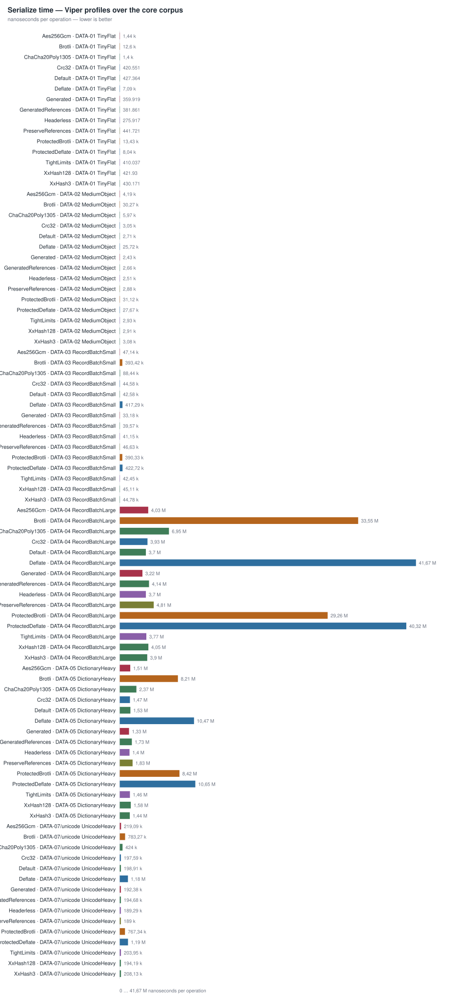

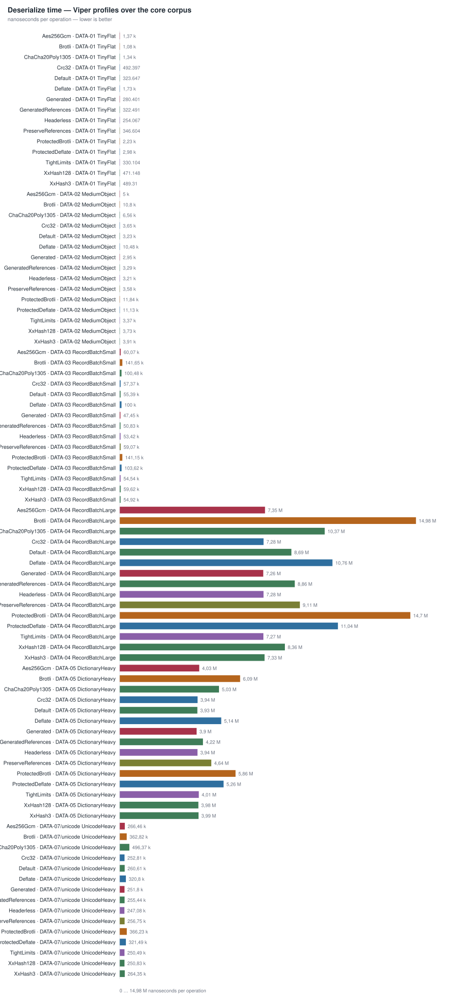

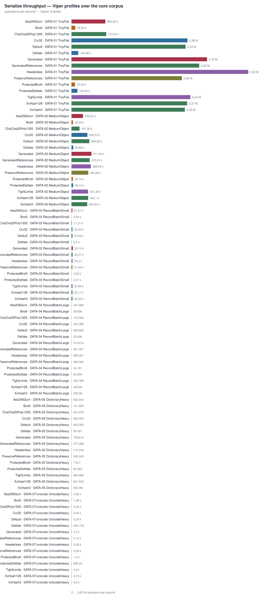

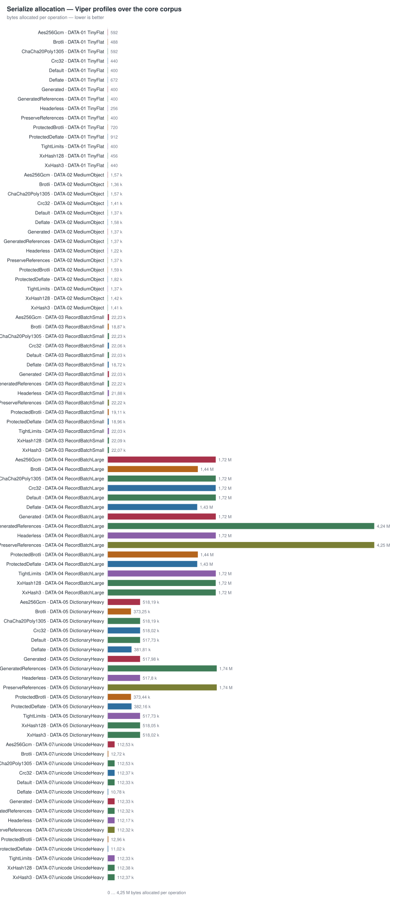

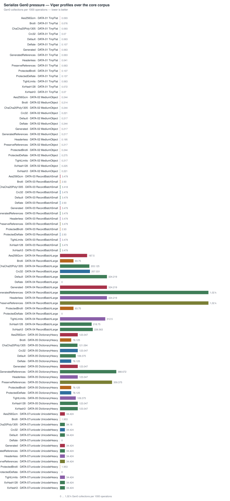


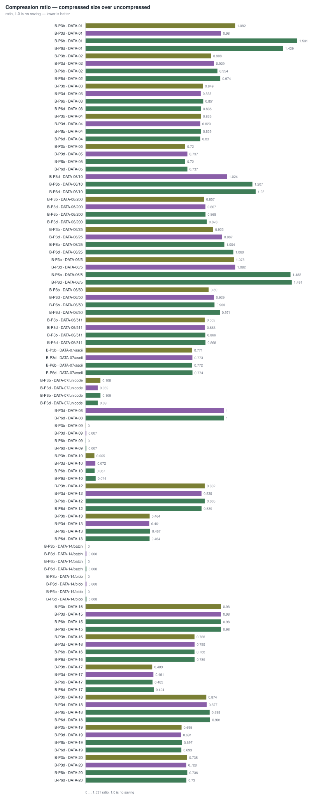

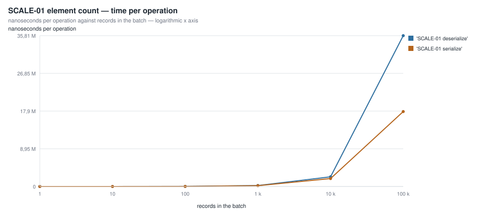

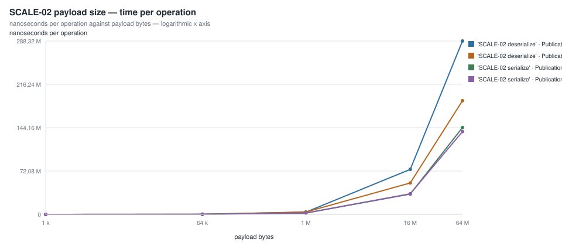

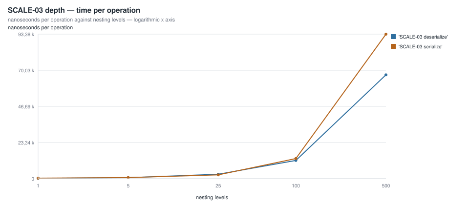

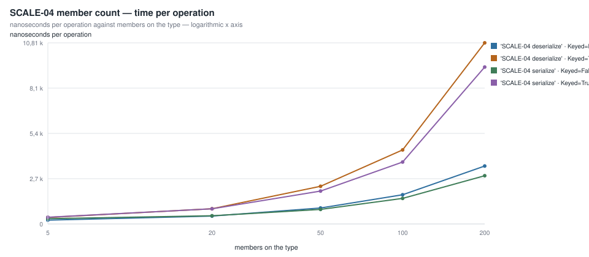

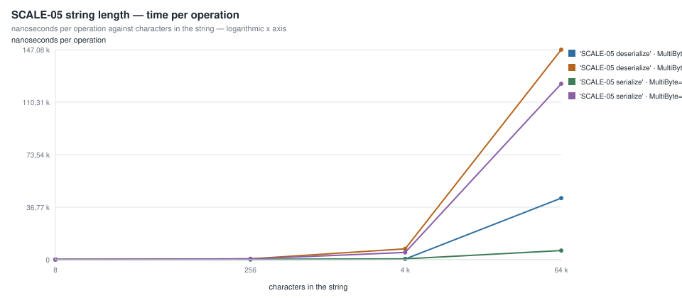

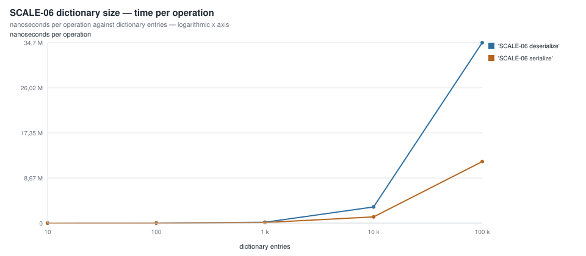

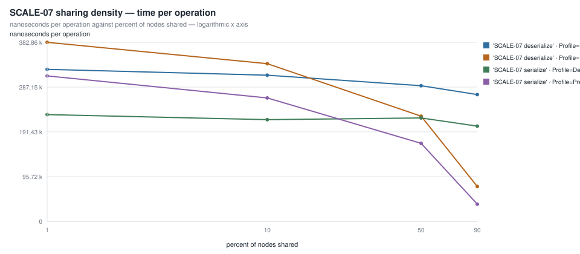

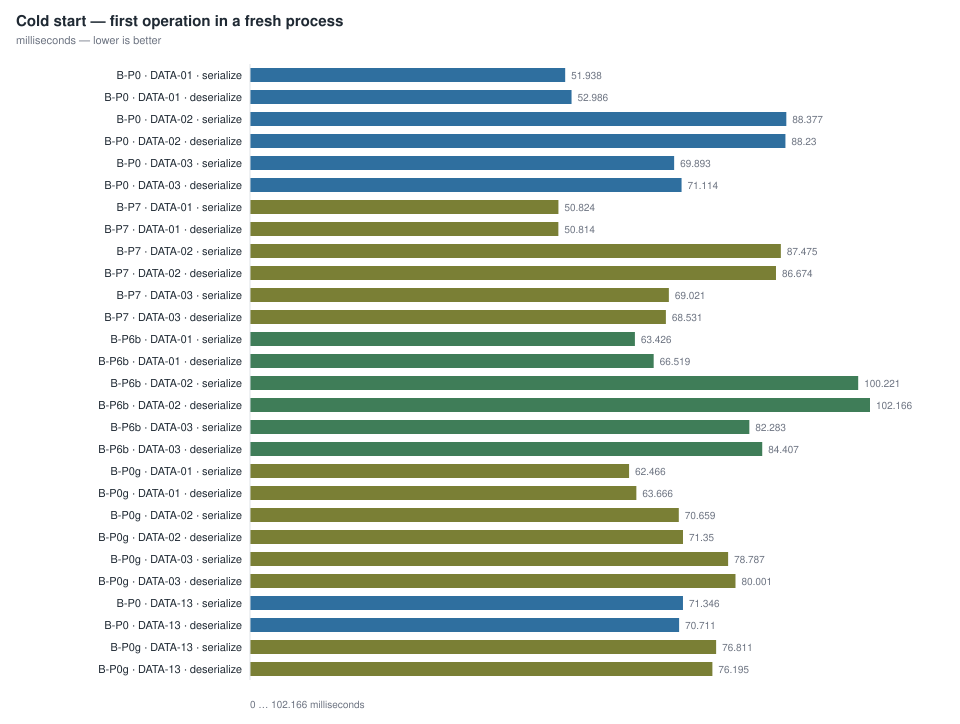

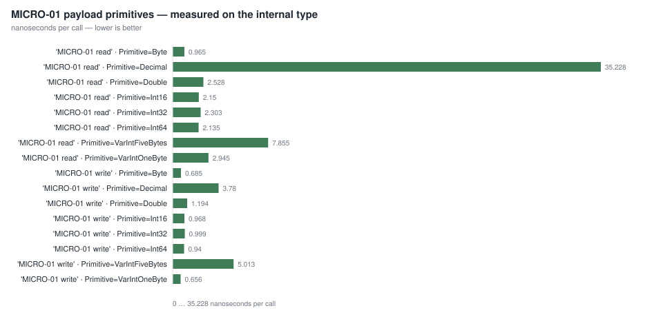

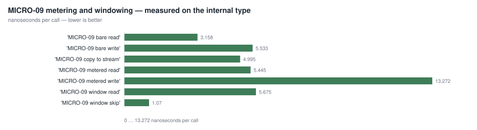


## Cells to read with caution


### Noisy

Published with the margin the run produced, and never re-run until the number looked prettier.

| Suite | Method | Parameters | Mean | Margin |
|---|---|---|---|---|
| ConcurrencyBenchmarks | 'PAR serialize on N threads' | Threads=2; Data=DATA-03 RecordBatchSmall | 11.92 ms | ±16.7% |
| ProfileMatrixBenchmarks | 'WL-04 deserialize ← byte[]' | Profile=Default; Data=DATA-04 RecordBatchLarge | 8.69 ms | ±11.8% |
| ProfileMatrixBenchmarks | 'WL-04 deserialize ← byte[]' | Profile=XxHash128; Data=DATA-04 RecordBatchLarge | 8.36 ms | ±10.3% |
| ConcurrencyBenchmarks | 'PAR serialize on N threads' | Threads=8; Data=DATA-03 RecordBatchSmall | 22.37 ms | ±8.8% |
| ProfileStreamBenchmarks | 'WL-05 deserialize ← Stream' | Profile=PreserveReferences; Data=DATA-05 DictionaryHeavy | 4.78 ms | ±8.2% |
| ConcurrencyBenchmarks | 'PAR serialize on N threads' | Threads=2; Data=DATA-02 MediumObject | 875.52 µs | ±7.4% |
| HarnessFloorBenchmarks | 'floor serialize' | Data=DATA-04 RecordBatchLarge | 3.60 ns | ±6.8% |
| HarnessFloorBenchmarks | 'floor serialize' | Data=DATA-03 RecordBatchSmall | 3.69 ns | ±6.6% |
| HarnessFloorBenchmarks | 'floor serialize' | Data=DATA-01 TinyFlat | 3.97 ns | ±6.6% |
| HarnessFloorBenchmarks | 'floor serialize' | Data=DATA-02 MediumObject | 4.03 ns | ±6.5% |
| HarnessFloorBenchmarks | 'floor serialize' | Data=DATA-07/unicode UnicodeHeavy | 3.59 ns | ±6.5% |
| HarnessFloorBenchmarks | 'floor deserialize' | Data=DATA-04 RecordBatchLarge | 4.06 ns | ±6.3% |
| HarnessFloorBenchmarks | 'floor deserialize' | Data=DATA-02 MediumObject | 4.06 ns | ±6.3% |
| HarnessFloorBenchmarks | 'floor deserialize' | Data=DATA-05 DictionaryHeavy | 3.96 ns | ±6.1% |
| AlgorithmBenchmarks | 'phase read' | Profile=Aes256Gcm; Data=DATA-16 StringTable | 4.73 ms | ±6.1% |
| HarnessFloorBenchmarks | 'floor serialize' | Data=DATA-05 DictionaryHeavy | 3.65 ns | ±6.0% |
| HarnessFloorBenchmarks | 'floor deserialize' | Data=DATA-03 RecordBatchSmall | 4.99 ns | ±5.8% |
| AlgorithmBenchmarks | 'phase read' | Profile=Crc32; Data=DATA-16 StringTable | 4.26 ms | ±5.7% |
| HarnessFloorBenchmarks | 'floor deserialize' | Data=DATA-07/unicode UnicodeHeavy | 5.30 ns | ±5.5% |
| ConcurrencyBenchmarks | 'PAR serialize on N threads' | Threads=4; Data=DATA-01 TinyFlat | 427.52 µs | ±5.4% |
| ReferenceIdentityBenchmarks | 'MICRO-07 table rent and return' | SharedPercent=10 | 0.01 ns | ±5.4% |
| ProfileMatrixBenchmarks | 'WL-04 deserialize ← byte[]' | Profile=PreserveReferences; Data=DATA-05 DictionaryHeavy | 4.64 ms | ±5.3% |
| HarnessFloorBenchmarks | 'floor deserialize' | Data=DATA-01 TinyFlat | 5.29 ns | ±5.2% |
| PayloadSizeScalingBenchmarks | 'SCALE-02 serialize' | Bytes=64000000 | 144.40 ms | ±5.2% |
| ProfileMatrixBenchmarks | 'WL-06 round trip' | Profile=Headerless; Data=DATA-05 DictionaryHeavy | 6.20 ms | ±5.1% |
| ConcurrencyBenchmarks | 'PAR serialize on N threads' | Threads=1; Data=DATA-02 MediumObject | 743.16 µs | ±5.1% |
| ConcurrencyBenchmarks | 'PAR deserialize on N threads' | Threads=2; Data=DATA-01 TinyFlat | 230.04 µs | ±4.9% |
| StringScalingBenchmarks | 'SCALE-05 serialize' | Length=8; MultiByte=True | 202.06 ns | ±4.8% |
| SharingDensityBenchmarks | 'SCALE-07 serialize' | SharedPercent=0; Profile=PreserveReferences | 311.04 µs | ±4.6% |
| ReferenceIdentityBenchmarks | 'MICRO-07 table rent and return' | SharedPercent=90 | 0.01 ns | ±4.5% |
| SharingDensityBenchmarks | 'SCALE-07 deserialize' | SharedPercent=0; Profile=PreserveReferences | 382.86 µs | ±4.4% |
| ProfileMatrixBenchmarks | 'WL-01 serialize → byte[]' | Profile=Crc32; Data=DATA-07/unicode UnicodeHeavy | 197.59 µs | ±4.4% |
| SharingDensityBenchmarks | 'SCALE-07 deserialize' | SharedPercent=0; Profile=Default | 325.08 µs | ±4.3% |
| ReferenceIdentityBenchmarks | 'MICRO-07 table rent and return' | SharedPercent=50 | 0.01 ns | ±4.2% |
| DepthScopeBenchmarks | 'MICRO-03 descend and return' | Depth=8 | 21.29 ns | ±4.2% |
| GeneratorProfileBenchmarks | 'WL-04 deserialize ← byte[]' | Profile=Default; Data=DATA-18 WideObject | 3.37 µs | ±4.2% |
| DepthScopeBenchmarks | 'MICRO-03 descend and return' | Depth=1 | 3.66 ns | ±4.1% |
| ValuePrimitiveBenchmarks | 'MICRO-01 read' | Primitive=Int32 | 2.30 ns | ±4.1% |
| ProfileAsyncWriteBenchmarks | 'WL-24 serialize → Stream, awaited' | Profile=ProtectedBrotli; Data=DATA-03 RecordBatchSmall | 393.03 µs | ±4.1% |
| AlgorithmBenchmarks | 'phase read' | Profile=Brotli; Data=DATA-09 HighlyCompressible | 500.68 µs | ±4.0% |
| ProfileAsyncWriteBenchmarks | 'WL-24 serialize → Stream, awaited' | Profile=PreserveReferences; Data=DATA-01 TinyFlat | 481.59 ns | ±4.0% |
| ProfileStreamBenchmarks | 'WL-02 serialize → Stream' | Profile=Crc32; Data=DATA-02 MediumObject | 2.78 µs | ±4.0% |
| AlgorithmBenchmarks | 'phase read' | Profile=ProtectedBrotli; Data=DATA-09 HighlyCompressible | 512.68 µs | ±4.0% |
| EnvelopeDifferentialBenchmarks | 'DIFF-01 serialize' | Configuration=Headerless | 2.63 µs | ±4.0% |
| ProtectionPrimitiveBenchmarks | 'MICRO-10 aes-256-gcm decrypt' | Bytes=1000000 | 119.59 µs | ±4.0% |
| ProfileStreamBenchmarks | 'WL-02 serialize → Stream' | Profile=XxHash128; Data=DATA-02 MediumObject | 2.81 µs | ±4.0% |
| GeneratorProfileBenchmarks | 'WL-01 serialize → byte[]' | Profile=PreserveReferences; Data=DATA-18 WideObject | 2.84 µs | ±4.0% |
| GeneratorProfileBenchmarks | 'WL-01 serialize → byte[]' | Profile=Default; Data=SCALE-04/k5 WideKeyed005 | 429.77 ns | ±3.9% |
| ProfileStreamBenchmarks | 'WL-03 serialize → non-seekable Stream' | Profile=Crc32; Data=DATA-02 MediumObject | 2.87 µs | ±3.9% |
| ValuePrimitiveBenchmarks | 'MICRO-01 read' | Primitive=VarIntFiveBytes | 7.85 ns | ±3.9% |
| GeneratorProfileBenchmarks | 'WL-04 deserialize ← byte[]' | Profile=GeneratedReferences; Data=DATA-18 WideObject | 2.84 µs | ±3.9% |
| GeneratorProfileBenchmarks | 'WL-01 serialize → byte[]' | Profile=Default; Data=DATA-18 WideObject | 2.96 µs | ±3.9% |
| ProfileBufferBenchmarks | 'WL-23 serialize → PooledPayload' | Profile=Headerless; Data=DATA-02 MediumObject | 2.56 µs | ±3.8% |
| GeneratorProfileBenchmarks | 'WL-01 serialize → byte[]' | Profile=Default; Data=DATA-01 TinyFlat | 415.18 ns | ±3.8% |
| GeneratorProfileBenchmarks | 'WL-04 deserialize ← byte[]' | Profile=PreserveReferences; Data=DATA-13 KeyedEvolution | 87.82 µs | ±3.8% |
| ProfileAsyncWriteBenchmarks | 'WL-24 serialize → PipeWriter, awaited' | Profile=Default; Data=DATA-03 RecordBatchSmall | 42.17 µs | ±3.8% |
| GeneratorProfileBenchmarks | 'WL-01 serialize → byte[]' | Profile=GeneratedReferences; Data=SCALE-04/k200 WideKeyed200 | 7.85 µs | ±3.8% |
| AllocationTargetBenchmarks | 'ALLOC-19 read graph with PreserveReferences ← span' |  | 32.16 µs | ±3.8% |
| GeneratorProfileBenchmarks | 'WL-04 deserialize ← byte[]' | Profile=GeneratedReferences; Data=SCALE-04/k200 WideKeyed200 | 10.27 µs | ±3.8% |
| MemberCountScalingBenchmarks | 'SCALE-04 deserialize' | Members=20; Keyed=False | 471.32 ns | ±3.8% |
| FrameStreamBenchmarks | 'WL-20 frames ← Stream' | Profile=Default; Data=DATA-01 TinyFlat | 615.75 ns | ±3.8% |
| GeneratorProfileBenchmarks | 'WL-01 serialize → byte[]' | Profile=Generated; Data=DATA-02 MediumObject | 2.47 µs | ±3.8% |
| GeneratorProfileBenchmarks | 'WL-04 deserialize ← byte[]' | Profile=GeneratedReferences; Data=SCALE-04/p5 WidePositional005 | 243.72 ns | ±3.8% |
| SharingDensityBenchmarks | 'SCALE-07 serialize' | SharedPercent=50; Profile=Default | 221.13 µs | ±3.8% |
| ProfileMatrixBenchmarks | 'WL-06 round trip' | Profile=TightLimits; Data=DATA-02 MediumObject | 6.71 µs | ±3.7% |
| ProfileBufferBenchmarks | 'WL-23 serialize → PooledPayload' | Profile=PreserveReferences; Data=DATA-02 MediumObject | 3.07 µs | ±3.7% |
| ProfileFramedReadBenchmarks | 'WL-24 deserialize ← Stream, awaited' | Profile=Default; Data=DATA-01 TinyFlat | 656.09 ns | ±3.7% |
| AllocationTargetBenchmarks | 'ALLOC-15 reference: the array alone' |  | 4.83 ns | ±3.7% |
| ProfileAsyncWriteBenchmarks | 'WL-24 serialize → Stream, awaited' | Profile=PreserveReferences; Data=DATA-03 RecordBatchSmall | 47.13 µs | ±3.7% |
| ProfileMatrixBenchmarks | 'WL-01 serialize → byte[]' | Profile=XxHash3; Data=DATA-03 RecordBatchSmall | 44.78 µs | ±3.7% |
| GeneratorProfileBenchmarks | 'WL-04 deserialize ← byte[]' | Profile=Default; Data=SCALE-04/k200 WideKeyed200 | 11.42 µs | ±3.7% |
| GeneratorProfileBenchmarks | 'WL-04 deserialize ← byte[]' | Profile=Default; Data=DATA-01 TinyFlat | 314.90 ns | ±3.7% |
| ProfileStreamBenchmarks | 'WL-03 serialize → non-seekable Stream' | Profile=Headerless; Data=DATA-02 MediumObject | 2.50 µs | ±3.7% |
| ProfileAsyncWriteBenchmarks | 'WL-24 serialize → PipeWriter, awaited' | Profile=PreserveReferences; Data=DATA-01 TinyFlat | 608.87 ns | ±3.7% |
| DictionaryScalingBenchmarks | 'SCALE-06 serialize' | Entries=10 | 1.49 µs | ±3.7% |
| AllocationTargetBenchmarks | 'ALLOC-15 Serialize → byte[]' |  | 343.90 ns | ±3.7% |
| AllocationTargetBenchmarks | 'ALLOC-19 write graph with PreserveReferences → IBufferWriter' |  | 27.47 µs | ±3.7% |
| GeneratorProfileBenchmarks | 'WL-04 deserialize ← byte[]' | Profile=Generated; Data=DATA-18 WideObject | 2.79 µs | ±3.7% |
| ProfileStreamBenchmarks | 'WL-03 serialize → non-seekable Stream' | Profile=XxHash3; Data=DATA-02 MediumObject | 2.84 µs | ±3.7% |
| ContractLookupBenchmarks | 'MICRO-04 keyed lookup' |  | 4.16 ns | ±3.7% |
| ProfileStreamBenchmarks | 'WL-05 deserialize ← Stream' | Profile=PreserveReferences; Data=DATA-02 MediumObject | 3.98 µs | ±3.7% |
| StringScalingBenchmarks | 'SCALE-05 serialize' | Length=64000; MultiByte=False | 6.41 µs | ±3.7% |
| ValuePrimitiveBenchmarks | 'MICRO-01 read' | Primitive=Int16 | 2.15 ns | ±3.7% |
| AllocationTargetBenchmarks | 'ALLOC-10 write V1 → IBufferWriter' |  | 342.47 ns | ±3.7% |
| ValueTextBenchmarks | 'MICRO-01 write blob' | Bytes=256; MultiByte=False | 26.74 ns | ±3.7% |
| HeaderBenchmarks | 'MICRO-08 write header' | AllFields=False | 31.23 ns | ±3.6% |
| ProfileBufferBenchmarks | 'WL-21 serialize → IBufferWriter' | Profile=PreserveReferences; Data=DATA-03 RecordBatchSmall | 46.66 µs | ±3.6% |
| ProfileMatrixBenchmarks | 'WL-01 serialize → byte[]' | Profile=GeneratedReferences; Data=DATA-03 RecordBatchSmall | 39.57 µs | ±3.6% |
| MeteringBenchmarks | 'MICRO-09 window skip' |  | 1.07 ns | ±3.6% |
| ProfileAsyncWriteBenchmarks | 'WL-24 serialize → PipeWriter, awaited' | Profile=Default; Data=DATA-02 MediumObject | 2.99 µs | ±3.6% |
| ProfileAsyncWriteBenchmarks | 'WL-24 serialize → PipeWriter, awaited' | Profile=PreserveReferences; Data=DATA-02 MediumObject | 3.19 µs | ±3.6% |
| ProfileAsyncWriteBenchmarks | 'WL-24 serialize → Stream, awaited' | Profile=Headerless; Data=DATA-02 MediumObject | 2.66 µs | ±3.6% |
| GeneratorProfileBenchmarks | 'WL-01 serialize → byte[]' | Profile=Default; Data=DATA-02 MediumObject | 2.94 µs | ±3.6% |
| ProfileBufferBenchmarks | 'WL-21 serialize → IBufferWriter' | Profile=Headerless; Data=DATA-03 RecordBatchSmall | 40.79 µs | ±3.6% |
| ProfileBufferBenchmarks | 'WL-21 serialize → IBufferWriter' | Profile=Default; Data=DATA-01 TinyFlat | 400.20 ns | ±3.6% |
| ProfileBufferBenchmarks | 'WL-21 serialize → IBufferWriter' | Profile=Headerless; Data=DATA-02 MediumObject | 2.48 µs | ±3.6% |
| ProtectionPrimitiveBenchmarks | 'MICRO-10 aes-256-gcm decrypt' | Bytes=65536 | 8.61 µs | ±3.6% |
| ProfileAsyncWriteBenchmarks | 'WL-24 serialize → PipeWriter, awaited' | Profile=PreserveReferences; Data=DATA-03 RecordBatchSmall | 47.87 µs | ±3.6% |
| MemberCountScalingBenchmarks | 'SCALE-04 deserialize' | Members=100; Keyed=True | 4.42 µs | ±3.6% |
| ValuePrimitiveBenchmarks | 'MICRO-01 read' | Primitive=Int64 | 2.13 ns | ±3.6% |
| ProfileMatrixBenchmarks | 'WL-01 serialize → byte[]' | Profile=GeneratedReferences; Data=DATA-02 MediumObject | 2.66 µs | ±3.6% |
| ProtectionPrimitiveBenchmarks | 'MICRO-10 aes-256-gcm encrypt' | Bytes=1000000 | 109.41 µs | ±3.6% |
| GeneratorProfileBenchmarks | 'WL-04 deserialize ← byte[]' | Profile=Generated; Data=SCALE-04/p5 WidePositional005 | 214.48 ns | ±3.6% |
| ElementCountScalingBenchmarks | 'SCALE-01 serialize' | Count=1 | 441.60 ns | ±3.6% |
| ProfileMatrixBenchmarks | 'WL-06 round trip' | Profile=Default; Data=DATA-02 MediumObject | 6.82 µs | ±3.6% |
| GeneratorProfileBenchmarks | 'WL-01 serialize → byte[]' | Profile=PreserveReferences; Data=DATA-12 PolymorphicBatch | 365.33 µs | ±3.6% |
| ProfileStreamBenchmarks | 'WL-02 serialize → Stream' | Profile=Aes256Gcm; Data=DATA-03 RecordBatchSmall | 46.71 µs | ±3.6% |
| AllocationTargetBenchmarks | 'ALLOC-20 reference: Serialize → Stream' |  | 21.22 µs | ±3.6% |
| ProfileStreamBenchmarks | 'WL-05 deserialize ← Stream' | Profile=Headerless; Data=DATA-01 TinyFlat | 320.08 ns | ±3.6% |
| ProfileFramedReadBenchmarks | 'WL-18 deserialize ← non-seekable Stream' | Profile=Aes256Gcm; Data=DATA-03 RecordBatchSmall | 62.68 µs | ±3.6% |
| ProfileAsyncWriteBenchmarks | 'WL-24 serialize → Stream, awaited' | Profile=Default; Data=DATA-02 MediumObject | 2.85 µs | ±3.6% |
| AllocationTargetBenchmarks | 'ALLOC-17 reference: the record alone' |  | 9.62 ns | ±3.6% |
| ProfileMatrixBenchmarks | 'WL-04 deserialize ← byte[]' | Profile=Default; Data=DATA-01 TinyFlat | 323.65 ns | ±3.6% |
| ProfileStreamBenchmarks | 'WL-02 serialize → Stream' | Profile=XxHash128; Data=DATA-03 RecordBatchSmall | 41.76 µs | ±3.6% |
| ValuePrimitiveBenchmarks | 'MICRO-01 write' | Primitive=Decimal | 3.78 ns | ±3.5% |
| ArrayMaterializationBenchmarks | 'MICRO-18 read through the pooled path' | Length=16 | 79.04 ns | ±3.5% |
| MemberCountScalingBenchmarks | 'SCALE-04 serialize' | Members=200; Keyed=False | 2.88 µs | ±3.5% |
| AllocationTargetBenchmarks | 'ALLOC-18 write graph → IBufferWriter' |  | 21.47 µs | ±3.5% |
| ProfileStreamBenchmarks | 'WL-03 serialize → non-seekable Stream' | Profile=XxHash3; Data=DATA-03 RecordBatchSmall | 43.08 µs | ±3.5% |
| GeneratorProfileBenchmarks | 'WL-01 serialize → byte[]' | Profile=GeneratedReferences; Data=DATA-18 WideObject | 2.60 µs | ±3.5% |
| ArrayMaterializationBenchmarks | 'MICRO-18 read into the final array' | Length=16 | 63.72 ns | ±3.5% |
| ProfileStreamBenchmarks | 'WL-05 deserialize ← Stream' | Profile=XxHash128; Data=DATA-03 RecordBatchSmall | 55.91 µs | ±3.5% |
| ProfileAsyncWriteBenchmarks | 'WL-24 serialize → PipeWriter, awaited' | Profile=Aes256Gcm; Data=DATA-03 RecordBatchSmall | 45.10 µs | ±3.5% |
| GeneratorProfileBenchmarks | 'WL-01 serialize → byte[]' | Profile=Generated; Data=SCALE-04/k200 WideKeyed200 | 6.75 µs | ±3.5% |
| ElementCountScalingBenchmarks | 'SCALE-01 serialize' | Count=100 | 17.13 µs | ±3.5% |
| ReferenceIdentityBenchmarks | 'MICRO-07 write lookup and register' | SharedPercent=50 | 8.46 ns | ±3.5% |
| ProfileStreamBenchmarks | 'WL-02 serialize → Stream' | Profile=Headerless; Data=DATA-02 MediumObject | 2.50 µs | ±3.5% |
| ProfileStreamBenchmarks | 'WL-02 serialize → Stream' | Profile=Default; Data=DATA-03 RecordBatchSmall | 42.47 µs | ±3.5% |
| ProfileStreamBenchmarks | 'WL-03 serialize → non-seekable Stream' | Profile=PreserveReferences; Data=DATA-03 RecordBatchSmall | 46.34 µs | ±3.5% |
| ProfileMatrixBenchmarks | 'WL-04 deserialize ← byte[]' | Profile=XxHash3; Data=DATA-01 TinyFlat | 489.31 ns | ±3.5% |
| ProfileBufferBenchmarks | 'WL-22 deserialize ← ReadOnlySpan' | Profile=PreserveReferences; Data=DATA-03 RecordBatchSmall | 60.45 µs | ±3.5% |
| ProfileStreamBenchmarks | 'WL-02 serialize → Stream' | Profile=TightLimits; Data=DATA-02 MediumObject | 2.67 µs | ±3.5% |
| ProfileStreamBenchmarks | 'WL-05 deserialize ← Stream' | Profile=XxHash128; Data=DATA-01 TinyFlat | 825.91 ns | ±3.5% |
| SharingDensityBenchmarks | 'SCALE-07 deserialize' | SharedPercent=50; Profile=PreserveReferences | 224.91 µs | ±3.5% |
| ProfileStreamBenchmarks | 'WL-02 serialize → Stream' | Profile=XxHash3; Data=DATA-02 MediumObject | 2.82 µs | ±3.5% |
| GeneratorProfileBenchmarks | 'WL-01 serialize → byte[]' | Profile=GeneratedReferences; Data=DATA-13 KeyedEvolution | 75.08 µs | ±3.5% |
| ProfileBufferBenchmarks | 'WL-23 serialize → PooledPayload' | Profile=Default; Data=DATA-03 RecordBatchSmall | 42.68 µs | ±3.5% |
| ProfileStreamBenchmarks | 'WL-02 serialize → Stream' | Profile=Crc32; Data=DATA-03 RecordBatchSmall | 41.62 µs | ±3.5% |
| EnvelopeDifferentialBenchmarks | 'DIFF-01 serialize' | Configuration=Encrypted | 4.18 µs | ±3.5% |
| MemberCountScalingBenchmarks | 'SCALE-04 serialize' | Members=20; Keyed=False | 489.16 ns | ±3.5% |
| ProfileStreamBenchmarks | 'WL-03 serialize → non-seekable Stream' | Profile=Aes256Gcm; Data=DATA-03 RecordBatchSmall | 46.43 µs | ±3.5% |
| ProfileFramedReadBenchmarks | 'WL-18 deserialize ← non-seekable Stream' | Profile=PreserveReferences; Data=DATA-01 TinyFlat | 549.06 ns | ±3.5% |
| ProfileStreamBenchmarks | 'WL-02 serialize → Stream' | Profile=Aes256Gcm; Data=DATA-02 MediumObject | 4.08 µs | ±3.5% |
| ProfileMatrixBenchmarks | 'WL-01 serialize → byte[]' | Profile=Headerless; Data=DATA-02 MediumObject | 2.51 µs | ±3.5% |
| ProfileFramedReadBenchmarks | 'WL-24 deserialize ← PipeReader, awaited' | Profile=Default; Data=DATA-02 MediumObject | 3.72 µs | ±3.5% |
| ElementCountScalingBenchmarks | 'SCALE-01 serialize' | Count=1000 | 194.12 µs | ±3.5% |
| ProfileBufferBenchmarks | 'WL-22 deserialize ← ReadOnlySpan' | Profile=Headerless; Data=DATA-03 RecordBatchSmall | 54.66 µs | ±3.5% |
| FormatterShapeBenchmarks | 'MICRO-06 scalar write' |  | 5.44 ns | ±3.5% |
| ValueTextBenchmarks | 'MICRO-01 read string' | Bytes=8; MultiByte=False | 21.83 ns | ±3.4% |
| FormatterShapeBenchmarks | 'MICRO-06 map read' |  | 1.21 µs | ±3.4% |
| ProfileBufferBenchmarks | 'WL-23 serialize → PooledPayload' | Profile=ProtectedBrotli; Data=DATA-07/unicode UnicodeHeavy | 773.97 µs | ±3.4% |
| GeneratorProfileBenchmarks | 'WL-04 deserialize ← byte[]' | Profile=PreserveReferences; Data=DATA-12 PolymorphicBatch | 409.26 µs | ±3.4% |
| ProfileMatrixBenchmarks | 'WL-01 serialize → byte[]' | Profile=Crc32; Data=DATA-03 RecordBatchSmall | 44.58 µs | ±3.4% |
| ValueTextBenchmarks | 'MICRO-01 write string' | Bytes=256; MultiByte=False | 43.01 ns | ±3.4% |
| ProfileBufferBenchmarks | 'WL-22 deserialize ← ReadOnlySequence' | Profile=Headerless; Data=DATA-01 TinyFlat | 355.17 ns | ±3.4% |
| ProfileBufferBenchmarks | 'WL-22 deserialize ← ReadOnlySequence' | Profile=PreserveReferences; Data=DATA-03 RecordBatchSmall | 59.81 µs | ±3.4% |
| GeneratorProfileBenchmarks | 'WL-04 deserialize ← byte[]' | Profile=GeneratedReferences; Data=DATA-13 KeyedEvolution | 84.15 µs | ±3.4% |
| ProfileFramedReadBenchmarks | 'WL-24 deserialize ← Stream, awaited' | Profile=Aes256Gcm; Data=DATA-03 RecordBatchSmall | 61.74 µs | ±3.4% |
| ProfileFramedReadBenchmarks | 'WL-24 deserialize ← Stream, awaited' | Profile=PreserveReferences; Data=DATA-02 MediumObject | 4.23 µs | ±3.4% |
| ProfileMatrixBenchmarks | 'WL-04 deserialize ← byte[]' | Profile=XxHash128; Data=DATA-01 TinyFlat | 471.15 ns | ±3.4% |
| ProfileBufferBenchmarks | 'WL-21 serialize → IBufferWriter' | Profile=ProtectedBrotli; Data=DATA-03 RecordBatchSmall | 391.81 µs | ±3.4% |
| ProfileBufferBenchmarks | 'WL-21 serialize → IBufferWriter' | Profile=Aes256Gcm; Data=DATA-01 TinyFlat | 1.39 µs | ±3.4% |
| ProfileBufferBenchmarks | 'WL-23 serialize → PooledPayload' | Profile=Headerless; Data=DATA-01 TinyFlat | 296.77 ns | ±3.4% |
| ProfileAsyncWriteBenchmarks | 'WL-24 serialize → Stream, awaited' | Profile=Aes256Gcm; Data=DATA-03 RecordBatchSmall | 47.45 µs | ±3.4% |
| GeneratorProfileBenchmarks | 'WL-04 deserialize ← byte[]' | Profile=Generated; Data=DATA-12 PolymorphicBatch | 337.78 µs | ±3.4% |
| ProfileStreamBenchmarks | 'WL-02 serialize → Stream' | Profile=PreserveReferences; Data=DATA-01 TinyFlat | 385.82 ns | ±3.4% |
| GeneratorProfileBenchmarks | 'WL-01 serialize → byte[]' | Profile=PreserveReferences; Data=DATA-02 MediumObject | 3.10 µs | ±3.4% |
| ProfileBufferBenchmarks | 'WL-21 serialize → IBufferWriter' | Profile=Headerless; Data=DATA-01 TinyFlat | 279.15 ns | ±3.4% |
| ProfileStreamBenchmarks | 'WL-03 serialize → non-seekable Stream' | Profile=ChaCha20Poly1305; Data=DATA-01 TinyFlat | 1.48 µs | ±3.4% |
| ProfileStreamBenchmarks | 'WL-03 serialize → non-seekable Stream' | Profile=Headerless; Data=DATA-03 RecordBatchSmall | 41.46 µs | ±3.4% |
| ProfileFramedReadBenchmarks | 'WL-24 deserialize ← PipeReader, awaited' | Profile=Default; Data=DATA-01 TinyFlat | 577.61 ns | ±3.4% |
| GeneratorProfileBenchmarks | 'WL-04 deserialize ← byte[]' | Profile=Generated; Data=DATA-02 MediumObject | 3.04 µs | ±3.4% |
| ProfileStreamBenchmarks | 'WL-02 serialize → Stream' | Profile=Headerless; Data=DATA-03 RecordBatchSmall | 41.07 µs | ±3.4% |
| ReferenceIdentityBenchmarks | 'MICRO-07 read register and resolve' | SharedPercent=0 | 7.81 ns | ±3.4% |
| ProfileBufferBenchmarks | 'WL-22 deserialize ← ReadOnlySpan' | Profile=Headerless; Data=DATA-01 TinyFlat | 255.56 ns | ±3.4% |
| FrameStreamBenchmarks | 'WL-20 frames ← Stream' | Profile=ProtectedBrotli; Data=DATA-01 TinyFlat | 3.26 µs | ±3.4% |
| ProfileStreamBenchmarks | 'WL-05 deserialize ← Stream' | Profile=TightLimits; Data=DATA-01 TinyFlat | 503.83 ns | ±3.4% |
| ProfileFramedReadBenchmarks | 'WL-18 deserialize ← non-seekable Stream' | Profile=ProtectedBrotli; Data=DATA-01 TinyFlat | 3.02 µs | ±3.4% |
| ProfileStreamBenchmarks | 'WL-02 serialize → Stream' | Profile=Default; Data=DATA-02 MediumObject | 2.63 µs | ±3.4% |
| ProfileBufferBenchmarks | 'WL-23 serialize → PooledPayload' | Profile=PreserveReferences; Data=DATA-03 RecordBatchSmall | 47.59 µs | ±3.4% |
| GeneratorProfileBenchmarks | 'WL-01 serialize → byte[]' | Profile=GeneratedReferences; Data=DATA-01 TinyFlat | 373.68 ns | ±3.4% |
| ElementCountScalingBenchmarks | 'SCALE-01 deserialize' | Count=10 | 2.19 µs | ±3.4% |
| GeneratorProfileBenchmarks | 'WL-01 serialize → byte[]' | Profile=Default; Data=SCALE-04/p5 WidePositional005 | 323.33 ns | ±3.4% |
| ValuePrimitiveBenchmarks | 'MICRO-01 write' | Primitive=Int32 | 1.00 ns | ±3.4% |
| AllocationTargetBenchmarks | 'ALLOC-13 write Deflate → IBufferWriter' |  | 5.70 µs | ±3.4% |
| MemberCountScalingBenchmarks | 'SCALE-04 serialize' | Members=50; Keyed=False | 867.83 ns | ±3.4% |
| GeneratorProfileBenchmarks | 'WL-04 deserialize ← byte[]' | Profile=Default; Data=DATA-13 KeyedEvolution | 73.18 µs | ±3.4% |
| EnvelopeDifferentialBenchmarks | 'DIFF-01 deserialize' | Configuration=MinimalHeader | 3.37 µs | ±3.4% |
| ProfileMatrixBenchmarks | 'WL-04 deserialize ← byte[]' | Profile=Crc32; Data=DATA-02 MediumObject | 3.65 µs | ±3.4% |
| GeneratorProfileBenchmarks | 'WL-04 deserialize ← byte[]' | Profile=PreserveReferences; Data=SCALE-04/k200 WideKeyed200 | 12.95 µs | ±3.4% |
| ValueTextBenchmarks | 'MICRO-01 write string' | Bytes=8; MultiByte=True | 32.53 ns | ±3.4% |
| ProfileStreamBenchmarks | 'WL-03 serialize → non-seekable Stream' | Profile=XxHash128; Data=DATA-03 RecordBatchSmall | 41.65 µs | ±3.4% |
| ProfileStreamBenchmarks | 'WL-03 serialize → non-seekable Stream' | Profile=Aes256Gcm; Data=DATA-02 MediumObject | 4.01 µs | ±3.4% |
| ValuePrimitiveBenchmarks | 'MICRO-01 read' | Primitive=Double | 2.53 ns | ±3.4% |
| ProfileMatrixBenchmarks | 'WL-04 deserialize ← byte[]' | Profile=XxHash128; Data=DATA-02 MediumObject | 3.73 µs | ±3.4% |
| ProfileFramedReadBenchmarks | 'WL-18 deserialize ← non-seekable Stream' | Profile=Default; Data=DATA-03 RecordBatchSmall | 56.22 µs | ±3.4% |
| ProfileAsyncWriteBenchmarks | 'WL-24 serialize → PipeWriter, awaited' | Profile=Default; Data=DATA-01 TinyFlat | 552.25 ns | ±3.4% |
| ProfileMatrixBenchmarks | 'WL-01 serialize → byte[]' | Profile=XxHash128; Data=DATA-01 TinyFlat | 421.93 ns | ±3.4% |
| ProfileStreamBenchmarks | 'WL-03 serialize → non-seekable Stream' | Profile=Default; Data=DATA-03 RecordBatchSmall | 40.01 µs | ±3.4% |
| ProfileStreamBenchmarks | 'WL-02 serialize → Stream' | Profile=Default; Data=DATA-01 TinyFlat | 400.09 ns | ±3.4% |
| ProfileAsyncWriteBenchmarks | 'WL-24 serialize → Stream, awaited' | Profile=Headerless; Data=DATA-01 TinyFlat | 334.39 ns | ±3.4% |
| ProfileMatrixBenchmarks | 'WL-01 serialize → byte[]' | Profile=Generated; Data=DATA-03 RecordBatchSmall | 33.18 µs | ±3.3% |
| DictionaryScalingBenchmarks | 'SCALE-06 deserialize' | Entries=10 | 1.63 µs | ±3.3% |
| GeneratorProfileBenchmarks | 'WL-04 deserialize ← byte[]' | Profile=Default; Data=DATA-12 PolymorphicBatch | 363.10 µs | ±3.3% |
| DictionaryScalingBenchmarks | 'SCALE-06 serialize' | Entries=1000 | 110.71 µs | ±3.3% |
| ProfileStreamBenchmarks | 'WL-02 serialize → Stream' | Profile=XxHash3; Data=DATA-03 RecordBatchSmall | 42.36 µs | ±3.3% |
| ProfileFramedReadBenchmarks | 'WL-18 deserialize ← non-seekable Stream' | Profile=Default; Data=DATA-02 MediumObject | 3.69 µs | ±3.3% |
| ProfileStreamBenchmarks | 'WL-03 serialize → non-seekable Stream' | Profile=GeneratedReferences; Data=DATA-01 TinyFlat | 365.37 ns | ±3.3% |
| ProfileStreamBenchmarks | 'WL-03 serialize → non-seekable Stream' | Profile=GeneratedReferences; Data=DATA-02 MediumObject | 2.54 µs | ±3.3% |
| ValueTextBenchmarks | 'MICRO-01 write string' | Bytes=8; MultiByte=False | 31.15 ns | ±3.3% |
| ProfileBufferBenchmarks | 'WL-23 serialize → PooledPayload' | Profile=Aes256Gcm; Data=DATA-03 RecordBatchSmall | 45.88 µs | ±3.3% |
| GeneratorProfileBenchmarks | 'WL-01 serialize → byte[]' | Profile=Default; Data=DATA-12 PolymorphicBatch | 297.81 µs | ±3.3% |
| ProfileStreamBenchmarks | 'WL-03 serialize → non-seekable Stream' | Profile=Default; Data=DATA-01 TinyFlat | 390.97 ns | ±3.3% |
| ProfileStreamBenchmarks | 'WL-05 deserialize ← Stream' | Profile=XxHash3; Data=DATA-02 MediumObject | 4.03 µs | ±3.3% |
| ProfileBufferBenchmarks | 'WL-22 deserialize ← ReadOnlySpan' | Profile=Aes256Gcm; Data=DATA-03 RecordBatchSmall | 59.40 µs | ±3.3% |
| ProfileStreamBenchmarks | 'WL-05 deserialize ← Stream' | Profile=XxHash3; Data=DATA-03 RecordBatchSmall | 56.84 µs | ±3.3% |
| ProfileBufferBenchmarks | 'WL-22 deserialize ← ReadOnlySpan' | Profile=ProtectedBrotli; Data=DATA-03 RecordBatchSmall | 143.37 µs | ±3.3% |
| ProfileStreamBenchmarks | 'WL-05 deserialize ← Stream' | Profile=Default; Data=DATA-01 TinyFlat | 516.98 ns | ±3.3% |
| EnvelopeDifferentialBenchmarks | 'DIFF-01 deserialize' | Configuration=Headerless | 3.13 µs | ±3.3% |
| ProfileStreamBenchmarks | 'WL-05 deserialize ← Stream' | Profile=ChaCha20Poly1305; Data=DATA-01 TinyFlat | 1.82 µs | ±3.3% |
| MemberCountScalingBenchmarks | 'SCALE-04 deserialize' | Members=50; Keyed=False | 952.28 ns | ±3.3% |
| ValuePrimitiveBenchmarks | 'MICRO-01 write' | Primitive=VarIntFiveBytes | 5.01 ns | ±3.3% |
| ProfileStreamBenchmarks | 'WL-05 deserialize ← Stream' | Profile=Crc32; Data=DATA-03 RecordBatchSmall | 56.98 µs | ±3.3% |
| AllocationTargetBenchmarks | 'ALLOC-17 read record of primitives ← span' |  | 220.62 ns | ±3.3% |
| ProfileMatrixBenchmarks | 'WL-04 deserialize ← byte[]' | Profile=XxHash128; Data=DATA-03 RecordBatchSmall | 59.62 µs | ±3.3% |
| GeneratorProfileBenchmarks | 'WL-04 deserialize ← byte[]' | Profile=Generated; Data=DATA-01 TinyFlat | 283.94 ns | ±3.3% |
| ProfileStreamBenchmarks | 'WL-03 serialize → non-seekable Stream' | Profile=PreserveReferences; Data=DATA-01 TinyFlat | 393.49 ns | ±3.3% |
| ProfileAsyncWriteBenchmarks | 'WL-24 serialize → Stream, awaited' | Profile=Headerless; Data=DATA-03 RecordBatchSmall | 41.52 µs | ±3.3% |
| ProfileBufferBenchmarks | 'WL-22 deserialize ← ReadOnlySpan' | Profile=Default; Data=DATA-03 RecordBatchSmall | 56.08 µs | ±3.3% |
| ContractLookupBenchmarks | 'MICRO-04 positional lookup' |  | 4.16 ns | ±3.3% |
| ProfileFramedReadBenchmarks | 'WL-24 deserialize ← PipeReader, awaited' | Profile=PreserveReferences; Data=DATA-01 TinyFlat | 590.40 ns | ±3.3% |
| SharingDensityBenchmarks | 'SCALE-07 serialize' | SharedPercent=90; Profile=Default | 203.62 µs | ±3.3% |
| AlgorithmBenchmarks | 'phase write' | Profile=Deflate; Data=DATA-09 HighlyCompressible | 221.36 µs | ±3.3% |
| ProtectionPrimitiveBenchmarks | 'MICRO-10 aes-256-gcm encrypt' | Bytes=4096 | 1.19 µs | ±3.3% |
| ProfileAsyncWriteBenchmarks | 'WL-24 serialize → PipeWriter, awaited' | Profile=ProtectedBrotli; Data=DATA-02 MediumObject | 32.67 µs | ±3.3% |
| DepthScalingBenchmarks | 'SCALE-03 deserialize' | Depth=500 | 67.10 µs | ±3.3% |
| SharingDensityBenchmarks | 'SCALE-07 serialize' | SharedPercent=90; Profile=PreserveReferences | 36.77 µs | ±3.3% |
| GeneratorProfileBenchmarks | 'WL-04 deserialize ← byte[]' | Profile=Generated; Data=SCALE-04/k5 WideKeyed005 | 343.38 ns | ±3.3% |
| GeneratorProfileBenchmarks | 'WL-01 serialize → byte[]' | Profile=Generated; Data=DATA-01 TinyFlat | 368.58 ns | ±3.3% |
| ProfileStreamBenchmarks | 'WL-03 serialize → non-seekable Stream' | Profile=Crc32; Data=DATA-01 TinyFlat | 424.28 ns | ±3.3% |
| ProfileAsyncWriteBenchmarks | 'WL-24 serialize → PipeWriter, awaited' | Profile=ProtectedBrotli; Data=DATA-03 RecordBatchSmall | 391.23 µs | ±3.3% |
| ValueTextBenchmarks | 'MICRO-01 write blob' | Bytes=256; MultiByte=True | 27.03 ns | ±3.2% |
| ProfileBufferBenchmarks | 'WL-23 serialize → PooledPayload' | Profile=Default; Data=DATA-01 TinyFlat | 398.32 ns | ±3.2% |
| ProfileMatrixBenchmarks | 'WL-04 deserialize ← byte[]' | Profile=TightLimits; Data=DATA-01 TinyFlat | 330.10 ns | ±3.2% |
| ProfileStreamBenchmarks | 'WL-03 serialize → non-seekable Stream' | Profile=ChaCha20Poly1305; Data=DATA-03 RecordBatchSmall | 90.15 µs | ±3.2% |
| ContractLookupBenchmarks | 'MICRO-04 union lookup' |  | 9.42 ns | ±3.2% |
| ProfileBufferBenchmarks | 'WL-21 serialize → IBufferWriter' | Profile=PreserveReferences; Data=DATA-02 MediumObject | 2.87 µs | ±3.2% |
| SharingDensityBenchmarks | 'SCALE-07 serialize' | SharedPercent=10; Profile=PreserveReferences | 263.93 µs | ±3.2% |
| ProfileStreamBenchmarks | 'WL-03 serialize → non-seekable Stream' | Profile=ProtectedBrotli; Data=DATA-03 RecordBatchSmall | 387.93 µs | ±3.2% |
| ProfileFramedReadBenchmarks | 'WL-18 deserialize ← non-seekable Stream' | Profile=PreserveReferences; Data=DATA-02 MediumObject | 3.90 µs | ±3.2% |
| GeneratorProfileBenchmarks | 'WL-04 deserialize ← byte[]' | Profile=Default; Data=SCALE-04/k5 WideKeyed005 | 342.48 ns | ±3.2% |
| ProfileBufferBenchmarks | 'WL-23 serialize → PooledPayload' | Profile=Headerless; Data=DATA-03 RecordBatchSmall | 41.61 µs | ±3.2% |
| ProfileMatrixBenchmarks | 'WL-06 round trip' | Profile=Brotli; Data=DATA-03 RecordBatchSmall | 561.98 µs | ±3.2% |
| ProfileAsyncWriteBenchmarks | 'WL-24 serialize → Stream, awaited' | Profile=Aes256Gcm; Data=DATA-07/unicode UnicodeHeavy | 164.40 µs | ±3.2% |
| MemberCountScalingBenchmarks | 'SCALE-04 serialize' | Members=100; Keyed=True | 3.69 µs | ±3.2% |
| ProfileStreamBenchmarks | 'WL-05 deserialize ← Stream' | Profile=ProtectedBrotli; Data=DATA-02 MediumObject | 13.11 µs | ±3.2% |
| ProfileFramedReadBenchmarks | 'WL-24 deserialize ← Stream, awaited' | Profile=PreserveReferences; Data=DATA-03 RecordBatchSmall | 61.89 µs | ±3.2% |
| ProfileBufferBenchmarks | 'WL-22 deserialize ← ReadOnlySequence' | Profile=Default; Data=DATA-03 RecordBatchSmall | 55.16 µs | ±3.2% |
| ProfileMatrixBenchmarks | 'WL-01 serialize → byte[]' | Profile=ProtectedBrotli; Data=DATA-02 MediumObject | 31.12 µs | ±3.2% |
| SharingDensityBenchmarks | 'SCALE-07 deserialize' | SharedPercent=10; Profile=Default | 312.57 µs | ±3.2% |
| ValueTextBenchmarks | 'MICRO-01 read blob' | Bytes=256; MultiByte=False | 40.66 ns | ±3.2% |
| ProfileBufferBenchmarks | 'WL-22 deserialize ← ReadOnlySpan' | Profile=PreserveReferences; Data=DATA-02 MediumObject | 3.59 µs | ±3.2% |
| ProfileStreamBenchmarks | 'WL-02 serialize → Stream' | Profile=Crc32; Data=DATA-01 TinyFlat | 420.91 ns | ±3.2% |
| ProfileMatrixBenchmarks | 'WL-06 round trip' | Profile=GeneratedReferences; Data=DATA-01 TinyFlat | 745.59 ns | ±3.2% |
| GeneratorProfileBenchmarks | 'WL-01 serialize → byte[]' | Profile=Default; Data=DATA-13 KeyedEvolution | 64.01 µs | ±3.2% |
| SharingDensityBenchmarks | 'SCALE-07 deserialize' | SharedPercent=50; Profile=Default | 290.07 µs | ±3.2% |
| ProfileStreamBenchmarks | 'WL-05 deserialize ← Stream' | Profile=ChaCha20Poly1305; Data=DATA-03 RecordBatchSmall | 102.27 µs | ±3.2% |
| ValueTextBenchmarks | 'MICRO-01 write blob' | Bytes=8; MultiByte=True | 22.50 ns | ±3.2% |
| DepthScalingBenchmarks | 'SCALE-03 serialize' | Depth=1 | 308.76 ns | ±3.2% |
| ProfileMatrixBenchmarks | 'WL-04 deserialize ← byte[]' | Profile=XxHash3; Data=DATA-03 RecordBatchSmall | 54.92 µs | ±3.2% |
| ProfileStreamBenchmarks | 'WL-02 serialize → Stream' | Profile=Generated; Data=DATA-02 MediumObject | 2.35 µs | ±3.2% |
| ProfileMatrixBenchmarks | 'WL-06 round trip' | Profile=Headerless; Data=DATA-01 TinyFlat | 579.72 ns | ±3.2% |
| StringScalingBenchmarks | 'SCALE-05 serialize' | Length=8; MultiByte=False | 205.73 ns | ±3.2% |
| ProfileStreamBenchmarks | 'WL-03 serialize → non-seekable Stream' | Profile=XxHash128; Data=DATA-01 TinyFlat | 415.97 ns | ±3.2% |
| ProfileStreamBenchmarks | 'WL-05 deserialize ← Stream' | Profile=Deflate; Data=DATA-01 TinyFlat | 2.13 µs | ±3.2% |
| DumperBenchmarks | 'MICRO-19 dump DATA-01' |  | 1.72 µs | ±3.2% |
| MemberCountScalingBenchmarks | 'SCALE-04 deserialize' | Members=200; Keyed=False | 3.46 µs | ±3.2% |
| ValueTextBenchmarks | 'MICRO-01 read string' | Bytes=8; MultiByte=True | 26.86 ns | ±3.2% |
| SharingDensityBenchmarks | 'SCALE-07 deserialize' | SharedPercent=10; Profile=PreserveReferences | 337.22 µs | ±3.2% |
| ValueTextBenchmarks | 'MICRO-01 write blob' | Bytes=8; MultiByte=False | 25.03 ns | ±3.2% |
| ProfileFramedReadBenchmarks | 'WL-24 deserialize ← PipeReader, awaited' | Profile=ProtectedBrotli; Data=DATA-02 MediumObject | 12.41 µs | ±3.2% |
| ProfileBufferBenchmarks | 'WL-21 serialize → IBufferWriter' | Profile=Aes256Gcm; Data=DATA-02 MediumObject | 4.14 µs | ±3.2% |
| ProfileBufferBenchmarks | 'WL-22 deserialize ← ReadOnlySequence' | Profile=Default; Data=DATA-02 MediumObject | 3.72 µs | ±3.2% |
| ElementCountScalingBenchmarks | 'SCALE-01 deserialize' | Count=100 | 21.48 µs | ±3.2% |
| ProfileMatrixBenchmarks | 'WL-04 deserialize ← byte[]' | Profile=GeneratedReferences; Data=DATA-02 MediumObject | 3.29 µs | ±3.2% |
| EnvelopeDifferentialBenchmarks | 'DIFF-01 deserialize' | Configuration=Encrypted | 4.89 µs | ±3.2% |
| ProfileAsyncWriteBenchmarks | 'WL-24 serialize → Stream, awaited' | Profile=Default; Data=DATA-03 RecordBatchSmall | 42.66 µs | ±3.2% |
| MemberCountScalingBenchmarks | 'SCALE-04 serialize' | Members=50; Keyed=True | 1.96 µs | ±3.2% |
| ProfileAsyncWriteBenchmarks | 'WL-24 serialize → PipeWriter, awaited' | Profile=Aes256Gcm; Data=DATA-01 TinyFlat | 1.55 µs | ±3.2% |
| ProfileStreamBenchmarks | 'WL-03 serialize → non-seekable Stream' | Profile=PreserveReferences; Data=DATA-02 MediumObject | 2.84 µs | ±3.2% |
| GeneratorProfileBenchmarks | 'WL-01 serialize → byte[]' | Profile=GeneratedReferences; Data=DATA-02 MediumObject | 2.61 µs | ±3.2% |
| ProfileStreamBenchmarks | 'WL-02 serialize → Stream' | Profile=ChaCha20Poly1305; Data=DATA-03 RecordBatchSmall | 89.21 µs | ±3.2% |
| ProtectionPrimitiveBenchmarks | 'MICRO-10 xxhash128 compute' | Bytes=1000000 | 26.33 µs | ±3.1% |
| GeneratorProfileBenchmarks | 'WL-01 serialize → byte[]' | Profile=PreserveReferences; Data=DATA-13 KeyedEvolution | 79.37 µs | ±3.1% |
| ProfileStreamBenchmarks | 'WL-03 serialize → non-seekable Stream' | Profile=GeneratedReferences; Data=DATA-03 RecordBatchSmall | 39.38 µs | ±3.1% |
| ProfileMatrixBenchmarks | 'WL-04 deserialize ← byte[]' | Profile=Headerless; Data=DATA-01 TinyFlat | 254.07 ns | ±3.1% |
| ProfileBufferBenchmarks | 'WL-22 deserialize ← ReadOnlySequence' | Profile=Aes256Gcm; Data=DATA-03 RecordBatchSmall | 61.15 µs | ±3.1% |
| GeneratorProfileBenchmarks | 'WL-04 deserialize ← byte[]' | Profile=GeneratedReferences; Data=DATA-02 MediumObject | 3.12 µs | ±3.1% |
| BudgetBenchmarks | 'MICRO-02 charge keyed field' |  | 0.94 ns | ±3.1% |
| ProfileBufferBenchmarks | 'WL-23 serialize → PooledPayload' | Profile=Aes256Gcm; Data=DATA-07/unicode UnicodeHeavy | 159.48 µs | ±3.1% |
| AllocationTargetBenchmarks | 'ALLOC-11 write V0 → IBufferWriter' |  | 229.89 ns | ±3.1% |
| ProfileFramedReadBenchmarks | 'WL-18 deserialize ← non-seekable Stream' | Profile=Default; Data=DATA-01 TinyFlat | 557.56 ns | ±3.1% |
| ProfileMatrixBenchmarks | 'WL-04 deserialize ← byte[]' | Profile=Aes256Gcm; Data=DATA-02 MediumObject | 5.00 µs | ±3.1% |
| ProfileMatrixBenchmarks | 'WL-06 round trip' | Profile=Headerless; Data=DATA-03 RecordBatchSmall | 97.45 µs | ±3.1% |
| ProfileStreamBenchmarks | 'WL-03 serialize → non-seekable Stream' | Profile=Default; Data=DATA-02 MediumObject | 2.63 µs | ±3.1% |
| EnvelopeDifferentialBenchmarks | 'DIFF-01 serialize' | Configuration=MinimalHeader | 2.81 µs | ±3.1% |
| ProfileFramedReadBenchmarks | 'WL-18 deserialize ← non-seekable Stream' | Profile=ProtectedBrotli; Data=DATA-03 RecordBatchSmall | 145.15 µs | ±3.1% |
| StringScalingBenchmarks | 'SCALE-05 deserialize' | Length=8; MultiByte=False | 115.03 ns | ±3.1% |
| ProfileStreamBenchmarks | 'WL-03 serialize → non-seekable Stream' | Profile=Generated; Data=DATA-01 TinyFlat | 350.04 ns | ±3.1% |
| ProfileBufferBenchmarks | 'WL-23 serialize → PooledPayload' | Profile=Default; Data=DATA-07/unicode UnicodeHeavy | 141.92 µs | ±3.1% |
| SmallFieldBenchmarks | 'MICRO-17 read small-field record' |  | 274.40 ns | ±3.1% |
| ProfileStreamBenchmarks | 'WL-05 deserialize ← Stream' | Profile=GeneratedReferences; Data=DATA-01 TinyFlat | 500.88 ns | ±3.1% |
| ProfileAsyncWriteBenchmarks | 'WL-24 serialize → Stream, awaited' | Profile=Aes256Gcm; Data=DATA-02 MediumObject | 4.22 µs | ±3.1% |
| AlgorithmBenchmarks | 'phase write' | Profile=ProtectedDeflate; Data=DATA-09 HighlyCompressible | 232.45 µs | ±3.1% |
| ProfileStreamBenchmarks | 'WL-02 serialize → Stream' | Profile=Brotli; Data=DATA-03 RecordBatchSmall | 377.92 µs | ±3.1% |
| ProfileStreamBenchmarks | 'WL-05 deserialize ← Stream' | Profile=Headerless; Data=DATA-03 RecordBatchSmall | 54.93 µs | ±3.1% |
| GeneratorProfileBenchmarks | 'WL-04 deserialize ← byte[]' | Profile=PreserveReferences; Data=DATA-01 TinyFlat | 337.35 ns | ±3.1% |
| ProfileStreamBenchmarks | 'WL-05 deserialize ← Stream' | Profile=Default; Data=DATA-02 MediumObject | 3.57 µs | ±3.1% |
| ProfileMatrixBenchmarks | 'WL-01 serialize → byte[]' | Profile=XxHash128; Data=DATA-02 MediumObject | 2.91 µs | ±3.1% |
| ProfileAsyncWriteBenchmarks | 'WL-24 serialize → PipeWriter, awaited' | Profile=Aes256Gcm; Data=DATA-07/unicode UnicodeHeavy | 159.33 µs | ±3.1% |
| ProfileBufferBenchmarks | 'WL-23 serialize → PooledPayload' | Profile=Default; Data=DATA-02 MediumObject | 2.77 µs | ±3.1% |
| ProfileMatrixBenchmarks | 'WL-06 round trip' | Profile=Generated; Data=DATA-02 MediumObject | 5.95 µs | ±3.1% |
| ProfileFramedReadBenchmarks | 'WL-24 deserialize ← Stream, awaited' | Profile=Aes256Gcm; Data=DATA-02 MediumObject | 5.82 µs | ±3.1% |
| SharingDensityBenchmarks | 'SCALE-07 deserialize' | SharedPercent=90; Profile=PreserveReferences | 74.55 µs | ±3.1% |
| SharingDensityBenchmarks | 'SCALE-07 serialize' | SharedPercent=50; Profile=PreserveReferences | 166.81 µs | ±3.1% |
| ProfileBufferBenchmarks | 'WL-23 serialize → PooledPayload' | Profile=PreserveReferences; Data=DATA-01 TinyFlat | 405.91 ns | ±3.1% |
| MemberCountScalingBenchmarks | 'SCALE-04 serialize' | Members=100; Keyed=False | 1.53 µs | ±3.1% |
| CycleDetectionBenchmarks | 'ALLOC-09 engine write, ancestor stack' | Depth=4 | 392.52 ns | ±3.1% |
| MemberCountScalingBenchmarks | 'SCALE-04 serialize' | Members=5; Keyed=False | 315.68 ns | ±3.1% |
| ProfileStreamBenchmarks | 'WL-02 serialize → Stream' | Profile=GeneratedReferences; Data=DATA-02 MediumObject | 2.59 µs | ±3.1% |
| ProfileMatrixBenchmarks | 'WL-06 round trip' | Profile=Generated; Data=DATA-03 RecordBatchSmall | 82.71 µs | ±3.1% |
| ProtectionPrimitiveBenchmarks | 'MICRO-10 aes-256-gcm encrypt' | Bytes=65536 | 7.63 µs | ±3.1% |
| ProfileAsyncWriteBenchmarks | 'WL-24 serialize → PipeWriter, awaited' | Profile=Headerless; Data=DATA-03 RecordBatchSmall | 40.47 µs | ±3.1% |
| FrameStreamBenchmarks | 'WL-20 frames ← PipeReader' | Profile=Default; Data=DATA-01 TinyFlat | 535.98 ns | ±3.1% |
| AlgorithmBenchmarks | 'phase write' | Profile=Default; Data=DATA-09 HighlyCompressible | 200.71 µs | ±3.1% |
| MeteringBenchmarks | 'MICRO-09 window read' |  | 5.67 ns | ±3.1% |
| ProfileStreamBenchmarks | 'WL-02 serialize → Stream' | Profile=ProtectedBrotli; Data=DATA-07/unicode UnicodeHeavy | 760.59 µs | ±3.1% |
| ProfileFramedReadBenchmarks | 'WL-24 deserialize ← Stream, awaited' | Profile=Default; Data=DATA-02 MediumObject | 4.00 µs | ±3.1% |
| DictionaryScalingBenchmarks | 'SCALE-06 deserialize' | Entries=1000 | 160.09 µs | ±3.1% |
| GeneratorProfileBenchmarks | 'WL-01 serialize → byte[]' | Profile=Generated; Data=SCALE-04/k5 WideKeyed005 | 404.06 ns | ±3.1% |
| ProfileStreamBenchmarks | 'WL-02 serialize → Stream' | Profile=ProtectedBrotli; Data=DATA-03 RecordBatchSmall | 388.77 µs | ±3.1% |
| SharingDensityBenchmarks | 'SCALE-07 deserialize' | SharedPercent=90; Profile=Default | 271.12 µs | ±3.1% |
| ProfileMatrixBenchmarks | 'WL-06 round trip' | Profile=XxHash128; Data=DATA-01 TinyFlat | 1.01 µs | ±3.1% |
| ProfileFramedReadBenchmarks | 'WL-24 deserialize ← PipeReader, awaited' | Profile=Aes256Gcm; Data=DATA-02 MediumObject | 5.33 µs | ±3.1% |
| ProtectionPrimitiveBenchmarks | 'MICRO-10 xxhash128 compute' | Bytes=65536 | 1.51 µs | ±3.1% |
| ProfileStreamBenchmarks | 'WL-03 serialize → non-seekable Stream' | Profile=Crc32; Data=DATA-03 RecordBatchSmall | 42.24 µs | ±3.1% |
| ValueTextBenchmarks | 'MICRO-01 read blob' | Bytes=8; MultiByte=True | 26.27 ns | ±3.1% |
| ProfileMatrixBenchmarks | 'WL-06 round trip' | Profile=GeneratedReferences; Data=DATA-03 RecordBatchSmall | 91.32 µs | ±3.1% |
| ProfileBufferBenchmarks | 'WL-21 serialize → IBufferWriter' | Profile=Aes256Gcm; Data=DATA-03 RecordBatchSmall | 45.01 µs | ±3.0% |
| ProfileFramedReadBenchmarks | 'WL-18 deserialize ← non-seekable Stream' | Profile=Aes256Gcm; Data=DATA-02 MediumObject | 5.52 µs | ±3.0% |
| ProfileMatrixBenchmarks | 'WL-04 deserialize ← byte[]' | Profile=Brotli; Data=DATA-07/unicode UnicodeHeavy | 362.82 µs | ±3.0% |
| MemberCountScalingBenchmarks | 'SCALE-04 serialize' | Members=20; Keyed=True | 904.32 ns | ±3.0% |
| ProfileBufferBenchmarks | 'WL-22 deserialize ← ReadOnlySequence' | Profile=PreserveReferences; Data=DATA-02 MediumObject | 3.80 µs | ±3.0% |
| GeneratorProfileBenchmarks | 'WL-04 deserialize ← byte[]' | Profile=PreserveReferences; Data=DATA-02 MediumObject | 3.63 µs | ±3.0% |
| ProfileAsyncWriteBenchmarks | 'WL-24 serialize → PipeWriter, awaited' | Profile=ProtectedBrotli; Data=DATA-07/unicode UnicodeHeavy | 771.16 µs | ±3.0% |
| ProfileAsyncWriteBenchmarks | 'WL-24 serialize → PipeWriter, awaited' | Profile=Headerless; Data=DATA-07/unicode UnicodeHeavy | 146.05 µs | ±3.0% |
| AllocationTargetBenchmarks | 'ALLOC-20 SerializeAsync → Stream' |  | 21.65 µs | ±3.0% |
| ValuePrimitiveBenchmarks | 'MICRO-01 read' | Primitive=VarIntOneByte | 2.95 ns | ±3.0% |
| MemberCountScalingBenchmarks | 'SCALE-04 deserialize' | Members=100; Keyed=False | 1.74 µs | ±3.0% |
| ProfileStreamBenchmarks | 'WL-05 deserialize ← Stream' | Profile=ProtectedBrotli; Data=DATA-03 RecordBatchSmall | 145.21 µs | ±3.0% |
| ProtectionPrimitiveBenchmarks | 'MICRO-10 crc32 compute' | Bytes=4096 | 120.49 ns | ±3.0% |
| ProfileStreamBenchmarks | 'WL-05 deserialize ← Stream' | Profile=ProtectedDeflate; Data=DATA-02 MediumObject | 12.40 µs | ±3.0% |
| EnvelopeDifferentialBenchmarks | 'DIFF-01 serialize' | Configuration=EncryptedWithKeyId | 4.19 µs | ±3.0% |
| ProfileAsyncWriteBenchmarks | 'WL-24 serialize → PipeWriter, awaited' | Profile=Headerless; Data=DATA-01 TinyFlat | 426.30 ns | ±3.0% |
| ValueTextBenchmarks | 'MICRO-01 write string' | Bytes=4096; MultiByte=False | 201.23 ns | ±3.0% |
| ProfileStreamBenchmarks | 'WL-03 serialize → non-seekable Stream' | Profile=Generated; Data=DATA-03 RecordBatchSmall | 32.66 µs | ±3.0% |
| ProfileMatrixBenchmarks | 'WL-04 deserialize ← byte[]' | Profile=ProtectedBrotli; Data=DATA-01 TinyFlat | 2.23 µs | ±3.0% |
| ProfileStreamBenchmarks | 'WL-05 deserialize ← Stream' | Profile=Crc32; Data=DATA-01 TinyFlat | 828.27 ns | ±3.0% |
| ProfileMatrixBenchmarks | 'WL-04 deserialize ← byte[]' | Profile=ChaCha20Poly1305; Data=DATA-02 MediumObject | 6.56 µs | ±3.0% |
| ProfileStreamBenchmarks | 'WL-05 deserialize ← Stream' | Profile=TightLimits; Data=DATA-03 RecordBatchSmall | 55.55 µs | ±3.0% |
| ProfileFramedReadBenchmarks | 'WL-18 deserialize ← non-seekable Stream' | Profile=Aes256Gcm; Data=DATA-01 TinyFlat | 1.82 µs | ±3.0% |
| GeneratorProfileBenchmarks | 'WL-01 serialize → byte[]' | Profile=Default; Data=SCALE-04/k200 WideKeyed200 | 9.14 µs | ±3.0% |
| ProfileStreamBenchmarks | 'WL-02 serialize → Stream' | Profile=ChaCha20Poly1305; Data=DATA-01 TinyFlat | 1.46 µs | ±3.0% |
| ProfileBufferBenchmarks | 'WL-22 deserialize ← ReadOnlySpan' | Profile=ProtectedBrotli; Data=DATA-02 MediumObject | 12.28 µs | ±3.0% |
| ProfileMatrixBenchmarks | 'WL-04 deserialize ← byte[]' | Profile=GeneratedReferences; Data=DATA-01 TinyFlat | 322.49 ns | ±3.0% |
| ProfileMatrixBenchmarks | 'WL-01 serialize → byte[]' | Profile=Aes256Gcm; Data=DATA-02 MediumObject | 4.19 µs | ±3.0% |
| ProfileMatrixBenchmarks | 'WL-06 round trip' | Profile=GeneratedReferences; Data=DATA-02 MediumObject | 6.45 µs | ±3.0% |
| ProfileMatrixBenchmarks | 'WL-04 deserialize ← byte[]' | Profile=Headerless; Data=DATA-02 MediumObject | 3.21 µs | ±3.0% |
| MemberCountScalingBenchmarks | 'SCALE-04 deserialize' | Members=5; Keyed=False | 227.73 ns | ±3.0% |
| StringScalingBenchmarks | 'SCALE-05 serialize' | Length=4000; MultiByte=False | 594.01 ns | ±3.0% |
| AllocationTargetBenchmarks | 'ALLOC-16 SerializePooled' |  | 341.84 ns | ±3.0% |
| ProfileBufferBenchmarks | 'WL-22 deserialize ← ReadOnlySpan' | Profile=ProtectedBrotli; Data=DATA-01 TinyFlat | 2.29 µs | ±3.0% |
| CompressionPrimitiveBenchmarks | 'MICRO-10 brotli decompress' | Bytes=65536; Compressible=True | 52.66 µs | ±3.0% |
| CompressionPrimitiveBenchmarks | 'MICRO-10 deflate decompress' | Bytes=1000000; Compressible=False | 123.62 µs | ±3.0% |
| MemberCountScalingBenchmarks | 'SCALE-04 serialize' | Members=5; Keyed=True | 401.43 ns | ±3.0% |
| CycleDetectionBenchmarks | 'ALLOC-09 engine write, ancestor stack' | Depth=32 | 3.22 µs | ±3.0% |
| ProfileStreamBenchmarks | 'WL-05 deserialize ← Stream' | Profile=Headerless; Data=DATA-02 MediumObject | 3.38 µs | ±3.0% |
| ProfileBufferBenchmarks | 'WL-22 deserialize ← ReadOnlySequence' | Profile=ProtectedBrotli; Data=DATA-07/unicode UnicodeHeavy | 371.30 µs | ±3.0% |
| ProfileFramedReadBenchmarks | 'WL-18 deserialize ← non-seekable Stream' | Profile=PreserveReferences; Data=DATA-03 RecordBatchSmall | 63.27 µs | ±3.0% |
| CycleDetectionBenchmarks | 'ALLOC-09 per-operation HashSet replica' | Depth=4 | 79.48 ns | ±3.0% |
| ProfileMatrixBenchmarks | 'WL-01 serialize → byte[]' | Profile=Default; Data=DATA-03 RecordBatchSmall | 42.58 µs | ±3.0% |
| PayloadSizeScalingBenchmarks | 'SCALE-02 serialize' | Bytes=1000 | 2.27 µs | ±2.9% |
| ProfileFramedReadBenchmarks | 'WL-24 deserialize ← Stream, awaited' | Profile=PreserveReferences; Data=DATA-01 TinyFlat | 670.38 ns | ±2.9% |
| ProfileStreamBenchmarks | 'WL-05 deserialize ← Stream' | Profile=ProtectedBrotli; Data=DATA-01 TinyFlat | 3.02 µs | ±2.9% |
| CompressionPrimitiveBenchmarks | 'MICRO-10 deflate decompress' | Bytes=4096; Compressible=False | 846.65 ns | ±2.9% |
| ReferenceIdentityBenchmarks | 'MICRO-07 write lookup and register' | SharedPercent=90 | 4.97 ns | ±2.9% |
| ProfileStreamBenchmarks | 'WL-03 serialize → non-seekable Stream' | Profile=ProtectedDeflate; Data=DATA-02 MediumObject | 27.69 µs | ±2.9% |
| DepthScalingBenchmarks | 'SCALE-03 deserialize' | Depth=5 | 644.82 ns | ±2.9% |
| ProfileStreamBenchmarks | 'WL-05 deserialize ← Stream' | Profile=PreserveReferences; Data=DATA-01 TinyFlat | 527.19 ns | ±2.9% |
| GeneratorProfileBenchmarks | 'WL-01 serialize → byte[]' | Profile=GeneratedReferences; Data=SCALE-04/k5 WideKeyed005 | 451.46 ns | ±2.9% |
| DictionaryScalingBenchmarks | 'SCALE-06 serialize' | Entries=100 | 11.61 µs | ±2.9% |
| ProfileMatrixBenchmarks | 'WL-06 round trip' | Profile=Default; Data=DATA-07/unicode UnicodeHeavy | 509.18 µs | ±2.9% |
| ProfileStreamBenchmarks | 'WL-02 serialize → Stream' | Profile=Aes256Gcm; Data=DATA-07/unicode UnicodeHeavy | 164.90 µs | ±2.9% |
| ProfileAsyncWriteBenchmarks | 'WL-24 serialize → Stream, awaited' | Profile=Default; Data=DATA-07/unicode UnicodeHeavy | 145.57 µs | ±2.9% |
| ProfileStreamBenchmarks | 'WL-02 serialize → Stream' | Profile=XxHash128; Data=DATA-01 TinyFlat | 415.22 ns | ±2.9% |
| GeneratorProfileBenchmarks | 'WL-04 deserialize ← byte[]' | Profile=Default; Data=SCALE-04/p5 WidePositional005 | 232.72 ns | ±2.9% |
| ProfileBufferBenchmarks | 'WL-22 deserialize ← ReadOnlySpan' | Profile=Headerless; Data=DATA-02 MediumObject | 3.22 µs | ±2.9% |
| ProfileBufferBenchmarks | 'WL-22 deserialize ← ReadOnlySequence' | Profile=Aes256Gcm; Data=DATA-01 TinyFlat | 1.59 µs | ±2.9% |
| ProfileStreamBenchmarks | 'WL-02 serialize → Stream' | Profile=GeneratedReferences; Data=DATA-03 RecordBatchSmall | 38.49 µs | ±2.9% |
| ProfileMatrixBenchmarks | 'WL-01 serialize → byte[]' | Profile=ProtectedDeflate; Data=DATA-03 RecordBatchSmall | 422.72 µs | ±2.9% |
| ProfileBufferBenchmarks | 'WL-23 serialize → PooledPayload' | Profile=Aes256Gcm; Data=DATA-02 MediumObject | 4.15 µs | ±2.9% |
| ProfileAsyncWriteBenchmarks | 'WL-24 serialize → Stream, awaited' | Profile=Default; Data=DATA-01 TinyFlat | 484.40 ns | ±2.9% |
| ProfileMatrixBenchmarks | 'WL-06 round trip' | Profile=XxHash128; Data=DATA-02 MediumObject | 6.95 µs | ±2.9% |
| ProfileStreamBenchmarks | 'WL-05 deserialize ← Stream' | Profile=Brotli; Data=DATA-01 TinyFlat | 1.39 µs | ±2.9% |
| EnvelopeDifferentialBenchmarks | 'DIFF-01 deserialize' | Configuration=Protected | 11.58 µs | ±2.9% |
| ProfileStreamBenchmarks | 'WL-03 serialize → non-seekable Stream' | Profile=ChaCha20Poly1305; Data=DATA-02 MediumObject | 5.92 µs | ±2.9% |
| ProfileAsyncWriteBenchmarks | 'WL-24 serialize → Stream, awaited' | Profile=Aes256Gcm; Data=DATA-01 TinyFlat | 1.48 µs | ±2.9% |
| ReferenceIdentityBenchmarks | 'MICRO-07 write lookup and register' | SharedPercent=10 | 14.60 ns | ±2.9% |
| ValuePrimitiveBenchmarks | 'MICRO-01 write' | Primitive=VarIntOneByte | 0.66 ns | ±2.9% |
| ProfileStreamBenchmarks | 'WL-02 serialize → Stream' | Profile=TightLimits; Data=DATA-01 TinyFlat | 384.34 ns | ±2.9% |
| ProfileBufferBenchmarks | 'WL-22 deserialize ← ReadOnlySequence' | Profile=Headerless; Data=DATA-03 RecordBatchSmall | 54.42 µs | ±2.9% |
| ProfileAsyncWriteBenchmarks | 'WL-24 serialize → Stream, awaited' | Profile=ProtectedBrotli; Data=DATA-07/unicode UnicodeHeavy | 764.15 µs | ±2.9% |
| ProfileMatrixBenchmarks | 'WL-04 deserialize ← byte[]' | Profile=Brotli; Data=DATA-01 TinyFlat | 1.08 µs | ±2.9% |
| SharingDensityBenchmarks | 'SCALE-07 serialize' | SharedPercent=10; Profile=Default | 217.48 µs | ±2.9% |
| ProfileStreamBenchmarks | 'WL-03 serialize → non-seekable Stream' | Profile=Aes256Gcm; Data=DATA-07/unicode UnicodeHeavy | 157.28 µs | ±2.9% |
| ProfileStreamBenchmarks | 'WL-02 serialize → Stream' | Profile=ProtectedDeflate; Data=DATA-02 MediumObject | 27.35 µs | ±2.9% |
| DepthScalingBenchmarks | 'SCALE-03 serialize' | Depth=25 | 2.45 µs | ±2.9% |
| ProfileStreamBenchmarks | 'WL-02 serialize → Stream' | Profile=Deflate; Data=DATA-02 MediumObject | 25.97 µs | ±2.9% |
| MemberCountScalingBenchmarks | 'SCALE-04 deserialize' | Members=50; Keyed=True | 2.25 µs | ±2.9% |
| ProfileStreamBenchmarks | 'WL-03 serialize → non-seekable Stream' | Profile=TightLimits; Data=DATA-03 RecordBatchSmall | 40.92 µs | ±2.9% |
| GeneratorProfileBenchmarks | 'WL-01 serialize → byte[]' | Profile=PreserveReferences; Data=DATA-01 TinyFlat | 401.98 ns | ±2.9% |
| ProfileBufferBenchmarks | 'WL-22 deserialize ← ReadOnlySequence' | Profile=Default; Data=DATA-01 TinyFlat | 507.24 ns | ±2.9% |
| ProfileAsyncWriteBenchmarks | 'WL-24 serialize → PipeWriter, awaited' | Profile=Aes256Gcm; Data=DATA-02 MediumObject | 4.30 µs | ±2.9% |
| ProfileStreamBenchmarks | 'WL-03 serialize → non-seekable Stream' | Profile=Generated; Data=DATA-02 MediumObject | 2.33 µs | ±2.9% |
| ProfileStreamBenchmarks | 'WL-02 serialize → Stream' | Profile=Headerless; Data=DATA-01 TinyFlat | 270.44 ns | ±2.9% |
| HeaderBenchmarks | 'MICRO-08 parse header' | AllFields=False | 32.99 ns | ±2.9% |
| ProfileMatrixBenchmarks | 'WL-01 serialize → byte[]' | Profile=ChaCha20Poly1305; Data=DATA-02 MediumObject | 5.97 µs | ±2.9% |
| ProfileMatrixBenchmarks | 'WL-06 round trip' | Profile=Headerless; Data=DATA-02 MediumObject | 6.26 µs | ±2.9% |
| ProfileMatrixBenchmarks | 'WL-06 round trip' | Profile=ProtectedBrotli; Data=DATA-03 RecordBatchSmall | 577.43 µs | ±2.9% |
| ProfileMatrixBenchmarks | 'WL-04 deserialize ← byte[]' | Profile=Brotli; Data=DATA-03 RecordBatchSmall | 141.65 µs | ±2.9% |
| ProfileMatrixBenchmarks | 'WL-04 deserialize ← byte[]' | Profile=Generated; Data=DATA-02 MediumObject | 2.95 µs | ±2.9% |
| ProfileFramedReadBenchmarks | 'WL-24 deserialize ← PipeReader, awaited' | Profile=PreserveReferences; Data=DATA-03 RecordBatchSmall | 64.11 µs | ±2.9% |
| FormatterShapeBenchmarks | 'MICRO-06 scalar read' |  | 8.51 ns | ±2.9% |
| ProfileStreamBenchmarks | 'WL-03 serialize → non-seekable Stream' | Profile=Deflate; Data=DATA-02 MediumObject | 26.18 µs | ±2.9% |
| ProfileStreamBenchmarks | 'WL-02 serialize → Stream' | Profile=Aes256Gcm; Data=DATA-01 TinyFlat | 1.40 µs | ±2.9% |
| ProfileStreamBenchmarks | 'WL-02 serialize → Stream' | Profile=Brotli; Data=DATA-07/unicode UnicodeHeavy | 756.72 µs | ±2.9% |
| ProfileStreamBenchmarks | 'WL-03 serialize → non-seekable Stream' | Profile=XxHash128; Data=DATA-02 MediumObject | 2.75 µs | ±2.9% |
| ProfileFramedReadBenchmarks | 'WL-24 deserialize ← Stream, awaited' | Profile=ProtectedBrotli; Data=DATA-02 MediumObject | 13.04 µs | ±2.9% |
| AlgorithmBenchmarks | 'phase read' | Profile=Crc32; Data=DATA-09 HighlyCompressible | 203.51 µs | ±2.8% |
| ProfileMatrixBenchmarks | 'WL-06 round trip' | Profile=XxHash3; Data=DATA-03 RecordBatchSmall | 100.17 µs | ±2.8% |
| ProfileStreamBenchmarks | 'WL-05 deserialize ← Stream' | Profile=Generated; Data=DATA-01 TinyFlat | 482.33 ns | ±2.8% |
| ProtectionPrimitiveBenchmarks | 'MICRO-10 xxhash3 compute' | Bytes=4096 | 96.64 ns | ±2.8% |
| ProfileMatrixBenchmarks | 'WL-01 serialize → byte[]' | Profile=ProtectedBrotli; Data=DATA-03 RecordBatchSmall | 390.33 µs | ±2.8% |
| ProfileStreamBenchmarks | 'WL-02 serialize → Stream' | Profile=Brotli; Data=DATA-02 MediumObject | 30.76 µs | ±2.8% |
| ProfileMatrixBenchmarks | 'WL-01 serialize → byte[]' | Profile=PreserveReferences; Data=DATA-02 MediumObject | 2.88 µs | ±2.8% |
| ProfileStreamBenchmarks | 'WL-03 serialize → non-seekable Stream' | Profile=XxHash3; Data=DATA-01 TinyFlat | 410.89 ns | ±2.8% |
| ProfileStreamBenchmarks | 'WL-03 serialize → non-seekable Stream' | Profile=Aes256Gcm; Data=DATA-01 TinyFlat | 1.39 µs | ±2.8% |
| SharingDensityBenchmarks | 'SCALE-07 serialize' | SharedPercent=0; Profile=Default | 228.28 µs | ±2.8% |
| DepthScalingBenchmarks | 'SCALE-03 deserialize' | Depth=25 | 2.86 µs | ±2.8% |
| StringScalingBenchmarks | 'SCALE-05 serialize' | Length=256; MultiByte=False | 232.13 ns | ±2.8% |
| ProfileStreamBenchmarks | 'WL-02 serialize → Stream' | Profile=PreserveReferences; Data=DATA-02 MediumObject | 2.79 µs | ±2.8% |
| GeneratorProfileBenchmarks | 'WL-04 deserialize ← byte[]' | Profile=Default; Data=DATA-02 MediumObject | 3.37 µs | ±2.8% |
| ProfileStreamBenchmarks | 'WL-02 serialize → Stream' | Profile=ProtectedBrotli; Data=DATA-01 TinyFlat | 13.45 µs | ±2.8% |
| ProfileBufferBenchmarks | 'WL-22 deserialize ← ReadOnlySequence' | Profile=ProtectedBrotli; Data=DATA-02 MediumObject | 12.80 µs | ±2.8% |
| ProfileBufferBenchmarks | 'WL-21 serialize → IBufferWriter' | Profile=Aes256Gcm; Data=DATA-07/unicode UnicodeHeavy | 156.79 µs | ±2.8% |
| ProfileStreamBenchmarks | 'WL-05 deserialize ← Stream' | Profile=ProtectedDeflate; Data=DATA-03 RecordBatchSmall | 105.38 µs | ±2.8% |
| MeteringBenchmarks | 'MICRO-09 metered read' |  | 5.44 ns | ±2.8% |
| ProfileStreamBenchmarks | 'WL-05 deserialize ← Stream' | Profile=Aes256Gcm; Data=DATA-01 TinyFlat | 1.76 µs | ±2.8% |
| AllocationTargetBenchmarks | 'ALLOC-14 write AES-256-GCM → IBufferWriter' |  | 1.32 µs | ±2.8% |
| ValuePrimitiveBenchmarks | 'MICRO-01 write' | Primitive=Int64 | 0.94 ns | ±2.8% |
| ProfileAsyncWriteBenchmarks | 'WL-24 serialize → Stream, awaited' | Profile=ProtectedBrotli; Data=DATA-02 MediumObject | 34.75 µs | ±2.8% |
| ElementCountScalingBenchmarks | 'SCALE-01 serialize' | Count=10 | 2.01 µs | ±2.8% |
| GeneratorProfileBenchmarks | 'WL-04 deserialize ← byte[]' | Profile=GeneratedReferences; Data=DATA-01 TinyFlat | 311.68 ns | ±2.8% |
| ProfileMatrixBenchmarks | 'WL-06 round trip' | Profile=Crc32; Data=DATA-02 MediumObject | 6.98 µs | ±2.8% |
| DepthScopeBenchmarks | 'MICRO-03 descend and unwind' | Depth=8 | 3.52 µs | ±2.8% |
| ProfileMatrixBenchmarks | 'WL-06 round trip' | Profile=ProtectedDeflate; Data=DATA-01 TinyFlat | 11.37 µs | ±2.8% |
| GeneratorProfileBenchmarks | 'WL-04 deserialize ← byte[]' | Profile=PreserveReferences; Data=SCALE-04/p5 WidePositional005 | 265.29 ns | ±2.8% |
| ProfileStreamBenchmarks | 'WL-03 serialize → non-seekable Stream' | Profile=ProtectedBrotli; Data=DATA-02 MediumObject | 32.54 µs | ±2.8% |
| DepthScalingBenchmarks | 'SCALE-03 serialize' | Depth=100 | 12.99 µs | ±2.8% |
| ProfileMatrixBenchmarks | 'WL-04 deserialize ← byte[]' | Profile=ProtectedDeflate; Data=DATA-01 TinyFlat | 2.98 µs | ±2.8% |
| ProtectionPrimitiveBenchmarks | 'MICRO-10 xxhash3 compute' | Bytes=65536 | 1.49 µs | ±2.8% |
| ProtectionPrimitiveBenchmarks | 'MICRO-10 aes-256-gcm decrypt' | Bytes=4096 | 1.15 µs | ±2.8% |
| ProfileMatrixBenchmarks | 'WL-01 serialize → byte[]' | Profile=Default; Data=DATA-02 MediumObject | 2.71 µs | ±2.8% |
| ProfileFramedReadBenchmarks | 'WL-24 deserialize ← Stream, awaited' | Profile=Aes256Gcm; Data=DATA-01 TinyFlat | 2.01 µs | ±2.8% |
| PayloadSizeScalingBenchmarks | 'SCALE-02 deserialize' | Bytes=64000 | 169.95 µs | ±2.8% |
| ProfileMatrixBenchmarks | 'WL-04 deserialize ← byte[]' | Profile=TightLimits; Data=DATA-03 RecordBatchSmall | 54.54 µs | ±2.8% |
| AlgorithmBenchmarks | 'phase read' | Profile=XxHash128; Data=DATA-09 HighlyCompressible | 206.89 µs | ±2.8% |
| MemberCountScalingBenchmarks | 'SCALE-04 serialize' | Members=200; Keyed=True | 9.36 µs | ±2.8% |
| GeneratorProfileBenchmarks | 'WL-01 serialize → byte[]' | Profile=PreserveReferences; Data=SCALE-04/p5 WidePositional005 | 322.60 ns | ±2.8% |
| DepthScalingBenchmarks | 'SCALE-03 serialize' | Depth=5 | 687.83 ns | ±2.8% |
| ProfileMatrixBenchmarks | 'WL-01 serialize → byte[]' | Profile=TightLimits; Data=DATA-01 TinyFlat | 410.04 ns | ±2.8% |
| ProfileBufferBenchmarks | 'WL-21 serialize → IBufferWriter' | Profile=ProtectedBrotli; Data=DATA-02 MediumObject | 33.01 µs | ±2.8% |
| MeteringBenchmarks | 'MICRO-09 metered write' |  | 13.27 ns | ±2.8% |
| ProfileMatrixBenchmarks | 'WL-01 serialize → byte[]' | Profile=ProtectedDeflate; Data=DATA-02 MediumObject | 27.67 µs | ±2.8% |
| ValueTextBenchmarks | 'MICRO-01 read blob' | Bytes=256; MultiByte=True | 40.26 ns | ±2.8% |
| ProfileBufferBenchmarks | 'WL-22 deserialize ← ReadOnlySpan' | Profile=Default; Data=DATA-01 TinyFlat | 323.03 ns | ±2.8% |
| ProfileMatrixBenchmarks | 'WL-01 serialize → byte[]' | Profile=PreserveReferences; Data=DATA-01 TinyFlat | 441.72 ns | ±2.8% |
| ProtectionPrimitiveBenchmarks | 'MICRO-10 xxhash3 compute' | Bytes=1000000 | 26.11 µs | ±2.8% |
| ProfileMatrixBenchmarks | 'WL-06 round trip' | Profile=Default; Data=DATA-03 RecordBatchSmall | 97.97 µs | ±2.8% |
| ValueTextBenchmarks | 'MICRO-01 read string' | Bytes=256; MultiByte=False | 45.25 ns | ±2.8% |
| CompressionPrimitiveBenchmarks | 'MICRO-10 deflate compress' | Bytes=1000000; Compressible=True | 219.05 µs | ±2.8% |
| ProfileStreamBenchmarks | 'WL-03 serialize → non-seekable Stream' | Profile=Brotli; Data=DATA-03 RecordBatchSmall | 382.35 µs | ±2.8% |
| ProfileStreamBenchmarks | 'WL-05 deserialize ← Stream' | Profile=Default; Data=DATA-03 RecordBatchSmall | 54.95 µs | ±2.7% |
| ProfileMatrixBenchmarks | 'WL-06 round trip' | Profile=Default; Data=DATA-01 TinyFlat | 793.64 ns | ±2.7% |
| ProfileAsyncWriteBenchmarks | 'WL-24 serialize → Stream, awaited' | Profile=PreserveReferences; Data=DATA-02 MediumObject | 2.92 µs | ±2.7% |
| ProfileStreamBenchmarks | 'WL-05 deserialize ← Stream' | Profile=Brotli; Data=DATA-02 MediumObject | 10.66 µs | ±2.7% |
| ProfileStreamBenchmarks | 'WL-02 serialize → Stream' | Profile=GeneratedReferences; Data=DATA-07/unicode UnicodeHeavy | 141.30 µs | ±2.7% |
| ProfileBufferBenchmarks | 'WL-22 deserialize ← ReadOnlySpan' | Profile=Aes256Gcm; Data=DATA-01 TinyFlat | 1.32 µs | ±2.7% |
| ProfileStreamBenchmarks | 'WL-02 serialize → Stream' | Profile=XxHash3; Data=DATA-07/unicode UnicodeHeavy | 146.01 µs | ±2.7% |
| CompressionPrimitiveBenchmarks | 'MICRO-10 brotli decompress' | Bytes=65536; Compressible=False | 3.07 µs | ±2.7% |
| ProfileStreamBenchmarks | 'WL-03 serialize → non-seekable Stream' | Profile=PreserveReferences; Data=DATA-07/unicode UnicodeHeavy | 145.46 µs | ±2.7% |
| ProfileMatrixBenchmarks | 'WL-01 serialize → byte[]' | Profile=Generated; Data=DATA-02 MediumObject | 2.43 µs | ±2.7% |
| GeneratorProfileBenchmarks | 'WL-04 deserialize ← byte[]' | Profile=Generated; Data=DATA-13 KeyedEvolution | 73.43 µs | ±2.7% |
| ProfileMatrixBenchmarks | 'WL-04 deserialize ← byte[]' | Profile=PreserveReferences; Data=DATA-03 RecordBatchSmall | 59.07 µs | ±2.7% |
| ElementCountScalingBenchmarks | 'SCALE-01 deserialize' | Count=1000 | 223.22 µs | ±2.7% |
| ProfileBufferBenchmarks | 'WL-23 serialize → PooledPayload' | Profile=Aes256Gcm; Data=DATA-01 TinyFlat | 1.39 µs | ±2.7% |
| BudgetBenchmarks | 'MICRO-02 validate array count' |  | 1.65 ns | ±2.7% |
| ProfileMatrixBenchmarks | 'WL-04 deserialize ← byte[]' | Profile=ProtectedDeflate; Data=DATA-03 RecordBatchSmall | 103.62 µs | ±2.7% |
| ProfileFramedReadBenchmarks | 'WL-24 deserialize ← PipeReader, awaited' | Profile=PreserveReferences; Data=DATA-02 MediumObject | 3.87 µs | ±2.7% |
| ProfileBufferBenchmarks | 'WL-22 deserialize ← ReadOnlySequence' | Profile=Aes256Gcm; Data=DATA-02 MediumObject | 5.31 µs | ±2.7% |
| ProfileStreamBenchmarks | 'WL-05 deserialize ← Stream' | Profile=Deflate; Data=DATA-02 MediumObject | 10.39 µs | ±2.7% |
| ProfileStreamBenchmarks | 'WL-05 deserialize ← Stream' | Profile=GeneratedReferences; Data=DATA-02 MediumObject | 3.47 µs | ±2.7% |
| MemberCountScalingBenchmarks | 'SCALE-04 deserialize' | Members=5; Keyed=True | 388.54 ns | ±2.7% |
| AllocationTargetBenchmarks | 'ALLOC-18 read graph ← span' |  | 28.42 µs | ±2.7% |
| DepthScalingBenchmarks | 'SCALE-03 deserialize' | Depth=100 | 11.77 µs | ±2.7% |
| ProfileBufferBenchmarks | 'WL-21 serialize → IBufferWriter' | Profile=Headerless; Data=DATA-07/unicode UnicodeHeavy | 143.18 µs | ±2.7% |
| ReferenceIdentityBenchmarks | 'MICRO-07 write lookup and register' | SharedPercent=0 | 15.92 ns | ±2.7% |
| ProfileMatrixBenchmarks | 'WL-01 serialize → byte[]' | Profile=Generated; Data=DATA-01 TinyFlat | 359.92 ns | ±2.7% |
| ProfileStreamBenchmarks | 'WL-02 serialize → Stream' | Profile=ProtectedDeflate; Data=DATA-03 RecordBatchSmall | 417.24 µs | ±2.7% |
| AlgorithmBenchmarks | 'phase read' | Profile=XxHash3; Data=DATA-09 HighlyCompressible | 204.33 µs | ±2.7% |
| ProfileMatrixBenchmarks | 'WL-04 deserialize ← byte[]' | Profile=Deflate; Data=DATA-01 TinyFlat | 1.73 µs | ±2.7% |
| ProtectionPrimitiveBenchmarks | 'MICRO-10 xxhash128 compute' | Bytes=4096 | 99.68 ns | ±2.7% |
| EnvelopeDifferentialBenchmarks | 'DIFF-01 deserialize' | Configuration=EncryptedWithKeyId | 4.77 µs | ±2.7% |
| BudgetBenchmarks | 'MICRO-02 validate collection count' |  | 1.25 ns | ±2.7% |
| ProfileMatrixBenchmarks | 'WL-06 round trip' | Profile=Generated; Data=DATA-07/unicode UnicodeHeavy | 493.17 µs | ±2.7% |
| ProfileFramedReadBenchmarks | 'WL-24 deserialize ← PipeReader, awaited' | Profile=Default; Data=DATA-03 RecordBatchSmall | 59.53 µs | ±2.7% |
| ProfileMatrixBenchmarks | 'WL-04 deserialize ← byte[]' | Profile=Generated; Data=DATA-07/unicode UnicodeHeavy | 251.80 µs | ±2.7% |
| ProfileMatrixBenchmarks | 'WL-01 serialize → byte[]' | Profile=TightLimits; Data=DATA-07/unicode UnicodeHeavy | 203.95 µs | ±2.6% |
| GeneratorProfileBenchmarks | 'WL-04 deserialize ← byte[]' | Profile=GeneratedReferences; Data=DATA-12 PolymorphicBatch | 372.66 µs | ±2.6% |
| MemberCountScalingBenchmarks | 'SCALE-04 deserialize' | Members=200; Keyed=True | 10.81 µs | ±2.6% |
| ProfileMatrixBenchmarks | 'WL-01 serialize → byte[]' | Profile=Default; Data=DATA-07/unicode UnicodeHeavy | 198.91 µs | ±2.6% |
| HeaderBenchmarks | 'MICRO-08 write header' | AllFields=True | 157.67 ns | ±2.6% |
| FormatterShapeBenchmarks | 'MICRO-06 map write' |  | 470.92 ns | ±2.6% |
| ProfileMatrixBenchmarks | 'WL-06 round trip' | Profile=Aes256Gcm; Data=DATA-02 MediumObject | 9.22 µs | ±2.6% |
| ProfileMatrixBenchmarks | 'WL-06 round trip' | Profile=XxHash3; Data=DATA-02 MediumObject | 7.19 µs | ±2.6% |
| PayloadSizeScalingBenchmarks | 'SCALE-02 deserialize' | Bytes=1000 | 2.43 µs | ±2.6% |
| ProfileMatrixBenchmarks | 'WL-01 serialize → byte[]' | Profile=XxHash3; Data=DATA-01 TinyFlat | 430.17 ns | ±2.6% |
| ProfileStreamBenchmarks | 'WL-02 serialize → Stream' | Profile=PreserveReferences; Data=DATA-07/unicode UnicodeHeavy | 144.65 µs | ±2.6% |
| DepthScalingBenchmarks | 'SCALE-03 deserialize' | Depth=1 | 210.60 ns | ±2.6% |
| DepthScopeBenchmarks | 'MICRO-03 descend and unwind' | Depth=64 | 16.28 µs | ±2.6% |
| ValueTextBenchmarks | 'MICRO-01 read blob' | Bytes=8; MultiByte=False | 28.01 ns | ±2.6% |
| ProfileMatrixBenchmarks | 'WL-04 deserialize ← byte[]' | Profile=ProtectedBrotli; Data=DATA-02 MediumObject | 11.84 µs | ±2.6% |
| DepthScopeBenchmarks | 'MICRO-03 enter and exit' | Depth=500 | 0.95 ns | ±2.6% |
| ProfileStreamBenchmarks | 'WL-03 serialize → non-seekable Stream' | Profile=Headerless; Data=DATA-07/unicode UnicodeHeavy | 143.38 µs | ±2.6% |
| ProfileBufferBenchmarks | 'WL-21 serialize → IBufferWriter' | Profile=Default; Data=DATA-03 RecordBatchSmall | 40.51 µs | ±2.6% |
| ProfileStreamBenchmarks | 'WL-02 serialize → Stream' | Profile=Generated; Data=DATA-01 TinyFlat | 354.80 ns | ±2.6% |
| ProfileAsyncWriteBenchmarks | 'WL-24 serialize → Stream, awaited' | Profile=PreserveReferences; Data=DATA-07/unicode UnicodeHeavy | 149.07 µs | ±2.6% |
| ProfileStreamBenchmarks | 'WL-03 serialize → non-seekable Stream' | Profile=Brotli; Data=DATA-07/unicode UnicodeHeavy | 759.65 µs | ±2.6% |
| ReferenceIdentityBenchmarks | 'MICRO-07 read register and resolve' | SharedPercent=50 | 4.73 ns | ±2.6% |
| GeneratorProfileBenchmarks | 'WL-04 deserialize ← byte[]' | Profile=PreserveReferences; Data=SCALE-04/k5 WideKeyed005 | 406.54 ns | ±2.6% |
| ProfileMatrixBenchmarks | 'WL-06 round trip' | Profile=ChaCha20Poly1305; Data=DATA-01 TinyFlat | 2.96 µs | ±2.6% |
| DepthScalingBenchmarks | 'SCALE-03 serialize' | Depth=500 | 93.38 µs | ±2.6% |
| ReferenceIdentityBenchmarks | 'MICRO-07 read register and resolve' | SharedPercent=10 | 6.94 ns | ±2.6% |
| ProfileAsyncWriteBenchmarks | 'WL-24 serialize → Stream, awaited' | Profile=ProtectedBrotli; Data=DATA-01 TinyFlat | 13.47 µs | ±2.6% |
| ProfileStreamBenchmarks | 'WL-03 serialize → non-seekable Stream' | Profile=Generated; Data=DATA-07/unicode UnicodeHeavy | 141.89 µs | ±2.6% |
| ProfileStreamBenchmarks | 'WL-02 serialize → Stream' | Profile=Generated; Data=DATA-07/unicode UnicodeHeavy | 146.50 µs | ±2.6% |
| ProfileFramedReadBenchmarks | 'WL-24 deserialize ← Stream, awaited' | Profile=ProtectedBrotli; Data=DATA-07/unicode UnicodeHeavy | 370.83 µs | ±2.6% |
| ProfileMatrixBenchmarks | 'WL-06 round trip' | Profile=TightLimits; Data=DATA-03 RecordBatchSmall | 97.28 µs | ±2.6% |
| AlgorithmBenchmarks | 'phase read' | Profile=Deflate; Data=DATA-09 HighlyCompressible | 223.55 µs | ±2.6% |
| FormatterShapeBenchmarks | 'MICRO-06 sequence write' |  | 181.12 ns | ±2.6% |
| ProfileMatrixBenchmarks | 'WL-06 round trip' | Profile=Crc32; Data=DATA-03 RecordBatchSmall | 102.90 µs | ±2.6% |
| GeneratorProfileBenchmarks | 'WL-01 serialize → byte[]' | Profile=Generated; Data=DATA-13 KeyedEvolution | 55.96 µs | ±2.6% |
| ProfileMatrixBenchmarks | 'WL-06 round trip' | Profile=Generated; Data=DATA-01 TinyFlat | 698.33 ns | ±2.6% |
| ProfileFramedReadBenchmarks | 'WL-24 deserialize ← PipeReader, awaited' | Profile=ProtectedBrotli; Data=DATA-01 TinyFlat | 2.95 µs | ±2.6% |
| ProfileMatrixBenchmarks | 'WL-04 deserialize ← byte[]' | Profile=GeneratedReferences; Data=DATA-03 RecordBatchSmall | 50.83 µs | ±2.6% |
| ProfileBufferBenchmarks | 'WL-22 deserialize ← ReadOnlySpan' | Profile=ProtectedBrotli; Data=DATA-07/unicode UnicodeHeavy | 364.89 µs | ±2.6% |
| ArrayMaterializationBenchmarks | 'MICRO-18 read through the pooled path' | Length=4096 | 13.76 µs | ±2.6% |
| ProfileStreamBenchmarks | 'WL-05 deserialize ← Stream' | Profile=XxHash3; Data=DATA-01 TinyFlat | 822.10 ns | ±2.6% |
| ProfileMatrixBenchmarks | 'WL-06 round trip' | Profile=ChaCha20Poly1305; Data=DATA-03 RecordBatchSmall | 192.60 µs | ±2.6% |
| CycleDetectionBenchmarks | 'ALLOC-09 per-operation HashSet replica' | Depth=32 | 489.01 ns | ±2.6% |
| ProfileStreamBenchmarks | 'WL-03 serialize → non-seekable Stream' | Profile=ProtectedBrotli; Data=DATA-01 TinyFlat | 13.40 µs | ±2.6% |
| ElementCountScalingBenchmarks | 'SCALE-01 deserialize' | Count=1 | 355.38 ns | ±2.6% |
| ProfileMatrixBenchmarks | 'WL-01 serialize → byte[]' | Profile=Generated; Data=DATA-07/unicode UnicodeHeavy | 192.38 µs | ±2.6% |
| ProfileStreamBenchmarks | 'WL-03 serialize → non-seekable Stream' | Profile=ProtectedBrotli; Data=DATA-07/unicode UnicodeHeavy | 747.51 µs | ±2.5% |
| ProfileBufferBenchmarks | 'WL-21 serialize → IBufferWriter' | Profile=PreserveReferences; Data=DATA-07/unicode UnicodeHeavy | 141.89 µs | ±2.5% |
| ProfileFramedReadBenchmarks | 'WL-24 deserialize ← Stream, awaited' | Profile=Default; Data=DATA-03 RecordBatchSmall | 56.95 µs | ±2.5% |
| ProfileStreamBenchmarks | 'WL-03 serialize → non-seekable Stream' | Profile=XxHash3; Data=DATA-07/unicode UnicodeHeavy | 155.13 µs | ±2.5% |
| ProfileBufferBenchmarks | 'WL-22 deserialize ← ReadOnlySpan' | Profile=Aes256Gcm; Data=DATA-02 MediumObject | 5.04 µs | ±2.5% |
| ProfileBufferBenchmarks | 'WL-22 deserialize ← ReadOnlySequence' | Profile=Headerless; Data=DATA-02 MediumObject | 3.35 µs | ±2.5% |
| ProfileMatrixBenchmarks | 'WL-01 serialize → byte[]' | Profile=Brotli; Data=DATA-03 RecordBatchSmall | 393.42 µs | ±2.5% |
| ProfileStreamBenchmarks | 'WL-02 serialize → Stream' | Profile=XxHash3; Data=DATA-01 TinyFlat | 398.97 ns | ±2.5% |
| DepthScopeBenchmarks | 'MICRO-03 descend and unwind' | Depth=1 | 1.90 µs | ±2.5% |
| HeaderBenchmarks | 'MICRO-08 parse header' | AllFields=True | 470.99 ns | ±2.5% |
| ProfileMatrixBenchmarks | 'WL-06 round trip' | Profile=TightLimits; Data=DATA-07/unicode UnicodeHeavy | 489.10 µs | ±2.5% |
| FormatterShapeBenchmarks | 'MICRO-06 composite write' |  | 49.94 ns | ±2.5% |
| StringScalingBenchmarks | 'SCALE-05 deserialize' | Length=4000; MultiByte=False | 471.78 ns | ±2.5% |
| FrameStreamBenchmarks | 'WL-20 frames ← PipeReader' | Profile=ProtectedBrotli; Data=DATA-01 TinyFlat | 2.86 µs | ±2.5% |
| ProfileBufferBenchmarks | 'WL-23 serialize → PooledPayload' | Profile=Headerless; Data=DATA-07/unicode UnicodeHeavy | 146.52 µs | ±2.5% |
| ProfileStreamBenchmarks | 'WL-02 serialize → Stream' | Profile=ChaCha20Poly1305; Data=DATA-02 MediumObject | 5.90 µs | ±2.5% |
| ProfileMatrixBenchmarks | 'WL-06 round trip' | Profile=ProtectedBrotli; Data=DATA-02 MediumObject | 45.67 µs | ±2.5% |
| ProfileMatrixBenchmarks | 'WL-01 serialize → byte[]' | Profile=Deflate; Data=DATA-03 RecordBatchSmall | 417.29 µs | ±2.5% |
| ProfileMatrixBenchmarks | 'WL-01 serialize → byte[]' | Profile=GeneratedReferences; Data=DATA-01 TinyFlat | 381.86 ns | ±2.5% |
| ProfileMatrixBenchmarks | 'WL-04 deserialize ← byte[]' | Profile=PreserveReferences; Data=DATA-01 TinyFlat | 346.60 ns | ±2.5% |
| ProfileStreamBenchmarks | 'WL-05 deserialize ← Stream' | Profile=Aes256Gcm; Data=DATA-02 MediumObject | 5.26 µs | ±2.5% |
| MeteringBenchmarks | 'MICRO-09 bare write' |  | 5.53 ns | ±2.5% |
| StringScalingBenchmarks | 'SCALE-05 deserialize' | Length=256; MultiByte=True | 623.10 ns | ±2.5% |
| ProfileFramedReadBenchmarks | 'WL-24 deserialize ← PipeReader, awaited' | Profile=Aes256Gcm; Data=DATA-03 RecordBatchSmall | 59.56 µs | ±2.5% |
| ProfileMatrixBenchmarks | 'WL-06 round trip' | Profile=PreserveReferences; Data=DATA-01 TinyFlat | 827.38 ns | ±2.5% |
| DictionaryScalingBenchmarks | 'SCALE-06 deserialize' | Entries=100 | 14.73 µs | ±2.5% |
| ProfileMatrixBenchmarks | 'WL-04 deserialize ← byte[]' | Profile=Aes256Gcm; Data=DATA-07/unicode UnicodeHeavy | 266.46 µs | ±2.5% |
| ProfileAsyncWriteBenchmarks | 'WL-24 serialize → PipeWriter, awaited' | Profile=Headerless; Data=DATA-02 MediumObject | 2.60 µs | ±2.5% |
| SmallFieldBenchmarks | 'MICRO-17 write small-field record' |  | 288.01 ns | ±2.5% |
| ProfileMatrixBenchmarks | 'WL-04 deserialize ← byte[]' | Profile=Crc32; Data=DATA-01 TinyFlat | 492.40 ns | ±2.4% |
| ProfileMatrixBenchmarks | 'WL-04 deserialize ← byte[]' | Profile=Generated; Data=DATA-03 RecordBatchSmall | 47.45 µs | ±2.4% |
| CompressionPrimitiveBenchmarks | 'MICRO-10 brotli decompress' | Bytes=4096; Compressible=True | 4.49 µs | ±2.4% |
| ProfileAsyncWriteBenchmarks | 'WL-24 serialize → PipeWriter, awaited' | Profile=Default; Data=DATA-07/unicode UnicodeHeavy | 143.90 µs | ±2.4% |
| ProfileStreamBenchmarks | 'WL-02 serialize → Stream' | Profile=GeneratedReferences; Data=DATA-01 TinyFlat | 351.89 ns | ±2.4% |
| CompressionPrimitiveBenchmarks | 'MICRO-10 deflate decompress' | Bytes=65536; Compressible=False | 6.84 µs | ±2.4% |
| AlgorithmBenchmarks | 'phase read' | Profile=Aes256Gcm; Data=DATA-09 HighlyCompressible | 249.64 µs | ±2.4% |
| EnvelopeDifferentialBenchmarks | 'DIFF-01 serialize' | Configuration=Protected | 27.55 µs | ±2.4% |
| ProfileStreamBenchmarks | 'WL-02 serialize → Stream' | Profile=Headerless; Data=DATA-07/unicode UnicodeHeavy | 142.60 µs | ±2.4% |
| ProfileStreamBenchmarks | 'WL-02 serialize → Stream' | Profile=XxHash128; Data=DATA-07/unicode UnicodeHeavy | 147.28 µs | ±2.4% |
| ProfileFramedReadBenchmarks | 'WL-24 deserialize ← PipeReader, awaited' | Profile=ProtectedBrotli; Data=DATA-07/unicode UnicodeHeavy | 371.55 µs | ±2.4% |
| ProfileMatrixBenchmarks | 'WL-06 round trip' | Profile=ProtectedDeflate; Data=DATA-02 MediumObject | 40.16 µs | ±2.4% |
| DepthScopeBenchmarks | 'MICRO-03 enter and exit' | Depth=8 | 0.96 ns | ±2.4% |
| ValuePrimitiveBenchmarks | 'MICRO-01 read' | Primitive=Byte | 0.97 ns | ±2.4% |
| BudgetBenchmarks | 'MICRO-02 validate rank-3 shape' |  | 7.11 ns | ±2.4% |
| ProfileFramedReadBenchmarks | 'WL-18 deserialize ← non-seekable Stream' | Profile=ProtectedBrotli; Data=DATA-07/unicode UnicodeHeavy | 367.99 µs | ±2.4% |
| ProfileMatrixBenchmarks | 'WL-06 round trip' | Profile=PreserveReferences; Data=DATA-03 RecordBatchSmall | 108.68 µs | ±2.4% |
| ProfileBufferBenchmarks | 'WL-21 serialize → IBufferWriter' | Profile=Default; Data=DATA-07/unicode UnicodeHeavy | 149.98 µs | ±2.4% |
| ProfileStreamBenchmarks | 'WL-03 serialize → non-seekable Stream' | Profile=Deflate; Data=DATA-03 RecordBatchSmall | 409.23 µs | ±2.4% |
| ProfileStreamBenchmarks | 'WL-03 serialize → non-seekable Stream' | Profile=GeneratedReferences; Data=DATA-07/unicode UnicodeHeavy | 144.47 µs | ±2.4% |
| ProfileStreamBenchmarks | 'WL-02 serialize → Stream' | Profile=TightLimits; Data=DATA-07/unicode UnicodeHeavy | 142.51 µs | ±2.4% |
| ProfileMatrixBenchmarks | 'WL-04 deserialize ← byte[]' | Profile=Default; Data=DATA-02 MediumObject | 3.23 µs | ±2.4% |
| ProfileBufferBenchmarks | 'WL-23 serialize → PooledPayload' | Profile=ProtectedBrotli; Data=DATA-01 TinyFlat | 13.59 µs | ±2.3% |
| ValuePrimitiveBenchmarks | 'MICRO-01 write' | Primitive=Int16 | 0.97 ns | ±2.3% |
| StringScalingBenchmarks | 'SCALE-05 serialize' | Length=256; MultiByte=True | 572.26 ns | ±2.3% |
| StringScalingBenchmarks | 'SCALE-05 deserialize' | Length=256; MultiByte=False | 138.52 ns | ±2.3% |
| ProfileMatrixBenchmarks | 'WL-06 round trip' | Profile=TightLimits; Data=DATA-01 TinyFlat | 781.87 ns | ±2.3% |
| ValueTextBenchmarks | 'MICRO-01 write blob' | Bytes=4096; MultiByte=True | 114.07 ns | ±2.3% |
| ProfileAsyncWriteBenchmarks | 'WL-24 serialize → Stream, awaited' | Profile=Headerless; Data=DATA-07/unicode UnicodeHeavy | 148.74 µs | ±2.3% |
| ProfileFramedReadBenchmarks | 'WL-24 deserialize ← PipeReader, awaited' | Profile=Aes256Gcm; Data=DATA-07/unicode UnicodeHeavy | 269.07 µs | ±2.3% |
| ProfileFramedReadBenchmarks | 'WL-24 deserialize ← Stream, awaited' | Profile=ProtectedBrotli; Data=DATA-01 TinyFlat | 3.29 µs | ±2.3% |
| ProfileStreamBenchmarks | 'WL-03 serialize → non-seekable Stream' | Profile=ProtectedDeflate; Data=DATA-03 RecordBatchSmall | 414.53 µs | ±2.3% |
| ValueTextBenchmarks | 'MICRO-01 write blob' | Bytes=4096; MultiByte=False | 116.05 ns | ±2.3% |
| GeneratorProfileBenchmarks | 'WL-01 serialize → byte[]' | Profile=Generated; Data=DATA-12 PolymorphicBatch | 273.75 µs | ±2.3% |
| ProfileMatrixBenchmarks | 'WL-06 round trip' | Profile=Brotli; Data=DATA-01 TinyFlat | 14.52 µs | ±2.3% |
| ProfileStreamBenchmarks | 'WL-05 deserialize ← Stream' | Profile=ProtectedDeflate; Data=DATA-01 TinyFlat | 3.71 µs | ±2.3% |
| ProfileMatrixBenchmarks | 'WL-04 deserialize ← byte[]' | Profile=TightLimits; Data=DATA-07/unicode UnicodeHeavy | 250.49 µs | ±2.3% |
| ProfileMatrixBenchmarks | 'WL-04 deserialize ← byte[]' | Profile=ProtectedBrotli; Data=DATA-07/unicode UnicodeHeavy | 366.23 µs | ±2.3% |
| ProfileFramedReadBenchmarks | 'WL-24 deserialize ← Stream, awaited' | Profile=ProtectedBrotli; Data=DATA-03 RecordBatchSmall | 147.67 µs | ±2.3% |
| ProfileStreamBenchmarks | 'WL-03 serialize → non-seekable Stream' | Profile=Crc32; Data=DATA-07/unicode UnicodeHeavy | 149.92 µs | ±2.3% |
| ProfileBufferBenchmarks | 'WL-21 serialize → IBufferWriter' | Profile=Default; Data=DATA-02 MediumObject | 2.68 µs | ±2.3% |
| ProfileMatrixBenchmarks | 'WL-04 deserialize ← byte[]' | Profile=Default; Data=DATA-07/unicode UnicodeHeavy | 260.61 µs | ±2.3% |
| ValueTextBenchmarks | 'MICRO-01 read string' | Bytes=256; MultiByte=True | 195.94 ns | ±2.3% |
| EnvelopeDifferentialBenchmarks | 'DIFF-01 serialize' | Configuration=ProtectedCustomNames | 27.82 µs | ±2.3% |
| ValuePrimitiveBenchmarks | 'MICRO-01 write' | Primitive=Byte | 0.69 ns | ±2.3% |
| CompressionPrimitiveBenchmarks | 'MICRO-10 deflate compress' | Bytes=65536; Compressible=True | 16.34 µs | ±2.3% |
| ValueTextBenchmarks | 'MICRO-01 write string' | Bytes=256; MultiByte=True | 129.30 ns | ±2.3% |
| ValueTextBenchmarks | 'MICRO-01 read blob' | Bytes=4096; MultiByte=True | 188.33 ns | ±2.3% |
| ReferenceIdentityBenchmarks | 'MICRO-07 read register and resolve' | SharedPercent=90 | 2.65 ns | ±2.3% |
| CompressionPrimitiveBenchmarks | 'MICRO-10 brotli decompress' | Bytes=4096; Compressible=False | 488.86 ns | ±2.3% |
| ProfileMatrixBenchmarks | 'WL-06 round trip' | Profile=ChaCha20Poly1305; Data=DATA-02 MediumObject | 12.92 µs | ±2.3% |
| CycleDetectionBenchmarks | 'ALLOC-09 engine write, ancestor stack' | Depth=500 | 101.20 µs | ±2.3% |
| ProfileAsyncWriteBenchmarks | 'WL-24 serialize → PipeWriter, awaited' | Profile=PreserveReferences; Data=DATA-07/unicode UnicodeHeavy | 150.46 µs | ±2.3% |
| ProfileMatrixBenchmarks | 'WL-01 serialize → byte[]' | Profile=Crc32; Data=DATA-01 TinyFlat | 420.55 ns | ±2.3% |
| AlgorithmBenchmarks | 'phase write' | Profile=Crc32; Data=DATA-09 HighlyCompressible | 221.90 µs | ±2.2% |
| ValueTextBenchmarks | 'MICRO-01 read string' | Bytes=4096; MultiByte=False | 336.30 ns | ±2.2% |
| ProfileMatrixBenchmarks | 'WL-04 deserialize ← byte[]' | Profile=Generated; Data=DATA-01 TinyFlat | 280.40 ns | ±2.2% |
| ProfileStreamBenchmarks | 'WL-03 serialize → non-seekable Stream' | Profile=TightLimits; Data=DATA-01 TinyFlat | 393.26 ns | ±2.2% |
| ProfileStreamBenchmarks | 'WL-03 serialize → non-seekable Stream' | Profile=Deflate; Data=DATA-01 TinyFlat | 7.09 µs | ±2.2% |
| ProfileMatrixBenchmarks | 'WL-01 serialize → byte[]' | Profile=ProtectedBrotli; Data=DATA-01 TinyFlat | 13.43 µs | ±2.2% |
| FormatterShapeBenchmarks | 'MICRO-06 composite read' |  | 66.61 ns | ±2.2% |
| ArrayMaterializationBenchmarks | 'MICRO-18 read into the final array' | Length=4096 | 10.83 µs | ±2.2% |
| DepthScopeBenchmarks | 'MICRO-03 enter and exit' | Depth=1 | 1.07 ns | ±2.2% |
| ProfileMatrixBenchmarks | 'WL-01 serialize → byte[]' | Profile=ChaCha20Poly1305; Data=DATA-01 TinyFlat | 1.40 µs | ±2.2% |
| ProfileMatrixBenchmarks | 'WL-01 serialize → byte[]' | Profile=XxHash3; Data=DATA-02 MediumObject | 3.08 µs | ±2.2% |
| CompressionPrimitiveBenchmarks | 'MICRO-10 deflate decompress' | Bytes=65536; Compressible=True | 5.86 µs | ±2.2% |
| ProfileMatrixBenchmarks | 'WL-01 serialize → byte[]' | Profile=ProtectedBrotli; Data=DATA-07/unicode UnicodeHeavy | 767.34 µs | ±2.2% |
| DepthScopeBenchmarks | 'MICRO-03 descend and return' | Depth=64 | 218.41 ns | ±2.2% |
| ProfileBufferBenchmarks | 'WL-22 deserialize ← ReadOnlySpan' | Profile=Aes256Gcm; Data=DATA-07/unicode UnicodeHeavy | 262.80 µs | ±2.2% |
| ProfileStreamBenchmarks | 'WL-03 serialize → non-seekable Stream' | Profile=ProtectedDeflate; Data=DATA-01 TinyFlat | 8.31 µs | ±2.2% |
| ProfileStreamBenchmarks | 'WL-02 serialize → Stream' | Profile=Default; Data=DATA-07/unicode UnicodeHeavy | 141.46 µs | ±2.2% |
| ProfileMatrixBenchmarks | 'WL-06 round trip' | Profile=Deflate; Data=DATA-02 MediumObject | 38.24 µs | ±2.2% |
| ConcurrencyBenchmarks | 'PAR deserialize on N threads' | Threads=1; Data=DATA-02 MediumObject | 866.18 µs | ±2.2% |
| AllocationTargetBenchmarks | 'ALLOC-20 DeserializeAsync ← Stream' |  | 30.31 µs | ±2.2% |
| ProfileAsyncWriteBenchmarks | 'WL-24 serialize → PipeWriter, awaited' | Profile=ProtectedBrotli; Data=DATA-01 TinyFlat | 13.71 µs | ±2.2% |
| ValueTextBenchmarks | 'MICRO-01 write string' | Bytes=65536; MultiByte=False | 3.56 µs | ±2.2% |
| ProfileStreamBenchmarks | 'WL-02 serialize → Stream' | Profile=Deflate; Data=DATA-01 TinyFlat | 7.08 µs | ±2.2% |
| ProfileMatrixBenchmarks | 'WL-04 deserialize ← byte[]' | Profile=Default; Data=DATA-03 RecordBatchSmall | 55.39 µs | ±2.1% |
| ProfileMatrixBenchmarks | 'WL-01 serialize → byte[]' | Profile=XxHash128; Data=DATA-03 RecordBatchSmall | 45.11 µs | ±2.1% |
| ProfileBufferBenchmarks | 'WL-21 serialize → IBufferWriter' | Profile=ProtectedBrotli; Data=DATA-01 TinyFlat | 14.49 µs | ±2.1% |
| ProfileStreamBenchmarks | 'WL-03 serialize → non-seekable Stream' | Profile=XxHash128; Data=DATA-07/unicode UnicodeHeavy | 150.90 µs | ±2.1% |
| ProfileMatrixBenchmarks | 'WL-04 deserialize ← byte[]' | Profile=GeneratedReferences; Data=DATA-07/unicode UnicodeHeavy | 255.44 µs | ±2.1% |
| CompressionPrimitiveBenchmarks | 'MICRO-10 deflate decompress' | Bytes=1000000; Compressible=True | 56.41 µs | ±2.1% |
| PayloadSizeScalingBenchmarks | 'SCALE-02 serialize' | Bytes=64000 | 124.45 µs | ±2.1% |
| ProfileStreamBenchmarks | 'WL-05 deserialize ← Stream' | Profile=GeneratedReferences; Data=DATA-03 RecordBatchSmall | 52.34 µs | ±2.1% |
| BudgetBenchmarks | 'MICRO-02 validate dictionary count' |  | 1.21 ns | ±2.1% |
| AlgorithmBenchmarks | 'phase write' | Profile=ProtectedBrotli; Data=DATA-09 HighlyCompressible | 552.59 µs | ±2.1% |
| ProfileMatrixBenchmarks | 'WL-06 round trip' | Profile=ProtectedBrotli; Data=DATA-01 TinyFlat | 17.56 µs | ±2.1% |
| ProfileMatrixBenchmarks | 'WL-06 round trip' | Profile=XxHash3; Data=DATA-07/unicode UnicodeHeavy | 515.38 µs | ±2.1% |
| ProfileBufferBenchmarks | 'WL-22 deserialize ← ReadOnlySpan' | Profile=Headerless; Data=DATA-07/unicode UnicodeHeavy | 251.76 µs | ±2.1% |
| ProfileMatrixBenchmarks | 'WL-01 serialize → byte[]' | Profile=GeneratedReferences; Data=DATA-07/unicode UnicodeHeavy | 194.68 µs | ±2.1% |
| ReferenceScopeBenchmarks | 'MICRO-07 read scope enter and exit' |  | 2.59 ns | ±2.1% |
| ProfileMatrixBenchmarks | 'WL-01 serialize → byte[]' | Profile=Crc32; Data=DATA-02 MediumObject | 3.05 µs | ±2.0% |
| ProfileMatrixBenchmarks | 'WL-04 deserialize ← byte[]' | Profile=Aes256Gcm; Data=DATA-01 TinyFlat | 1.37 µs | ±2.0% |
| ProfileMatrixBenchmarks | 'WL-04 deserialize ← byte[]' | Profile=XxHash3; Data=DATA-02 MediumObject | 3.91 µs | ±2.0% |
| ProfileBufferBenchmarks | 'WL-21 serialize → IBufferWriter' | Profile=ProtectedBrotli; Data=DATA-07/unicode UnicodeHeavy | 788.86 µs | ±2.0% |
| GeneratorProfileBenchmarks | 'WL-04 deserialize ← byte[]' | Profile=GeneratedReferences; Data=SCALE-04/k5 WideKeyed005 | 390.09 ns | ±2.0% |
| AlgorithmBenchmarks | 'phase write' | Profile=Brotli; Data=DATA-09 HighlyCompressible | 523.39 µs | ±2.0% |
| ProfileBufferBenchmarks | 'WL-22 deserialize ← ReadOnlySequence' | Profile=PreserveReferences; Data=DATA-01 TinyFlat | 516.72 ns | ±2.0% |
| ProfileMatrixBenchmarks | 'WL-04 deserialize ← byte[]' | Profile=Deflate; Data=DATA-07/unicode UnicodeHeavy | 320.80 µs | ±2.0% |
| ReferenceScopeBenchmarks | 'MICRO-07 write scope enter and exit' |  | 2.60 ns | ±2.0% |
| ProfileBufferBenchmarks | 'WL-23 serialize → PooledPayload' | Profile=PreserveReferences; Data=DATA-07/unicode UnicodeHeavy | 144.97 µs | ±2.0% |
| ProfileMatrixBenchmarks | 'WL-06 round trip' | Profile=GeneratedReferences; Data=DATA-07/unicode UnicodeHeavy | 494.43 µs | ±2.0% |
| ProfileFramedReadBenchmarks | 'WL-18 deserialize ← non-seekable Stream' | Profile=Aes256Gcm; Data=DATA-07/unicode UnicodeHeavy | 273.21 µs | ±2.0% |
| ProfileStreamBenchmarks | 'WL-05 deserialize ← Stream' | Profile=Default; Data=DATA-07/unicode UnicodeHeavy | 252.02 µs | ±2.0% |

